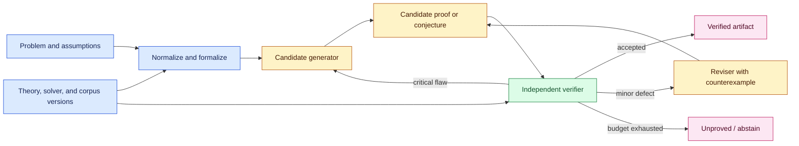
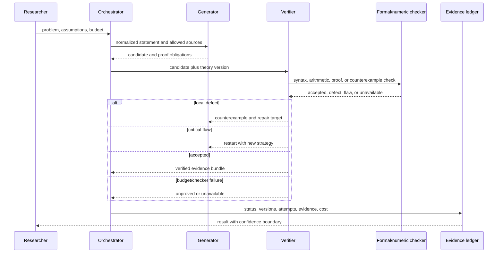

# Mathematical reasoning as search plus verification
Status: emerging
Sources: [Google DeepMind — Accelerating Mathematical and Scientific Discovery with Gemini Deep Think — 2026-02-11](https://deepmind.google/blog/accelerating-mathematical-and-scientific-discovery-with-gemini-deep-think/); [Lean theorem prover](https://lean-lang.org/)

## In one sentence

Reliable mathematical reasoning treats a model derivation as a candidate, uses bounded search and revision, and accepts the result only when independent checks establish the declared proof obligations.

## Background: what existed before

Language models produce mathematical-looking text well, but fluency is not validity. A sign error can invalidate a derivation, an unstated assumption can make a theorem false, a parser can change the problem, and a plausible citation can point to nonexistent work. Human experts can catch these failures, but review is expensive and usually happens after a polished answer has acquired authority.

The traditional software baseline is a symbolic or numerical system with explicit inputs and deterministic checks. A computer algebra system simplifies expressions, a theorem prover checks formal propositions, a numerical program tests instances, and a mathematician selects useful conjectures. These tools are reliable within their specification, but formalizing a research problem can take more time than writing a natural-language prompt. A verifier can also check the wrong formalization perfectly.

The useful architecture is hybrid. A model explores candidate lemmas, searches literature, proposes proof paths, or writes a formalization. A verifier checks syntax, arithmetic, formal proof, or counterexamples. A reviser repairs local defects; a generator restarts when the core idea is wrong. The system must abstain when search is exhausted or the checker cannot establish the claim.

**Candidate** means an unaccepted derivation or conjecture. A **proof obligation** is a statement that must be established for the result to follow. A **verifier** returns structured accepted, rejected, incomplete, or unavailable status; it is not a model sentence saying “looks correct.” Lean is one formal theorem prover. Executable tests and symbolic tools cover other obligations but do not automatically prove universal claims.

## What changed and why now

Google DeepMind’s February 11, 2026 report describes Aletheia, a math research agent powered by Gemini Deep Think. The source says it uses a natural-language verifier to identify flaws in candidate solutions, iteratively generates and revises solutions, and can admit failure. It describes web search for research literature and reports up to 90% on IMO-ProofBench Advanced as inference-time compute scales. It also says the results were human-graded and explicitly does not claim Level 3 major advances or Level 4 landmark breakthroughs in its taxonomy.

The report describes autonomous and human–AI research examples, but these are publisher-reported results, not independent proof that the system solves arbitrary research mathematics. The durable engineering lesson is narrower: search, verification, revision, and failure admission should be explicit states in a reasoning workflow. More inference-time computation may improve search, but every branch consumes model calls, verifier calls, memory, and reviewer attention.

## Impact on current processing and architecture

Normalize the problem into a versioned statement. Store original prose, parsed representation, assumptions, definitions, expected output type, and source references. A model may propose a formalization, but a human or trusted rule must review it because an elegant proof of the wrong statement is still a failure.



The verifier should return which obligation was checked, checker and theory versions, parse status, counterexample, and budget used. Natural-language explanation can accompany the result but cannot replace the machine-readable status. Preserve failed candidates when they explain why a route was abandoned; do not retain only a polished final answer.

Let b be generator branches, v verifier calls per branch, and c the cost of a call. A first-order search budget is `B = b × v × c`. If rejection probability is r and each rejection triggers t local repairs, expected work grows roughly with `B × (1 + r × t)` before restarts. This is not a quality model; it gives an operator a way to choose a stopping policy and expose an expensive verifier feedback loop.

Use states `PARSED`, `SEARCHING`, `REJECTED_LOCAL`, `RESTART_REQUIRED`, `VERIFIED`, `UNPROVED`, `CHECKER_UNAVAILABLE`, and `FORMALIZATION_UNCERTAIN`. A polished derivation that timed out remains unproved. A checker outage is not a negative theorem result. A parser failure is not a model failure. These distinctions make retries and incident review meaningful.



Formal proof is powerful but not universal. If the formal statement is wrong, Lean proves the wrong thing. If a theorem depends on an axiom, library, or imported lemma, record that dependency. Numerical tests find counterexamples and validate examples but cannot establish a universal theorem. Symbolic algebra can simplify an expression while preserving an incorrect assumption. Use multiple checkers when the consequence warrants it.

The evidence ledger connects claims to obligations. Label each result theorem, conjecture, empirical observation, source-backed claim, or engineering inference. Store the problem hash, formalization hash, model, checker, library manifest, branch count, verifier outputs, and reviewer decision. A generated explanation must not silently promote an unproved idea into a factual conclusion.

## Real-world applications and constraints

In education, a reasoning agent can propose a solution, find a counterexample to a student conjecture, and show a checker trace. It should expose uncertainty and teach inspection, not present fluency as authority. A local verifier can check arithmetic and finite cases; formal proof can validate a carefully defined subset.

In software verification, the model can translate a requirement into invariants, generate proof obligations, and suggest tests. The release gate must check the actual code and configuration. “The loop terminates” is not evidence until a termination argument or bounded verification supports it.

In algorithm research, a system can search for counterexamples, browse literature, and propose a proof route. Record URLs, versions, relevant passages, and the exact text used. A model citation is a lead until verified. In physics and engineering, dimensional analysis, boundary conditions, conservation laws, and units provide independent constraints, while simulation remains evidence over a parameter range rather than a universal law.

Large proof searches belong in asynchronous queues with branch limits, solver timeouts, cancellation, and resumable checkpoints. Reserve interactive capacity for interpretation. When the budget ends, return the best candidate as unproved with its search limit.

## Mental model

Think of a model as a scientist proposing experiments and the verifier as a laboratory instrument. A proposal may be brilliant, wrong, or underspecified. The instrument has a calibration and measurement boundary; it can confirm a property it knows how to measure, but not certify the entire theory. The lab notebook records proposal, test, version, result, and uncertainty.

## What changed this month

The February source makes verifier-guided research concrete through Aletheia and Gemini Deep Think. It reports model-assisted mathematical and scientific work, inference-time scaling, web-supported research, and a taxonomy that stops short of major or landmark advances. The engineering change is to expose the candidate-to-verification lifecycle rather than logging only a final answer.

## Engineering consequence

Treat a verified result as a typed artifact, not text. Require proof status, problem and formalization hashes, model/checker versions, theory manifest, search budget, verifier evidence, and review decision. Make `UNPROVED` and `CHECKER_UNAVAILABLE` valid terminal states.

Measure candidate usefulness, verifier false-accept rate, proof completion rate, cost per verified result, abstention quality, and review time. Protect a holdout theorem set and test adversarial notation, false lemmas, parser errors, checker outages, and resource exhaustion. More polished candidates with more false accepts are a regression.

The data model should make replay possible. A run record can contain `run_id`, `problem_hash`, `formalization_hash`, `candidate_id`, `parent_candidate_id`, `checker_id`, `theory_manifest`, `branch_depth`, `attempt`, `status`, `started_at`, `finished_at`, `cost_units`, and evidence references. A candidate should be immutable once checked; repairs create a new candidate linked to the rejected parent. This makes it possible to answer whether a result was accepted because of a genuine proof, a changed theorem, a weaker checker, or a lucky random test.

Use two queues. An interactive queue handles small exercises and quick counterexamples with a strict deadline. A research queue handles broad search, literature retrieval, and formalization with asynchronous workers and resumable checkpoints. Do not allow a research search to consume all verifier capacity. Admission should consider expected branch count, checker cost, priority, and the value of a verified result. If a job cannot fit its budget, reject it before generating hundreds of candidates.

When the system finds a candidate, present the proof boundary rather than only a confidence number: assumptions, obligations, accepted steps, failed alternatives, unverified leaps, and source dependencies. Human reviewers can then focus on semantic correctness and significance rather than manually rechecking every arithmetic line. For high-impact mathematics, require two independent verification paths or a domain expert sign-off before publication or downstream use.

This design also improves incident response. If a theorem later fails, operators can locate the exact checker result, dependency version, candidate ancestry, and release decision. They can quarantine downstream artifacts without deleting the original evidence. If the issue is only a parser or library regression, the team can rerun affected candidates under a corrected manifest. If the formalization was wrong, the problem statement itself needs review. Those are different repairs and should remain different incident categories.

## Limits and failure modes

DeepMind’s results are source-reported and task-specific. Human grading, benchmark composition, inference-time compute, and research collaboration affect the outcome. The report does not establish arbitrary theorem-solving reliability or formal proof coverage.

Verifier error is central. A natural-language verifier can miss subtle flaws; a formal verifier can check the wrong translation; a numerical test can miss the dangerous case. Search can amplify a flawed objective if the evaluator rewards persuasion instead of validity. Version the evaluator, protect holdouts, sandbox code, and stop when the budget ends.

## Mini exercise (15–30 min)

Build a tiny proof-search loop for arithmetic identities. Generate candidate transformations, check them on random inputs and a symbolic rule table, return counterexamples, and distinguish finite evidence from a general proof. Add search budget and abstention.

## Build it locally

```python
from dataclasses import dataclass
import random

@dataclass
class Result:
    status: str
    expression: str
    counterexample: tuple | None = None
    attempts: int = 0

def verify_identity(left, right, trials=20, seed=7):
    rng = random.Random(seed)
    for _ in range(trials):
        x = rng.randint(-10, 10)
        if left(x) != right(x):
            return False, (x, left(x), right(x))
    return True, None

candidates = [
    ("(x + 1)^2 = x^2 + 2x + 1", lambda x: (x + 1) ** 2,
     lambda x: x ** 2 + 2 * x + 1),
    ("(x + 1)^2 = x^2 + 2x", lambda x: (x + 1) ** 2,
     lambda x: x ** 2 + 2 * x),
]

for expression, left, right in candidates:
    ok, counterexample = verify_identity(left, right)
    print(Result("finite-tests-pass" if ok else "rejected",
                 expression, counterexample, 20))
```

### Numbered local steps

1. Save the example as `proof_search.py` and run it with Python 3.10 or newer.
2. Add a domain restriction and represent the assumption explicitly.
3. Add a symbolic square-expansion rule and label it as a rule proof, not random testing.
4. Return `checker_unavailable` after a configurable timeout.
5. Add a branch counter and stop with `unproved` when the budget ends.
6. Store expression, seed, checker version, trial count, and counterexample in a receipt.
7. Add a deliberately weak checker and document why its pass does not prove the theorem.
8. Compare candidate count, verifier calls, rejections, and finite-test outcomes.

## Interview Q&A

### Why is a fluent derivation not enough?

Language quality does not prove each inference, assumption, or citation. Independent checks must establish the declared obligations.

### What does inference-time scaling buy?

More search and revision can improve the chance of a valid route, but increases cost and can amplify evaluator errors. It needs a budget and stopping rule.

### Can Lean prove the model’s answer?

It can prove a formal proposition under its logic, libraries, and assumptions. It cannot prove that the formalization matches the original intent.

### What should happen on timeout?

Return unavailable or unproved with the budget and partial evidence. Never convert timeout into success or false.

## Glossary

- **Candidate:** An unaccepted proposed derivation or conjecture.
- **Counterexample:** An input or construction that exposes a failed universal claim.
- **Formalization:** Encoding a natural-language problem into a precise proof language.
- **Inference-time compute:** Computation spent while generating or searching, rather than training.
- **Proof obligation:** A statement that must be established for a result to follow.
- **Verifier:** An independent checker that emits structured result and evidence.

## References

1. Google DeepMind, “Accelerating Mathematical and Scientific Discovery with Gemini Deep Think,” February 11, 2026. Primary source for Aletheia, verifier-guided revision, failure admission, inference-time scaling, reported benchmarks, research examples, and taxonomy limits: https://deepmind.google/blog/accelerating-mathematical-and-scientific-discovery-with-gemini-deep-think/
2. Lean, “Theorem Prover,” official documentation: https://lean-lang.org/
3. The search equations, state machine, controls, and Python example are engineering analysis and inference, not independent validation of Deep Think.

## Claim ledger

| Claim | Source | Fact or inference |
|---|---|---|
| DeepMind describes Aletheia as using a natural-language verifier and iterative generation/revision. | DeepMind February 11 post | Source-reported capability |
| DeepMind reports up to 90% on IMO-ProofBench Advanced as inference-time compute scales. | DeepMind February 11 post | Publisher-reported result |
| DeepMind says its taxonomy does not claim Level 3 or Level 4 advances. | DeepMind February 11 post | Source qualification |
| A formal checker proves the formalized statement under its dependencies, not automatically the intended claim. | Lean boundary plus systems analysis | Engineering inference |
| Search and verifier budgets should be measured as cost per verified result. | Systems design analysis | Engineering inference |
| The Python example tests finite samples and is not a general theorem prover. | This lesson’s example | Explicit limitation |
