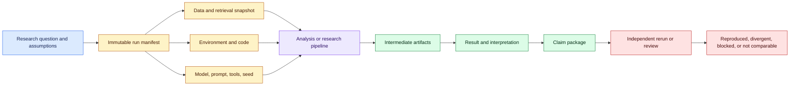
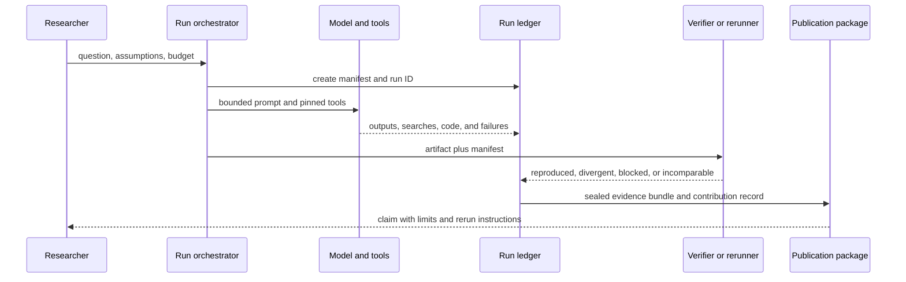

# Scientific reproducibility for model-assisted research
Status: durable
Sources: [Google DeepMind — Accelerating Mathematical and Scientific Discovery with Gemini Deep Think — 2026-02-11](https://deepmind.google/blog/accelerating-mathematical-and-scientific-discovery-with-gemini-deep-think/); [Nature — Reproducibility](https://www.nature.com/articles/533452a)

## In one sentence

Scientific reproducibility is the ability to rerun a declared method with the same data, code, model configuration, and environment, then explain any divergence instead of hiding it behind a matching headline result.

## Background: what existed before

Reproducibility is older than machine learning. A scientific result is more useful when another team can inspect the method, obtain the relevant inputs, rerun the analysis, and understand why its output agrees or differs. In software terms, a paper is not just a result; it is a build description for an experiment. The build includes source data, transformations, code, dependencies, instruments, parameters, and interpretation.

Many research artifacts historically omitted some of this information. A paper might describe a dataset without preserving the exact snapshot, name a library without recording its version, or show a final figure without publishing the intermediate table. A computational notebook may contain the analysis but depend on an untracked local file or manual step. These gaps do not prove that the original result is wrong, but they prevent a clean audit.

Machine learning adds more moving parts. A model endpoint can change behind a stable name. Sampling can be nondeterministic. Retrieval results can change as an index is updated. Tool calls can depend on live websites. Hardware kernels can introduce numerical variation. The prompt may be part of the method, and the model’s output may be an intermediate hypothesis rather than a final scientific conclusion.

The engineering baseline is therefore not “save the notebook.” It is a versioned run package with explicit boundaries between input, computation, artifact, and claim. A rerun should be able to say `reproduced`, `divergent`, `blocked`, or `not comparable` with evidence for the state.

## What changed and why now

Google DeepMind’s February 11, 2026 Deep Think report describes a research workflow that combines mathematicians, physicists, and computer scientists with Gemini Deep Think. It describes Aletheia, a math research agent that uses a natural-language verifier to identify flaws, iteratively generate and revise solutions, browse literature, and admit failure. The report says the system scored up to 90% on IMO-ProofBench Advanced as inference-time compute scaled, with results graded by human experts. It also presents a taxonomy of AI contribution and explicitly says it does not claim Level 3 major advances or Level 4 landmark breakthroughs.

Those are publisher-reported facts, not independent validation of arbitrary research performance. Their engineering significance is that the research process contains more than a final generated answer: prompts, model outputs, browsing traces, candidate solutions, verification results, human collaboration, and contribution labels become part of the evidence. When AI contributes to an open-ended investigation, reproducibility must cover the model-mediated path as well as the final calculation.

## Impact on current processing and architecture

A reproducible run starts with a manifest. The manifest names the research question, data snapshot, code commit, environment lockfile, model identifier, endpoint or checkpoint, prompt and tool configuration, random seed, hardware/runtime, and output artifacts. It also names what cannot be shared, why it cannot be shared, and how another researcher can perform a permitted rerun.



The manifest is a control boundary, not a file filled in after the fact. Before execution, validate that required inputs exist and that the model and tool versions are allowed. During execution, append events with run ID, stage, timestamp, artifact hash, and status. After execution, seal the manifest so later corrections create a new run rather than rewriting history.

Keep the raw model-mediated process separate from the normalized claim. A raw response may contain several candidate proofs, speculative explanations, failed searches, and copied references. The normalized claim states exactly what the research team is asserting. The artifact package links that claim to the data, code, proof, simulation, or experiment that supports it. This distinction prevents a polished summary from becoming the only surviving evidence.



Reproduction state needs more precision than pass or fail. `specified` means the method and inputs are declared but not run. `provisioned` means the environment and data are available. `running` means execution is active. `reproduced` means the declared outputs match within stated tolerances. `divergent` means the rerun completed but differs materially. `blocked` means a dependency, permission, or data restriction prevented execution. `not_comparable` means inputs or method changed enough that the run answers a different question.

These states affect retries. A timeout does not prove a scientific claim false. A missing dataset does not prove the original result unreproducible in principle. A changed model endpoint does not produce a comparable rerun. Preserve the original manifest and create a new attempt with an explicit reason whenever an input changes.

Reproducibility also has a cost model. The rerun may require downloading a large dataset, rebuilding a container, loading a model, reserving a GPU, or scheduling an instrument. Record resource budgets and actual use. If a team replaces a high-cost step with a cheaper approximation, label that result as a sensitivity analysis or alternate experiment rather than silently calling it a reproduction.

## Real-world applications and constraints

In AI-assisted mathematics, preserve the problem statement, prompt, model version, browsing sources, candidate solutions, verifier output, formalization, and human edits. A proof assistant can validate the encoded proposition, but it cannot establish that the proposition captures the intended natural-language problem. Store library commits, imported axioms, compiler versions, and proof-check commands.

In climate or earth-science analysis, a data URL is not enough. Record acquisition time, dataset release, spatial and temporal filters, coordinate system, missing-value handling, and preprocessing. A rerun against the latest feed may be scientifically useful but is not the same experiment.

In drug or protein research, preserve sequence databases, model checkpoints, assay protocol, instrument calibration, sample lineage, and negative results. A model-generated candidate is a hypothesis; it becomes evidence only through the declared experimental and validation process.

In software and systems research, pin compiler, runtime, hardware, kernel, library, and benchmark configuration. Report variance and warm-up behavior. A matching average can hide a changed workload, cache state, or measurement boundary.

In a proprietary environment, access controls may prevent publishing raw data or prompts. Provide a secure rerun protocol, synthetic fixture, redacted schema, or trusted third-party execution path. Document the gap honestly. “Not publicly rerunnable” is different from “reproducible by authorized reviewers.”

## Mental model

Think of a research result as a signed build artifact. The source code is the method, the input lockfile is the data snapshot, the compiler is the environment, the binary is the derived result, and the release notes are the interpretation and limitations. A successful build proves that the declared inputs produce the artifact; it does not prove that the software solves the right problem. Scientific reproducibility has the same boundary.

## What changed this month

The Deep Think report makes model outputs, prompts, browsing, verification, human collaboration, and AI-contribution taxonomy visible parts of an AI-assisted research workflow. The practical change is that reproducibility must capture the model as a probabilistic research component while preserving deterministic checks and human accountability.

## Engineering consequence

Define a manifest schema and reject incomplete runs before expensive execution. At minimum, require run ID, actor, purpose, code revision, data version or access explanation, environment, model identifier, prompt/tool configuration, seed or nondeterminism note, and artifact references.

Use content-addressed artifacts. A data snapshot, container, prompt bundle, model configuration, and output should have hashes or immutable version identifiers. Store derived artifacts separately from source inputs and link them through the manifest.

Publish a minimal reproduction command. It should fetch or point to the declared inputs, create the pinned environment, run the analysis, and compare outputs using stated tolerances. If the command cannot be public, provide the authorized equivalent and explain the restriction.

Separate reproducibility from validity. A repeatable flawed analysis is still flawed, and a scientifically valid result may be difficult to reproduce because data are restricted. Report both dimensions rather than using reproducibility as a proxy for truth.

## Limits and failure modes

Model endpoints can change behind stable identifiers. Capture snapshot or deployment metadata and treat a live endpoint rerun as potentially non-comparable.

Retrieval indexes and websites drift. Cache documents, record retrieval timestamps, and preserve citation spans.

Hardware and parallel kernels can create small numeric differences. Define tolerances and compare intermediate distributions, not only one rounded number.

Data licensing can prevent full release. Provide an access-controlled path, synthetic fixture, or precise provenance gap.

Human interpretation can change even when code and outputs match. Preserve the claim wording, assumptions, and review record.

Reproduction pipelines can leak sensitive prompts, samples, or credentials. Apply least privilege, secret scanning, retention, and redaction to run artifacts.

## Mini exercise (15–30 min)

Create a small run manifest for a deterministic data analysis. Run it once, change the input file, rerun, and classify the result as reproduced, divergent, or not comparable. Add a missing-dependency case and record why it is blocked.

## Runnable low-cost example

```python
import hashlib
import json
from pathlib import Path


def sha256(path: Path) -> str:
    return hashlib.sha256(path.read_bytes()).hexdigest()


def run_manifest(data_path: Path) -> dict:
    numbers = [int(line) for line in data_path.read_text().splitlines() if line.strip()]
    return {
        "data_hash": sha256(data_path),
        "count": len(numbers),
        "sum": sum(numbers),
        "mean": sum(numbers) / len(numbers),
        "method": "integer_sum_v1",
    }


def compare(original: dict, rerun: dict) -> str:
    if original["data_hash"] != rerun["data_hash"]:
        return "not_comparable"
    if original["sum"] == rerun["sum"] and original["count"] == rerun["count"]:
        return "reproduced"
    return "divergent"


def main() -> None:
    path = Path("repro-data.txt")
    path.write_text("2\n4\n6\n")
    original = run_manifest(path)
    rerun = run_manifest(path)
    assert compare(original, rerun) == "reproduced"
    path.write_text("2\n4\n7\n")
    changed = run_manifest(path)
    assert compare(original, changed) == "not_comparable"
    print(json.dumps({"original": original, "changed_state": compare(original, changed)}, indent=2))
    path.unlink()


if __name__ == "__main__":
    main()
```

## Build it locally

1. Save the example as `reproducibility.py` and run `python3 reproducibility.py`.
2. Add a code commit, Python version, dependency lockfile, and model identifier to the manifest.
3. Add a prompt hash and a note describing any nondeterministic model or tool behavior.
4. Store intermediate outputs and compare them alongside the final sum.
5. Add a tolerance field for floating-point results.
6. Add a blocked state when the data file or dependency is unavailable.
7. Seal the original manifest and create a new run when any input changes.

## Interview Q&A

**What is the difference between reproducibility and validity?** Reproducibility asks whether the declared method can be rerun consistently. Validity asks whether the method and conclusion answer the scientific question correctly.

**Why is a model ID insufficient?** A model name may resolve to a changing endpoint. Record snapshot, deployment, prompt, tools, sampling settings, and retrieved inputs.

**What does a formal proof establish?** It establishes the encoded proposition under its formal environment. It does not prove that the encoding matches the intended research question.

**What should happen when data cannot be shared?** Document the restriction and provide an authorized rerun, synthetic fixture, redacted schema, or trusted execution path.

**When should a rerun be labeled not comparable?** When data, preprocessing, code, model, environment, or method changed enough that the output answers a different experimental question.

## Glossary

- **Reproducibility:** Ability to rerun a declared method with the declared inputs and inspect agreement or divergence.
- **Run manifest:** Versioned record of data, code, environment, model, tools, parameters, and artifacts.
- **Provenance:** Evidence describing an artifact’s origin and transformations.
- **Content addressing:** Naming an artifact by a cryptographic hash or immutable version.
- **Nondeterminism:** Variation caused by sampling, concurrency, hardware, or changing services.
- **Method equivalence:** Condition that a rerun uses the same meaningful procedure and assumptions.
- **Not comparable:** State indicating that changed inputs or methods answer a different question.
- **Evidence bundle:** Linked raw inputs, intermediate outputs, checks, and interpretation supporting a claim.

## References

- [Accelerating Mathematical and Scientific Discovery with Gemini Deep Think — Google DeepMind — 2026-02-11](https://deepmind.google/blog/accelerating-mathematical-and-scientific-discovery-with-gemini-deep-think/)
- [Reproducibility — Nature](https://www.nature.com/articles/533452a)
- [Lean theorem prover](https://lean-lang.org/)

## Claim ledger

| Claim | Source | Fact or inference |
|---|---|---|
| The Deep Think report describes collaboration among mathematicians, physicists, and computer scientists. | Google DeepMind report | Fact about the publisher’s report |
| The report describes Aletheia using verification, revision, browsing, and failure admission. | Google DeepMind report | Fact about the publisher’s report |
| The report says results reached up to 90% on IMO-ProofBench Advanced as inference-time compute scaled. | Google DeepMind report | Fact about the publisher’s measurement |
| The report presents an AI-contribution taxonomy and does not claim Level 3 or Level 4 results. | Google DeepMind report | Fact about the publisher’s report |
| A model-mediated research run needs prompts, browsing, outputs, verification, and human decisions in its evidence package. | Reproducibility engineering | Engineering inference |
| A rerun with changed data or method should be labeled not comparable rather than reproduced. | Experimental-method design | Engineering inference |
| The local example demonstrates manifest classification, not scientific validity or production reproducibility. | This lesson | Fact about the example |
