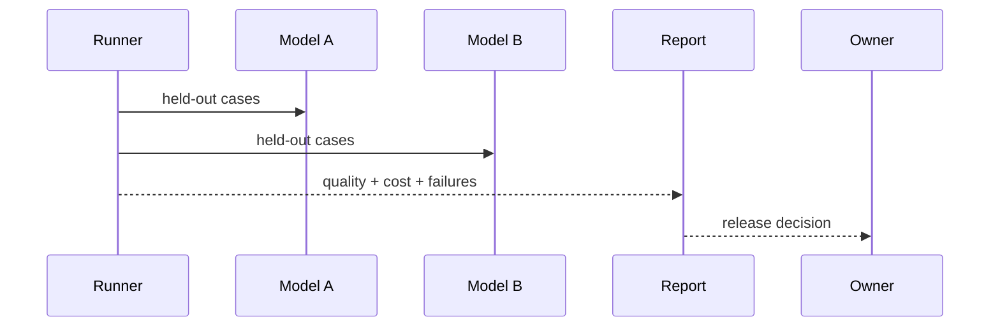
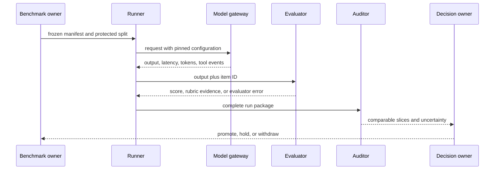

# Model benchmarking
Status: durable
Sources: [HELM](https://crfm.stanford.edu/helm/latest/); [NIST AI RMF](https://www.nist.gov/itl/ai-risk-management-framework); [Google DeepMind's February 11, 2026 Deep Think report](https://deepmind.google/blog/accelerating-mathematical-and-scientific-discovery-with-gemini-deep-think/)
## In one sentence
Meaningful benchmarking tests representative tasks, costs, latency, and failure modes—not one leaderboard score.
## Background: what existed before
Teams selected models from aggregate accuracy numbers disconnected from their workload.
## What changed and why now
System-level evaluation emphasizes scenarios, robustness, and transparent metrics.
## Impact on current processing and architecture
Build a task suite with held-out data, rubric, latency/cost capture, and regression thresholds.
## Real-world applications and constraints
Compare support summarizers or coding agents. Test leakage, sample size, and distribution shift.
## Mental model
```mermaid
flowchart LR
 T[Tasks]-->R[Runner]-->M[Metrics]-->D[Decision]
 R-->C[Cost/latency]
 classDef a fill:#dbeafe,stroke:#2563eb,color:#111827; classDef b fill:#dcfce7,stroke:#16a34a,color:#111827; class T,R a; class M,C,D b
```

## What changed this month
February frames evaluation as a workload decision rather than a vanity leaderboard.
## Engineering consequence
Report confidence intervals and slice results; keep a fixed regression set.
## Limits and failure modes
Benchmarks can be gamed or stale; human rubrics vary; offline gains may not transfer online.

## SDE2 primer and prerequisites

An SDE2 should read a benchmark as an experiment service. The runner schedules requests, the model gateway enforces a configuration, the evaluator scores outputs, and the report supports a release or procurement decision. The difficult bugs are often outside the model: a changed prompt, a leaked test item, an evaluator that sees the reference answer, a retry that gets counted twice, or a cost meter that omits tool calls.

The prerequisites are basic probability, HTTP or batch job APIs, JSONL data, queues, and observability. The lesson adds five benchmark-specific contracts: a task taxonomy that describes the workload, a frozen split, an evaluator contract, an uncertainty report, and a decision rule. These are testable software artifacts. A benchmark is credible only when another engineer can identify exactly what was measured and what was excluded.

## February source reading: fact before inference

Read the Deep Think post as a worked warning about denominator and task boundaries. It reports up to 90% on IMO-ProofBench Advanced, human grading, and a lower-compute Aletheia result, while showing substantially weaker FutureMath Basic performance and a taxonomy that separates contribution levels. The numbers are source-reported measurements. They do not establish performance on customer support, code repair, or research workflows. The benchmark lesson is the comparison protocol: task family, evaluator, inference budget, and claims about transfer must remain visible.

The engineering inference is to make a benchmark a decision record. Store the workload definition, split manifest, model configuration, evaluator version, raw outcomes, uncertainty, cost, latency, and release recommendation. A source can motivate this design, but it cannot guarantee that a local benchmark predicts production behavior.

## Historical baseline and problem boundary

The useful benchmarking baseline is a single headline score on a named test set. It becomes misleading when the split, evaluator, decoding settings, or protected slices change. Reliable benchmarking treats task, denominator, configuration, and uncertainty as part of the result.

For **model benchmarking**, the important boundary is between the workload definition, the runner, the model gateway, the evaluator, and the decision owner. The runner may submit a request, but it cannot change the protected split or scoring code. The model may produce an answer, but it cannot select the reference answer or mark its own output correct. The report may recommend a release, but an owner must approve the policy change. Test this boundary with a contaminated item, an evaluator outage, a duplicate retry, and a late model response.

## Architecture and data flow

The benchmark service admits a versioned workload, runs it through a pinned model configuration, evaluates every item, aggregates by protected slice, and emits a decision package. Keep raw outputs separate from scores because a reviewer may need to inspect a disputed item without changing the aggregate. The decision service consumes evidence; it does not let a model or evaluator mutate the benchmark definition.

```mermaid
flowchart LR
  W[Workload manifest] --> R[Runner]
  R --> G[Model gateway]
  G --> O[Raw outputs and telemetry]
  O --> E[Evaluator]
  E --> S[Protected slice scores]
  S --> U[Uncertainty and cost report]
  U --> D[Release or procurement decision]
  W --> C[Contamination and split checks]
  C --> R
  classDef input fill:#dbeafe,stroke:#2563eb,color:#172554;
  classDef process fill:#fef3c7,stroke:#b45309,color:#451a03;
  classDef evidence fill:#dcfce7,stroke:#15803d,color:#14532d;
  classDef decision fill:#fee2e2,stroke:#dc2626,color:#450a0a;
  class W,C input;
  class R,G,E process;
  class O,S,U evidence;
  class D decision;
```



Keep task split, model checkpoint, decoding configuration, evaluator output, uncertainty estimate, and publication record separate. A leaderboard number is not a complete result. Bind task revision, denominator, hardware, evaluator, and contamination controls to each run while preserving only permitted diagnostic artifacts.

For model benchmarking, record a run identifier, workload owner, task taxonomy, split hash, contamination review, model and decoding configuration, evaluator version, raw-output location, slice scores, uncertainty method, cost and latency telemetry, human rubric, decision owner, and final state. Keep reference answers and hidden tests behind controlled access. The durable artifact is the complete benchmark manifest and report, not a generic conversation transcript.

## Processing walkthrough and state

Benchmark state should distinguish `planned`, `running`, `incomplete`, `scored`, `audited`, `comparable`, and `withdrawn`. Require a complete denominator, evaluator identity, and split hash before publishing a score. A failed job is not a low model score; a changed denominator is not a comparable result; an evaluator outage is not model failure.



On retry, reuse the item attempt ID and preserve the original response. A timeout can be retried, but the report must distinguish the first unknown attempt from the successful retry and avoid counting both as independent samples.

## Topic mechanics: Model benchmarking

### Decision model and topic-specific data contract

A benchmark is a measurement instrument with a workload model. Start with a taxonomy: routine requests, ambiguous cases, long contexts, tool calls, adversarial inputs, and high-cost or high-risk slices. Freeze a held-out set and record contamination risks, rubric, evaluator version, model configuration, tool permissions, retries, and human intervention. Report a distribution, not just a mean: quality by slice, abstention, critical errors, p50/p95 latency, tokens, dollars, and recovery. A cost-quality frontier often makes a smaller model preferable for routine work and a slower verifier preferable for rare high-impact work. Human grading needs calibration and agreement; automated graders need adversarial tests. DeepMind's February post provides a useful example: it reports up to 90% on IMO-ProofBench Advanced, human grading, lower inference-time compute in Aletheia, and much lower FutureMath Basic performance than its benchmark reference. The contrast warns against moving a score between task families. Test the decision rule itself: would a confidence interval or one costly failure change the procurement choice? Keep a regression set after deployment and audit for leakage.

Ask what **model benchmarking** can establish at each transition. The request establishes intent only; the model benchmarking evidence and state stage establishes a bounded representation; the next checker, owner, or reconciliation step establishes whether the proposed result is acceptable. A timeout, missing dependency, or ambiguous response therefore becomes an explicit status for **model benchmarking**, not an implicit success. Persist the relevant versions and evidence references, and retain unknown, deferred, or needs-review states when the system cannot prove the stronger claim.

Benchmarking needs versioned task definitions, scoring code, model checkpoint, decoding settings, hardware, and evaluation split. Publish those alongside the score; changing the denominator or evaluator is a new benchmark result, not a quiet update to the old number.

Benchmark runs should cap cases, decoding attempts, evaluator calls, and hardware time while protecting required slices. A run that cannot execute the full denominator is `incomplete`, not a score. Separate `fixture_error`, `model_failure`, and `evaluator_failure` so a published comparison remains interpretable.

Break model benchmarking metrics down by task slice, actor or tenant, version, dependency, and outcome class so a healthy average cannot hide a dangerous subgroup.


## Model benchmarking: focused design workshop

In model benchmarking, keep the task text, reference answer, model output, evaluator judgment, and release recommendation in separate typed fields. The benchmark runner owns completeness and accounting; the evaluator owns scoring; the model never owns either. This separation prevents a prompt change from masquerading as a model improvement and prevents a grader from silently changing the denominator.

The event trail should distinguish item-level outcomes: `correct`, `incorrect`, `abstained`, `tool_error`, `timeout`, `evaluator_error`, and `not_run`. Store the reason and the responsible component. A timeout caused by the serving platform should not lower model quality, while a model that repeatedly times out within its allowed budget should fail operational viability.

Test benchmark races. A task file or evaluator may change while jobs are queued, or a failed protected slice may be hidden by a newly computed aggregate. Freeze split, evaluator, and denominator at admission. Preserve `incomplete` and `evaluator_changed`; neither is a comparable score. Run a manifest-integrity check before aggregation.

Report quality, latency, cost, abstention, and critical-error rate by task class, risk slice, context length, tool path, and evaluator version. Averages are insufficient when a small safety slice carries the largest consequence. Include confidence intervals or bootstrap intervals for proportions and show the number of items behind every percentage.

Save a failing item as a regression fixture only after redaction, licensing review, and capture of the governing split and evaluator version. Do not add every failed test to the public benchmark; that creates leakage and rewards memorization.


## Applications and operational constraints

Start model benchmarking in offline or shadow mode. Compare candidate models against the incumbent on the same frozen workload, then run a small live cohort only after offline failures have owners. A benchmark can recommend a deployment; it must not directly change production routing.

For support summarization, measure factual omission, escalation impact, latency, and human edit rate. For coding agents, measure test-preserving task completion, tool failures, and review time. For research assistants, measure citation correctness, abstention, and expert acceptance. Choose an application with a named owner and document its data residency, quota, staffing, latency, and rollback constraints.

Plan capacity around evaluator workers, protected slices, hardware allocation, rate limits, and artifact retention. If a required slice cannot run, publish `incomplete` rather than a favorable partial score. A cheaper run is useful only when its denominator, evaluator, and quality threshold remain comparable. Include evaluator cost and human review time in the cost-quality frontier.

## Failure modes, security, and limits

Benchmarking fails through contamination, denominator drift, evaluator leakage, and aggregate scores that hide a protected slice. Keep test data and scoring code controlled, publish confidence or variance where relevant, and require complete run manifests. A leaderboard change is not a model improvement until task, evaluator, configuration, and population remain comparable.

Metrics can improve through test contamination, hidden prompt tuning, denominator changes, cherry-picked tasks, or a grader that rewards the model’s preferred style. Pair headline scores with protected splits, evaluator audits, confidence intervals, and full run manifests. A leaderboard position is not a general capability claim.

For model benchmarking, the February source has a bounded claim. The February source also has scope limits. DeepMind reports up to 90% on IMO-ProofBench Advanced, says results were graded by human experts, and reports lower inference-time compute for Aletheia at comparable reasoning quality. The same post shows FutureMath Basic results remain well below its benchmark reference and distinguishes levels of AI contribution. These reported numbers illustrate why a benchmark needs task and protocol context. Nothing in that observation proves robustness against your adversaries, correctness on your domain, or a particular service-level target. Treat vendor examples as source facts and label recommendations as inference. When evidence is weak, abstention and escalation are valid outcomes.

## Evaluation and change management

Build benchmark fixtures for protected slices, contamination checks, evaluator disagreement, incomplete runs, and task variants. Assert denominator, split, hardware, and scoring-version identity. Keep a holdout set hidden and report variance or uncertainty rather than treating one aggregate as general capability.

Publish a benchmark update only when split identity, evaluator integrity, protected-slice results, and run completeness meet the reporting contract. Re-run a small holdout before release, retain the prior manifest, and label any changed task or scoring code as a new comparison.

## February primary-source evidence

The source fact is bounded: **DeepMind reports up to 90% on IMO-ProofBench Advanced, says results were graded by human experts, and reports lower inference-time compute for Aletheia at comparable reasoning quality. The same post shows FutureMath Basic results remain well below its benchmark reference and distinguishes levels of AI contribution. These reported numbers illustrate why a benchmark needs task and protocol context.** The February publication date and the publisher's wording should be cited when teaching the event. The recommendation that teams implement task taxonomy, held-out slice, contamination check, confidence interval, cost-quality frontier, and human rubric is an inference from the event plus established systems practice. It should be validated with local fixtures, security review, operational metrics, and domain experts. The source does not independently verify the examples, and this article does not present them as guarantees.

## Mini exercise extension

Create six benchmark fixtures: a contaminated item, a missing protected slice, an evaluator disagreement, a serving timeout, a complete run, and a changed denominator. Assert different states for each case. Store item count, split hash, evaluator version, and recovery owner beside every assertion, then alter the governing version and prove that an old score remains historical rather than being silently recomputed.

## Build it locally: numbered implementation

1. Create a JSONL workload with task ID, task family, risk slice, reference answer, and protected-set marker.
2. Write a runner that records model output, latency, tokens, tool calls, and attempt ID without storing secrets in logs.
3. Implement an evaluator that returns `correct`, `incorrect`, `abstained`, or `evaluator_error`; never infer correctness from a missing score.
4. Add split and evaluator hashes to the run manifest and reject aggregation when either changes.
5. Compute per-slice quality, p95 latency, cost per completed item, and abstention rate.
6. Add bootstrap confidence intervals or repeated resampling for one quality metric.
7. Compare two models with a cost-quality decision rule and retain the full report for review.

## Runnable low-cost example

```python
from dataclasses import dataclass


@dataclass(frozen=True)
class Run:
    model: str
    slice_name: str
    correct: int
    total: int
    cost: float
    p95_ms: int

    @property
    def quality(self) -> float:
        return self.correct / self.total


def choose(runs: list[Run], minimum_quality: float, maximum_p95: int) -> Run:
    eligible = [
        run for run in runs
        if run.quality >= minimum_quality and run.p95_ms <= maximum_p95
    ]
    if not eligible:
        raise ValueError("no run satisfies the release contract")
    return min(eligible, key=lambda run: run.cost)


def main() -> None:
    runs = [
        Run("A", "safety", 98, 100, 0.10, 900),
        Run("B", "safety", 92, 100, 0.03, 500),
    ]
    chosen = choose(runs, minimum_quality=0.90, maximum_p95=700)
    assert chosen.model == "B"
    print(chosen)


if __name__ == "__main__":
    main()
```

This benchmark sketch applies a release contract to one slice. It does not measure contamination, uncertainty, evaluator validity, or generalization; add protected slices and complete manifests before publishing comparisons.

## Interview Q&A

**Q: What makes a benchmark result interpretable?** A: A frozen workload, configuration, evaluator, denominator, protected slices, and uncertainty report. Without these, the number cannot be compared safely.

**Q: What does a benchmark score measure?** A: Performance on the declared task population under the declared protocol. It does not automatically measure general capability or production reliability.

**Q: Which metric belongs beside accuracy?** A: At least p95 latency, cost per completed task, abstention, critical-error rate, and per-slice confidence intervals. The right set depends on the workflow’s failure cost.

**Q: When should a score be withheld?** A: When the denominator is incomplete, the evaluator changed, contamination is unresolved, a protected slice is missing, or the run cannot be reproduced from its manifest.

**Q: How should a benchmark influence rollout?** A: Use it as one input to a decision record, pair it with production shadowing and monitoring, and require an owner to approve the route or model change.

## Glossary

- **Task taxonomy:** Classification of workload slices such as routine, long-context, adversarial, tool-use, or high-risk.
- **Protected split:** Hidden or access-controlled evaluation population reserved for unbiased measurement.
- **Contamination:** Test information entering model training, prompt tuning, retrieval, or evaluator construction.
- **Evaluator contract:** Versioned rule that maps an output and reference to a score or explicit error.
- **Denominator:** Number and identity of cases included in a reported metric.
- **Cost-quality frontier:** Trade-off curve between quality and total operational cost.
- **Abstention:** Explicit response that the model or evaluator cannot safely establish an answer.
- **Comparable run:** Benchmark execution with the same meaningful task, configuration, evaluator, and population.

## References

- [Google DeepMind: Gemini Deep Think — February 11, 2026](https://deepmind.google/blog/accelerating-mathematical-and-scientific-discovery-with-gemini-deep-think/)
- [Stanford HELM](https://crfm.stanford.edu/helm/latest/)
- [NIST AI Risk Management Framework](https://www.nist.gov/itl/ai-risk-management-framework)

## Claim ledger

| Claim | Source | Fact or inference |
|---|---|---|
| The cited publisher published the February event on the stated date. | [Google DeepMind's February 11, 2026 Deep Think report](https://deepmind.google/blog/accelerating-mathematical-and-scientific-discovery-with-gemini-deep-think/) | Fact |
| DeepMind reports up to 90% on IMO-ProofBench Advanced, says results were graded by human experts, and reports lower inference-time compute for Aletheia at comparable reasoning quality. | [Google DeepMind's February 11, 2026 Deep Think report](https://deepmind.google/blog/accelerating-mathematical-and-scientific-discovery-with-gemini-deep-think/) | Fact |
| Turning a headline score into a workload decision with slices, cost, latency, and failure analysis. | Engineering design synthesis | Inference |
| A separately enforced boundary is safer and easier to operate than treating model text as authority. | Topic standards and systems reasoning | Inference |
| The local example demonstrates the concept but does not prove production security, reliability, or generalization. | This lesson | Fact about the example |
