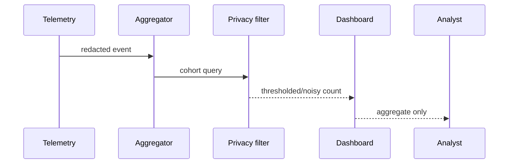
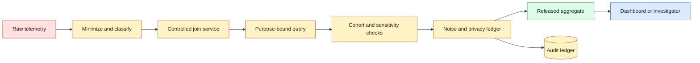
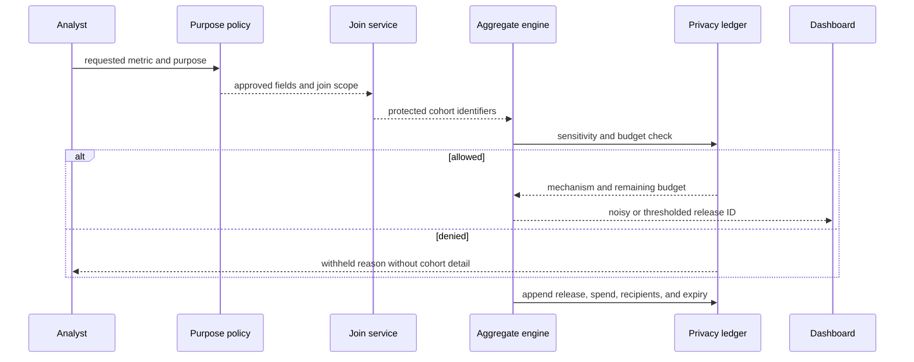

# Privacy-preserving analytics
Status: durable
Sources: [NIST Privacy Framework](https://www.nist.gov/privacy-framework); [Google differential privacy](https://developers.google.com/differential-privacy); [OpenAI's February 25, 2026 report, Disrupting malicious uses of AI](https://openai.com/index/disrupting-malicious-ai-uses/)
## In one sentence
Privacy-preserving analytics extracts aggregate signal while limiting what can be learned about an individual.
## Background: what existed before
Usage dashboards often retained raw identifiers and exposed small cohorts.
## What changed and why now
Agent telemetry increases the volume and sensitivity of interaction data, making minimization and noise important.
## Impact on current processing and architecture
Strip identifiers, aggregate cohorts, enforce minimum counts, and consider differential privacy noise.
## Real-world applications and constraints
Measure feature adoption without reading conversations. Noise, utility loss, and privacy-budget accounting constrain results.
## Mental model
```mermaid
flowchart LR
 R[Raw event]-->M[Minimize]-->G[Group]-->N[Noise]-->D[Dashboard]
 classDef a fill:#dbeafe,stroke:#2563eb,color:#111827; classDef b fill:#dcfce7,stroke:#16a34a,color:#111827; class R,D a; class M,G,N b
```

## What changed this month
February extends governance from agent actions to the analytics used to operate them.
## Engineering consequence
Set retention and query controls before collecting telemetry; document privacy assumptions.
## Limits and failure modes
Auxiliary data can re-identify users; repeated queries can consume a privacy budget; aggregates can still be sensitive.

## SDE2 primer and prerequisites

An SDE2 should see privacy-preserving analytics as a data pipeline with a threat model. The pipeline ingests events, removes or protects fields, computes a statistic, applies a release mechanism, and records who received the result. The hard engineering questions are which joins are permitted, how repeated queries compose, what an analyst can infer from auxiliary data, and how deletion or consent changes future releases.

The prerequisites are SQL or stream aggregation, access control, key management, and basic probability. The lesson adds six contracts: purpose limitation, data minimization, cohort threshold, controlled linkage, privacy-loss accounting, and release audit. Differential privacy is one mechanism within that design; it does not replace authorization, retention, or incident handling.

## February source reading: fact before inference

The February OpenAI report describes cross-platform and cross-model malicious activity. That source fact explains why a security team may want to correlate signals across providers, identities, or tools. It does not grant permission to build an unrestricted identity graph, and it does not prescribe differential privacy. NIST’s Privacy Framework and Google’s differential-privacy documentation provide the engineering vocabulary for purpose, minimization, noise, and trade-offs. Treat the report as an observation about threat intelligence and label the privacy architecture as inference.

## Historical baseline and problem boundary

The useful analytics baseline is an analyst querying row-level data and exporting a report. It offers precision but exposes membership, linkage, and purpose risks. Privacy-preserving analytics adds release controls and budget accounting while making utility and residual disclosure risk explicit.

For **privacy preserving analytics**, the key boundary separates raw evidence, protected linkage, aggregate computation, and released output. An analyst may receive a noisy count without receiving row-level identity. A security investigator may use a controlled join under a stricter purpose and retention policy. The model or dashboard cannot grant access to the linkage table. Test this boundary with a small cohort, a revoked purpose, a repeated query, and an attempted join on an unapproved field.

## Architecture and data flow

The analytics service should admit a declared purpose and query shape, resolve only permitted fields, compute an aggregate in a protected environment, charge the privacy ledger, and release a versioned result. Keep the raw event store, linkage service, aggregate table, and dashboard API separate. A dashboard should receive a release ID and limitations, not a SQL cursor into the event store.



Keep row-level inputs, cohort definition, privacy mechanism, budget ledger, released aggregate, and access purpose separate. A masked export is not automatically private. Bind query identity, purpose, cohort size, composition spend, and release policy to each result while avoiding raw-row retention.

Record query ID, actor, purpose, approved fields, join policy, cohort size, mechanism and parameters, privacy-budget spend, data version, release ID, recipients, retention, and deletion status. The durable artifact is the release ledger and its privacy accounting. Keep raw content behind controlled references with separate credentials and shorter retention.

## Processing walkthrough and state

Privacy-query state should distinguish `requested`, `purpose_checked`, `fields_minimized`, `cohort_rejected`, `computed`, `budget_charged`, `released`, and `withheld`. Check cumulative loss before release and preserve denial metadata without exposing the cohort. A noisy answer can still be unsafe when combined with earlier releases or an external identifier list.



On retry, reuse the query ID and do not charge or release a second result until the first attempt’s ledger state is reconciled. An unknown response from the release service is an operational incident, not permission to issue another query with a fresh budget.

## Topic mechanics: Privacy-preserving analytics

### Decision model and topic-specific data contract

Privacy-preserving analytics begins with purpose limitation. Define the question—such as weekly abuse rate by region—before collecting raw conversation content. Replace direct identifiers with keyed tokens in a restricted join service, strip fields not needed for the aggregate, enforce minimum cohort sizes, and separate an investigator's privileged evidence path from a product dashboard. Differential privacy adds calibrated noise and a privacy budget; it does not make a sensitive query harmless, and repeated or overlapping queries consume budget. For cross-platform abuse analysis, maintain two views: a protected linkage table that can join events under strict access and an aggregate table exposed to analysts. Log query purpose, caller, policy, and budget consumption. Test singling out with auxiliary data, differencing attacks across time windows, small cohorts, and repeated queries. Retain raw evidence only as long as an incident or legal process requires, and make deletion observable. The February report's cross-platform threat observation explains why linkage may be useful; it does not grant permission to collect everyone’s identity. Measure analyst utility alongside re-identification risk and deletion lag.

An analytics release establishes only the statistic under its declared population, mechanism, and budget. It does not establish that an individual is absent, that a campaign is malicious, or that a trend is causal. If the join service, ledger, or deletion feed is unavailable, retain `withheld` or `unknown` rather than returning a precise fallback. Preserve the release ID and policy revision so a later auditor can reconstruct why the output was visible.

Privacy-preserving analytics should version the cohort query, consent or purpose rule, noise mechanism, privacy budget ledger, and release threshold. Keep the budget spend attached to each result so a repeated query cannot appear harmless merely because its individual output is noisy.

Privacy analytics should enforce minimum cohort size, query rate, join depth, and cumulative privacy loss before computation. If a query is denied or the budget is depleted, return that state rather than releasing a more precise fallback. Log `small_cohort`, `budget_exhausted`, and `purpose_denied` distinctly.

Break privacy preserving analytics metrics down by task slice, actor or tenant, version, dependency, and outcome class so a healthy average cannot hide a dangerous subgroup.


## Privacy-preserving analytics: focused design workshop

In privacy preserving analytics, keep the analyst’s question, permitted purpose, protected query plan, mechanism parameters, aggregate, and release decision in separate fields. The analyst can request a metric; only the policy service can approve fields and joins; only the ledger can authorize budget spend. A model may help phrase or summarize the result, but it cannot decide that a small cohort is safe to reveal.

The event trail should distinguish `purpose_denied`, `field_denied`, `small_cohort`, `linkage_blocked`, `budget_exhausted`, `released`, and `release_failed`. Store enough metadata to audit the decision without storing the underlying individuals in the dashboard log.

Test privacy races. Consent or purpose can be withdrawn while a query is running, and repeated releases can consume more budget than any individual result shows. Check purpose and ledger state immediately before release. Preserve `budget_exhausted` and `purpose_revoked`; do not release a more detailed fallback.

Report utility, privacy loss, denial rate, query latency, deletion lag, and linkage-test results by purpose, tenant, cohort size, and release mechanism. A high average utility can conceal a dangerous small-group query or a tenant whose budget is exhausted.

Save a privacy failure as a synthetic or redacted regression fixture. Capture the governing purpose, field policy, ledger version, and release decision; never copy a production row into a test simply because it makes the failure easy to reproduce.


## Applications and operational constraints

Start in a shadow report that is visible only to the privacy owner. Compare utility against an approved baseline, run linkage and differencing tests, then expand to analysts only after the release contract and deletion path are verified.

For abuse analytics, correlate signals in a restricted service and expose aggregate campaign trends to responders. For product analytics, prefer event classes and cohort counts over conversation content. For research telemetry, publish minimum-count or noisy aggregates and document the threat model. Every use needs a named owner, permitted purpose, retention, deletion path, and escalation route.

Plan capacity around secure joins, key management, cohort computation, noise generation, and budget accounting. Under load, queue or reject a query while preserving its purpose and ledger state. A coarser aggregate can be a safe fallback only when its release policy is evaluated separately; do not silently broaden the time window or cohort to make a query pass.

## Failure modes, security, and limits

Privacy analytics fails through linkage, repeated-query attacks, small cohorts, correlated releases, and joins that reconstruct identity. Enforce purpose and minimum-cohort rules before computation, charge a tracked budget, and review release sequences. More noise is not a substitute for correct governance or data minimization.

Privacy metrics can look healthy when teams shrink the measured cohort, omit denied queries, or spend budget across untracked joins. Pair utility with privacy loss, linkage tests, purpose compliance, deletion lag, and repeated-query accounting. A noisy result is not safe if the release sequence identifies people.

The source boundary is narrow: OpenAI’s report describes threat activity across platforms and models; it does not specify a privacy mechanism or authorize a data-sharing architecture. NIST and Google provide general privacy engineering guidance, not a guarantee for this telemetry. The recommended design therefore requires a local threat model, synthetic attack fixtures, privacy review, and a documented owner for every cross-system join. Treat the incident report as motivation and the controls as engineering inference.

## Evaluation and change management

Build privacy fixtures for small cohorts, repeated queries, sensitive joins, purpose mismatch, budget exhaustion, and approved aggregates. Assert that no release exceeds its ledger and that outputs resist linkage tests. Use synthetic or redacted records; never sample raw production data merely to simplify evaluation.

Release an aggregate only when minimum cohort, purpose, privacy-budget, linkage-resistance, and utility requirements hold. Test the query sequence against a privacy ledger, retain an audit-only denial path, and do not reissue prior outputs after a policy rollback without reevaluating cumulative loss.

## February primary-source evidence

Use the OpenAI report only for the observation that malicious activity can span platforms and model providers. It does not claim that a particular aggregation, join, or privacy mechanism is safe. NIST’s framework contributes a vocabulary for identifying privacy risk and managing it; Google’s documentation explains differential-privacy mechanisms and their utility trade-offs. The local architecture is therefore a proposed defensive design. Its acceptance depends on the organization’s threat model, sensitivity analysis, composition accounting, retention rules, and review by a privacy owner.

## Mini exercise extension

Create six fixtures: a small cohort, a revoked purpose, a repeated query, an unapproved join, a budget-exhausted release, and an allowed aggregate. Assert distinct states and store purpose, mechanism, budget spend, and release ID beside each assertion. Change the policy version and prove that previous releases remain historical.

## Build it locally: numbered implementation

1. Create synthetic events with tenant, purpose, cohort, and sensitive-field metadata.
2. Implement minimization that removes fields not required by the declared metric.
3. Add a controlled join that returns opaque cohort tokens rather than identity fields.
4. Enforce minimum cohort size and a per-purpose budget before computation.
5. Add a simple noise mechanism and record its parameters in a release ledger.
6. Simulate two overlapping queries and reject the second when composition exceeds budget.
7. Add a deletion event and verify that future releases exclude the deleted subject.

## Runnable low-cost example

```python
from dataclasses import dataclass


@dataclass(frozen=True)
class Release:
    purpose: str
    cohort_size: int
    epsilon_cost: float
    remaining_budget: float


def authorize(release: Release, minimum_cohort: int) -> str:
    if release.purpose != "abuse_rate":
        return "purpose_denied"
    if release.cohort_size < minimum_cohort:
        return "small_cohort"
    if release.epsilon_cost > release.remaining_budget:
        return "budget_exhausted"
    return "released"


def main() -> None:
    allowed = Release("abuse_rate", 20, 0.5, 1.0)
    denied = Release("identity_lookup", 20, 0.1, 1.0)
    assert authorize(allowed, 10) == "released"
    assert authorize(denied, 10) == "purpose_denied"
    print(authorize(allowed, 10), authorize(denied, 10))


if __name__ == "__main__":
    main()
```

This sketch models purpose, cohort, and budget gates. It does not implement a differential-privacy mechanism, composition theorem, linkage resistance, or consent enforcement; use synthetic records and a privacy review before release.

## Interview Q&A

**Q: Does adding noise guarantee privacy?** A: No. Privacy depends on the mechanism, sensitivity, composition, auxiliary data, access policy, and release sequence.

**Q: Why minimize data before aggregation?** A: Noise cannot repair an unnecessary identity join or a retained raw field. Minimization reduces both breach impact and inference surface.

**Q: What belongs on the privacy dashboard?** A: Utility, privacy-budget spend, denial reasons, linkage-test results, retention, deletion lag, and release recipients—not only query latency.

**Q: When should an aggregate be withheld?** A: When purpose, minimum cohort, budget, join authorization, data freshness, or deletion state is unresolved.

**Q: How should a privacy release be operated?** A: Version the query and mechanism, charge a cumulative budget, preserve a release audit, and start with a narrow approved audience.

## Glossary

- **Data minimization:** Removing fields, precision, or retention not required for the declared purpose.
- **Pseudonym:** Replaceable token used to join records without exposing the direct identifier to an analyst.
- **Cohort threshold:** Minimum group size required before an aggregate can be released.
- **Differential privacy:** Formal framework that bounds how much one person’s data changes a release distribution.
- **Privacy budget:** Account of cumulative privacy loss across a sequence of releases.
- **Controlled join:** Restricted service that links records under purpose, field, and retention policy.
- **Differencing attack:** Inferring an individual by comparing overlapping aggregate releases.
- **Release ledger:** Immutable record of query, mechanism, budget spend, recipients, and expiry.

## References

- [OpenAI: Disrupting malicious uses of AI — February 25, 2026](https://openai.com/index/disrupting-malicious-ai-uses/)
- [NIST Privacy Framework](https://www.nist.gov/privacy-framework)
- [Google differential privacy](https://developers.google.com/differential-privacy)

## Claim ledger

| Claim | Source | Fact or inference |
|---|---|---|
| The cited publisher published the February event on the stated date. | [OpenAI's February 25, 2026 report, Disrupting malicious uses of AI](https://openai.com/index/disrupting-malicious-ai-uses/) | Fact |
| OpenAI's February report describes cross-platform and cross-model threat activity, which creates a legitimate need to join signals while limiting exposure. | [OpenAI's February 25, 2026 report, Disrupting malicious uses of AI](https://openai.com/index/disrupting-malicious-ai-uses/) | Fact |
| Separating an investigation's need for linkage from an analyst's need to see identity. | Engineering design synthesis | Inference |
| A separately enforced boundary is safer and easier to operate than treating model text as authority. | Topic standards and systems reasoning | Inference |
| The local example demonstrates the concept but does not prove production security, reliability, or generalization. | This lesson | Fact about the example |
