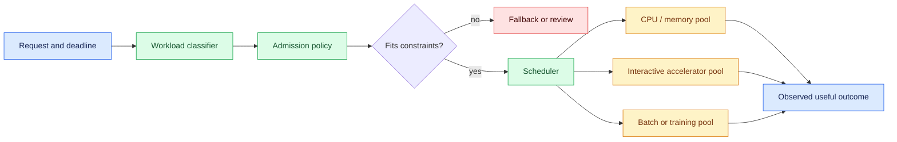
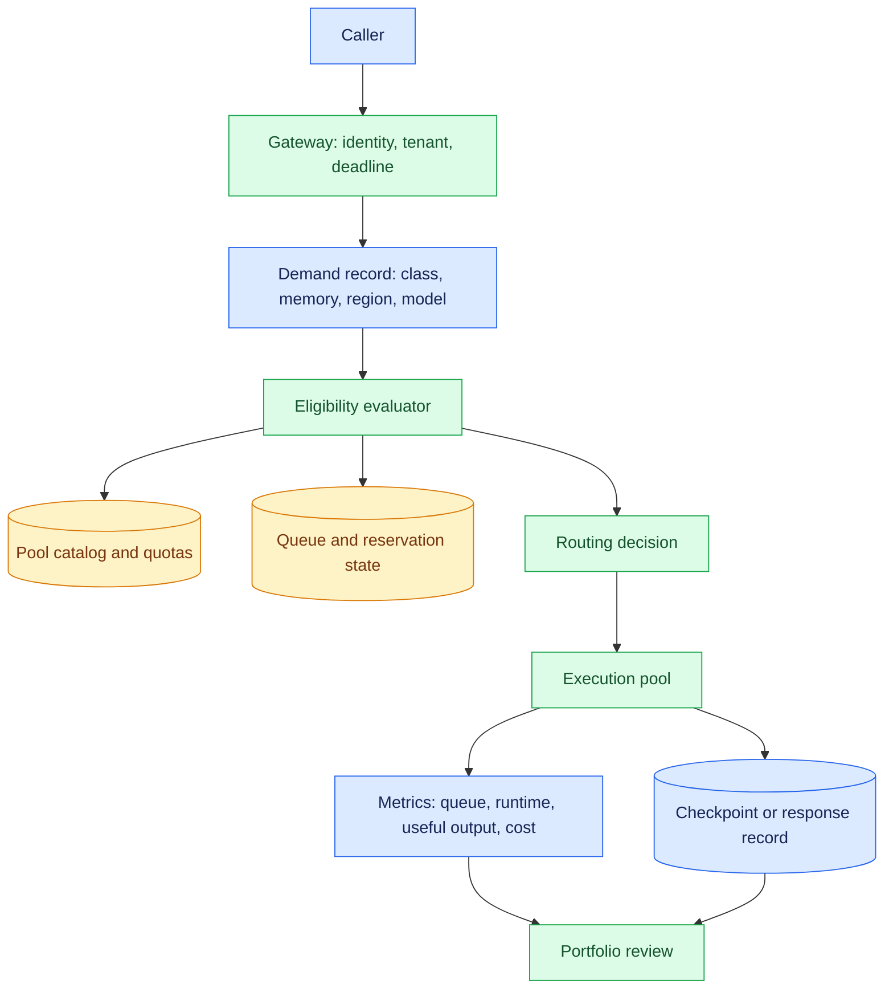
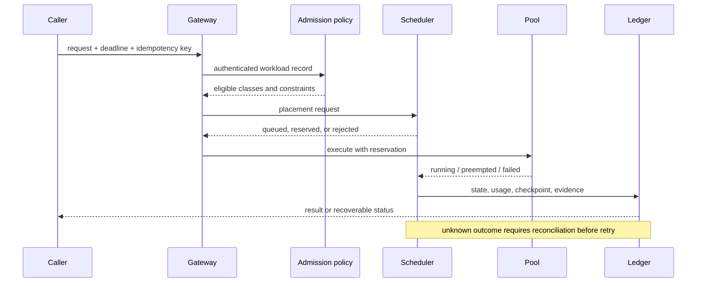

# Infrastructure portfolios
Status: durable
Sources: [Google Cloud TPU documentation](https://cloud.google.com/tpu/docs); [Kubernetes scheduling](https://kubernetes.io/docs/concepts/scheduling-eviction/); [OpenAI — Scaling AI for everyone, 2026-02-27](https://openai.com/index/scaling-ai-for-everyone/)

## In one sentence

An infrastructure portfolio assigns each workload to a suitable mix of compute pools, reservations, and fallback paths while measuring useful work, queueing, reliability, and cost together.

## Background: what existed before

Many teams began with one cluster and one accelerator family. That baseline is attractive because it keeps deployment manifests, observability, and procurement simple. It also hides a serious assumption: that interactive inference, batch evaluation, retrieval, fine-tuning, and long-running training have the same resource shape. They do not. A chat request is sensitive to tail latency and often needs modest memory. A batch embedding job benefits from throughput and can wait in a queue. Training may require a stable reservation and fast interconnect for hours. Retrieval, tokenization, policy checks, and orchestration may be CPU- or memory-bound even when the final generation uses an accelerator.

The single-pool baseline therefore creates two kinds of waste. A latency-sensitive service may reserve expensive capacity to avoid noisy neighbors, leaving that capacity idle between bursts. A throughput job may compete with interactive traffic and make user-facing tail latency unpredictable. “Utilization” alone cannot resolve this: a pool can be busy while producing little useful work, or appear underused because it is correctly holding headroom for a burst or failure.

## What changed and why now

The February source frames AI scale as a coupled problem involving compute, distribution, and capital. OpenAI’s announcement reports its own investment and capacity commitments, including dedicated inference and training capacity. Those are publisher-reported facts, not an independent benchmark or a recommendation for every organization. The engineering change is the need to reason explicitly about a portfolio: multiple workload classes, capacity contracts, placement constraints, and fallback behavior rather than a single “best” machine.

Google’s TPU documentation and Kubernetes scheduling documentation provide the operational vocabulary for that reasoning. A workload declares resource requirements and placement constraints; a scheduler attempts to place it; the platform exposes whether it is waiting, running, preempted, or failed. The useful lesson is not that one vendor’s hardware wins. It is that hardware choice must be connected to memory fit, topology, admission policy, queue age, availability, and unit economics.

## Impact on current processing and architecture

A portfolio adds a routing decision before execution. The request is classified into a workload class, then checked against memory, accelerator features, region, data residency, deadline, concurrency, and failure-domain constraints. A placement is useful only if it can be observed and reconciled. Record the selected pool, scheduler policy revision, queue time, retry count, tokens or examples processed, and the outcome.

The processing path should preserve a distinction between a reservation and a completed result. Reserving a GPU does not prove that a response was produced. Starting a training job does not prove that its checkpoint is valid. A capacity dashboard should therefore expose useful completions, not only allocated devices. For inference, useful units might be successful requests meeting a tail-latency target. For batch, they might be validated documents per dollar. For training, they might be completed, recoverable checkpoints per reserved hour.

## Real-world applications and constraints

An internal assistant may use a small CPU pool for authentication, retrieval, and policy checks, a low-latency accelerator pool for ordinary responses, and a larger pool only for requests that need a long context or multimodal processing. A document pipeline can route embeddings to a throughput-optimized pool and reserve interactive capacity for user queries. An evaluation service can use preemptible or lower-priority capacity only when its retry and checkpoint policy can tolerate interruption.

The constraints are concrete. Data residency may rule out an otherwise cheap region. A model may fit in aggregate memory but fail because the chosen topology cannot provide the required interconnect. A pool may advertise capacity while its queue or image-pull time violates the deadline. Power, cooling, quota, procurement lead time, on-call expertise, and spare-part availability can dominate a theoretical benchmark. A portfolio is successful only when its operating envelope is explicit.

## Mental model



The portfolio is not “CPU versus GPU versus TPU.” It is a set of contracts. Each pool declares what it accepts, what it costs, how quickly it can start, what failure modes it has, and which workloads may be displaced. The router should be able to say “no eligible capacity” or “deadline cannot be met,” rather than silently selecting an unsuitable machine.

## What changed this month

The February issue connects expanding AI demand with operational choices below the model API. The source announcement makes scale visible; the platform documents show how placement and resource declarations turn scale into schedulable work. The resulting concept is a portfolio review that joins workload shape, capacity, and failure handling. It is an engineering inference from the sources, not a claim that the announcement proves a universal architecture.

## Engineering consequence

Treat placement as a versioned, testable policy. A request should carry a workload class, deadline, maximum cost, data location, model or tool requirements, and an idempotency key. The scheduler should return a pool, reservation or queue state, expected start information, and the policy version used. The result record should include actual queue time, execution time, useful output, retries, and resource consumption.

Use at least four dashboards together: admission and rejection, queue and tail latency, useful completion, and cost or energy per useful unit. Slice them by tenant, workload class, model version, region, pool, and failure reason. A healthy aggregate can conceal a small but important class whose queue is growing or whose fallback violates residency.

## Limits and failure modes

Portfolio planning fails when a forecast is treated as a fact, when an accelerator benchmark is detached from the complete pipeline, or when utilization is optimized at the expense of headroom. It also fails operationally when every pool has a different image, driver, monitoring path, and on-call procedure. Diversity reduces concentration risk but increases the compatibility matrix.

Capacity can disappear after admission. A reservation may expire, a node may be drained, a quota may change, or an image may fail to pull. The state must become `capacity_unavailable` or `placement_unknown`; it must not become success because the request was once accepted. Retries need idempotency and checkpointing. A training retry without a known checkpoint can duplicate cost or corrupt an experiment.

Fallbacks have their own risks. Sending a residency-restricted request to another region is not an availability improvement. Sending a long-context request to a small-memory pool may cause repeated out-of-memory failures. Sending every overflow to the most expensive pool may preserve latency while creating an unbounded bill. Each fallback needs an explicit contract and an owner.

## Architecture and data flow



The pool catalog is more than a list of machine names. It should include allocatable memory, accelerator type and generation, topology, region, quota, startup time, price basis, software compatibility, maintenance windows, and failure-domain labels. Keep observed capacity separate from planned capacity. A forecast can inform a reservation, but it cannot claim that the reservation is currently available.

## Processing walkthrough and state



Use these states: `admitted`, `queued`, `reserved`, `running`, `completed`, `preempted`, `capacity_unavailable`, `placement_unknown`, `failed`, and `cancelled`. A reservation can transition to `capacity_unavailable` before execution. A worker timeout can produce `placement_unknown` until the ledger or provider confirms whether work completed. Only a validated useful result should enter `completed`.

## Topic mechanics: building a portfolio

First define workload classes using observable properties. Record request rate, burst shape, input and output size, memory peak, expected concurrency, deadline, retry tolerance, checkpoint interval, data location, and software requirements. Do not begin with a favored hardware label. The class should describe the work that must be performed.

Next define pool contracts. A contract specifies supported classes, minimum and maximum request shape, queue target, startup behavior, preemption behavior, region, software image, quota, and cost basis. Include a small reserve for incidents and deployments. A pool at 98% steady utilization may look efficient but leave no room for a failed zone or a traffic spike.

Then implement admission. Reject or defer requests that cannot meet a declared constraint. If a user chooses a cheaper asynchronous path, make that trade visible. If no pool can satisfy the deadline and residency together, return a clear status and escalation route. Do not let the language model phrase an impossible placement as a successful one.

Finally measure useful output. For interactive inference, pair p95 or p99 latency with successful responses and error rate. For batch, pair throughput with validation rate and retries. For training, pair accelerator-hours with completed checkpoints and reproducibility evidence. Cost per allocated hour is an input; cost per useful result is the decision metric.

## Applications and operational constraints

Begin in shadow mode: classify real traffic and compare the proposed pool with the current route without changing execution. Check that classes are stable, that the catalog is fresh, and that the measured bottleneck is real. Next route a narrow cohort to a reversible pool with a hard budget and a clear rollback. Only after observing queue, error, cost, and useful-output slices should the policy widen.

A multi-pool deployment needs ownership boundaries. Platform engineering owns the scheduler and pool health. Service teams own workload declarations and correctness checks. FinOps or capacity planning owns price assumptions and reservations. Security and privacy owners review region, tenant isolation, and telemetry. Without these owners, a portfolio becomes a dashboard with no accountable decision-maker.

## Evaluation and change management

Build fixtures for a memory mismatch, missing region, stale pool catalog, full queue, preemption after reservation, worker timeout, duplicate retry, and successful checkpoint recovery. For each fixture assert the state, user-visible status, ledger record, and recovery owner. Include a case where a cheaper pool violates the deadline and a case where a faster pool violates residency; both should be rejected.

Replay one fixed traffic window against two policy revisions. Compare queue age, tail latency, useful completion, cost, and recovery work by workload class. Keep the input snapshot and pool catalog revision so a later review can reproduce the decision. A policy change is not ready merely because average latency improved; verify that no protected class or failure domain regressed.

## Mini exercise (15–30 min)

Create three workload records: an interactive request with a 200 ms target, a batch job with a 20-minute target, and a training job requiring checkpoint recovery. Create two pools with different memory, startup time, preemption, region, and cost. Write a deterministic placement function that returns `reserved`, `queued`, `rejected`, or `fallback_review`. Add fixtures for a full queue, residency mismatch, and worker timeout. Print the selected pool, reason, policy version, and idempotency key; then explain why utilization alone cannot choose among the outcomes.

## Build it locally: numbered implementation

1. Define typed workload and pool records with deadline, memory, region, model requirements, preemption tolerance, and cost fields.
2. Implement eligibility checks as a pure function; test memory, region, quota, and software compatibility independently.
3. Add a deterministic scoring policy that prefers an eligible pool by deadline slack and useful-cost estimate, while preserving a minimum headroom percentage.
4. Persist the decision with policy version, catalog timestamp, idempotency key, and reason; never overwrite a prior placement.
5. Simulate queueing, preemption, unknown worker outcome, and checkpoint recovery as explicit state transitions.
6. Add metrics for queue age, p95 latency, useful completion, retries, cost, and fallback rate, sliced by workload class and pool.
7. Replay a fixed fixture set after changing the policy and inspect both improved classes and regressions before promotion.

## Runnable low-cost example

```python
from dataclasses import dataclass

@dataclass(frozen=True)
class Job:
    name: str
    deadline_ms: int
    memory_gb: int
    region: str
    preemption_ok: bool

@dataclass(frozen=True)
class Pool:
    name: str
    memory_gb: int
    region: str
    startup_ms: int
    preemptible: bool
    cost_per_hour: float
    queue_depth: int

def place(job: Job, pools: list[Pool]) -> tuple[str, str]:
    eligible = [
        p for p in pools
        if p.memory_gb >= job.memory_gb
        and p.region == job.region
        and (job.preemption_ok or not p.preemptible)
    ]
    if not eligible:
        return "fallback_review", "no pool satisfies memory, region, and preemption constraints"
    eligible.sort(key=lambda p: (p.queue_depth, p.startup_ms, p.cost_per_hour))
    chosen = eligible[0]
    if chosen.queue_depth > 10 and job.deadline_ms < chosen.startup_ms * 2:
        return "queued", f"{chosen.name}: queue is too deep for the deadline"
    return "reserved", chosen.name

if __name__ == "__main__":
    pools = [
        Pool("interactive-eu", 16, "eu", 100, False, 1.20, 2),
        Pool("batch-eu", 128, "eu", 3000, True, 0.45, 12),
    ]
    fast = Job("chat", 200, 8, "eu", False)
    large = Job("training", 60_000, 80, "eu", True)
    assert place(fast, pools) == ("reserved", "interactive-eu")
    assert place(large, pools) == ("reserved", "batch-eu")
    print(place(fast, pools))
    print(place(large, pools))
```

This example demonstrates deterministic eligibility and a small routing policy. It does not measure actual memory peaks, guarantee a reservation, model topology, or authorize a purchase. Production code must reconcile the returned reservation with the provider and record the final useful outcome.

## Interview Q&A

**Q: Why is one accelerator benchmark insufficient?** A: The serving path includes tokenization, memory movement, queueing, batching, model loading, retries, and validation. A benchmark that measures only kernel throughput may not predict tail latency or cost per useful result.

**Q: What should happen when capacity disappears after admission?** A: Preserve an explicit `capacity_unavailable` or `placement_unknown` state, reconcile with the provider, and retry only with the original idempotency key or a recovered checkpoint.

**Q: How do you avoid optimizing utilization at the expense of reliability?** A: Set headroom and failure-domain targets, then report useful completion and recovery burden alongside utilization. A busy pool is not healthy if it cannot absorb a burst or zone failure.

**Q: When is a preemptible pool appropriate?** A: When the workload can checkpoint, tolerate delay, and resume without duplicating effects. User-facing requests or jobs holding non-replayable external effects generally need a stronger contract.

**Q: What does the February OpenAI source prove?** A: It proves what OpenAI reported about its own investment and capacity commitments. It does not prove a universal accelerator choice, customer outcome, or reliability target; applying the portfolio pattern is an engineering inference.

## Glossary

- **Workload class**: a group of jobs with similar latency, memory, throughput, reliability, and placement requirements.
- **Pool**: a managed set of compute resources sharing a capacity and operating contract.
- **Headroom**: intentionally unallocated capacity kept for bursts, failures, deployments, or urgent work.
- **Placement**: the decision to run a workload on a specific eligible pool or to defer it.
- **Failure domain**: a unit that can fail together, such as a node, zone, region, or shared network path.
- **Useful completion**: an output that passed the application’s correctness or validation gate, not merely a task that consumed compute.
- **Preemption**: forced interruption of work so capacity can be reclaimed or reprioritized.
- **Idempotency key**: a stable identifier that lets retries refer to one logical job instead of creating duplicates.
- **Tail latency**: a high percentile such as p95 or p99 that describes slow requests and is often more important than the mean.

## References

- [Google Cloud TPU documentation](https://cloud.google.com/tpu/docs)
- [Kubernetes scheduling and eviction](https://kubernetes.io/docs/concepts/scheduling-eviction/)
- [OpenAI — Scaling AI for everyone, 2026-02-27](https://openai.com/index/scaling-ai-for-everyone/)

## Claim ledger

| Claim | Source | Fact or inference |
|---|---|---|
| Google Cloud documents TPU resources and operation. | [Google Cloud TPU documentation](https://cloud.google.com/tpu/docs) | Fact about the documentation |
| Kubernetes scheduling and eviction expose resource placement and interruption concepts. | [Kubernetes scheduling and eviction](https://kubernetes.io/docs/concepts/scheduling-eviction/) | Fact about the documentation |
| OpenAI’s February 27 announcement reports compute, distribution, capital, investment, and capacity commitments. | [OpenAI — Scaling AI for everyone](https://openai.com/index/scaling-ai-for-everyone/) | Fact about the publisher’s announcement |
| AI systems should use multiple workload-specific pools with explicit fallback and evidence states. | Source synthesis plus systems reasoning | Inference |
| Cost per useful completion is more decision-relevant than accelerator occupancy alone. | Engineering design recommendation | Inference |
| The Python example proves production placement, reliability, or cost efficiency. | This lesson | False; the example is a local illustration |
