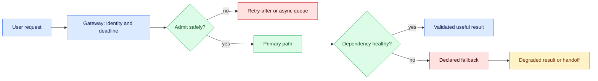
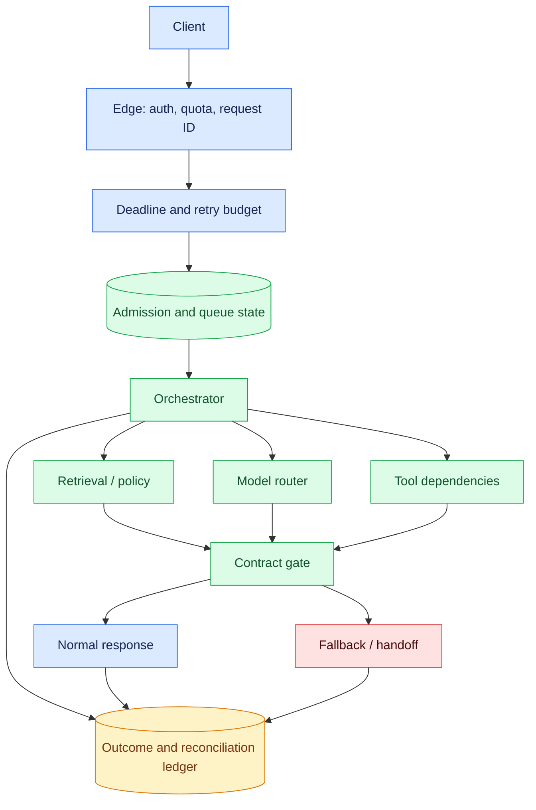
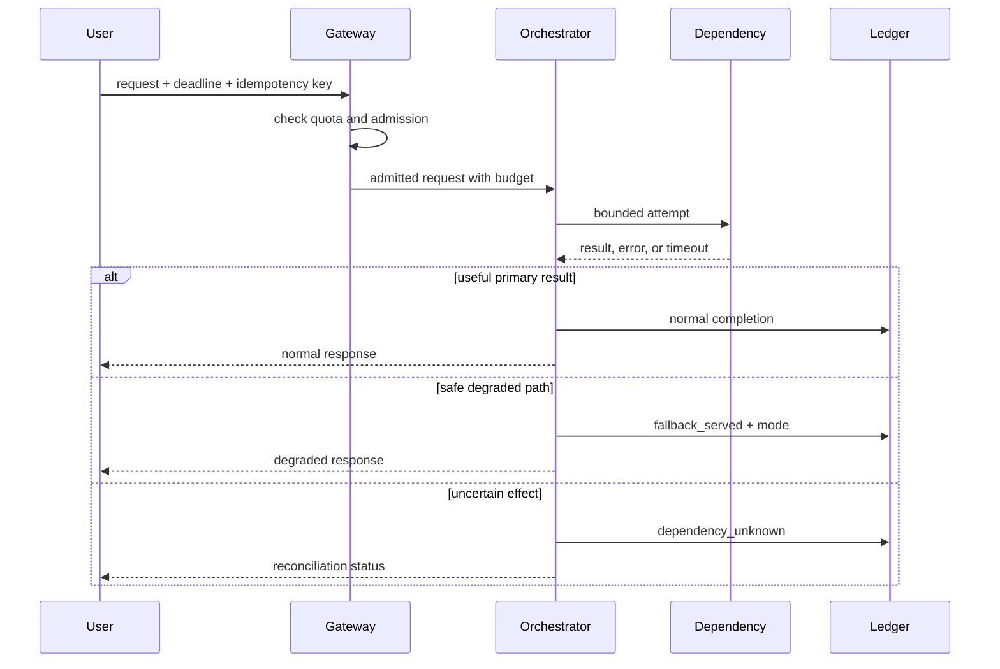

# Availability engineering
Status: durable
Sources: [Google SRE — Availability](https://sre.google/sre-book/availability/); [IETF RFC 9110](https://www.rfc-editor.org/rfc/rfc9110); [OpenAI — Scaling AI for everyone, 2026-02-27](https://openai.com/index/scaling-ai-for-everyone/)

## In one sentence

Availability engineering keeps a useful service reachable during dependency, capacity, and traffic failures by defining an explicit contract for normal service, degraded service, and recovery.

## Background: what existed before

An early AI demo often treated availability as a property of one endpoint: send a prompt, wait for a model response, and display the result. If the endpoint returned HTTP 200, the application counted success. That model breaks as soon as a request depends on authentication, retrieval, moderation, a model router, tool calls, storage, and a user interface. Each dependency adds latency and another failure opportunity. A chain can be unavailable even when every component is “mostly up.”

Classical web services already had the vocabulary to handle this: a service-level objective (SLO) states a measurable target, an error budget states how much failure the target permits, and load shedding protects admitted work when demand exceeds safe capacity. AI systems add special complications. Generation is expensive and variable; a long context can consume a disproportionate share of memory; retries can multiply tokens and tool calls; and a fallback may produce a response that is reachable but not equivalent to the primary experience.

Availability therefore cannot mean “some bytes came back.” It means the user received an outcome that met the declared contract, or an honest degraded outcome that is separately measured and recoverable.

## What changed and why now

OpenAI’s February 27 announcement describes surging demand, more than 900 million weekly active users, more than 9 million paying business users, and infrastructure partnerships intended to expand capacity. Those figures are claims made by the publisher about its own scale and plans; they are not an independent reliability benchmark. They do, however, make a practical pressure visible: demand and dependency scale force capacity, routing, quota, and fallback decisions into the product architecture.

Google SRE’s availability guidance supplies the operational baseline: define what users need, measure it, and spend an error budget deliberately. RFC 9110 supplies the HTTP semantics needed to distinguish successful, client-error, server-error, retryable, and cacheable responses. The engineering inference is to connect those ideas to AI-specific states such as `fallback_served`, `capacity_rejected`, `dependency_unknown`, and `reconciled`.

## Impact on current processing and architecture

Availability begins before model invocation. The gateway authenticates the caller, identifies the workload class, checks quota, and assigns a deadline. The orchestrator allocates that deadline across retrieval, policy checks, inference, tools, and rendering. Admission control decides whether accepting another request would cause already-admitted work to miss its contract.

Every retry must have a budget. If a client retries three times, the gateway retries twice, and a tool wrapper retries twice, one user action can create twelve downstream attempts. Retry only operations that are safe to repeat, use jitter, and stop when the remaining deadline cannot produce a useful result. After a timeout, the system may not know whether the downstream operation completed; it must reconcile before issuing an effectful duplicate.

## Real-world applications and constraints

An assistant can degrade from full generation to a cached answer, retrieval-only response, smaller model, draft mode, or human handoff. Each mode has a different promise. A cached answer needs freshness metadata. Retrieval-only mode must not invent missing synthesis. A smaller model may have different safety or quality characteristics. A human handoff needs queue visibility and an ownership target.

A document-processing API may accept asynchronous work when synchronous capacity is full, returning a durable job reference rather than pretending the work finished. A high-risk transaction may reject rather than fall back, because a stale or weak answer is worse than a clear unavailability response. Availability is always constrained by privacy, residency, correctness, cost, and staffing.

## Mental model



The key decision is not “primary or fallback.” It is “which user contract can still be met within the remaining deadline and safety constraints?” A fallback that violates freshness, residency, or correctness should be rejected. A degraded result must carry a mode label so product metrics do not mix it with normal success.

## What changed this month

February connects AI demand and infrastructure scale with a service-level design question: what should happen when capacity or a dependency is unavailable? The sources provide the scale motivation, SRE availability vocabulary, and HTTP behavior. The explicit degraded-state model, retry budget, and reconciliation ledger are engineering synthesis rather than claims made by the February announcement.

## Engineering consequence

Write an availability contract before writing a failover branch. Define the request classes, target latency, freshness, correctness, safety, regions, dependencies, and acceptable degraded modes. For each mode, specify the user-visible status, cache policy, data restrictions, owner, and recovery path. Put the contract under version control.

Measure availability from the user’s point of view. Track normal useful success, degraded useful success, timeout, rejected admission, dependency failure, and unknown outcome separately. Include p50 and tail latency, queue age, token cost, fallback rate, retry amplification, and error-budget consumption. Slice by tenant, region, model, dependency, workload class, and response mode.

## Limits and failure modes

The most common failure is a retry storm. A slow dependency causes clients to retry while the original work is still running, increasing load and making the dependency slower. Use a request deadline, bounded attempts, exponential backoff with jitter, and a shared retry budget. Do not let every library layer own an independent retry loop.

Another failure is an untruthful fallback. Returning stale data without a timestamp, routing restricted data to another region, or presenting a low-confidence answer as normal success can preserve uptime while violating the actual contract. Product and safety owners must approve the fallback semantics, not only platform engineering.

Health checks can also lie. A shallow endpoint may be healthy while the model queue is saturated or the retrieval index is stale. Probe the critical dependency path, but keep probes cheap and bounded. Use user-visible telemetry and synthetic tests without letting synthetic traffic consume production capacity.

Failover can overload the destination. A regional outage that moves all traffic into one surviving region may turn a partial failure into a global one. Reserve capacity, cap failover percentage, shed optional work, and make the response explicit when the surviving region cannot meet the original target.

## Architecture and data flow



The ledger is essential. It records request ID, tenant, contract version, dependency attempts, retry budget, response mode, status, timestamps, and reconciliation state. Payloads may remain behind controlled references. This record lets an operator answer whether the system rejected work, served a fallback, timed out after an unknown downstream effect, or completed normally.

## Processing walkthrough and state



Use explicit states: `received`, `admitted`, `queued`, `running`, `fallback_eligible`, `fallback_served`, `rejected_capacity`, `timed_out`, `dependency_unknown`, `reconciled`, `completed`, and `cancelled`. A timeout is not automatically a failed downstream operation. Reconciliation may query a provider by idempotency key, inspect a durable job record, or route to human review. Only then should the system retry an effectful operation.

## Topic mechanics: designing availability

Start with user journeys, not infrastructure percentages. For each journey, define what counts as useful, how fresh the data must be, how long the user will wait, and what must never happen. A support answer may tolerate a cached response for five minutes; a payment authorization may not. A batch API may accept an asynchronous queue; an interactive voice experience may need a short, bounded fallback.

Build a dependency budget. If the total deadline is 1,000 ms, allocate time to authentication, retrieval, model inference, tools, and rendering with margin. A dependency that consumes its budget should be cancelled or bypassed; otherwise it steals time from the rest of the path. Measure queue time separately from execution time because scaling the worker pool does not fix admission delay.

Use load shedding deliberately. Reject optional enrichment before the primary answer, reduce context size only when quality and policy permit it, and return `429 Too Many Requests` or an asynchronous job contract when the caller can retry safely. Respect HTTP semantics and provide a retry hint only when retry is likely to succeed. A retry hint without capacity planning can synchronize clients into another overload.

Design fallbacks as products. Name the mode, define its evidence and freshness, test its safety behavior, and tell the user what changed. Cache only responses whose authorization, tenant scope, and freshness are still valid. A fallback should not widen permissions just because the primary path failed.

## Applications and operational constraints

For a customer-facing assistant, shadow-classify requests and observe which fallbacks would have been selected before enabling them. Canary one tenant or region. Keep a kill switch for a faulty fallback, and alert on fallback rate and quality—not just server errors. For an asynchronous workflow, make job state durable and let clients poll or receive a callback without replaying the work.

Ownership must be explicit. Service teams own the user contract and correctness gates. Platform teams own admission, routing, and capacity. Dependency owners publish failure semantics and idempotency behavior. Support or operations owns human handoff. Security and privacy owners approve cache scope, cross-region behavior, and telemetry retention.

## Evaluation and change management

Inject dependency latency, errors, queue saturation, regional loss, stale cache, duplicate delivery, and partial tool completion. Verify that the service protects admitted work, avoids retry amplification, labels degraded responses, and reconciles uncertain effects. Test recovery too: when a dependency returns, do not release a burst of queued work that recreates the outage.

Compare policy revisions against a fixed traffic replay. Review normal success, degraded success, rejection, tail latency, token cost, retry amplification, and error-budget use by workload class. A policy that improves uptime by returning unsafe or stale answers is a regression. Preserve the contract and configuration versions in the review record.

## Mini exercise (15–30 min)

Model a 1,000 ms request with retrieval, generation, and one tool dependency. Give the tool a 250 ms budget and allow one retry only if 100 ms remains. Implement three outcomes: primary success, a cached retrieval fallback with freshness label, and a handoff when no safe response fits. Add a dependency timeout and prove that the code records `dependency_unknown` instead of blindly repeating an effectful call. Discuss which metric should count as normal availability and which should count as degraded availability.

## Build it locally: numbered implementation

1. Write a contract for one user journey with deadline, freshness, correctness, safety, and allowed degraded modes.
2. Assign budgets to each dependency and propagate one request ID, deadline, and retry budget through every call.
3. Implement admission control that rejects or queues work when capacity cannot meet the contract.
4. Make fallback selection deterministic and attach a response-mode label, evidence age, and owner to the result.
5. Add idempotency keys and a ledger state for timeouts whose downstream outcome is unknown.
6. Inject latency, errors, queue saturation, and recovery; assert no layer exceeds the global retry budget.
7. Replay a fixed request set under two policy revisions and compare normal success, degraded success, cost, tail latency, and recovery work.

## Runnable low-cost example

```python
from dataclasses import dataclass

@dataclass(frozen=True)
class Outcome:
    mode: str
    status: str
    retry: bool

def choose(primary_ok: bool, cache_fresh: bool, remaining_ms: int) -> Outcome:
    if primary_ok:
        return Outcome("normal", "completed", False)
    if cache_fresh and remaining_ms >= 50:
        return Outcome("cached_fallback", "degraded", False)
    if remaining_ms < 50:
        return Outcome("handoff", "degraded", False)
    return Outcome("retryable_failure", "unavailable", True)

if __name__ == "__main__":
    assert choose(True, False, 10).mode == "normal"
    assert choose(False, True, 100).mode == "cached_fallback"
    assert choose(False, False, 20).mode == "handoff"
    print(choose(False, True, 100))
```

This example makes response mode and retry intent explicit. It does not prove that a cache is authorized, fresh for a particular tenant, or safe for a particular task. Production code must validate those conditions and reconcile effectful timeouts.

## Interview Q&A

**Q: Is a fallback response equivalent to normal availability?** A: Not automatically. Count it separately and verify its freshness, safety, correctness, and user contract. A reachable but misleading answer is not a successful completion.

**Q: Why can retries make availability worse?** A: Each layer can multiply attempts while the original work is still consuming capacity. Propagate a deadline, use one shared retry budget, add jitter, and retry only safe operations.

**Q: What does `dependency_unknown` mean?** A: The caller timed out or lost the response without proving whether the downstream operation completed. Reconcile by idempotency key or durable status before issuing another effectful attempt.

**Q: When should a service reject instead of degrade?** A: Reject when the fallback would violate a hard requirement such as authorization, data residency, freshness, or transaction correctness. An honest failure can preserve more safety than an invented answer.

**Q: What does the February OpenAI source establish?** A: It establishes what OpenAI reported about demand and infrastructure plans. It does not establish your SLO or prove that a particular fallback, capacity plan, or reliability result works for your service.

## Glossary

- **Availability**: the proportion of requests that receive the promised useful outcome within the contract.
- **SLO**: a measurable service target such as successful useful responses within a latency and freshness bound.
- **Error budget**: the tolerated failure amount implied by an SLO during a defined window.
- **Admission control**: the decision to accept, queue, defer, or reject work based on safe capacity and contract budget.
- **Load shedding**: intentionally dropping optional or excess work to protect admitted requests.
- **Graceful degradation**: serving a reduced but explicitly defined experience when the primary path cannot meet its contract.
- **Retry amplification**: extra downstream attempts created when multiple layers retry one logical request.
- **Idempotency key**: a stable identifier that lets a retry refer to one logical operation.
- **Dependency unknown**: a state where completion cannot be proven after timeout or transport failure.
- **Tail latency**: a high percentile such as p95 or p99 describing the slowest important requests.

## References

- [Google SRE — Availability](https://sre.google/sre-book/availability/)
- [IETF RFC 9110 — HTTP Semantics](https://www.rfc-editor.org/rfc/rfc9110)
- [OpenAI — Scaling AI for everyone, 2026-02-27](https://openai.com/index/scaling-ai-for-everyone/)

## Claim ledger

| Claim | Source | Fact or inference |
|---|---|---|
| Google SRE describes availability, SLOs, and error-budget reasoning. | [Google SRE — Availability](https://sre.google/sre-book/availability/) | Fact about the source |
| RFC 9110 defines HTTP semantics used for status and retry behavior. | [IETF RFC 9110](https://www.rfc-editor.org/rfc/rfc9110) | Fact about the source |
| OpenAI’s February 27 announcement reports demand and infrastructure scale claims. | [OpenAI — Scaling AI for everyone](https://openai.com/index/scaling-ai-for-everyone/) | Fact about the publisher’s announcement |
| AI services should measure normal and degraded useful outcomes separately. | Source synthesis plus systems reasoning | Inference |
| A shared deadline and retry budget reduce retry amplification. | Engineering design recommendation | Inference |
| The Python example proves production availability or fallback safety. | This lesson | False; it is a local illustration |
