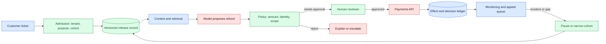
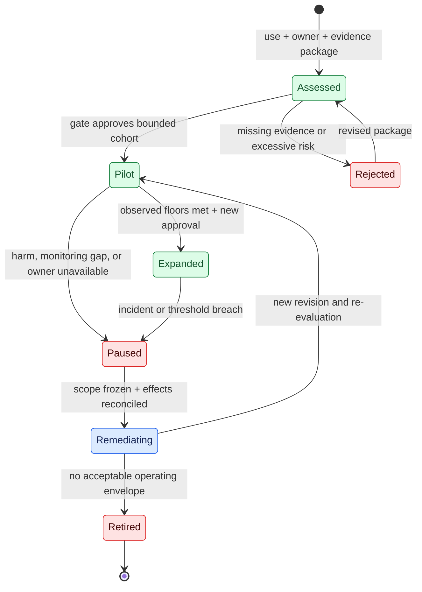

# Responsible deployment as a release and response system
Status: durable
Sources: [NIST AI RMF 1.0 — 2023-01-26](https://nvlpubs.nist.gov/nistpubs/ai/NIST.AI.100-1.pdf) (framework); [OpenAI Frontier — 2026-02-05](https://openai.com/index/introducing-openai-frontier/) (vendor announcement); [OpenAI malicious-use report — 2026-02-25](https://openai.com/index/disrupting-malicious-ai-uses/) (vendor incident report)

## In one sentence

Responsible deployment is the practice of admitting an AI feature into a defined use, observing what happens to affected people and systems, and retaining the ability to restrict, repair, or retire it when the evidence changes.

## Background: what existed before

A conventional software release normally has a version, owner, test suite, rollout mechanism, logs, and rollback path. Those tools still matter for AI. A green test suite, however, may say little about a model's behavior on a new customer message, an unfamiliar document, or an adversarial instruction hidden in a tool response. The model output is partly determined by data supplied at request time. An agent can then turn that output into an API call. A release decision therefore concerns the whole route from input to effect, including permissions, human review, and downstream recovery.

For this lesson, imagine an agent that reads customer support tickets and drafts refunds. The first version only proposes a response to an employee. A later version may submit a refund through a payments API. Both can use the same model, but the second has a different consequence if it mistakes a customer identity or accepts an instruction embedded in a ticket. The deployment unit must include the model revision, prompt or workflow revision, retrieval corpus, tool permissions, refund limit, reviewer rules, and the user cohort. A model version alone does not identify what was released.

The historical governance baseline was available before February 2026. NIST published AI Risk Management Framework (AI RMF) 1.0 in January 2023. Its four functions are **Govern**, **Map**, **Measure**, and **Manage**. Govern spans the work; Map establishes context and potential impacts; Measure examines risks and performance; Manage prioritizes and responds. NIST describes the framework as voluntary and use-case agnostic. It is guidance for organizing decisions, not proof that any particular release is safe. The February sources add concrete enterprise-agent and misuse observations to that older framework.

An SDE2 needs only familiar service concepts to follow the design: an API request has a caller and purpose; a queue can delay work; a database stores state; a permission check authorizes an effect; telemetry reports outcomes. Here the new object is a **release record** that connects those parts to a declared use and a named decision owner. The release record is evidence for a decision, not a certificate of harmlessness.

## What changed and why now

On February 5, OpenAI announced Frontier as a platform for enterprise agents and described shared business context, onboarding, feedback, and distinct identities with permissions and boundaries. This is a vendor description of its product. It establishes that the publisher is packaging agents as managed enterprise workloads; it does not establish that a particular customer's deployment is trustworthy. The architectural consequence is clear enough to investigate: once an agent can move among data sources and tools, deployment review must cover access and effects across those systems.

On February 25, OpenAI published a malicious-use report. Its landing page says that the case studies show actors using AI alongside websites and social media accounts, that activity can span platforms, and that one reported operation used more than one AI model. Those are OpenAI's reported observations, not a measured prevalence rate for all misuse. A local team should not expect one model provider's monitoring to see the complete chain. For the refund agent, abuse might begin with a forged support ticket, pass through a retrieval index, and end at a payment tool. The service owner has to observe the local transaction boundary.

Taken together with NIST, these February publications motivate a deployment system that records intended use, measures observed behavior, and routes adverse outcomes to an owner. The recommendation to implement the specific release gates below is an engineering inference. Neither February source publishes a universal gate schema or proves that monitoring can catch every failure.

## Impact on current processing and architecture

The first change is to make **scope** machine-readable. A request should carry the tenant, authenticated actor, feature revision, cohort, permitted action class, and purpose. The agent runtime can then load a release policy by revision. For example, `refund_draft_v3` may read order history and write a draft, while `refund_execute_v1` may request a payment only below a configured amount after human approval. A prompt saying “you may issue refunds” is not a permission grant. The payments API must enforce the action class and limit independently.

The second change is to distinguish three results. **Capability** asks whether the system can produce a useful draft or correctly identify an eligible refund. **Reliability** asks how often it does so across expected inputs, tool failures, and time. **Safety and harm** ask what happens when it fails, who is affected, whether misuse is possible, and whether the organization can detect and remedy the outcome. A single task-success percentage collapses these questions. A release record should carry separate evidence for each, including test populations and known blind spots.

The third change is to treat monitoring and recourse as part of the request path. Each attempt gets a correlation ID linking the input reference, model and policy revisions, proposed action, authorization result, external effect identifier, and final user-visible status. Store sensitive ticket text behind a controlled reference with a retention limit; an immutable event summary can still show who approved a refund and which policy was active. A user correction or appeal enters a case queue that can re-open the transaction and feed future evaluations. It must not silently train a new policy from an unreviewed complaint.



This diagram is an engineering design, not a diagram of Frontier. It places the release record before model work, so an unapproved cohort never reaches an effectful path. The policy check sits after generation because model text is untrusted, and the payments API repeats authorization at the resource boundary. The effect ledger records the actual payment identifier, not merely the model's intention to pay. The appeal queue feeds governance work even when no automated monitor fires.

## Real-world applications and constraints

The refund example is useful because it combines clear business value with reversibility limits. A draft is easy to discard; a submitted refund may have accounting consequences even if an operator later reverses it. Start with read-only drafting, then a small reviewed cohort, then bounded execution if evidence supports it. The same pattern applies to an internal code agent that proposes changes before gaining merge access, or a document assistant that drafts a case summary before it can file a formal decision. The action-specific harm and recourse process differ, so copying a refund threshold into another domain would be unjustified.

Operational constraints shape the gate. A small team may lack continuous human review, so a 24-hour approval queue becomes a latency and staffing constraint. Logs may contain personal data, so retention and access control limit what can be stored. A provider may expose usage and refusal metrics but lack downstream payment outcomes. A model change can arrive separately from a retrieval-corpus update or tool-schema change. A release manifest must pin these revisions or explain which are allowed to float. If the audit system fails, the service should stop effectful actions or enter a predeclared reduced mode rather than continue with invisible payments.

In a regulated or high-stakes setting, domain-specific obligations may require additional assessment and procedures. This lesson does not infer legal compliance from the NIST framework. The engineering method is to map applicable obligations into an explicit gate and have the appropriate domain owner review them.

## Mental model

Think of a deployment as a **lease on a specific operating envelope**. The lease names who may use the feature, what data it may read, what effect it may request, what evidence justified that scope, who owns response, and when the decision must be revisited. The lease can be narrowed without deleting the history of why it was issued. It expires or pauses if monitoring, staffing, or rollback capability becomes inadequate. This model prevents a successful pilot from automatically turning into general authority.

The state machine below separates a rollout change from a transaction outcome. An individual refund can be denied while the feature remains in pilot. A confirmed harmful refund can move the feature to paused even while other refunds were correct. This distinction is crucial for incident response: suppressing a user-facing error count should not clear a deployment-level finding.



## What changed this month

The February release-specific fact is Frontier's positioning of agent identity, shared context, feedback, and permissions as enterprise platform components. The February incident-report fact is OpenAI's description of malicious workflows crossing AI and non-AI tools and sometimes multiple models. The older NIST framework supplies a risk-management vocabulary. None of these sources announces the release state machine above. The state machine is a practical synthesis for teams moving from a chat feature to an agent that can affect records or money.

The important date boundary is also a claim boundary. A source published in February may describe one vendor's architecture or observed cases; it does not imply that every organization faced the same incident in February. A lesson about the issue month can use that publication to teach a durable design problem without presenting the recommendation as a new standard.

## Engineering consequence

Build a release package with six linked objects. First, the **use statement** names tasks, users, data, outputs, exclusions, and action limits. Second, the **risk register** records plausible failure or abuse paths, affected groups, existing controls, residual uncertainty, and a responsible owner. Third, the **evaluation record** names the dataset revision, sampling method, evaluator, outcome definitions, and results by meaningful slice. Fourth, the **runtime manifest** pins model, prompt, corpus, tool schema, and policy revisions. Fifth, the **operating plan** names monitors, alert owners, queue capacity, pause triggers, and reconciliation steps. Sixth, the **recourse plan** tells an affected person how to challenge or correct a result and who can remedy it. These are engineering artifacts; an executive summary without inspectable records cannot substitute for them.

At an expansion gate, compare current evidence with the proposed wider scope. If the pilot used internal employees, it may not justify customer-facing operation. If the pilot allowed drafts, it does not justify automatic payment. Re-evaluate every new action class and affected population. Preserve the previous decision record and create a new one with a parent revision, so a later incident can be traced to the exact scope decision.

Define guardrail metrics alongside usefulness. For the refund agent, track eligible-refund precision, mistaken-denial rate, unauthorized-payment attempts rejected by the API, approval queue age, payment reconciliation gaps, appeal rate, and time from confirmed incident to writes disabled. Slice by product, language, tenant, and release revision when sample size permits. A low average error rate can conceal a bad outcome for one product class. A high rejection rate may mean the control works or that the agent is unusable; examine both capability and protection outcomes.

Treat monitoring as a sampled observation system with blind spots. A dashboard can count recorded payments, but it cannot prove that a customer understood the explanation. The support queue may reveal harms that telemetry cannot classify. Conversely, a low complaint rate may reflect poor access to recourse. Reviewers should compare event logs, payment records, customer reports, and protected evaluation cases. Define an evidence threshold for pausing before the incident occurs; otherwise commercial pressure can redefine “acceptable” after observing harm.

## Limits and failure modes

**Scope drift** occurs when operators add a new tool or data source while leaving the old approval intact. A manifest diff should force a new gate when a change increases reachable effects. A prompt-only change can also alter behavior, so it belongs in the manifest even if the API schema stays fixed.

**Missing visibility** occurs when the model service reports a successful tool call but the downstream system never committed it, or commits twice after a timeout. The effect ledger should reconcile against the payment provider's transaction IDs. An unknown outcome is neither success nor failure until checked. During an outage of reconciliation, pause new payments or cap them to the preapproved fallback mode.

**Misleading metrics** occur when the team reports only successful completions, excludes appeals, or changes the evaluated population after seeing results. Keep outcome definitions and evaluation slices versioned. Distinguish a model's useful recommendation from safe end-to-end execution. A refusal may prevent a harmful payment but can still harm a legitimate customer if no escalation route exists.

**Incomplete rollback** occurs when disabling new writes leaves already issued payments, notices, or stored records untouched. Incident response needs a list of effects by revision and cohort, a reconciliation owner, a correction path, and customer communication rules. “Turn off the model” is only the first control action.

**Adversarial composition** matters because the malicious-use report describes workflows involving ordinary websites and social accounts as well as AI. A local team should test forged tickets, retrieved pages that impersonate policy, and repeated attempts across accounts. No one model-side refusal rule can independently validate identity, payment ownership, or cross-platform behavior. That last sentence is an engineering inference from the reported pattern and the service architecture, not a measured claim in the report.

**Governance theater** is a release checklist with no authority to block or pause. The gate should reject incomplete evidence in code; the accountable human should be able to narrow scope; and on-call staff should have a tested disable procedure. Conversely, a gate can be overly broad and reject useful low-risk work. Review false rejection, user delay, and staffing cost as well as incidents. Responsible deployment is a continuing decision under uncertainty, not a promise of zero risk.

## Mini exercise (15–30 min)

Model a release gate for the refund agent. Create a pilot record with a named owner, fixed revision, monitoring coverage, a tested pause switch, and an appeal queue. Try four changes: remove the monitoring owner, raise the amount limit, widen from employees to all customers, and record a confirmed unresolved harm. The gate should allow the original pilot, block the incomplete record, and require fresh review for the scope changes. Then identify what additional evidence you would need before an actual payments API could be connected. The example below demonstrates state decisions only; it sends no payments.

### Runnable low-cost example

Save this as `release_gate.py` and run `python3 release_gate.py`. The standard library is sufficient.

```python
from dataclasses import dataclass


@dataclass(frozen=True)
class Release:
    revision: str
    cohort: str
    amount_limit: int
    owner: str
    monitor_owner: str
    pause_tested: bool
    appeal_queue: str
    unresolved_harms: int = 0


def decide(candidate: Release, approved: Release | None) -> str:
    if not all((candidate.revision, candidate.owner,
                candidate.monitor_owner, candidate.appeal_queue)):
        return "blocked: evidence owner or revision missing"
    if not candidate.pause_tested or candidate.unresolved_harms:
        return "paused: control gap or unresolved harm"
    if approved is None:
        return "pilot: new bounded review required"
    if (candidate.cohort != approved.cohort
            or candidate.amount_limit > approved.amount_limit):
        return "review: scope expansion"
    return "allowed: within approved envelope"


base = Release("r1", "employees", 50, "payments-lead",
               "on-call", True, "support-appeals")
cases = {
    "same scope": base,
    "missing monitor": Release("r1", "employees", 50, "payments-lead",
                               "", True, "support-appeals"),
    "higher limit": Release("r2", "employees", 500, "payments-lead",
                            "on-call", True, "support-appeals"),
    "unresolved harm": Release("r1", "employees", 50, "payments-lead",
                               "on-call", True, "support-appeals", 1),
}
for label, candidate in cases.items():
    print(f"{label}: {decide(candidate, base)}")
```

Expected output distinguishes `allowed`, `blocked`, `review`, and `paused`. The code deliberately makes no statistical safety claim. A real gate needs evidence authenticity, an authenticated approver, an audit log, concurrency control, and an API that enforces the approved amount limit. In particular, a caller must not be allowed to submit its own `approved` object; the gate must load that record from an authorized store.

### Build it locally: numbered implementation steps

1. Define a JSON release manifest for one proposed feature revision. Include intended users, excluded uses, permitted tool actions, maximum effect, model and data revisions, and an expiration or review date.
2. Store approved manifests in an access-controlled table. Give the runtime read access and a separate reviewer role write access. Keep an append-only decision history so later edits do not rewrite the evidence used for a past payment.
3. Add admission middleware that resolves the authenticated tenant and release revision, then rejects requests outside the approved cohort. Keep the request's own text out of authorization decisions.
4. Make the payment tool validate actor, order ownership, amount, approval reference, and idempotency key. Store the provider transaction ID when known. Reconcile timeouts before retrying an uncertain payment.
5. Emit redacted events for proposal, policy decision, human approval, payment outcome, and appeal. Join them by correlation ID and preserve the governing revision in each event.
6. Exercise the pause switch in a staging environment and document what happens to queued and in-flight work. Verify that the switch prevents new payments and retains the data needed to repair previous ones.
7. Run pilot evaluations with ordinary tickets, forged instructions, wrong-account references, provider timeouts, and customer appeals. Report usefulness, error slices, queue age, and correction time separately before requesting wider scope.

## Interview Q&A

**Q: Why is a high task-success score insufficient for a release?**
**A:** It may measure only the model's recommendation on a fixed test set. Release review must also examine who can invoke the feature, what effects it can cause, failure recovery, affected groups, and whether monitoring can observe the outcome. A draft-only pilot and automatic payment may share a task score but have different risk.

**Q: What should happen when a new tool is added to an approved agent?**
**A:** Compare the new tool's reachable data and effects with the approved manifest. If it widens access or action scope, require a new release decision and relevant tests. The old approval cannot silently cover a new API.

**Q: How do you design a kill switch for an effectful agent?**
**A:** Put enforcement at admission and at the effect boundary, version the switch decision, and test queued and in-flight behavior. Disabling new writes must preserve audit and reconciliation paths for effects already attempted.

**Q: Where does an appeal fit into the architecture?**
**A:** It is a case with a user-visible route, assigned owner, evidence references, decision, and correction status. Appeals can expose harm missed by automated monitors and should feed reviewed evaluation cases without exposing private raw content unnecessarily.

**Q: What can the February malicious-use report establish?**
**A:** It establishes what OpenAI reported in its case studies, including combinations of AI and traditional tools and activity spanning platforms. It does not quantify all abuse or prove that a particular deployment's monitoring is effective.

## Glossary

- **Operating envelope:** the approved combination of users, tasks, data, tools, limits, and revisions for a release.
- **Release manifest:** the versioned technical description of the model, workflow, policy, data, and effect permissions being deployed.
- **Gate:** a decision point that checks evidence and scope before admitting a release or request.
- **Cohort:** the set of users or requests allowed into a stage of rollout.
- **Recourse:** a route for an affected person to challenge, correct, or remedy an outcome.
- **Effect ledger:** a record of authorized and actual external actions, including downstream identifiers and uncertain outcomes.
- **Reconciliation:** checking an ambiguous or interrupted action against the system of record before retrying or declaring completion.
- **Residual risk:** plausible remaining harm after selected controls, recorded with an owner rather than assumed away.
- **Release-specific fact:** a claim directly supported by a dated announcement or report; it does not automatically generalize to other systems.
- **Engineering inference:** a design recommendation derived from source facts and system constraints that requires local validation.

## References

- [NIST, Artificial Intelligence Risk Management Framework 1.0 (January 2023)](https://nvlpubs.nist.gov/nistpubs/ai/NIST.AI.100-1.pdf) — primary framework; voluntary Govern, Map, Measure, Manage vocabulary.
- [OpenAI, Introducing OpenAI Frontier (February 5, 2026)](https://openai.com/index/introducing-openai-frontier/) — primary vendor announcement; claims about its enterprise agent platform.
- [OpenAI, Disrupting malicious uses of AI (February 25, 2026)](https://openai.com/index/disrupting-malicious-ai-uses/) — primary vendor report; publisher-reported misuse patterns.

## Claim ledger

| Claim | Source | Fact or inference |
|---|---|---|
| NIST AI RMF 1.0 was published in January 2023, is voluntary, and organizes its core around Govern, Map, Measure, and Manage. | [NIST AI RMF 1.0](https://nvlpubs.nist.gov/nistpubs/ai/NIST.AI.100-1.pdf) | Framework fact |
| Frontier describes shared context, onboarding, feedback, and identities with permissions and boundaries for enterprise agents. | [OpenAI Frontier](https://openai.com/index/introducing-openai-frontier/) | Vendor release-specific fact; effectiveness unverified here |
| OpenAI reports malicious workflows that combine AI with websites or social accounts and may span platforms or models. | [OpenAI malicious-use report](https://openai.com/index/disrupting-malicious-ai-uses/) | Vendor-reported case-study observation; no general prevalence claim |
| A release manifest should bind model, data, policy, tools, cohort, and effect limits into one reviewable scope. | Architecture derived from the three sources and the refund example | Engineering inference |
| Monitoring gaps, unresolved harms, or missing recourse should prevent widening an effectful rollout. | NIST risk-management framing plus local design judgment | Engineering inference requiring domain review |
| The Python example distinguishes four gate states but does not establish production safety. | This lesson's executable example | Fact about example scope |
