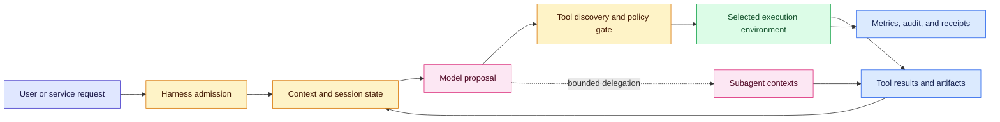
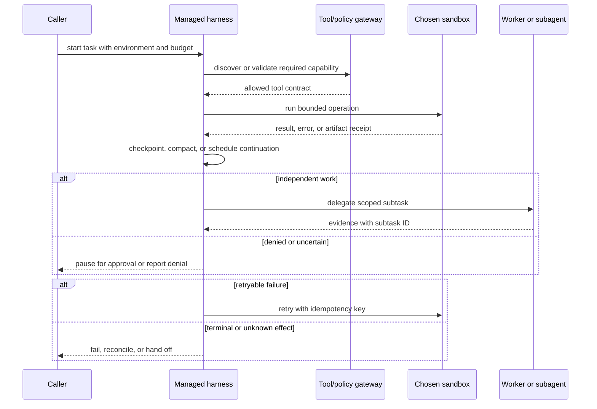

# Managed agent harnesses and portable sandboxes
Status: emerging
Sources: [OpenAI — Introducing the Agents API — 2026-09-10](https://openai.com/index/introducing-the-agents-api/)

## In one sentence

A managed agent harness is an operated control loop that coordinates model context, tools, long-running session state, and optional subagents, while a portable sandbox supplies the separately chosen compute, files, secrets, and network boundary in which those actions run.

## Background: what existed before

An ordinary language-model integration is usually a request-response service. An application sends a prompt and some context to a model endpoint, receives text or structured output, and then decides what to do. If the application needs a tool, its own server parses a tool call, checks permissions, invokes an API, appends the result, and sends another model request. A developer who wants a coding agent or research agent therefore has to assemble several pieces: a planner, a conversation store, a retry loop, a tool registry, a worker queue, a process or container runner, artifact storage, and telemetry.

That assembly is not merely plumbing. The application must decide which context survives a long task, how a crashed worker resumes, how a tool is selected without placing every schema in every prompt, how a child task reports back, and which identity is allowed to read a file or call an external service. A short prompt chain can hide these choices because it often runs synchronously and discards state when the request ends. A task that lasts hours or days cannot rely on one process, one context window, or one network connection.

The historical baseline was consequently a custom agent loop around mostly stateless model calls. Teams commonly kept transcripts in a database, put a queue in front of workers, and launched a container or virtual machine when code execution was required. These systems can be appropriate, especially where an organization needs full infrastructure ownership, but every team has to reproduce operational behavior such as cancellation, retry classification, checkpointing, artifact collection, and concurrency control. The “agent” is then a product-specific composition rather than a stable runtime boundary.

Two terms are important. A **harness** is the software that turns model calls into an operating loop: it manages context, exposes tools, schedules work, and records progress. A **sandbox** is an isolated execution environment with constrained resources and access. The harness decides what an agent proposes and how it continues; the sandbox limits where code and file operations happen. Treating those terms as synonyms creates an unsafe design because an orchestration layer can be trustworthy while an environment has the wrong network or secret permissions, or because a secure environment can still receive an unauthorized tool request.

The earlier stateful-runtime pattern also supplies a useful comparison. A durable workflow records events and resumes after failure; it does not make a generated plan correct. An enterprise agent platform adds identity, shared context, and administration; it does not automatically decide which process may access a tenant’s repository. This lesson uses those ideas as prerequisites, but its distinct boundary is the product decision to expose a maintained harness and let the customer choose among managed, customer-controlled, and partner-provided environments.

## What changed and why now

On September 10, 2026, OpenAI announced the Agents API in public beta. The announcement says that developers can create a cloud agent by specifying a task, model, tools, and environment, and that OpenAI hosts and maintains the harness. The source describes the harness and infrastructure behind Codex as the foundation exposed through the API. This is a release-specific fact about the announced public beta, not independent evidence that arbitrary agents are production-ready.

The important engineering change is the explicit split between the harness and the environment. The announcement says a developer may choose an OpenAI-managed sandbox, its own infrastructure, or a sandbox partner. It names different possible storage and secret mechanisms, and says CPU, GPU, memory, cold-start, and cost profiles can vary. An OpenAI-hosted sandbox is described as a provisioned environment for running code, working with files, and producing artifacts; its configuration can include files, packages, skills, and plugins. A customer-run or partner environment moves more of the execution, isolation, network, and incident responsibility to that environment owner.

The announcement also describes several harness-level mechanisms. Context management can automatically compact earlier context as a session approaches its limit. Tool search loads relevant tool definitions as needed, which the source presents as a way to reduce token usage and preserve the model cache. Programmatic tool calling lets an agent parallelize or chain operations in code and bring selected results back into context. The source says the API supports MCP, custom functions, and built-in tools such as web search. Multi-agent support can delegate independent work to subagents with separate context, and the example sets a maximum concurrent subagent count.

These details matter because they move a repeated application pattern into an API boundary. The provider operates a common lifecycle and evolves the harness alongside model launches, while the application supplies tools, knowledge, workflow-specific policy, and environment choice. That reduces the amount of orchestration code a team must own, but it does not remove the need to specify authority, data retention, resource quotas, approval, or failure behavior. A managed control loop is still a distributed system with a model making proposals inside it.

The source includes customer quotations about score, latency, cost, burst handling, and fewer failed responses after adopting the API. Those statements are customer or vendor measurements and testimonials, not independently verified benchmarks. They should motivate questions about a local workload—such as whether asynchronous fan-out reduces queue idle time—but should not be copied into an engineering SLO. Public beta status also means API behavior, limits, and integrations may change. A production design needs an adapter, pinned configuration where possible, and a migration path.

## Impact on current processing and architecture

The architecture now has two control planes. The harness control plane owns session identity, model configuration, context policy, tool discovery, delegation, and run progress. The environment control plane owns processes, filesystem mounts, package availability, secrets, network egress, compute quotas, and artifact persistence. A request crosses both planes before an effect occurs. The model’s proposal is not itself authorization, and an environment’s ability to execute code is not permission to access every connected service.

For a useful request record, store at least a task ID, tenant or project, actor, harness version, model identifier, tool-policy version, environment identifier, deadline, budget, and retention class. A session may have multiple context windows, worker attempts, or subagent runs. Those should be related by IDs rather than represented as one ever-growing transcript. When context is compacted, retain a machine-readable summary or checkpoint with provenance and a pointer to the original evidence under the appropriate access policy. A compacted context is a processing artifact, not proof that the omitted details were irrelevant.

The data flow is therefore not “prompt to answer.” It is admission, planning, tool selection, environment execution, observation, state update, and either another bounded iteration or a terminal outcome. Tool search changes the admission cost: the harness can retrieve only definitions likely to be relevant, but the gateway still needs to check a concrete call. Programmatic tool calling changes batching and context flow: a worker can perform independent reads and return a reduced result, but parallel calls can amplify rate-limit pressure and make partial failure harder to reconcile. Subagents create a second trust and cost boundary: their outputs are evidence for the coordinator, not automatically approved instructions.

### Component and data-flow architecture



The harness should pass the environment only the capabilities required for the task. For example, a report-building task may receive read-only input files and a writable output directory but no production credentials. A repository task may have a temporary checkout and a test command, while deployment remains a separate approval-controlled tool. A sandbox package or plugin is an input to the environment policy, not a reason to widen network access. If files and secrets have different owners, model them as separate mounts or capability handles rather than a single workspace bucket.

Long-session context management also changes storage design. Keep raw observations in an access-controlled event store, keep the active context small, and record which summary or selected tool result entered the next model call. A deletion request, tenant boundary, or incident investigation must be able to find both active summaries and retained source artifacts. A provider’s automatic compaction may be useful, but the application still has to understand retention, export, and redaction behavior for its obligations.

### Sequence and failure flow



The failure branch is the core design lesson. A timeout from a sandbox does not prove that a remote tool had no effect. A lost session does not justify asking the model to repeat an operation without checking a receipt. A subagent that returns plausible text may have used stale or unauthorized evidence. The harness can preserve progress, but the tool owner must provide idempotency, reconciliation, or a human decision for uncertain side effects. These are engineering inferences from the architecture, not promises made by the announcement.

## Real-world applications and constraints

For software maintenance, a managed harness can keep a coding task alive while tests, dependency inspection, and review happen in a temporary environment. The sandbox should have a repository snapshot, a bounded package cache, no production credentials, and an egress allowlist. A pull request is an artifact requiring human or automated review; a green test run is not authority to merge or deploy. Capture the commit digest, command outputs, test version, and patch so another worker can reproduce the claim.

For operations analysis, the harness can delegate independent log, dependency, and deployment investigations. Tool search can avoid injecting a large tool catalog into every context, and programmatic calls can combine read-only results before presenting them to the model. The practical constraints are data sensitivity, log volume, rate limits, stale dashboards, and the risk that an apparently diagnostic tool has a write path. Make query tools read-only by construction, attach a time range and tenant to every request, and require a separate approval for remediation.

For batch research or document processing, asynchronous sessions and subagents may absorb bursty work without keeping an application server busy between steps. The queue still needs backpressure, fair scheduling, cancellation, and per-tenant budgets. A maximum number of concurrent subagents limits fan-out but does not by itself bound total tokens or downstream API calls. Measure queue wait, harness time, environment startup, model latency, tool latency, artifact size, retries, and human review time separately.

For data-science workflows, a customer-controlled environment may be preferable when datasets must remain in a private network or when specialized GPUs and package mirrors are required. The trade-off is that the customer now owns worker health, images, patching, network policy, identity propagation, and evidence collection. A fully managed sandbox may shorten setup and centralize operations but can have different residency, package, filesystem, or cold-start constraints. A partner environment may provide a useful middle ground, but it adds another contract and incident boundary.

Portability is not just “the same API works everywhere.” Check whether the environment supports the same filesystem paths, package versions, secret references, hardware, network routes, artifact semantics, timeouts, and cancellation behavior. Define a capability manifest such as `gpu:a10`, `network:approved-registry`, `files:read-input-write-output`, and `secrets:none`. Have the harness reject a task when required capabilities are absent rather than silently substituting a weaker or broader environment. This lets an application route work without teaching the model infrastructure-specific authority.

Security needs defense in depth. Treat user prompts, retrieved documents, tool results, plugins, and files as potentially untrusted data. Do not let text inside a repository or webpage change the sandbox allowlist. Enforce identity and resource ownership outside the model. Separate read, draft, and commit tools; expire credentials; redact secrets from observations and traces; limit egress; and record denials. For code execution, use process, filesystem, network, CPU, memory, wall-clock, and output limits appropriate to the risk. The example below simulates policy; it is not a real security boundary.

## Mental model

Think of the harness as an air-traffic controller and the sandbox as an assigned aircraft hangar. The controller may sequence work, select instruments, preserve a flight plan, and coordinate other flights. The hangar determines which tools, fuel, files, and physical capabilities are available. Neither component should infer permission from a natural-language request. The controller can say “run the test in environment B,” but the environment admission policy decides whether the task’s identity, capabilities, resource budget, and data class fit there.

A second useful model is a capability ledger. Each run starts with a small set of explicit capabilities and every tool call consumes or preserves a known subset. Context is evidence; it is not capability. A file saying “upload me” does not grant network access. A model proposing `delete_record` does not grant deletion permission. A subagent’s conclusion does not grant the coordinator the authority to publish it. This separation makes the system testable: for each transition, ask which component authenticated the actor, checked the resource, enforced the budget, and recorded the result.

## What changed this month

The September source makes the harness/environment split concrete through the public-beta Agents API. It describes a provider-maintained Codex harness, selectable OpenAI-hosted, customer-run, or partner environments, and harness support for context compaction, on-demand tool definitions, programmatic calls, and bounded parallel subagents. It also says the API is available to developers without an additional Agents API fee beyond tokens and tools, while the API is expected to iterate during public beta. Those are announcement facts with a release date and scope.

The engineering consequence is not that teams can stop designing runtimes. It is that runtime ownership becomes a choice that should be recorded explicitly. A team can outsource some orchestration and environment operations, retain its own tool and policy gateway, or run more of the stack itself. The correct choice depends on data residency, network topology, hardware, latency, cost, change control, and incident response. The source supplies a new interface and options; local tests must establish whether a selected option meets the application’s contract.

## Engineering consequence

Design an adapter around the harness API and a capability manifest around each environment. The adapter should translate application state into a session request, attach policy and budget metadata, persist run and artifact IDs, and normalize provider-specific errors into `retryable`, `denied`, `approval_required`, `unknown_effect`, and `terminal` categories. Keep a kill switch that stops new work and a reconciliation path for in-flight effects.

At minimum, test five boundaries: session creation with missing capabilities; context compaction with an important evidence pointer; tool discovery followed by an unauthorized argument; sandbox timeout after a side-effecting request; and subagent fan-out exceeding the configured budget. Observe cost and latency by harness, model, environment, tool, and subagent—not just by user request. Alert on denial spikes, unknown-effect outcomes, artifact leakage, queue growth, and environment startup failures.

Do not promise exactly-once behavior merely because a session is long-lived. Use idempotency keys for writes, query receipts after ambiguous timeouts, and make retries safe or explicitly require review. Do not treat a managed sandbox as a universal security guarantee; verify its actual mounts, egress, isolation, secrets, retention, and patching contract. Do not treat customer-run infrastructure as automatically more private; misconfigured logs, object storage, or credentials can widen exposure.

Budget the run as a fan-out calculation. If a coordinator makes k model turns, launches s subagents, and each subagent averages m turns, a first-order model-call estimate is `N_calls ≈ k + s × m`; tool calls and retries add to that number. If each call costs c tokens and a retry probability is q, expected spend is approximately `N_calls × c / (1 − q)` under an independent-retry approximation. This is not a billing formula—context sizes and provider pricing vary—but it exposes why a concurrency cap alone does not bound cost. Enforce separate limits for wall-clock time, total calls, tokens, tool invocations, artifact bytes, and downstream requests.

## Limits and failure modes

The source is an official product announcement, not a neutral benchmark or a security audit. Public-beta interfaces can change, and the announcement does not define every quota, retention detail, regional guarantee, isolation property, or failure semantic. The API’s ability to create an agent is a capability claim; it is not evidence of successful completion for a particular workflow. Customer quotations are reported measurements with unknown workloads and methodology, so they cannot establish portable latency, cost, or safety guarantees.

The harness may compact away a detail the model needed, select an incomplete tool definition, or coordinate parallel work whose combined rate exceeds a downstream limit. A sandbox may cold-start slowly, lack a required package, lose an artifact, or return after a remote side effect occurred. A partner environment may expose a different filesystem or cancellation model. A subagent may duplicate work, leak sensitive context through its result, or produce a confident but unsupported synthesis. These cases need explicit tests and states rather than a generic “agent failed” label.

There are also economic limits. Managed orchestration can reduce engineering work while adding usage, storage, tool, or egress cost. Context compaction may reduce tokens but consume processing time and lose useful detail if summaries are poor. Tool search may reduce prompt size but add lookup latency and create a false sense that a missing tool is unavailable. Parallel subagents can reduce wall-clock time for independent reads while increasing total tokens, queue pressure, and review burden. Measure the whole workflow, including retries and human intervention.

## Mini exercise (15–30 min)

Build a dependency-free simulator for environment selection. Define three environments—managed, customer VPC, and partner—with different capabilities, startup latency, and cost units. Define tasks that require combinations such as read-only files, GPU, approved network, or no external secrets. Select only environments whose capabilities are a superset of the task requirements, then print the feasible choices and reject a task with no safe placement. Add a timeout case and an unknown-effect result for a side-effecting tool. The goal is to make the harness/environment boundary visible, not to emulate a real container.

## Runnable low-cost example

```python
from dataclasses import dataclass

@dataclass(frozen=True)
class Environment:
    name: str
    capabilities: frozenset
    startup_seconds: int
    cost_units: int

@dataclass(frozen=True)
class Task:
    name: str
    requires: frozenset
    side_effect: bool = False

ENVIRONMENTS = [
    Environment("managed", frozenset({"files:read", "files:write", "network:approved"}), 4, 2),
    Environment("customer-vpc", frozenset({"files:read", "files:write", "network:approved", "gpu"}), 12, 3),
    Environment("partner", frozenset({"files:read", "files:write"}), 7, 2),
]

def feasible(task, environment):
    return task.requires <= environment.capabilities

def place(task, environments):
    choices = [e for e in environments if feasible(task, e)]
    if not choices:
        return {"status": "rejected", "reason": "missing-capability"}
    chosen = min(choices, key=lambda e: (e.cost_units, e.startup_seconds))
    if task.side_effect:
        return {"status": "approval-required", "environment": chosen.name}
    return {"status": "accepted", "environment": chosen.name}

tasks = [
    Task("summarize-files", frozenset({"files:read"})),
    Task("train-small-model", frozenset({"files:read", "gpu"})),
    Task("publish-report", frozenset({"files:read", "files:write"}), True),
]

for task in tasks:
    print(task.name, place(task, ENVIRONMENTS))
```

The simulator chooses a least-cost feasible environment, but it deliberately does not execute code, create credentials, or make a network request. The `approval-required` result demonstrates that placement and authorization are different decisions. In a real system, the returned environment ID would be bound to a policy-checked session and the side effect would require an idempotency key and receipt.

## Build it locally

1. Save the example as `sandbox_selector.py` and run it with Python 3.11 or newer; confirm that the GPU task cannot use the managed or partner environment.
2. Add a `network:none` task and a fourth environment that has no network capability. Verify that the selector does not infer `network:approved` from `files:read`.
3. Add a maximum startup budget and return `deferred` when every feasible environment exceeds it. Keep `deferred` distinct from `rejected`.
4. Add a fake tool call with an idempotency key. Return `unknown_effect` on the first attempt, then require a receipt lookup before allowing a retry.
5. Add a small JSONL audit record containing task name, required capabilities, selected environment, policy version, decision, and reason. Do not record secrets or pretend this simulator provides isolation.
6. Change the cost and startup values to represent a burst of ten tasks. Explain whether choosing the cheapest environment still minimizes end-to-end cost once queue wait and cold starts are included.

## Interview Q&A

**What is the difference between an agent harness and a sandbox?** The harness manages the model-driven loop, context, tools, sessions, and delegation. The sandbox is the constrained compute and data environment where execution occurs. They need separate policies and observability.

**Why does separating them improve portability?** An application can keep workflow and tool contracts stable while selecting an environment for residency, GPU, network, startup, or cost needs. Portability still requires testing filesystem, secret, cancellation, quota, and artifact semantics; an identical API does not guarantee identical behavior.

**Does context compaction make a long-running agent durable?** No. It can help fit a session into context limits. Durability additionally needs persisted state, replay or recovery rules, artifact retention, identity, idempotency, and reconciliation for external effects.

**Why is tool search a security boundary?** It is not an authorization boundary by itself. It changes which definitions enter context. Every selected call still needs server-side authentication, argument validation, resource checks, rate limits, and audit records.

**When are subagents useful?** When subtasks are genuinely independent and their outputs have a clear contract. Bound concurrency, context, data access, tokens, and deadlines; treat their results as untrusted evidence until the coordinator validates them.

**What should happen after a sandbox timeout?** Classify whether the operation was read-only or side-effecting. For a side effect, query a receipt or reconcile state before retrying. If the outcome remains unknown, pause or escalate rather than asking the model to guess.

**What should an SDE2 measure?** Queue wait, environment startup, model and tool latency, context size, token cost, retry count, artifact size, denial rate, unknown effects, subagent fan-out, and human review—not just final completion rate.

## Glossary

- **Agent harness:** Runtime services that coordinate model calls, context, tools, state, and delegated work.
- **Sandbox:** An isolated execution environment with limits on processes, files, network, secrets, and resources.
- **Capability:** An explicit permission or environment feature, such as read-only files or approved network egress.
- **Context compaction:** Reducing or summarizing earlier session material so a later model call fits its context limit.
- **Tool search:** Loading relevant tool definitions on demand instead of placing every definition in every prompt.
- **Programmatic tool calling:** Letting code execute or combine tool calls and return selected results to the model.
- **Subagent:** A delegated model run with its own scoped context and task.
- **Idempotency key:** A stable request identifier that lets a service recognize a safe retry.
- **Unknown effect:** A state in which a request may have changed an external system but the caller lacks a reliable receipt.
- **Cold start:** Time and resources required to initialize an environment before work can run.
- **Capability manifest:** A versioned declaration of what an environment can access or execute.

## References

- [OpenAI — Introducing the Agents API — 2026-09-10](https://openai.com/index/introducing-the-agents-api/) — primary September source for the public-beta harness, environment choices, hosted sandboxes, context management, tool search, programmatic tool calling, subagents, and pricing/availability statements.
- [OpenAI Developers — Agents API overview](https://developers.openai.com/) — follow-up documentation link named by the primary announcement; consult current API contracts before implementation.
- [Temporal — What is Temporal?](https://docs.temporal.io/what-is-temporal) — background on durable execution and recovery; used only for the historical runtime comparison.

## Claim ledger

| Claim | Source | Fact or inference |
|---|---|---|
| OpenAI announced the Agents API in public beta on September 10, 2026. | [OpenAI announcement](https://openai.com/index/introducing-the-agents-api/) | Release-specific source fact |
| The announced API lets a developer specify a task, model, tools, and environment when creating a session. | [OpenAI announcement](https://openai.com/index/introducing-the-agents-api/) | Release-specific source fact |
| OpenAI says it hosts and maintains the harness behind the API. | [OpenAI announcement](https://openai.com/index/introducing-the-agents-api/) | Vendor claim, not independent verification |
| The announcement describes OpenAI-hosted, customer-run, and sandbox-partner environment choices. | [OpenAI announcement](https://openai.com/index/introducing-the-agents-api/) | Release-specific source fact |
| Hosted sandboxes are described as environments for code, files, artifacts, packages, skills, and plugins. | [OpenAI announcement](https://openai.com/index/introducing-the-agents-api/) | Vendor capability description |
| Context compaction, tool search, programmatic tool calling, and multi-agent support are described as harness features. | [OpenAI announcement](https://openai.com/index/introducing-the-agents-api/) | Release-specific source fact |
| Customer quotations about score, latency, cost, burst handling, and failed responses are not portable benchmarks. | [OpenAI announcement](https://openai.com/index/introducing-the-agents-api/) | Engineering interpretation of source provenance |
| A tool proposal must be separated from authorization and resource ownership. | [OpenAI announcement](https://openai.com/index/introducing-the-agents-api/); local security design | Engineering inference |
| Context compaction does not by itself provide durable execution or correct recovery. | [OpenAI announcement](https://openai.com/index/introducing-the-agents-api/); [Temporal](https://docs.temporal.io/what-is-temporal) | Engineering inference |
| A timeout after a side effect requires receipt lookup or reconciliation before retry. | Local distributed-systems design principle | Engineering inference |
| Environment portability requires testing capabilities, artifacts, cancellation, quotas, identity, and network behavior. | OpenAI environment-choice description; local implementation design | Engineering inference |
| The Python selector is a policy simulation and does not provide real process or network isolation. | This lesson’s example | Explicit limitation/fact about the example |
