# Permission-preserving data agents
Status: emerging
Sources: [OpenAI — 2026-09-10](https://openai.com/index/put-data-to-work/)

## In one sentence

A permission-preserving data agent lets a person ask a business question in natural language while the connected data system—not the model’s prose—continues to decide which tables, rows, and columns that person may use.

## Background: what existed before

Business analytics traditionally had two separate interfaces. A data warehouse or lake stored facts, dimensions, events, and documents. A business-intelligence (BI) tool placed a visual and query-oriented interface over those stores. Access control was usually configured in the warehouse, BI catalog, identity provider, or a combination of the three. A user who needed an answer selected a report, wrote SQL, opened a dashboard, or asked an analyst to do that work.

That arrangement had a useful security property: the execution system already knew the user identity and could apply its own authorization rules. A query did not become safe because somebody described it in English. It was safe only to the extent that the database, views, row-level-security policies, column masks, and BI permissions evaluated the request correctly. It also had a usability cost. A person had to know which source contained the metric, which table joined to which, what “active customer” meant, and where a trusted dashboard lived.

Natural-language interfaces change the front door but do not remove those obligations. A model can translate “why did renewals fall in the west?” into a plan, choose a connector, retrieve definitions, create a query, explain a trend, and suggest an action. Each step can introduce a different failure. The model may choose a similarly named field, mistake a fiscal period for a calendar period, join incompatible grains, reveal a restricted segment in a summary, or send a recommendation to the wrong audience. A prompt instruction such as “respect privacy” is guidance, not an authorization decision.

The important prerequisite is to distinguish identity, semantics, authorization, evidence, and action. Identity answers “which principal is making this request?” Semantics answers “what does revenue, renewal, or active user mean here?” Authorization answers “which data and operations may this principal access?” Evidence answers “which rows, definitions, filters, and calculations support the result?” Action answers “what side effect may happen after a person reviews the result?” A robust agent needs all five, with observable boundaries between them.

This lesson builds on two earlier ideas without repeating them. January’s data-governance lesson treats prompts, embeddings, outputs, and other derived artifacts as governed data assets with owners, purposes, retention, and lineage. June’s policy-enforcement-points lesson explains why a policy must be enforced at the boundary where a request can read data or change state. The September concept is narrower and more concrete: it follows one delegated analytics workflow where semantic definitions make natural-language analysis useful, while the source account’s table, row, and column controls remain authoritative.

## What changed and why now

On September 10, 2026, OpenAI announced a Data agent in ChatGPT Work. OpenAI says it can connect to approved company data sources, investigate changes, produce interactive dashboards, and support follow-up analysis in a conversation. The announcement names connectors including Amazon Redshift, Datadog, Google BigQuery, ClickHouse, Databricks, MongoDB, Snowflake, Google Drive, and SharePoint. These are release-specific statements about the announced product, not a general guarantee about every connector or deployment.

The architectural change is the combination of two delegated capabilities. First, the agent can use semantic context: business terms, metric definitions, custom calculations, and relationships supplied by semantic layers and trusted sources. OpenAI names examples such as Databricks Genie Ontology, dbt, GitHub, Snowflake Horizon, and BI dashboards. This context can reduce the gap between a user’s phrase and a technical schema. It does not make a metric correct by itself; it gives the planner a governed vocabulary to resolve and explain.

Second, OpenAI states that enterprise administrators choose which data connections are available and which roles can use them, and that queries enforce the connected account’s existing permissions, including table, row, and column restrictions. This is the central permission-preserving claim. The model may propose a plan, but the connected account remains the source of authority. A result should therefore be understood as “the answer computed over the authorized visible slice,” not “the answer over all company data.”

The announcement also places evidence and action in the same workflow. Users can ask follow-up questions and review the evidence behind a finding. They can turn an analysis into an interactive dashboard, share and refresh it, and ask the agent to recommend next steps. OpenAI says the agent can share findings through Slack or email and carry out actions through connected tools that the user approves. That approval boundary is significant: analysis and communication are not the same as an unattended write or notification.

The change is not that natural language replaces SQL, policies, catalogs, or analysts. The change is that a planning system now sits between an everyday question and governed analytics interfaces. That makes semantic metadata, principal propagation, query logging, evidence display, and action approval part of one product path. Reliability and authorization must be tested together because a plausible answer can still be outside the requester’s permitted scope.

## Impact on current processing and architecture

A permission-preserving data agent should process a request as a staged workflow:

1. Establish the user and workspace context.
2. Resolve only administrator-approved connectors and tools.
3. Translate the question into candidate business concepts using semantic definitions.
4. Build a query or analysis plan that carries the principal and purpose.
5. Execute it in the source account, where table, row, and column restrictions apply.
6. Collect evidence: definitions, filters, time ranges, source identifiers, and calculation steps.
7. Render a result or dashboard that preserves caveats and authorized scope.
8. Ask for a human decision before any external communication or state-changing action.

The model is most useful in steps three, four, six, and seven. It can map “renewals” to a canonical measure, explain a join, suggest a comparison, and turn an analysis into a view. It should not be the final authority for access. The connector or source system must evaluate the actual query under the user’s permissions. If a query plan requests a restricted column, the system should reject or mask it rather than rely on the model to omit it.

```mermaid
flowchart LR
  U[User question] --> I[Identity and workspace]
  I --> A[Approved connectors and roles]
  A --> S[Semantic layer and metric definitions]
  S --> P[Query or analysis plan]
  P --> D[Source account authorization]
  D --> X[Authorized rows and columns]
  X --> E[Evidence and dashboard]
  E --> H[Human approval gate]
  H --> T[Approved message or action]
  classDef actor fill:#dbeafe,stroke:#2563eb,color:#172554
  classDef control fill:#fef3c7,stroke:#d97706,color:#451a03
  classDef source fill:#fee2e2,stroke:#dc2626,color:#450a0a
  classDef result fill:#dcfce7,stroke:#16a34a,color:#14532d
  class U actor
  class I,A,S,P,H control
  class D,X source
  class E,T result
```



The diagram separates semantic resolution from source authorization. A semantic layer can say that “renewal rate” is renewed contracts divided by eligible contracts, but it cannot grant access to a confidential customer column. Conversely, a database can permit a column while lacking the business definition needed to interpret it. Both boundaries are necessary.

This architecture changes what teams must log. A traditional query log may contain a principal, SQL text, timestamp, and status. An agent trace also needs the resolved metric definition, connector selected, source snapshot or freshness indicator, generated query identifier, policy decision, evidence references, dashboard version, and approval decision. Minimize sensitive payloads in the trace. January’s governance principle applies: logs and derived results are data assets with their own purpose, retention, and access rules.

The queue model changes too. Natural-language analysis is often multi-step and may wait for a warehouse query, a dashboard render, or a person’s approval. Give each request an idempotency key and explicit state such as `planned`, `executing`, `evidence_ready`, `awaiting_approval`, `completed`, or `rejected`. A retry must not resend an approved email or repeat a write. A dashboard refresh should re-evaluate authorization rather than assume that a previously visible result remains permitted.

Cost and latency need separate budgets. Semantic retrieval and query planning consume model and metadata time. Warehouse execution consumes compute and may contend with production workloads. Dashboard generation consumes rendering work. Approval adds human latency but controls side effects. A fast answer that hides a restricted slice is a security failure; a safe system that makes every exploratory question wait for a heavyweight review may not be adopted. Measure these stages independently.

## Real-world applications and constraints

Consider a sales leader asking, “Which large accounts are at risk, and what should we fix first?” The agent needs an account definition, renewal window, risk signal, and authorized account scope. A regional manager may see only accounts in one territory. A finance role may see revenue but not individual compensation. The answer should disclose the selected definitions and filters, and a leader should be able to inspect why an account appeared without gaining access to fields they are not allowed to read.

For operations, a question such as “Where is support demand rising?” may combine ticket volume, staffing, product area, and customer tier. A semantic layer can define “open ticket” and align time zones. A row filter can prevent a regional team from seeing another region’s customers. The agent can produce a dashboard for the authorized slice. It should not infer that an empty result means no demand exists; it may mean the user’s scope excludes the relevant records. This is a semantic and authorization caveat worth displaying.

For finance, the main constraint is not only confidentiality. Metrics may be controlled by close calendars, currency conversion rules, and approval status. An agent that computes a plausible number from an unclosed period can cause a bad decision. Use semantic definitions with effective versions, freshness indicators, and an evidence panel that distinguishes actuals, estimates, and missing data. Any export or executive distribution should require the organization’s approval policy.

For people analytics, row and column controls are particularly important. An analyst may be allowed to see department-level aggregates but not names, free-text comments, or small groups that could be re-identified. Aggregation is not automatically anonymous: a filter, join, or dashboard drill-down may expose a person. Treat privacy thresholds and disclosure review as source-specific controls, not as a promise made by the model.

For customer support, an agent may inspect approved documents and ticket systems, then suggest who should follow up. The action stage should be typed and constrained: draft a message, place it in a review queue, or send only after explicit approval. Slack and email are side-effecting destinations. The person approving should see the recipients, source evidence, and any restricted-data transformations. “The user asked for next steps” does not mean “send the message now.”

Organizations also need connector operations. Administrators should inventory available connections, roles, service accounts, scopes, refresh behavior, and offboarding paths. Test when a role is removed during a long analysis. Test a connector outage, stale semantic definition, partial query, and source timeout. Decide whether the agent returns an incomplete answer, asks the user to retry, or refuses to summarize. Fail-open behavior is especially dangerous when authorization state is unavailable; the default should be bounded and explicit.

## Mental model

Use a five-layer mental model: vocabulary, plan, authority, evidence, and action.

Vocabulary is the semantic layer. It maps human terms to governed metrics, dimensions, relationships, and calculation rules. Plan is the model-generated proposal: sources, filters, joins, groupings, and intended output. Authority is the connected account’s enforcement of administrator-approved connections, roles, table permissions, row filters, and column restrictions. Evidence is the inspectable explanation of what was used and how the result was derived. Action is a separate transition that may communicate, publish, or mutate state.

The model proposes a path through the layers. The source system decides the permitted path. Evidence allows a person and an auditor to compare the proposal with the executed work. Approval controls the final transition.

```mermaid
sequenceDiagram
  participant U as User
  participant G as Data agent
  participant M as Semantic layer
  participant C as Connector/source
  participant V as Evidence view
  participant A as Approval gate
  U->>G: Ask business question
  G->>M: Resolve metric and relationships
  M-->>G: Definition and candidate plan
  G->>C: Execute as user / permitted role
  alt source permits request
    C-->>G: Authorized result and query status
    G->>V: Attach filters, definitions, and evidence
    V-->>U: Result or dashboard for review
    U->>A: Approve named side effect
    A-->>G: Permit, edit, or reject action
  else source denies or metadata is insufficient
    C-->>G: Deny, mask, or request clarification
    G-->>U: Explain bounded failure
  end
  classDef actor fill:#dbeafe,stroke:#2563eb,color:#172554
  classDef semantic fill:#f3e8ff,stroke:#9333ea,color:#581c87
  classDef source fill:#fee2e2,stroke:#dc2626,color:#450a0a
  classDef review fill:#dcfce7,stroke:#16a34a,color:#14532d
```

The source-denial branch is a normal outcome, not an exceptional bug. A permission-preserving system should explain that the request could not be completed within the user’s connected access, without revealing the existence or shape of hidden data. Error messages themselves need review: “column payroll_salary denied” may leak a sensitive schema to someone who should not know it exists.

## What changed this month

The September source makes governed semantic analytics a current product boundary rather than a purely theoretical design pattern. OpenAI states that the Data agent can use approved data sources and semantic context, that administrators control connection availability and role access, and that queries enforce table, row, and column permissions of the connected account. It also describes evidence review, interactive dashboards, and approved connected-tool actions.

Those statements are source facts about the September 10 announcement. Partner quotations and customer examples in the announcement are testimonials, not independent verification of accuracy, security, or productivity. OpenAI’s internal adoption statement is also a provider-reported statement, not a general measure of enterprise outcomes. This lesson uses the product description to identify an architectural pattern; it does not claim that every generated analysis is correct or that source permissions eliminate all leakage.

## Engineering consequence

Treat the data agent as a policy-carrying query planner with a side-effect boundary. The minimum request envelope should carry a stable principal, workspace, purpose, connector, semantic-definition version, request ID, and approval state. The query executor should receive the principal through a trusted channel and execute under a source-native account or role. Never let model-generated text select an arbitrary service account.

Make evidence a first-class output. Store a structured record containing the metric definition, source names, filter predicates, time range, row count where safe, freshness, query ID, authorization outcome, and caveats. Render enough for a user to challenge an answer, but do not expose restricted values through the evidence panel. The record itself is governed data and should inherit tenant, retention, and access rules.

Separate read plans from action plans. A read plan may be retried if it has no side effects, although it still needs a fresh authorization check. An action plan should list exact recipients, destination, payload class, and approval identity. Require an idempotency key and expire approvals when the underlying evidence or authorization changes. Log `approved`, `rejected`, `expired`, and `executed` as distinct states.

Test the seams, not only the model. Use synthetic users with overlapping and disjoint row scopes. Give one user column access and another only aggregate access. Ask equivalent questions with different wording and check that the authorized result is stable. Revoke a role between planning and execution. Add a misleading metric synonym to the semantic catalog. Hide a source and confirm that the agent does not quietly substitute an unapproved connector. These are engineering recommendations and inferences from the stated boundaries, not controls that the announcement independently validates.

Quantify the privacy/utility trade-off instead of treating “aggregate” as a magic safety word. For a query result, retain a tuple such as `(principal, purpose, definition_version, predicate_hash, source_revision, row_count, result_class)`. A policy may require a minimum cohort size k before returning a group statistic, but k-anonymity alone does not prevent differencing attacks: two permitted queries whose predicates differ by one person can reveal that person’s contribution. A simple risk check is to compare a new result with prior results over the same population and reject queries whose difference isolates a restricted row or column. For every accepted result, measure authorization latency, semantic-plan latency, warehouse latency, evidence-generation latency, and the fraction of requests deferred for insufficient scope.

## Limits and failure modes

Semantic correctness is not authorization. A definition can be official and still be inappropriate for a particular user or period. A model can choose the wrong definition, join data at the wrong grain, double-count records, or summarize a restricted subset as if it were the whole company. Require definition IDs, query previews, result-quality checks, and caveats for small or incomplete slices.

Permission preservation does not automatically prevent inference. A user may be allowed to see regional totals but infer an individual’s change by comparing dashboards before and after a filter. Small groups, repeated queries, drill-downs, and joins can create disclosure risk. Apply source-native aggregation controls, query budgets, suppression thresholds, and review where appropriate. Do not claim that row and column permissions alone provide anonymity.

Freshness can make an authorized answer wrong. A dashboard may refresh on a schedule; a semantic definition may lag a schema change; a source may be temporarily partial. Show timestamps and source status. If evidence is incomplete, return a bounded answer or ask for a retry rather than filling gaps with confident prose.

Approval can also fail. A user may approve a dashboard but not an email, or approve a draft based on evidence that becomes stale before execution. Bind approval to an action hash, recipient set, and evidence version. Recheck authorization at execution. Avoid broad “approve all future actions” controls for high-impact destinations.

Connector credentials create operational risk. A service account with broad access can defeat the intended user boundary. Prefer delegated identity or narrowly scoped roles, rotate credentials, strip untrusted headers, and monitor unusual reads. When a source is unavailable, fail closed for sensitive access and provide a recovery path. Availability trade-offs are real, but silently using a broader fallback is not an acceptable convenience.

Finally, vendor documentation cannot establish your deployment’s behavior. Connector versions, workspace settings, semantic-layer configuration, regional residency, logging, and retention may differ. Reproduce the claims in a test tenant with synthetic records and documented roles before production rollout. Treat the September announcement as a design and release description, not as a substitute for an organization-specific security assessment.

## Mini exercise (15–30 min)

Build a tiny row-and-column permission simulator. Create synthetic sales records for two regions, expose revenue to both roles, expose account names only to regional managers, and expose a private discount column to finance. Then process three natural-language-style requests represented as structured plans: regional revenue, named accounts at risk, and discount analysis. The executor should filter rows and columns before aggregation, return a denial for an unauthorized field, and attach evidence describing the authorized scope. Add an approval step that allows a dashboard draft but refuses to send a message until a recipient is explicitly approved.

The exercise demonstrates the key boundary: a plan can request a field, but the source authorization function decides whether the field enters computation. It is intentionally not an LLM integration and does not prove that a production connector is secure.

## Build it locally

1. Save the Python example below as `permission_agent.py` and run it with `python3 permission_agent.py`.
2. Read the `ROWS` list and identify which role can see each row and column.
3. Add a third role with aggregate revenue access but no account names; assert that its result contains no names.
4. Add a plan requesting `discount`; make the executor return a structured denial for the sales role rather than dropping the field silently.
5. Add an `evidence` object containing the role, allowed columns, row count, and plan identifier; avoid storing the raw restricted rows in the evidence.
6. Add an approval function that accepts only a dashboard destination and rejects email unless recipients are present.
7. Change one row’s region and rerun the assertions to verify that the result changes because authorization is evaluated at execution time.

```python
ROWS = [
    {"region": "west", "account": "Acme", "revenue": 120, "discount": 12},
    {"region": "east", "account": "Beta", "revenue": 90, "discount": 8},
]

ROLE_POLICY = {
    "west_manager": {"regions": {"west"}, "columns": {"region", "account", "revenue"}},
    "finance": {"regions": {"west", "east"}, "columns": {"region", "account", "revenue", "discount"}},
}

def execute(plan, role):
    policy = ROLE_POLICY[role]
    requested = set(plan["columns"])
    denied = requested - policy["columns"]
    if denied:
        return {"status": "denied", "reason": "restricted columns", "columns": sorted(denied)}
    visible = [row for row in ROWS if row["region"] in policy["regions"]]
    result = [{key: row[key] for key in plan["columns"]} for row in visible]
    return {"status": "ok", "rows": result, "evidence": {"role": role, "row_count": len(result)}}

manager_plan = {"columns": ["region", "account", "revenue"]}
private_plan = {"columns": ["region", "discount"]}

manager_result = execute(manager_plan, "west_manager")
assert manager_result["status"] == "ok"
assert len(manager_result["rows"]) == 1
assert execute(private_plan, "west_manager")["status"] == "denied"
assert execute(private_plan, "finance")["rows"][0]["discount"] == 12
print("authorized rows:", manager_result["rows"])
print("unauthorized field: denied before computation")
```

The example uses an explicit structured plan instead of pretending that a model is an access-control system. The policy filters rows and columns before producing a result. Its `evidence` object records scope without copying the source data. A production system would need authenticated identity, source-native enforcement, audit storage, freshness, aggregation controls, and more careful error handling.

## Interview Q&A

**Q: Why is a semantic layer necessary if the warehouse already has SQL?**

A: SQL expresses operations, but a semantic layer gives those operations shared business meaning: metric definitions, relationships, calculation rules, and terminology. It can help a planner choose the right definition and help a reviewer understand the result. It does not replace authorization or prove that a generated query is correct.

**Q: Where should row and column permissions be enforced?**

A: At the source account or another trusted execution boundary that evaluates the actual query under the user’s permitted role. The model can propose filters, but it must not be trusted to remember every restriction. Defense in depth may add an agent-side policy check, but the source remains authoritative.

**Q: Why separate evidence from the answer?**

A: A concise answer can hide the definition, time range, filters, freshness, or authorized subset used to compute it. Structured evidence lets a user audit the reasoning and detect a wrong metric or incomplete source. Evidence must itself avoid leaking restricted fields.

**Q: Does permission preservation guarantee privacy?**

A: No. Authorized aggregates can still enable inference through repeated queries, small groups, joins, or dashboard comparisons. Permissions answer whether a principal may access a data operation; privacy controls also need aggregation policy, disclosure review, query monitoring, and appropriate suppression.

**Q: Why require approval for Slack or email?**

A: Sending a message is a side effect with recipients, content, and reputational consequences. A user asking for recommendations has not necessarily approved a particular communication. Bind approval to the concrete destination, payload, evidence version, and recipient set, then recheck authorization before execution.

**Q: What should happen when a source denies the generated query?**

A: Return a bounded explanation or request clarification without revealing hidden schema or data. Do not silently broaden credentials, substitute an unapproved source, or present a partial result as a complete company-wide answer. Log the denial for operations and access review.

## Glossary

- **Semantic layer:** A governed vocabulary and model of business metrics, dimensions, relationships, and calculations.
- **Principal:** An authenticated user, service, or role on whose behalf an operation runs.
- **Connector:** An integration that lets the agent reach an approved data or business system.
- **Row-level permission:** A rule limiting which records a principal may read.
- **Column-level permission:** A rule limiting which fields a principal may read.
- **Source account:** The identity or role recognized by the connected data system when it authorizes a query.
- **Evidence:** Structured support for a result, including definitions, filters, source status, and calculation details.
- **Side effect:** An operation that changes state or communicates externally, such as publishing or sending email.
- **Idempotency key:** A stable request identifier that lets a service retry work without repeating a side effect.
- **Data grain:** The level represented by one row, such as one order, account, or month-region pair.
- **Disclosure inference:** Learning restricted information indirectly from allowed outputs or repeated comparisons.
- **Freshness:** How current a source or derived result is relative to the time a user asks a question.

## References

- [Now everyone can put data to work — OpenAI, 2026-09-10](https://openai.com/index/put-data-to-work/)
- [Data governance — January 2026 lesson](../2026-01/18-data-governance.md)
- [Policy enforcement points — June 2026 lesson](../2026-06/12-policy-enforcement-points.md)

## Claim ledger

| Claim | Source | Fact or inference |
|---|---|---|
| OpenAI announced the Data agent in ChatGPT Work on September 10, 2026. | [OpenAI announcement](https://openai.com/index/put-data-to-work/) | Release-specific fact |
| OpenAI says the Data agent connects to approved sources including warehouses, databases, monitoring systems, files, and documents. | [OpenAI announcement](https://openai.com/index/put-data-to-work/) | Release-specific vendor claim |
| OpenAI says semantic layers and trusted sources provide business terms, metric definitions, custom calculations, and relationships. | [OpenAI announcement](https://openai.com/index/put-data-to-work/) | Release-specific vendor claim |
| OpenAI says administrators choose available connections and roles, while queries enforce connected-account table, row, and column permissions. | [OpenAI announcement](https://openai.com/index/put-data-to-work/) | Release-specific vendor claim |
| OpenAI describes evidence review, interactive dashboards, and connected-tool actions that users approve. | [OpenAI announcement](https://openai.com/index/put-data-to-work/) | Release-specific vendor claim |
| Partner and customer quotations in the announcement are not independent verification of accuracy, security, or productivity. | [OpenAI announcement](https://openai.com/index/put-data-to-work/) | Engineering interpretation of source context |
| Semantic resolution and source authorization should be separate architecture boundaries. | [OpenAI announcement](https://openai.com/index/put-data-to-work/) | Engineering inference |
| Agent traces should record principal, definition, query, authorization, evidence, and approval state while minimizing sensitive payloads. | [January data-governance lesson](../2026-01/18-data-governance.md) and [OpenAI announcement](https://openai.com/index/put-data-to-work/) | Engineering inference |
| A model-generated plan is not an authorization decision, so source-native enforcement should evaluate the executed request. | [June policy-enforcement-points lesson](../2026-06/12-policy-enforcement-points.md) and [OpenAI announcement](https://openai.com/index/put-data-to-work/) | Engineering inference |
| Row and column permissions alone do not guarantee protection against inference from aggregates or repeated queries. | [OpenAI announcement](https://openai.com/index/put-data-to-work/) | Engineering inference and stated limitation |
| The Python simulator demonstrates a safe local boundary; it does not establish production security, scale, or provider behavior. | This lesson’s example and cited source | Engineering inference |
