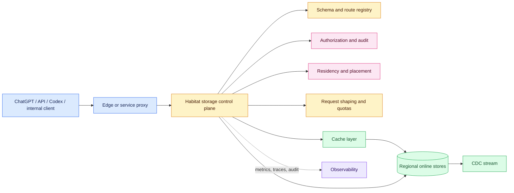
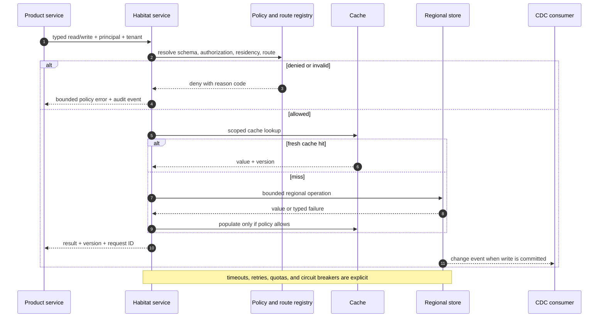

# AI-Product Online-Storage Control Planes
Status: emerging
Sources: [OpenAI — 2026-09-11](https://openai.com/index/scaling-storage-one-billion-users-part-one/)

## In one sentence

An AI product’s online-storage control plane is the shared request, policy, routing, and operational layer that makes user state safe and predictable to read and write across many products, regions, tenants, and storage systems.

## Background: storage used to look like a library call

An online-storage system serves small, latency-sensitive reads and writes on the product’s critical path. A conversation lookup, account preference, Codex setting, feature flag, entitlement, or agent checkpoint may all need to finish before an application can render a page or continue a workflow. This is different from an offline data lake: the online path has a request deadline, a caller identity, a consistency contract, and a user waiting at the other end.

The historical baseline is a product service calling a database client directly. That arrangement is attractive because it is simple. A team owns its schema, creates a connection pool, writes a query, and deploys the application. A reusable client library can improve consistency without introducing another network hop. For a small number of services and one database topology, this is often the right starting point.

The difficulty appears when the “client library” becomes an entire platform. It may need to decide which storage resource contains an object, select a region, enforce authorization, encrypt fields, apply rate limits, cache reads, serialize values, expose change data capture (CDC), and manage connections. Every product process now carries a copy of those decisions. The application code may look like one function call, but the distributed policy is duplicated across binaries and release trains.

An **online-storage control plane** is the control surface that governs those decisions. It does not mean every byte must pass through one database or that a single centralized machine handles all traffic. It means the storage contract has an explicit owner for policies and routing. A data plane performs the actual reads and writes; the control plane determines how those operations are authorized, placed, shaped, observed, and changed.

The important prerequisite is to distinguish three paths:

1. The **product path** carries a user or agent request.
2. The **storage data path** carries a bounded read or write to a backing store or cache.
3. The **control path** distributes schemas, routing rules, policy versions, feature flags, credentials, and deployment configuration.

These paths interact, but they have different failure behavior. A stale routing configuration may send a valid request to the wrong region. An authorization bug may expose data even when storage is healthy. A slow cache or database may consume the user-visible latency budget. Treating all three as “the database” hides the design work.

## What changed and why now

OpenAI’s September 11, 2026 engineering post describes Habitat, an online-storage platform used by OpenAI products. OpenAI states that Habitat began at DevDay 2023 as a small Python client library connected to Azure Cosmos DB, then evolved into a distributed service. The post reports more than 70 million requests per second, more than one billion people using supported products each week, almost 40 geographic regions, and more than 500 petabytes of data. These are publisher-reported scale figures, not independently verified measurements or guarantees for another system.

The architectural change was the extraction of storage behavior from each client into a standalone service. The original library handled schema lookup, routing, authorization, encryption, serialization, request shaping, connection pooling, caches, and storage selection. As products multiplied, changing that library required coordinated rollout across many services. OpenAI describes a regional-sharding change that needed client-side routing logic, feature flags, shadowing, deployment across dozens of services, and careful rollback handling. A rollback to an older client contributed to the outage the change was intended to avoid, according to the post.

The service boundary creates a single operational control point. OpenAI says it enabled centralized deployments, observability, platform improvements, access-control enforcement, audit logging, and restriction of access to underlying resources. The point is not merely that a service is “more scalable” than a library. The point is that the policy and migration blast radius becomes an owned platform interface.

The transition also exposed a cost. A local library call became a network call to a Python service. OpenAI reports that the Python service added network latency and CPU and memory cost compared with local execution. The team accepted that short-term trade-off to unblock product development and establish stable APIs, then later rewrote the service in Rust. The post reports that, at publication time, the Rust service handled 95% of production requests and that OpenAI measured it as six times more CPU efficient and fifteen times more memory efficient than the Python version. Those are OpenAI’s measurements in its environment; they are not universal language-runtime benchmarks.

## Impact on current processing and architecture

The useful design pattern is a policy-aware request pipeline. A product should not need to know whether a logical object is in a cache, Azure Cosmos DB, another online store, or a regional replica. It sends a typed, bounded request to a storage API. The storage service resolves the schema and placement, authenticates the caller, checks authorization, applies tenant and rate policy, selects a backend, performs the operation, and emits telemetry and change events.



The diagram is a conceptual architecture, not a claim that OpenAI exposes these as public APIs or that every request visits each box. The source identifies caching, ACL policies, placement and data residency, encryption, isolation, rate limiting, routing, online stores, caches, and CDC services as parts of Habitat’s platform view. The exact internal implementation is not fully specified by the post.



This sequence separates a policy failure from a backend failure. That distinction is operationally important: retrying an authorization denial is wasteful, while retrying an idempotent backend read may be reasonable within the remaining deadline. The source discusses these layers and failure pressures but does not publish this exact sequence; it is an engineering model of the described service boundary.

### The request contract

The first consequence is a narrower API. Habitat uses a NoSQL API based on client-defined object and edge types rather than arbitrary SQL. OpenAI explains the choice as a way to make request cost predictable and to avoid unbounded scans, joins, and graph traversals on a hot path. A logical object has a bounded key and a known relationship shape. A product that needs complex analysis uses a separate path rather than silently turning a user request into a large online query.

This is a processing decision, not an aesthetic preference. An arbitrary query API makes cost depend on data volume, indexes, join selectivity, and accidental query plans. A constrained API makes expensive work visible to the caller. The caller may have to perform multiple direct-edge reads or build a secondary view, but the online service can protect admission, quotas, and tail latency.

### Policy and placement

Authorization must be checked at the storage boundary, not only in the product service. Product-level checks are still useful, but a shared storage boundary can prevent a forgotten route or compromised internal caller from reaching another tenant’s records. The authorization decision should be bound to the authenticated principal, object type, tenant, operation, and policy version. An audit event should record the decision and a stable resource identifier without copying sensitive values into general logs.

Residency and placement are related but distinct. Placement chooses where data is stored or read for availability and performance. Residency expresses a constraint about where a tenant’s data may be processed or persisted. A route that is fast but crosses an unauthorized boundary is incorrect. The control plane should resolve an allowed region before selecting a cache or backend, and a cache key must include the scope that makes the cached value safe to reuse.

Isolation is also more than a namespace string. Multi-tenancy requires limits on storage capacity, request rate, connection usage, and noisy-neighbor effects. The service can apply quotas and request shaping before a burst reaches a shared backend. Encryption protects data in transit or at rest, but it does not replace authorization, auditability, or correct routing.

### Cache and change-data paths

Caching is a performance layer with a correctness contract. A cache hit is useful only when the value is fresh enough, authorized for the current caller, and tied to the correct region and schema version. A stale value may be acceptable for a feature preference but not for an account suspension or permission change. The cache-control decision belongs in the storage contract, where the object’s consistency and invalidation behavior are known.

CDC creates a second processing path from online writes to downstream systems. The post says Habitat streams changes to isolated Rockset instances for complex querying and that Kafka, Databricks, Rockset, and other services appear in the platform’s surrounding ecosystem. CDC is not a magic consistency guarantee: a consumer may lag, events may be retried, and a snapshot may race with changes. Downstream users need a watermark, schema version, event identity, and a documented replay policy.

## Real-world applications and constraints

This architecture applies to AI products with shared durable state:

- A conversation product stores threads, user preferences, attachments, tool configuration, and safety-related state while serving requests from many regions.
- A coding agent stores workspace metadata, task state, permissions, and audit receipts. It must not infer that access to a model implies access to every workspace object.
- An API platform stores usage limits, organization configuration, model entitlements, and request metadata. Rate decisions need predictable reads even during a traffic burst.
- An internal evaluation platform stores experiment definitions and produces CDC-fed analytical views. The online path should remain responsive while analysts run expensive queries elsewhere.

Each application has a different consistency boundary. A conversation draft may tolerate read-after-write delay of a short interval; a revocation record may require a fail-closed check; an idempotency record must prevent a repeated tool action. The storage platform should expose these semantics explicitly instead of forcing every product team to reverse-engineer them.

The operational constraint is that the storage service becomes critical shared infrastructure. An outage or bad policy can affect multiple products at once. The service needs regional failure plans, bounded retries, circuit breakers, capacity reserves, deployment canaries, and a way to disable a new routing rule without requiring every client to roll back. Centralization reduces configuration fan-out but can increase blast radius if the service has no isolation.

## Mental model

Think of the storage control plane as an air-traffic controller for bounded data operations. It does not manufacture the aircraft or own every airport. It knows the flight’s identity, permitted destination, route constraints, priority, and current capacity; it sends the request to an appropriate data-plane resource and records what happened.

The analogy has three practical rules:

1. **The request has a passport.** Identity, tenant, authorization scope, residency, and operation type travel with it. A database key alone is not permission.
2. **The route is a policy decision.** Cache, region, replica, and backend are selected from explicit constraints, not from whichever connection happens to be reused.
3. **The flight plan is bounded.** The API should make work predictable. If a product needs an expensive join, it moves to a separately owned analytical or materialized-view path.

The control plane is therefore a composition of request policy, data placement, and operational evidence. A central service is useful when it owns those concerns coherently; it is harmful if it becomes an opaque bottleneck with no tenant isolation or failure policy.

## What changed this month

The September source makes online storage a first-class AI-product architecture topic. The change is not a new database algorithm. It is a documented example of a fast-growing AI platform moving from a convenience library toward a service-owned storage layer as products, regions, and policy requirements multiplied.

OpenAI’s post emphasizes sequencing. The team first needed stable APIs and platform reliability, accepted Python’s inefficiency, then invested in a Rust rewrite. It also emphasizes that scale pressure came from more than raw request count: hundreds of database calls can make tail latency dominate a user request; background configuration parsing can stall an event loop; connection reuse can concentrate load on already-slow processes; and too many workers can flood downstream resources.

These details matter for current AI processing because a model request often performs many state lookups before inference begins. A small degradation at each lookup can become a large tail event. A storage control plane needs its own latency budget, event-loop or thread scheduling signal, connection-fan-in strategy, and request-shaping policy. It is part of the model-serving experience even though it does not run the model.

## Engineering consequence

When designing an AI product, write the storage contract before selecting the database. Define object types, operations, maximum fanout, consistency, authorization inputs, residency constraints, cache behavior, idempotency, CDC semantics, and timeout behavior. Then make the service enforce those properties.

Measure the path in spans that separate gateway time, policy time, cache time, backend time, serialization, queueing, and response delivery. The January latency lesson’s central idea applies here: a single end-to-end number does not show which stage spent the budget. The January observability lesson also applies: metrics should be low-cardinality and payloads should be redacted; an audit trail should explain a permission decision without becoming an uncontrolled copy of user data.

For deployments, prefer one service rollout with compatibility checks over dozens of client upgrades. Keep schema and protocol versions explicit. Shadow a routing change with read-only comparisons, compare expected and actual regions, and define rollback behavior. A feature flag does not make a rollout safe if an older client can reappear with incompatible assumptions. Test rollback itself.

For runtime capacity, separate I/O concurrency from CPU-heavy work such as encryption, compression, checksumming, routing, and health checks. OpenAI reports that asyncio concurrency did not provide CPU parallelism for its Python service and that event-loop scheduling delay became visible in high-percentile traces. This supports a general inference: monitor scheduler delay, not just CPU percentage, whenever a proxy performs meaningful CPU work. Tune connection reuse and fan-in so load is distributed across workers and does not amplify an already overloaded process.

Put the storage path on a latency budget. If the request deadline is D, then `D ≥ T_gateway + T_authz + T_cache + T_backend + T_serialize + T_queue`; each term should have a measured p95 or p99 budget rather than only an average. A cache hit ratio h changes expected backend work to roughly `(1 − h) × R`, where R is request volume, but a stale or cross-tenant hit can be a correctness or security failure. Capacity planning also needs object fanout: if one logical read expands to f backend objects and traffic is R requests/s, backend operation rate is approximately fR, before retries and change-feed writes.

## Limits and failure modes

Centralization is not automatically safer or faster. It adds a network hop, a shared dependency, and another deployment surface. It may concentrate an authorization bug or a bad route into many products. A storage service can also become a “god service” whose API accumulates arbitrary query features until its bounded-work property disappears.

Important failure modes include:

- **Stale authorization or residency state:** a cached policy allows a request after a role or region constraint changed. High-risk decisions should fail closed or use a short, explicit validation window.
- **Unsafe cache reuse:** a value keyed only by object ID is served across tenants, regions, or policy versions. Key scope and invalidation are part of correctness.
- **Routing skew:** a connection pool or load balancer sends disproportionate traffic to a slow process. Monitor per-worker concurrency and tail latency, not only fleet averages.
- **Fan-out overload:** a deployment creates many workers or connections at once and floods a database, NAT gateway, or service mesh. Roll out gradually and cap concurrency.
- **CDC lag or duplication:** an analytical view is behind the online source or processes an event twice. Consumers need event IDs, ordering assumptions, watermarks, and idempotent updates.
- **Unbounded API growth:** a new query quietly scans a large dataset on the user path. Reject or redesign it before production.
- **Control-plane outage:** all products depend on one service for reads. Use regional isolation, carefully chosen caches, bounded degraded modes, and explicit stale-data policy.
- **False confidence from vendor measurements:** reported scale, efficiency, and latency improvements describe the publisher’s workload and environment. Reproduce the relevant property with your own traffic shape and data sensitivity.

The defensive response is to make each failure observable and reversible. Keep audit records for authorization and route decisions, but protect them with tenant-aware access and retention. Avoid retry storms: retries must respect deadlines and idempotency. Do not turn a cache or a stale replica into a silent source of truth.

## Mini exercise (20–30 min)

Build the small routed-cache simulator below, then extend it with one policy or failure mode. The example is intentionally local and uses only Python’s standard library. It does not connect to a real database, implement cryptography, or prove multi-tenant isolation; it demonstrates how a control plane can make routing and authorization decisions explicit before a data-plane operation.

```python
from dataclasses import dataclass


@dataclass(frozen=True)
class Request:
    tenant: str
    principal: str
    object_id: str
    region: str
    operation: str


class PolicyError(Exception):
    pass


class StorageControlPlane:
    def __init__(self):
        self.allowed = {("acme", "alice"): {"profile:1", "note:1"}}
        self.residency = {"acme": "us"}
        self.backends = {"us": {"profile:1": "profile-us", "note:1": "note-us"},
                         "eu": {"profile:1": "profile-eu", "note:1": "note-eu"}}
        self.cache = {("us", "profile:1"): {"name": "Alice", "version": 7}}

    def route(self, request: Request) -> str:
        if request.operation not in {"read", "write"}:
            raise PolicyError("unsupported operation")
        if request.object_id not in self.allowed.get((request.tenant, request.principal), set()):
            raise PolicyError("authorization denied")
        required_region = self.residency[request.tenant]
        if request.region != required_region:
            raise PolicyError("residency constraint")
        cache_key = (required_region, request.object_id)
        if request.operation == "read" and cache_key in self.cache:
            return f"cache:{cache_key[0]}:{request.object_id}"
        return self.backends[required_region][request.object_id]


if __name__ == "__main__":
    plane = StorageControlPlane()
    good = Request("acme", "alice", "profile:1", "us", "read")
    assert plane.route(good) == "cache:us:profile:1"
    try:
        plane.route(Request("acme", "alice", "profile:1", "eu", "read"))
    except PolicyError as error:
        print("safe rejection:", error)
    else:
        raise AssertionError("residency check was bypassed")
    print("authorized route:", plane.route(good))
```

## Build it locally

1. Save the code as `storage_control_plane.py` and run `python3 storage_control_plane.py`. Confirm that the authorized read uses the US cache and the EU request is rejected before backend selection.
2. Add a second tenant with a different residency region and an object with the same `object_id`. Assert that its cache key includes the tenant or another isolation scope; explain why region alone is insufficient.
3. Add a `policy_version` to the authorization map and cache key. Simulate a permission revocation and reject cached data when the request’s policy version is older than the current one.
4. Add a bounded `max_fanout` field to `Request`. Reject requests that would require more than a small number of direct-edge reads, modeling Habitat’s preference for predictable work.
5. Add a `changes` list containing object ID, event ID, and version. Write an idempotent consumer that ignores a duplicate event and reports the highest applied version.
6. Add counters for `authorized_cache_hit`, `backend_route`, `authorization_denied`, and `residency_denied`. Keep identifiers out of metric labels; print a structured event instead.
7. Inject a simulated backend outage. Decide whether this object may use a stale cache, fail closed, or return an explicit unavailable state, and document the decision in a comment and assertion.

The exercise teaches policy ordering and bounded routing. It does not test network timeouts, encryption, real authorization tokens, database consistency, or production capacity. Those require integration tests and a threat model.

## Interview Q&A

**Q: Why move storage logic from a library into a service?**
**A:** A service centralizes deployment, observability, routing, authorization, audit logging, and access to underlying stores. It reduces client rollout fan-out. The trade-off is an extra network hop and a shared dependency.

**Q: Is the storage service a control plane or a data plane?**
**A:** It can participate in both. Its read/write handlers are data-plane traffic, while its schema, routing, policy, and rollout mechanisms are control-plane responsibilities. The useful distinction is which decisions are centrally governed and which bytes are moved.

**Q: Why constrain the API instead of accepting arbitrary SQL?**
**A:** Bounded object and edge operations make request cost and isolation easier to reason about. Arbitrary joins and scans can turn a cheap-looking product call into an overload event. Complex queries can use an offline or secondary-view path.

**Q: Does encryption solve the storage security problem?**
**A:** No. Encryption protects particular data paths or storage states, but authorization, tenant isolation, residency, audit logging, secret management, and safe cache keys are separate controls.

**Q: What should be in a storage latency trace?**
**A:** At least admission, policy evaluation, cache lookup, backend selection, backend duration, serialization, retries, and response delivery. Separating these spans shows whether the tail came from storage, a scheduler, a retry, or the control layer.

**Q: Why can more Python workers worsen a service?**
**A:** More workers can increase CPU scheduling, connection churn, and downstream fan-out. OpenAI reports that event-loop scheduling delay, connection reuse imbalance, and connection flooding were operational concerns in Habitat’s Python service. The general lesson is to measure per-worker load and downstream connection behavior rather than assuming concurrency equals parallel CPU execution.

**Q: When is stale cache data acceptable?**
**A:** Only when the object’s consistency contract permits it and the cache entry remains within an explicit freshness and authorization boundary. A preference may tolerate staleness; a revocation or permission decision often should not.

## Glossary

- **Control plane:** The components that define, distribute, and enforce configuration, policy, placement, and operational decisions.
- **Data plane:** The path that carries the actual read, write, or change operation.
- **Online storage:** Low-latency storage used directly by a product request rather than primarily for offline analysis.
- **Tail latency:** Slow request behavior in a high percentile, such as p95 or p99, rather than the average.
- **Residency:** A rule limiting where data may be stored or processed.
- **Request shaping:** Admission, quotas, rate limits, batching, or other controls that bound work entering a shared system.
- **Multi-tenancy:** Sharing infrastructure among customers, organizations, or product domains while preserving isolation.
- **Change data capture (CDC):** A stream of records describing changes made in an operational data store.
- **Fan-out:** The number of downstream operations or clients created by one request or deployment.
- **Metastable failure:** A self-reinforcing degraded state in which overload causes traffic or work to concentrate on already-slow components.
- **Idempotent:** Producing the same externally visible result when the same operation is safely repeated.
- **Read-after-write consistency:** A guarantee that a read following a successful write observes that write under the defined scope.

## References

- [Rapidly scaling online storage to serve over 1 billion ChatGPT users — OpenAI, 2026-09-11](https://openai.com/index/scaling-storage-one-billion-users-part-one/)
- [Latency Budgets for Streaming AI Systems — January lesson](../../months/2026-01/04-latency-budgets.md)
- [Observability — January lesson](../../months/2026-01/16-observability.md)

## Claim ledger

| Claim | Source | Fact or inference |
|---|---|---|
| OpenAI says Habitat supports more than 70 million requests per second, products used by more than one billion people weekly, almost 40 regions, and more than 500 petabytes. | [OpenAI engineering post](https://openai.com/index/scaling-storage-one-billion-users-part-one/) | Publisher-reported measurement; not independently verified here |
| Habitat began as a small Python library supporting GPTs at DevDay 2023. | [OpenAI engineering post](https://openai.com/index/scaling-storage-one-billion-users-part-one/) | Source-specific fact |
| The platform includes caching, authorization policies, placement and residency, encryption, isolation, rate limiting, routing, online storage, and CDC-related components. | [OpenAI engineering post](https://openai.com/index/scaling-storage-one-billion-users-part-one/) | Source-specific fact, summarized |
| Client-library changes created coordination and rollback risk across many services. | [OpenAI engineering post](https://openai.com/index/scaling-storage-one-billion-users-part-one/) | Source-specific account |
| A standalone service can centralize deployments, observability, access control, audit logging, and restrictions on underlying stores. | [OpenAI engineering post](https://openai.com/index/scaling-storage-one-billion-users-part-one/) | Source-specific design rationale |
| The service boundary adds network and resource overhead compared with local library execution. | [OpenAI engineering post](https://openai.com/index/scaling-storage-one-billion-users-part-one/) | Source-specific engineering observation |
| OpenAI reports that Rust handled 95% of production requests and measured six-times CPU and fifteen-times memory efficiency relative to Python. | [OpenAI engineering post](https://openai.com/index/scaling-storage-one-billion-users-part-one/) | Vendor measurement scoped to its environment |
| A constrained object-and-edge API makes online request work more predictable than unrestricted scans and joins. | [OpenAI engineering post](https://openai.com/index/scaling-storage-one-billion-users-part-one/) | Source rationale plus engineering interpretation |
| Complex analytical queries should be isolated from the online path through a secondary view or offline system. | [OpenAI engineering post](https://openai.com/index/scaling-storage-one-billion-users-part-one/) | Source-specific architecture and engineering inference |
| Cache keys, residency, authorization, and consistency must be designed together. | [OpenAI engineering post](https://openai.com/index/scaling-storage-one-billion-users-part-one/) | Engineering inference from the named control layers |
| CDC consumers need explicit replay, ordering, version, and lag handling. | [OpenAI engineering post](https://openai.com/index/scaling-storage-one-billion-users-part-one/) | Engineering inference; the source identifies CDC but does not specify all consumer semantics |
| Event-loop scheduling delay and connection-pool skew can affect tail latency in a Python proxy service. | [OpenAI engineering post](https://openai.com/index/scaling-storage-one-billion-users-part-one/) | Source-specific engineering observation |
| Storage traces should separate policy, cache, backend, retry, and delivery stages. | [January latency and observability lessons](../../months/2026-01/04-latency-budgets.md), [../../months/2026-01/16-observability.md](../../months/2026-01/16-observability.md) | Engineering inference |
| The Python simulator demonstrates routing and policy ordering but does not establish production security, capacity, or reliability. | This lesson’s runnable example | Limitation and inference |
