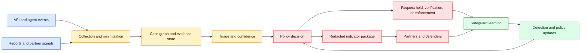
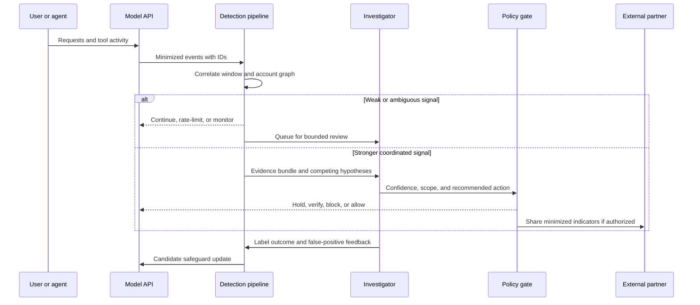

# Threat Intelligence for Agentic Misuse and Model Distillation
Status: emerging
Sources: [Anthropic — 2026-09-10](https://www.anthropic.com/threat-intelligence-report-september-2026)

## In one sentence

Threat intelligence for an AI provider is a privacy- and safety-sensitive data product that turns observed misuse signals into investigated cases, bounded enforcement, defensive indicators, safeguard improvements, and carefully shared evidence, while preserving uncertainty about prevalence, attribution, and the effect of the model on the operation.

## Background: what existed before

Traditional threat intelligence (TI) is the disciplined collection and interpretation of information about threats so that defenders can make better decisions. A security team may collect a suspicious domain, a file hash, an identity-provider event, or a sequence of unusual API calls; enrich it with internal and external context; decide how confident it is; and distribute a useful, time-bounded indicator to a detection system or trusted partner. The important word is *decision*. A list of bad-looking strings is not yet intelligence. It becomes intelligence when its provenance, confidence, relevance, expiry, and recommended defensive action are explicit.

AI services add a difficult observation point to that model. The provider can see requests, account relationships, tool calls, model responses, rate patterns, geography, payment events, and sometimes reports from customers or partners. It usually cannot see the victim's whole environment, the user's intent, what happened after an answer left the service, or whether an apparent campaign is a test, research, legitimate automation, or abuse. A provider therefore sees a narrow but valuable slice of a larger operation. Treating that slice as complete truth produces both false positives and false confidence.

Before agentic systems, a model API was often treated as a request/response boundary. A suspicious request could be filtered, refused, or sent to a review queue. An agentic workload changes the shape of evidence. An agent may decompose a goal into many calls, use tools, inspect results, retry after failure, maintain state, and hand work to another process. A single harmless-looking call can be part of a harmful sequence, while a legitimate automation job can look like a high-volume campaign. Detection must reason over sessions, account graphs, tool categories, timing, and changes in behavior rather than only classifying isolated prompts.

The other prerequisite is understanding model distillation. In legitimate distillation, a smaller student model learns from examples generated by a larger teacher model. The teacher's responses may be used as training data, which can make useful capability cheaper to deploy. Anthropic's September report uses *illicit distillation* for an industrial-scale, covert attempt to extract and replicate a model's capabilities without authorization. The report says such activity is often enabled by fraudulent accounts, stolen credentials, proxy services, or unauthorized resale of transcripts. That is a different security problem from ordinary model training: the service must protect access, customer data, and valuable capability while still serving legitimate users.

These two problems meet in the provider's telemetry. Agentic misuse creates sequences that can be investigated. Distillation creates repeated, coordinated extraction behavior that may be visible only when account, request, and organization relationships are joined. Neither problem is solved by one content classifier. The system needs state, evidence handling, human review, enforcement controls, partner communication, and a way to learn from each case without turning an allegation into a permanent fact.

## What changed and why now

Anthropic's September 10 report describes operations it says its Threat Intelligence team identified and disrupted over the preceding eight months. The report covers activity disrupted from December 2025 through August 2026 across seven harm areas: cyber operations, influence operations, surveillance, scams and fraud, biological misuse, conventional weapons development, and distillation. Anthropic says it disrupted the activity, strengthened safeguards using what it learned, and shared intelligence with authorities and industry partners where appropriate.

The report is a source-specific change in engineering practice because it presents provider-side misuse response as a feedback loop rather than a one-time moderation decision. The described loop is:

1. Observe activity through service telemetry, reports, and investigations.
2. Link signals into a case without assuming every signal is proof.
3. Classify the suspected behavior and estimate confidence.
4. Disrupt the account, organization, request path, or capability access in proportion to the evidence.
5. Extract indicators that are useful to defenders and safe to share.
6. Update safeguards, classifiers, and investigation methods.
7. Share appropriate findings with authorities, affected parties, industry partners, or the public.

This is not a claim that the report supplies a universal detection recipe. Anthropic explicitly says the cases are not typical misuse; they are the most notable and novel activity identified to date. That distinction matters. A report of several disrupted cases can demonstrate mechanisms and failure modes without estimating how common those behaviors are across all providers or users.

The report also changes the vocabulary used to discuss AI-enabled operations. It describes *uplift* as the capability boost associated with AI, considered through speed, scale, and depth. It reports that many cyber cases involved direct execution or orchestration through multi-agent frameworks, while humans remained involved in setting targets and reviewing exfiltration. This is useful operationally because “the model did the attack” is too coarse. A defender should ask which stages were automated, which decisions remained human, which tools were available, and which new tempo or breadth became possible.

For distillation, Anthropic distinguishes ordinary teacher–student training from unauthorized extraction. The report says that since an earlier February disclosure it identified and disrupted additional campaigns attributed with high confidence to seven China-based labs targeting generally available models. That is an attributed provider finding, not an independently adjudicated finding that should be generalized to every organization or country. The report describes account pools, proxy services, fraudulent identities, stolen credentials, purchased or rerouted transcripts, and attempts to harvest reasoning traces. It also reports one campaign that peaked at nearly three million exchanges per day from more than 3,500 fraudulent accounts and says more than 151 million exchanges were observed between May and July 2026. Those are Anthropic's measurements and definitions; they should be quoted with that attribution and not presented as an industry-wide prevalence estimate.

## Impact on current processing and architecture

The central architectural consequence is that misuse detection becomes a stateful, evidence-producing pipeline alongside the model-serving path. The serving path must remain low-latency and predictable; the investigation path can be asynchronous, richer, and more conservative. Mixing the two creates a dangerous trade-off: expensive investigation work can delay ordinary requests, while a fast enforcement decision can punish a legitimate account before evidence is reviewed.

### 1. Collect events with provenance

Useful events include request metadata, account and organization identifiers, authentication changes, payment anomalies, model and tool selection, session linkage, rate and concurrency changes, refusal or safeguard outcomes, customer reports, and enforcement history. The provider should minimize sensitive content in general-purpose metrics. Store a reference to a protected evidence object rather than copying prompts, tool results, or secrets into every dashboard.

Every event needs an event ID, observed-at timestamp, source, schema version, tenant boundary, and retention class. Clock skew and retries mean the event time and ingestion time are not interchangeable. Idempotency keys prevent a retried collector from inflating counts. A late event should be accepted with its original observation time and a clear ingestion time rather than silently rewriting history.

### 2. Build a case graph, not just a score

A case graph joins accounts, payment instruments, API keys, organizations, IP or proxy observations, sessions, models, tools, and behavior windows. Graph linkage can identify coordinated activity that a per-request classifier misses. It also creates a blast-radius risk: a mistaken shared identifier can connect unrelated customers. Graph edges therefore need evidence type, confidence, time bounds, and an explanation. “These accounts share a signal” is safer than “these accounts are the same actor” until attribution has passed review.

The investigation record should preserve competing hypotheses. For example, a burst of repeated requests may indicate distillation, a load test, a reseller, or a customer migration. A case state such as `observed`, `triage`, `investigating`, `contained`, `shared`, `closed`, or `reopened` makes uncertainty and reversibility visible. A state transition should record who or what caused it, the evidence version, the policy basis, and the next review time.

### 3. Separate detection from enforcement

Detection asks, “What pattern is present, and how confident are we?” Enforcement asks, “What action is authorized and proportionate now?” A classifier can route a case to review without blocking. A high-confidence account abuse decision might block a request or require identity verification. An organization-level action may be more effective than banning accounts individually when a coordinated proxy network is involved, but it can also affect legitimate customers if the organization link is wrong.

Anthropic describes metadata and irregular-activity signals, organization-level attribution, classifiers for adversarial extraction, request blocking, account bans, and identity verification when potential abuse signals are present. These are provider-reported controls. An engineering inference is that each control should have a distinct policy gate and rollback path. A model score should not directly mutate customer state without a policy decision, a reason code, and an appeal or review mechanism appropriate to the severity.

### 4. Make indicator sharing selective

Indicators of compromise (IOCs) are observable artifacts associated with malicious activity: domains, addresses, hashes, package identifiers, account patterns, or other defensive clues. An IOC feed needs context: what activity it relates to, when it was observed, confidence, whether it is operator-controlled or merely used by a victim, and what action a recipient should take. A stale domain can be reassigned; a shared cloud IP can host benign traffic; an email address may be personal data. Defenders should not block every artifact without type-specific validation.

The report publishes IOCs for some cases and says that platform-specific indicators or review-evasion details may be shared directly with affected platform partners. That is a useful disclosure boundary. Public sharing can help defenders quickly, while private sharing can reduce unnecessary exposure of sensitive identities, customer data, or evasion mechanics. A sharing policy should classify recipients, fields, legal basis, confidence, expiry, and notification obligations. “Shared” should mean a recorded transfer with provenance, not merely that an analyst pasted a value into a chat.

### 5. Treat safeguard learning as a controlled deployment

An investigation can produce a new classifier feature, a rate limit, a model behavior safeguard, a verification challenge, or a tool permission change. Each change needs a test set with benign neighbors, an offline replay, a canary or staged rollout, and monitoring for false positives and false negatives. A safeguard that blocks one campaign but prevents legitimate batch analytics can shift customers to unsafe workarounds. A safeguard that only catches known prompts will fail when an actor changes the wording or proxy path.

Distillation makes this feedback loop especially important because attackers can adapt to visible controls. Anthropic says it uses classifiers designed to detect adversarial extraction, blocks requests and bans associated accounts when confident, and added mechanisms intended to make stolen transcripts less useful. It also reports identity verification for some suspected abuse and says its safeguards continue to evolve. These statements describe Anthropic's implementation and intent; they do not prove that the controls prevent all extraction or that encrypted or summarized reasoning is unrecoverable.

## Real-world applications and constraints

### Hosted model APIs

A hosted API can correlate request patterns across sessions and accounts, but it must respect tenant isolation and privacy commitments. Store only the minimum content needed for a decision, encrypt sensitive evidence, restrict investigator access, and define retention before collecting more telemetry. Customer-visible audit records should distinguish a policy refusal, a temporary review hold, and an account enforcement action.

### Agent platforms with tools

For agents, log tool category and authorization outcome even when tool arguments are redacted. A sequence of repository reads, credential-store access, network requests, and bulk exports can be riskier than any single prompt. The safe design is capability-based: the agent receives only the tools and scopes needed for the task, with high-impact actions requiring explicit approval or a separate service principal. Threat intelligence should help improve those boundaries, not become permission to inspect customer data broadly.

### Model routers and resellers

The report's distillation discussion highlights a special boundary: an intermediary may route a user's request to another model, retain the exchange, or use it for training. A router should disclose model identity, retention, training use, and geography; preserve user consent; and avoid silently forwarding sensitive content. Providers need contractual and technical controls for reseller behavior, but cannot assume that banning one account disables a locally deployed or copied product. The report itself notes cases where account enforcement disrupted development or service access but not a product already deployed on-premises.

### Security operations centers

A SOC can consume provider-shared indicators, but should enrich them against its own logs before blocking. Use staged actions: alert, hunt, isolate a test asset, rotate credentials, or block a confirmed artifact. Avoid using public case details as a substitute for local evidence. The provider's observation of an agentic campaign can reveal a pattern, not whether the SOC's customer is affected.

### Constraints and cost

Graph joins, content review, retention, and model-assisted triage consume storage, analyst time, and compute. A practical system uses hot short-retention telemetry for streaming decisions and colder restricted evidence for investigations. Sampling can reduce cost but must not erase rare high-impact signals. Content inspection can increase privacy risk; metadata-only detection can miss a low-volume campaign. The right design is a measured combination, with explicit coverage gaps rather than a claim of complete visibility.

## Mental model

Think of provider threat intelligence as a closed-loop control system with an uncertainty ledger. Sensors observe partial signals; a case manager assembles evidence; a policy gate selects a reversible or irreversible action; a sharing service distributes a minimized finding; and a learning loop changes detection or safeguards. The loop should preserve the difference between “observed,” “suspected,” “attributed,” “enforced,” and “shared.”



The graph is intentionally split from the enforcement path. This makes provenance and review possible before a high-impact action, while still allowing an urgent temporary control when policy permits it.



This sequence shows why “classifier score equals ban” is an unsafe shortcut. The decision depends on scope, confidence, authorization, and the cost of a mistaken action.

## What changed this month

The September report makes provider-side, cross-case threat intelligence the lesson's concrete development. Anthropic reports seven harm areas in one observation window, describes agentic cyber activity that moved beyond question-and-answer use, publishes selected indicators, and explains a layered response to illicit distillation. It also describes the organization's internal designators for observed generative threat groups and its attempt to reason about AI uplift through speed, scale, and depth.

The most important change is architectural: misuse handling is described as a system that learns across incidents. Anthropic says each case informed safeguards and that relevant intelligence was shared where appropriate. For an engineer, the transferable concept is not a particular actor or a particular model. It is the data lifecycle from partial observation to bounded action and back into detection, with disclosure that preserves uncertainty.

The report's distillation section also makes model access a supply-chain concern. Fraudulent account networks, stolen API keys, proxy routing, purchased transcripts, and silent rerouting can connect customer privacy, identity, payments, model capability, and downstream training. That means API security and model safety cannot be operated as unrelated queues.

## Engineering consequence

Build a misuse intelligence service as a governed subsystem, not as an unreviewed prompt filter. Define an event schema, an evidence store, a case state machine, policy actions, indicator packaging, and a learning deployment path. Keep the serving API's availability and latency objectives separate from asynchronous investigation work.

For every automated decision, answer five questions: what was observed, how was it linked, how confident is the link, what action is authorized, and how can the action be reversed or appealed? For every shared indicator, answer four more: who can receive it, what minimum fields are needed, how long is it useful, and what harm could sharing cause?

Measure detection quality by workload slice. Track precision and recall where labels exist, time to triage, time to containment, false-positive appeals, repeated campaign detection, indicator usefulness reports, and safeguard regression rates. Do not optimize only for the number of bans or blocked requests. A high count can reflect an overbroad rule, while a low count can reflect missing visibility.

For distillation, add account and organization graph features, unusual volume and concurrency, proxy and payment risk, model/tool mix, repeated extraction-oriented behavior, and consent/retention signals from routing partners. Combine them with strong customer protection: scoped keys, rapid revocation, usage alerts, per-organization quotas, clear model identity, and no silent transcript reuse. These are engineering inferences from the described attack surface, not claims that any single control prevents illicit distillation.

Treat detection as a decision problem with an explicit base rate. If a suspicious pattern has prevalence P, detector recall TPR, and false-positive rate FPR, its positive predictive value is `PPV = (TPR × P) / ((TPR × P) + (FPR × (1 − P)))`. A detector can have high recall and still flood analysts when misuse is rare. Set thresholds against review capacity, containment harm, and appeal cost; report precision and recall by tenant, model, geography, and workload slice. For campaign linkage, also track graph precision: merging two unrelated customers into one campaign can cause disproportionate account or partner harm.

## Limits and failure modes

The report is provider-authored threat intelligence. Its cases are selected as notable and novel, so they cannot establish prevalence. The observation window ends before the publication date, and the report reflects Anthropic's visibility, definitions, telemetry, and investigative judgments. “High confidence” attribution is still an attributed assessment, not a court finding. Case-study descriptions show what was observed and reported, not everything an actor did or every actor using AI.

Detection can fail in both directions. A benign customer may generate high-volume, repetitive, multilingual, or automated traffic. Shared proxies, cloud networks, payment instruments, or enterprise administrators can make unrelated accounts look coordinated. Conversely, a low-volume actor can evade volume thresholds, distribute requests across accounts, or use an intermediary that hides the original user. An organization-level ban can reduce abuse efficiently but increase collateral damage if the link is wrong.

Content review has privacy and data-minimization risks. Investigator access to prompts, tool results, or transcripts can expose secrets and personal data. A copied IOC can become a new sensitive dataset. Apply role-based access, encryption, field-level redaction, retention limits, and audit logs. A hash or domain is not automatically harmless: it may identify a private service or a person's infrastructure.

State creates operational hazards. A delayed event can arrive after an account is cleared; an eventually consistent graph can miss a connection; an expired indicator can remain in a partner's blocklist; a classifier update can change historical decisions; and a retry can duplicate an enforcement action. Use idempotent transitions, immutable evidence references, versioned rules, expiry fields, and explicit reconciliation jobs. A fail-open decision preserves availability but can extend abuse; fail-closed can deny legitimate work. Choose per action and document the residual risk.

Distillation defenses also have a fundamental capability boundary. If a model's outputs are accessible, some information about its capabilities can be learned. Access controls, anomaly detection, response shaping, identity checks, and contract enforcement can raise the cost or detect patterns, but they do not prove that unauthorized replication is impossible. A locally deployed or already copied model may remain available after provider account enforcement. Similarly, a provider's safeguard may reduce harmful use of its hosted model without controlling downstream models trained from extracted data.

Finally, public disclosure can help defenders while informing adversaries about what is visible. Publish enough for recognition and defense, but avoid operational exploit recipes, private customer data, reusable credentials, or unnecessary evasion detail. The report's selective IOC approach and withholding of some identities and sensitive biological details illustrate a disclosure trade-off rather than a universal publication rule.

## Mini exercise (15–30 min)

Build a local indicator-redaction pipeline that accepts synthetic event records, removes secrets and raw content, groups related observations into a case, and emits a short-lived indicator package only after a confidence threshold. The exercise teaches the control boundary without contacting a model, scanning a network, or handling real threat infrastructure.

## Build it locally

1. **Prerequisites:** Use Python 3 and only the standard library. Understand dictionaries, regular expressions, lists, and assertions. The records below are fictional; do not replace them with live credentials, domains, addresses, or customer data.
2. **Run the baseline:** Save the fenced program as `ti_pipeline.py`, then run `python3 ti_pipeline.py`. It should print a minimized case and an expiring indicator package.
3. **Inspect the controls:** Notice that raw prompt text is discarded, API-key-like values are replaced, duplicate events are grouped by case, and low-confidence cases are not shared.
4. **Add a test:** Add a synthetic event from a different organization and assert that it cannot join the first case merely because it shares a cloud provider name.
5. **Extend the policy:** Add an `expires_at` field and reject sharing when the current time is beyond it. Then add an appeal state that changes `contained` to `review` without deleting evidence.
6. **Discuss production gaps:** Write down what would require a database, queue, access control, human review, partner contract, or legal/privacy review. The toy program is deterministic; it is not a production detector or an attribution engine.

```python
import re
from datetime import datetime, timedelta, timezone

API_KEY = re.compile(r"\bsk-[A-Za-z0-9_-]{8,}\b")


def minimize(text):
    """Remove secret-shaped values before evidence leaves the protected path."""
    return API_KEY.sub("[REDACTED_KEY]", text)[:120]


def build_case(events, now):
    """Group only synthetic events that explicitly share a case reference."""
    grouped = {}
    for event in events:
        case = grouped.setdefault(event["case_id"], {
            "case_id": event["case_id"],
            "orgs": set(),
            "signals": [],
            "confidence": 0.0,
        })
        case["orgs"].add(event["org"])
        case["signals"].append({
            "kind": event["kind"],
            "summary": minimize(event["summary"]),
            "observed_at": event["observed_at"],
        })
        case["confidence"] = max(case["confidence"], event["confidence"])

    case = next(iter(grouped.values()))
    if case["confidence"] < 0.80:
        return {"state": "review", "case_id": case["case_id"]}
    return {
        "state": "contained",
        "case_id": case["case_id"],
        "organizations": sorted(case["orgs"]),
        "signals": case["signals"],
        "share_until": (now + timedelta(hours=24)).isoformat(),
        "sharing": "minimized-defensive-indicator",
    }


now = datetime(2026, 9, 19, tzinfo=timezone.utc)
events = [
    {
        "case_id": "synthetic-001", "org": "demo-org",
        "kind": "coordinated-volume", "confidence": 0.86,
        "observed_at": "2026-09-19T10:00:00Z",
        "summary": "Repeated extraction-like requests used sk-DEMO_KEY_12345",
    },
    {
        "case_id": "synthetic-001", "org": "demo-org",
        "kind": "account-link", "confidence": 0.82,
        "observed_at": "2026-09-19T10:02:00Z",
        "summary": "Several synthetic accounts shared a payment signal",
    },
]

package = build_case(events, now)
assert package["state"] == "contained"
assert "sk-DEMO_KEY_12345" not in str(package)
assert package["organizations"] == ["demo-org"]
print(package)
```

The example deliberately uses a supplied case reference rather than pretending to infer attribution from a single signal. It demonstrates minimization, confidence gating, provenance-preserving summaries, and an expiry boundary. A real system would retain protected evidence separately, authorize every read, use durable state transitions, and require a policy decision before blocking an account or sharing an indicator. It would also test false positives with benign high-volume workloads and false negatives with distributed synthetic campaigns.

## Interview Q&A

**Q: Why is threat intelligence more than an abuse classifier?** A: A classifier labels an input or event. Threat intelligence links evidence to a decision: what happened, how confident the assessment is, what action is proportionate, what can be shared, and how the finding feeds future defenses.

**Q: Why does agentic misuse require session-level evidence?** A: An agent can distribute a goal across many calls and tools. An individual request may be benign while the sequence shows reconnaissance, repeated retries, data movement, or automated adaptation. Session and account context improve detection, but they also increase privacy and false-linkage risk.

**Q: Does a provider report prove that AI caused an operation?** A: No. The report can attribute observed use of a model to described workflows and assess uplift, but causal contribution, counterfactual human capability, and total impact require careful methodology. State exactly what was observed and what is inferred.

**Q: What is illicit distillation?** A: In this lesson's source-specific definition, it is an industrial-scale, covert attempt to extract and replicate a model's capabilities without authorization. It differs from legitimate distillation because authorization, access method, and intended training use are central to the security judgment.

**Q: Why separate detection from enforcement?** A: Detection expresses evidence and confidence; enforcement changes customer state or access. Separating them allows proportional policy, human review, rollback, appeals, and different thresholds for monitoring, verification, temporary holds, and bans.

**Q: Should every shared IOC be blocked?** A: No. Validate type, freshness, confidence, and local context. A shared address, cloud host, or domain can be reused or shared by benign parties. An IOC should include provenance and an expiry or review date.

**Q: What measurements matter?** A: Track precision/recall where labels exist, triage and containment time, false-positive appeals, repeated campaign detection, indicator usefulness, safeguard regressions, latency impact, and analyst workload. Ban counts alone reward overblocking and do not measure defensive value.

**Q: What can account enforcement not solve?** A: It may stop access to a hosted service but not a locally deployed product, previously copied capability, or a different provider filling another role. Defense needs layered access control, customer protection, partner coordination, and downstream monitoring.

## Glossary

- **Agentic misuse:** Harmful use in which a model participates in a multi-step workflow, tool execution, orchestration, or persistent task rather than only producing a one-off answer.
- **Case graph:** A time-bounded graph connecting accounts, sessions, organizations, tools, credentials, and observations with evidence and confidence on each relationship.
- **Distillation:** Training a student model from examples produced by a larger teacher model.
- **Indicator of compromise (IOC):** An observable artifact or pattern that may help identify related malicious activity.
- **Illicit distillation:** The source's term for covert, industrial-scale unauthorized extraction and replication of model capabilities.
- **Uplift:** The source's framing for the capability boost from AI, considered through speed, scale, and depth.
- **Provenance:** Information about where an event or claim came from, when it was observed, how it was transformed, and who is allowed to rely on it.
- **False positive:** A benign event incorrectly treated as suspicious or malicious.
- **False negative:** Malicious activity that a detector fails to identify.
- **Safeguard:** A technical or procedural control intended to reduce harmful model use or limit access; it is not proof of prevention.

## References

- [Anthropic — Detecting and countering misuse of AI: September 2026 — 2026-09-10](https://www.anthropic.com/threat-intelligence-report-september-2026)
- [Anthropic — Downloadable indicators of compromise and report materials](https://www.anthropic.com/threat-intelligence-report-september-2026)

## Claim ledger

| Claim | Source | Fact or inference |
|---|---|---|
| Anthropic says its Threat Intelligence team identified and disrupted misuse operations over the prior eight months and covers activity disrupted from December 2025 through August 2026. | [Anthropic — September 2026 report](https://www.anthropic.com/threat-intelligence-report-september-2026) | Fact, provider report |
| The report covers seven harm areas and says Claude Haiku, Sonnet, and Opus were used in the described misuse cases, with an exception concerning one illicit-distillation case. | [Anthropic — September 2026 report](https://www.anthropic.com/threat-intelligence-report-september-2026) | Fact, provider report |
| Anthropic says the published cases are notable and novel examples rather than typical misuse. | [Anthropic — September 2026 report](https://www.anthropic.com/threat-intelligence-report-september-2026) | Fact, provider statement |
| Anthropic defines uplift in terms of the AI capability boost and discusses speed, scale, and depth. | [Anthropic — September 2026 report](https://www.anthropic.com/threat-intelligence-report-september-2026) | Fact, provider definition |
| Anthropic reports that many cyber operations involved direct execution or orchestration through multi-agent frameworks while humans set targets and reviewed exfiltration. | [Anthropic — September 2026 report](https://www.anthropic.com/threat-intelligence-report-september-2026) | Fact, provider observation |
| Anthropic defines illicit distillation as a covert, industrial-scale attempt to extract and replicate capabilities without authorization and distinguishes it from legitimate teacher–student distillation. | [Anthropic — September 2026 report](https://www.anthropic.com/threat-intelligence-report-september-2026) | Fact, provider definition |
| Anthropic reports additional distillation campaigns attributed with high confidence to seven China-based labs targeting generally available models. | [Anthropic — September 2026 report](https://www.anthropic.com/threat-intelligence-report-september-2026) | Fact, provider attribution; not independent adjudication |
| Anthropic reports a campaign peak of nearly three million exchanges per day from more than 3,500 fraudulent accounts and more than 151 million observed exchanges between May and July 2026. | [Anthropic — September 2026 report](https://www.anthropic.com/threat-intelligence-report-september-2026) | Vendor measurement; not an industry prevalence estimate |
| Anthropic describes metadata and irregular-activity signals, organization-level attribution, extraction classifiers, blocking, bans, identity verification, and safeguard updates as parts of its response. | [Anthropic — September 2026 report](https://www.anthropic.com/threat-intelligence-report-september-2026) | Fact, provider description |
| A misuse intelligence system should separate evidence collection, triage, policy enforcement, indicator sharing, and safeguard deployment. | Anthropic report's described lifecycle plus standard security engineering | Inference |
| Case graphs should attach confidence and time bounds to relationships to limit false linkage and stale attribution. | Standard security engineering applied to the report's account and organization observations | Inference |
| Provider-side account enforcement cannot guarantee removal of a capability already deployed locally or copied into another system. | Anthropic report's discussion of on-premises deployment and account enforcement limits | Inference grounded in source |
| IOC sharing should be minimized, contextualized, access-controlled, and time-bounded because artifacts can be stale, shared, or sensitive. | Standard threat-intelligence and privacy engineering | Inference |
| The runnable example demonstrates a safe control boundary; it is not a production detector, attribution engine, or security assessment. | This lesson's implementation | Fact about the example |
