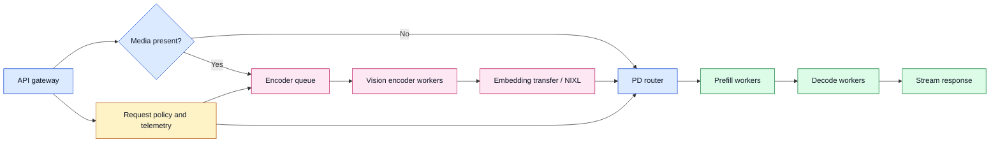
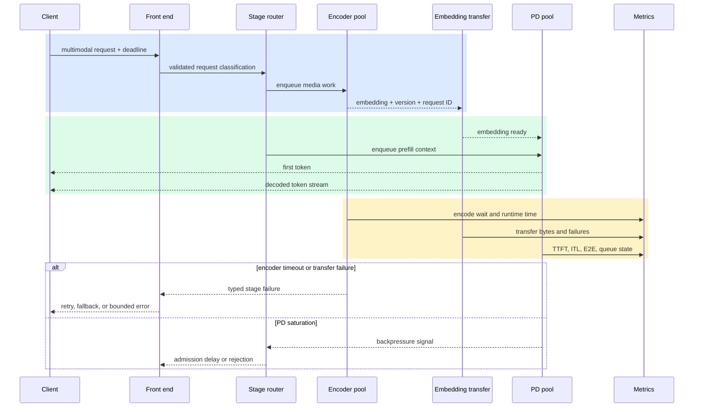

# Encode–prefill–decode disaggregation
Status: emerging
Sources: [NVIDIA — 2026-09-09, engineering post](https://developer.nvidia.com/blog/when-to-use-encode-prefill-decode-disaggregation-to-accelerate-multimodal-model-serving/)

## In one sentence

Encode–prefill–decode (EPD) disaggregation gives multimodal serving separate queues and scaling decisions for vision encoding, language-model prefill, and token-by-token decode so media-heavy traffic does not make every request wait in one scheduling domain.

## Prerequisites

This lesson assumes a basic understanding of an API request, a GPU worker, a queue, and latency percentiles. It also helps to know three inference terms. **Prefill** processes the prompt context in parallel and prepares the model’s attention state. **Decode** generates output tokens one at a time, usually reusing a key-value (KV) cache containing attention state from earlier tokens. **Time to first token (TTFT)** is the interval from request acceptance until the first generated token is available. **End-to-end (E2E) latency** includes the whole response, while **goodput** is useful completed capacity under a stated service-level objective (SLO), rather than raw throughput without a latency constraint.

A multimodal request adds another stage before language-model prefill. Images or video must be downloaded or decoded, passed through a vision transformer (ViT), and projected into embeddings that the language model can consume. An embedding is a numeric representation used as model input; it is not a natural-language caption and cannot simply be replaced by the original image after the transfer. EPD is a serving architecture for moving that work across explicit boundaries. It is not a new model-training method, a guarantee that every multimodal request becomes faster, or a substitute for measuring the front end, network, scheduler, and decoder.

## Background: what existed before

The historical baseline is aggregated serving. One worker receives a request, preprocesses its media, runs the vision encoder, performs language-model prefill, and decodes the answer. Its appeal is straightforward ownership: one scheduler sees the entire request lifecycle, and there is no inter-worker embedding transfer. For light media traffic, the simplicity can outweigh the benefit of another queue and another service boundary.

The problem appears when unlike work shares one scheduling domain. Vision encoding is front-loaded and can take substantially longer when a request contains many images, high-resolution inputs, or video. Prefill is also a burst of compute over the input context. Decode is a long-lived stream of smaller steps whose duration depends heavily on output length and concurrency. These phases consume different amounts of compute and memory at different times, but an aggregated worker has to coordinate them together.

That coupling creates two kinds of contention. First, a multimodal request can delay its own prefill because its media has not finished encoding. Second, a text-only request can wait behind vision work even though it has no media to encode. This is head-of-line blocking: an earlier or already admitted item prevents later work from progressing, even when the later item does not need the blocked resource. A single queue may be easy to operate, but it can make the latency of a small text request depend on the image count of a neighboring request.

Traditional inference optimizations still matter in this baseline. Batching can improve accelerator utilization, KV caching can avoid repeated attention work, and quantization can reduce model memory and compute. They do not automatically remove the modality boundary. A batch scheduler that combines text and image requests still needs a policy for the image encoder’s work. If it waits for the encoder in the same worker before prefill, the text requests remain coupled to media processing.

The engineering question is therefore not “is a multimodal model fast?” It is “which phase is limiting the service objective for this request distribution, and can a boundary improve that phase without making transfer and coordination more expensive?” That question is the useful baseline for reading the September NVIDIA post.

## What changed and why now

NVIDIA’s September 9, 2026 engineering post describes NVIDIA Dynamo implementing EPD disaggregation for multimodal inference. In the described design, encoder workers produce vision embeddings and prefill/decode (PD) workers consume those embeddings. The roles can be independently batched, scheduled, and scaled. A transfer path based on the NVIDIA Inference Transfer Library (NIXL) carries embeddings between the stages when the encoder is on a separate tier.

The change is architectural rather than merely a faster kernel. The system introduces a typed stage boundary:

1. The front end receives the request and handles request-level policy and media preparation according to the deployment.
2. An encoder worker handles vision computation for multimodal inputs.
3. A transfer mechanism makes the resulting embedding available to a selected PD worker.
4. The PD worker runs language-model prefill and then streams decode tokens.
5. Text-only traffic can enter the PD path without waiting for an encoder result.

The post compares three placements. In **aggregated** serving, one worker manages encoding, prefill, and decode. In **colocated EPD**, encoder workers and a PD worker share each GPU but retain separate queues and batching. In **disaggregated EPD**, encoder workers use a separate, potentially lower-cost GPU tier and transfer embeddings to a higher-end PD tier. These are topology choices, not a ranking that is always valid. NVIDIA states that colocated placement is generally a better fit on homogeneous hardware because dedicating an entire same-class GPU to a relatively light encoder can underutilize it. A separate encoder tier becomes more attractive when hardware is heterogeneous and the lower tier matches encoder demand.

The why-now condition is workload imbalance. If the vision encoder accounts for a meaningful share of processing time, independent encoder capacity can prevent it from limiting TTFT or goodput. If a large dense language model or a very long output dominates the request, EPD may add transfer and scheduling overhead without reducing the dominant work. The architecture is valuable when it follows the actual phase balance rather than when it is adopted as a fashionable serving pattern.

## Impact on current processing and architecture

The component flow below shows the new state carried across the boundary. The request metadata must identify whether an embedding is required, which model and preprocessing versions produced it, and where the PD worker can retrieve it. The embedding is an intermediate artifact with lifecycle, size, and failure semantics; it should not be treated as an invisible implementation detail.



The split changes admission control. Aggregated serving can reserve one worker for the full request. EPD must reserve encoder capacity, transfer capacity, and PD capacity, possibly at different times. A request admitted to the encoder pool but unable to obtain a PD slot needs a bounded state rather than an untracked orphan. Conversely, a text request should not be sent to the encoder queue at all. The router needs a clear media/no-media classification and a correlation identifier that follows the request across queues.

The split also changes backpressure. A full encoder queue should not necessarily stop text-only prefill. A full PD queue should cause the front end to delay or reject new multimodal work even if encoder GPUs are idle; otherwise embeddings accumulate and consume memory without improving completed requests. That policy is an engineering inference from the staged architecture: independent capacity is useful only when queue admission respects the next stage’s ability to drain work.

Embedding transfer is a real cost. The system sends an intermediate representation rather than only a small request descriptor. The transfer path adds serialization or memory-registration work, network latency, retries, and a possible version mismatch. The receiver must know the model, vision encoder, preprocessing, data type, shape, and request identity associated with the embedding. If a worker reloads or the request expires, the embedding may be unusable. Retention should be short and scoped to the request unless an explicitly governed embedding cache is intended.

Scheduling policies can now specialize. Encoder workers can batch image-heavy requests; PD workers can optimize prefill and decode for their own memory pressure; and a heterogeneous deployment can place each role on hardware suited to its intensity. But separate policies can also disagree about priorities. A high-priority user request admitted to a low-priority encoder queue still arrives late at the PD tier. Propagate deadline or service class metadata across the boundary, and measure queue wait by stage rather than only reporting total latency.

Mixed modality traffic is where isolation has a particularly concrete effect. In an aggregated batch, text-only requests may wait while a multimodal item performs media processing and vision encoding. In EPD, the text request can proceed to prefill while the image request is in the encoder pool. This does not make the image request’s encoding free; it changes who waits for whom. The scheduler should report text and multimodal TTFT separately because an improvement in one class can coexist with a regression in another.



The sequence makes failure ownership explicit. A timeout before encoding is not the same as a decode timeout after a first token. The API can choose a policy for each: retry an idempotent encode, route to an aggregated fallback, ask the user to reduce media, or return a typed overload error. Blindly retrying both stages can duplicate expensive work and amplify a saturated queue. If an embedding is already complete and its metadata matches, a bounded retry may reuse it; if its provenance is uncertain, recompute or fail closed according to the product’s data and correctness requirements.

Observability must preserve stage boundaries. Record request class, media count or visual-token budget, encoder queue wait, encoder runtime, embedding size, transfer time, PD queue wait, prefill time, time to first token, inter-token latency (ITL), decode duration, output length, and final status. Avoid logging raw media or embeddings by default. Correlate spans with a request ID, model digest, encoder version, and PD version. The same request can have a low TTFT but poor E2E latency if decode is long; it can have good raw throughput but fail the ITL SLO under contention.

## Real-world applications and constraints

A document assistant receiving pages as images is a natural candidate. Many pages create substantial visual work before the answer can start, while users may ask short questions. An encoder pool can process pages independently and allow the language tier to remain focused on context and generation. The system still needs page ordering, duplicate-page handling, maximum image dimensions, and a policy for partial results when one page fails.

Video question answering has a different profile. Sampling frames creates a media-token budget and can make encoding dominate TTFT. However, download and pixel decoding may precede the ViT. NVIDIA explicitly notes that EPD does not optimize all pre-ViT work; its post reports a separate parallel media-decoding lever. A team should therefore instrument download, decode, encode, transfer, prefill, and decode before claiming that an EPD rollout addresses the bottleneck.

An enterprise assistant may mix text-only chat, screenshots, and scanned forms on one endpoint. Isolation can protect text TTFT from image-heavy neighbors. The product should define fairness: a text request should not starve the encoder, and a large image bundle should not monopolize PD memory. Separate quotas by tenant and modality can prevent a single batch upload from changing everyone’s tail latency.

Heterogeneous clusters create a capacity-planning opportunity. NVIDIA describes an experiment with RTX 6000D GPUs for encoder workers and GB200 GPUs for PD workers. That configuration is a source-specific test setup, not a universal hardware recommendation. Inference from the topology: if encoder arithmetic and memory needs are lower than PD needs, a lower-cost tier may add useful media capacity without consuming scarce PD accelerators. The decision must include transfer bandwidth, failure domains, utilization, power, and operational complexity.

Safety and privacy remain application constraints. Embeddings can carry information derived from an image, and a transfer link expands the path that must be authorized and encrypted. Apply tenant isolation, request-scoped access control, expiry, and deletion rules to embeddings. Do not infer that an embedding is harmless because it is not human-readable. Do not let a stage boundary bypass the API’s media permissions or retention policy.

## Mental model

Think of EPD as a three-station production line with a conveyor between the first and second stations. The encoder turns media into a model-ready intermediate product; prefill loads the request context; decode serves the output stream. The line improves when one station is the bottleneck and can be scaled or scheduled independently. It gets worse when the conveyor is slow, the intermediate product is large, or the downstream station—usually decode—is already the dominant constraint.

The most important mental distinction is TTFT versus E2E. EPD can shorten the path to the first token by keeping encoding from blocking prefill. It may not shorten generation of a long answer. A system owner who optimizes only TTFT can ship an architecture that feels responsive for the first token but costs more and completes no sooner. Track goodput at an SLO that represents the user’s actual experience.

## What changed this month

NVIDIA’s September post makes EPD a concrete Dynamo serving option and presents a decision framework for choosing aggregated, colocated, or separate encoder placement. The post reports that its gains are strongest for media-heavy prompts, short-to-medium outputs, smaller or quantized language models, and mixed text/multimodal traffic. It also reports that gains shrink when decode dominates or when the model is large and dense enough that vision work is a small share of the total.

The reported benchmark configuration used Qwen3.5 122B A10B NVFP4, four GB200 GPUs, and additional RTX 6000D GPUs for the disaggregated encoder setup. NVIDIA reports NIXL over UCX reliable-connected/TCP Ethernet for embedding transfer with a measured peak of 20 Gbps in that environment, and an ITL-under-100-ms goodput SLO. Those are experiment details, not portable service guarantees.

For one image-heavy test with ten images per request and output sequence length 1,024, NVIDIA reports TTFT reductions of 58% for colocated EPD and 50% for heterogeneous EPD, while describing a 70% increase in traffic served at the same latency SLO for the heterogeneous tier. The post also reports that, as output length rose from 128 to 2,048 with five images fixed, the heterogeneous EPD E2E advantage narrowed from 20.3% to 5.2%. These measurements illustrate the mechanism: encoding isolation helps the front of the request, while longer decode leaves less total-latency share for EPD to improve.

Under sustained 50:50 text and image traffic at output sequence length 128, NVIDIA reports mean text TTFT falling from 92.3 ms to 53.3 ms and image TTFT from 289.9 ms to 200.6 ms for its compared aggregated and colocated setup. Again, this is a vendor-reported result under the stated workload and hardware. It supports the head-of-line-blocking hypothesis; it does not establish that every mixed workload receives the same percentages.

## Engineering consequence

Adopt EPD only after building a phase budget. For a representative request slice, measure media download, media decode, vision encoding, embedding transfer, prefill, decode, and queue time. Then ask whether the intended SLO is TTFT, ITL, E2E completion, or goodput under a stated SLO. A 40% TTFT improvement may be valuable for interactive chat and nearly irrelevant to a batch job whose users wait for the final answer.

Use a topology decision table:

| Observed condition | Initial topology to test | Reason and warning |
|---|---|---|
| Light media, long outputs, homogeneous hardware | Aggregated | Avoid a boundary whose transfer cost does not address the dominant decode work. |
| Heavy media, homogeneous hardware | Colocated EPD | Separate queues without dedicating an entire GPU tier to a lighter encoder. |
| Heavy media, heterogeneous hardware | Disaggregated EPD | Test a lower-cost encoder tier, including network and failure-domain costs. |
| Mixed text and image traffic | Colocated or disaggregated EPD | Measure text TTFT and multimodal TTFT separately for head-of-line blocking. |
| Repeated identical media | EPD plus governed embedding cache | Cache may remove repeated encoding, but needs version, tenant, expiry, and invalidation keys. |

The table is a test plan, not a rule. Run matched workloads with the same model, prompt, media, output cap, concurrency, and SLO. Include bursts, cancellations, encoder failure, transfer failure, PD saturation, and a cold start. Compare cost per completed request, not only accelerator utilization. Keep an aggregated fallback if it is operationally viable, and make the fallback’s queue behavior visible rather than silently changing the experiment.

Use a phase-level break-even model before adopting the split. Let `T_agg = T_encode + T_prefill + T_decode` for an aggregated worker and `T_epd = max(T_encode_queue, T_prefill_queue) + T_transfer + T_decode` for the disaggregated path. The split helps only if queueing and overlap savings exceed transfer, serialization, routing, and failure-recovery overhead. For cost, compare `C_req = GPU_seconds × price_per_GPU_second + network_bytes × price_per_byte + retry_cost`; a higher utilization percentage can still lose if retries and cross-tier transfers increase.

## Limits and failure modes

**Transfer overhead can erase the gain.** Small media loads or a slow interconnect may make embedding movement longer than the saved scheduling time. Measure bytes, serialization, network wait, and receiver readiness.

**Decode dominance limits E2E improvement.** Long outputs still require many decode steps. EPD can improve TTFT while leaving completion latency nearly unchanged or, under colocated contention, making it worse.

**Queue imbalance creates staged overload.** An idle encoder does not help when PD is saturated, and a fast PD tier cannot consume embeddings from a full encoder queue. Apply admission control at the front and expose per-stage queue depth.

**Embedding mismatch causes correctness failures.** A stale or incompatible embedding can be paired with the wrong model, preprocessing version, tenant, or request. Bind metadata, validate it at the receiver, expire artifacts, and reject ambiguity.

**Retries amplify work.** Retrying after an uncertain transfer can duplicate encoding and worsen congestion. Use request IDs, bounded retries, idempotent handoff, and explicit timeout ownership.

**Hardware assumptions do not travel.** The reported GB200/RTX topology and benchmark numbers describe NVIDIA’s setup. A homogeneous cluster may favor colocation; a different interconnect, model, or runtime can reverse the result.

**Front-end work remains.** Download and media decoding may dominate before the vision transformer begins. EPD cannot fix a slow object store, oversized image, or bad preprocessing pipeline by itself.

**Fairness can regress.** Independent queues can create priority inversion or starve one modality. Propagate service class, enforce tenant quotas, and report class-specific p95/p99 latency.

**Privacy boundaries expand.** Transferred embeddings and stage telemetry can expose derived media information. Encrypt links, restrict access, minimize retention, and make deletion cover intermediate artifacts.

## Build it locally

The following dependency-free example models a small staged scheduler. It does not implement a neural network or claim to predict GPU latency. It makes the queue-topology idea executable: text requests skip encoding, multimodal requests consume encoder capacity before PD capacity, and the scheduler reports when a downstream queue prevents admission. It is safe because it uses synthetic work and no network, files, credentials, or model weights.

```python
from dataclasses import dataclass
from collections import deque


@dataclass(frozen=True)
class Request:
    name: str
    multimodal: bool
    encode_ms: int
    prefill_ms: int
    decode_ms: int


class EpdSimulator:
    def __init__(self, encoder_slots=1, pd_slots=1):
        self.encoder_slots = encoder_slots
        self.pd_slots = pd_slots
        self.encoder = deque()
        self.pd = deque()
        self.pd_reserved = 0

    def _assert_pd_capacity(self):
        assert len(self.pd) + self.pd_reserved <= self.pd_slots

    def admit(self, request):
        if request.multimodal:
            if len(self.encoder) >= self.encoder_slots:
                return "backpressure: encoder queue"
            if len(self.pd) + self.pd_reserved >= self.pd_slots:
                return "backpressure: PD queue"
            self.encoder.append(request)
            # Reserve the downstream slot before doing encoder work.  This
            # prevents an encoded request from overflowing the PD queue.
            self.pd_reserved += 1
            self._assert_pd_capacity()
            return "queued: encoder -> PD"
        if len(self.pd) + self.pd_reserved >= self.pd_slots:
            return "backpressure: PD queue"
        self.pd.append(request)
        self._assert_pd_capacity()
        return "queued: PD"

    def finish_encode(self):
        if not self.encoder:
            return None
        request = self.encoder.popleft()
        assert self.pd_reserved > 0
        self.pd_reserved -= 1
        self.pd.append(request)
        self._assert_pd_capacity()
        return request.name

    def finish_pd(self):
        if not self.pd:
            return None
        request = self.pd.popleft()
        self._assert_pd_capacity()
        total = request.prefill_ms + request.decode_ms
        if request.multimodal:
            total += request.encode_ms
        return request.name, total


sim = EpdSimulator(encoder_slots=1, pd_slots=2)
requests = [
    Request("text-1", False, 0, 4, 8),
    Request("images-1", True, 20, 4, 8),
    Request("text-2", False, 0, 4, 8),
]
for request in requests:
    print(request.name, sim.admit(request))
print("completed", sim.finish_pd())
print("admit after drain", sim.admit(requests[-1]))
print("encoded", sim.finish_encode())
assert len(sim.pd) + sim.pd_reserved <= sim.pd_slots
assert sim.pd and {request.name for request in sim.pd} == {"text-2", "images-1"}
print("remaining stage", [request.name for request in sim.pd])
```

The output demonstrates the key separation: `text-1` can enter PD directly; `images-1` reserves downstream capacity before encoding; and the first attempt to admit `text-2` receives backpressure until `text-1` drains. After that drain, `text-2` can be admitted, and the encoded multimodal request uses its reservation during handoff. The assertions verify that the PD queue plus outstanding reservations never exceeds `pd_slots` and that encoding does not imply completion.

## Numbered local implementation steps

1. Save the code as `epd_scheduler.py` and run `python3 epd_scheduler.py`.
2. Add a `request_id` and preserve it when `finish_encode()` moves a request into the PD queue.
3. Add `arrival_ms` and record separate encoder wait, PD wait, and service time.
4. Change `pd_slots` to one and observe how a queued text request creates PD backpressure even when the encoder is idle.
5. Add a `deadline_ms` field and reject a request whose estimated encode-plus-PD work cannot meet the deadline.
6. Add a synthetic transfer cost after encoding; compare a colocated mode with zero transfer cost and a disaggregated mode with a nonzero cost.
7. Add a `model_version` field and assert that the encoder and PD versions match before handoff.
8. Generate two traffic mixes—mostly text and mostly images—and report separate average completion times by modality.
9. Add a bounded retry counter for a failed handoff; assert that retries stop instead of growing the queue forever.
10. Turn the printed results into a small decision record: workload, capacities, stage timings, rejected requests, and the SLO used to judge the topology.

## Mini exercise (15–30 min)

Extend the simulator with a `transfer_ms` value and two modes: aggregated, where the request runs all stages in one queue, and EPD, where multimodal work passes through encoder and PD queues. Generate a fixed mix of text requests and image requests with short and long outputs. Compare TTFT (encode plus prefill for image requests, prefill for text) with E2E completion time. Then increase decode time while keeping media work constant. Explain why EPD can continue helping TTFT while its E2E advantage shrinks. Add one overload test where the PD queue is full and state which requests are rejected and why.

## Interview Q&A

**1. What problem does EPD disaggregation solve?**

It separates vision encoding from language-model prefill and decode so the stages can have different queues, batching, placement, and scaling. The main target is contention when media-heavy requests delay themselves or text-only requests. It does not automatically accelerate decode.

**2. Why can text-only TTFT improve even though the text request has no image?**

In aggregated serving, the text request can share a scheduling domain with vision work and wait behind media preprocessing or encoding. With EPD, the text request can enter prefill without waiting for an encoder result, reducing head-of-line blocking. This is a scheduling effect, not a claim that text computation became cheaper.

**3. When is a separate encoder GPU tier attractive?**

When the cluster is heterogeneous and a lower-cost tier can handle the encoder while higher-end accelerators remain focused on PD. The decision must include embedding-transfer latency and bandwidth, utilization, failure domains, and operations. On homogeneous hardware, colocating encoder workers with PD workers may use capacity better.

**4. Why can EPD improve TTFT but not E2E latency?**

TTFT ends at the first token, so removing encoder-induced waiting can improve it. E2E latency also includes every decode step. Long output sequences make decode a larger share of total time, leaving less for encoder isolation to improve.

**5. Which metrics should an operator inspect?**

At minimum: encoder queue wait and runtime, embedding size and transfer time, PD queue wait, TTFT, ITL, E2E latency, output length, goodput under an explicit SLO, error and retry rates, and utilization by stage. Break metrics down by text versus multimodal traffic and by media load.

**6. What is a dangerous retry design at the stage boundary?**

Blindly retrying the entire request after an uncertain handoff can repeat expensive encoding and increase load during an outage. Use request identity, bounded retries, metadata validation, and a deliberate choice between reusing a verified embedding, recomputing it, falling back, or returning an error.

## Glossary

- **Aggregated serving:** One worker and scheduling domain performs encoding, prefill, and decode.
- **Decode:** Autoregressive generation of output tokens after context processing.
- **Embedding:** A numeric representation passed from one model stage to another.
- **Encode:** Vision-model processing that converts image or video input into embeddings.
- **EPD:** Encode–prefill–decode disaggregation; separate service roles and queues for those stages.
- **E2E latency:** Time from accepted request until the complete response is available.
- **Goodput:** Completed useful work that satisfies a stated latency or quality SLO.
- **Head-of-line blocking:** A queueing effect where one item delays later items that do not require the same work.
- **ITL:** Inter-token latency, the time between generated output tokens.
- **KV cache:** Stored attention state reused during generation to avoid recomputing prior context.
- **NIXL:** NVIDIA Inference Transfer Library, cited by the source as a mechanism for transferring embeddings between workers.
- **PD worker:** A worker responsible for language-model prefill and decode.
- **Prefill:** Parallel processing of the input context before generation begins.
- **TTFT:** Time to first token.
- **ViT:** Vision transformer, a neural network architecture used to encode visual inputs.

## References

1. NVIDIA, “When to Use Encode-Prefill-Decode Disaggregation to Accelerate Multimodal Model Serving,” 2026-09-09. [https://developer.nvidia.com/blog/when-to-use-encode-prefill-decode-disaggregation-to-accelerate-multimodal-model-serving/](https://developer.nvidia.com/blog/when-to-use-encode-prefill-decode-disaggregation-to-accelerate-multimodal-model-serving/). Primary engineering source for the topologies, workload factors, benchmark configuration, and reported measurements.
2. NVIDIA Dynamo, source repository linked by the primary post. [https://github.com/ai-dynamo/dynamo](https://github.com/ai-dynamo/dynamo). Engineering basis for the serving framework named by the source; consult the version used by a reproduction rather than assuming the post’s behavior applies to every release.
3. NVIDIA Inference Transfer Library, linked by the primary post. [https://github.com/NVIDIA/nixl](https://github.com/NVIDIA/nixl). Engineering basis for the inter-worker transfer boundary; deployment details and compatibility remain environment-specific.

## Claim ledger

| Claim | Source | Fact or inference |
|---|---|---|
| NVIDIA’s post is dated September 9, 2026 and describes EPD in Dynamo. | [NVIDIA primary post](https://developer.nvidia.com/blog/when-to-use-encode-prefill-decode-disaggregation-to-accelerate-multimodal-model-serving/) | Source fact |
| Aggregated serving puts vision encoding, prefill, and decode in one worker/scheduling domain. | NVIDIA primary post, “Why is EPD disaggregation important?” | Source fact / architecture description |
| Colocated EPD keeps encoder and PD roles separate while sharing GPU compute. | NVIDIA primary post, “Three encode placement topologies” | Source fact |
| Disaggregated EPD can use a separate lower-cost GPU tier and transfer embeddings to PD workers through NIXL. | NVIDIA primary post, topology discussion | Source fact |
| EPD is most useful when visual load is high, outputs are short to medium, models are smaller or quantized, or text and image traffic are mixed. | NVIDIA primary post, factors and selection sections | Source claim; workload conclusion |
| EPD can hurt when decode dominates or transfer overhead is not recovered. | NVIDIA primary post, output-length and model-size experiments | Source claim; mechanism is explained as an engineering inference |
| NVIDIA reports 58% and 50% TTFT reductions for colocated and heterogeneous EPD in its ten-image test. | NVIDIA primary post, image-heavy workload example | Vendor measurement; not a universal guarantee |
| NVIDIA reports a 70% same-SLO traffic increase for its heterogeneous setup in that test. | NVIDIA primary post, image-heavy workload example | Vendor measurement; configuration-specific |
| NVIDIA reports the heterogeneous E2E advantage narrowing from 20.3% to 5.2% as output length grows in one experiment. | NVIDIA primary post, output-sequence-length experiment | Vendor measurement; configuration-specific |
| NVIDIA reports mixed-traffic mean TTFT reductions of 42.2% for text and 30.8% for image requests in its compared setup. | NVIDIA primary post, mixed-modality section | Vendor measurement; configuration-specific |
| Separate queues require stage-aware admission and backpressure to avoid unbounded intermediate work. | Queueing behavior implied by the staged architecture | Engineering inference |
| Embedding metadata should bind model, preprocessing, version, request, and tenant context. | Correctness and authorization requirements at an inter-worker boundary | Engineering inference |
| A staged retry should be bounded and idempotent rather than blindly repeating the full request. | Failure amplification risk from retries across queues | Engineering inference |
| Embeddings should receive retention, access, encryption, and deletion controls. | Derived-data privacy and transfer-boundary requirements | Engineering inference |
