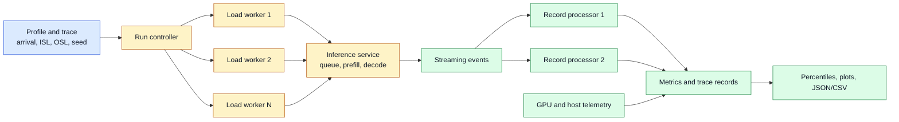
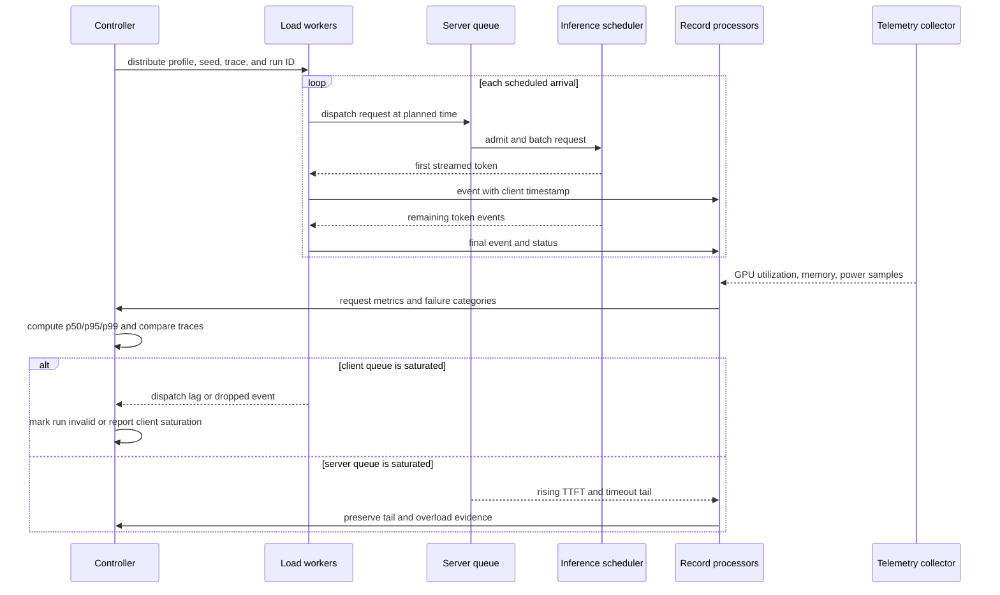

# Multiprocess, Trace-Shaped LLM Benchmarking
Status: emerging
Sources: [NVIDIA Technical Blog — 2026-09-18](https://developer.nvidia.com/blog/benchmarking-llm-inference-at-scale-with-aiperf/)

## In one sentence

Trace-shaped LLM benchmarking measures an inference service with a load generator whose processes, arrival times, request lengths, streaming events, and telemetry are designed to resemble production traffic without becoming the bottleneck being measured.

## Background: what existed before

An inference benchmark is a controlled workload sent to a model-serving system so an engineer can measure latency, throughput, capacity, or cost. For a large language model (LLM), the workload is more complicated than a traditional request/response benchmark because a request has an input prompt, a generated output, streaming token events, queueing, batching, and sometimes tool or retrieval steps. A useful benchmark must therefore measure both the whole request and the phases that users experience.

The historical baseline was often a shell loop, a single Python process, or a small asynchronous script that sent requests to an endpoint and averaged elapsed time. That approach is convenient for a smoke test. It can answer “does this endpoint respond?” and sometimes “what happens for one user?” It is a weak basis for capacity planning. A single client process may spend so much time creating requests, parsing responses, writing logs, or scheduling coroutines that the server receives less work than the test claims to generate. The measurement client becomes a hidden limiter.

The older benchmark pattern also treated traffic as a volume number: send 1,000 requests, or hold 32 concurrent requests, and report an average. Production traffic is a time series. Users arrive with gaps and bursts. Prompts have different lengths. Responses have different lengths. Long prompts consume prefill compute and memory before generation, while long outputs consume decode time and keep sequences resident. A fixed request count can therefore produce a very different server workload from the same count in real traffic.

Several terms are prerequisites:

- **Prefill** is the phase in which the model processes the input tokens and builds the initial key-value (KV) cache. It strongly affects time to first token.
- **Decode** is the autoregressive phase in which the model generates output tokens one or a few at a time. It affects inter-token latency and total completion time.
- **Time to first token (TTFT)** is the elapsed time from dispatch until the first streamed output token arrives.
- **Inter-token latency (ITL)** is the time between successive output tokens. It describes the smoothness of streaming generation.
- **Request latency** is the end-to-end duration until the response finishes.
- **Output-token throughput** is the rate at which the system produces output tokens across requests.
- **Arrival pattern** describes when requests enter the system. Constant arrivals are evenly spaced; Poisson arrivals include random gaps and bursts; a gamma-shaped process can tune burstiness.
- **Trace replay** feeds a captured or structured record of requests, timestamps, token lengths, or session behavior into the benchmark instead of inventing every request from one fixed distribution.

The measurement problem is a feedback loop. The client chooses when to dispatch. The server queues, batches, schedules, and streams. The client receives events and records them. If the client is single-process and saturated, it delays dispatch or processing. That delay changes the server’s queue, which changes the latency being measured. A benchmark can then report plausible numbers that describe the benchmarker’s limitations rather than the model server’s limits.

## What changed and why now

NVIDIA’s September 18, 2026 engineering post introduces AIPerf as the designated successor to GenAI-Perf and describes it as a ground-up rewrite. The post’s central architectural change is a multiprocess client: worker processes generate load, separate record-processing services handle results, and components coordinate over ZeroMQ (ZMQ). The stated purpose is to prevent the benchmark client from becoming the bottleneck at high concurrency or request rates. This is a source-reported design fact, not an independent proof that every deployment achieves a particular accuracy level.

The source also describes a broader workload model. AIPerf supports more than fifteen endpoint types, including chat, responses, and image generation, and accepts public datasets such as ShareGPT plus trace formats associated with Mooncake, Baseten, and WEKA AgentX. It provides synthetic and replay-oriented paths in one tool. That matters because a synthetic smoke test and a production trace answer different questions: the former isolates a controlled variable; the latter exposes the interaction among prompt lengths, output lengths, session timing, and queueing.

The new workflow makes load shape explicit. The post names constant, Poisson, and gamma arrival patterns, tunable burstiness, gradual ramping, and variable input/output-length distributions. It also shows fixed-length and variable-length profiles. In the static example, input and output lengths are pinned to 128 tokens. In the variable example, the request rate is 10 requests per second, input length has a mean of 512 and standard deviation of 128, output length has a mean of 128 and standard deviation of 32, and a random seed of 42 is supplied. The post reports that the variable Poisson run produces wider latency distributions than the single-concurrency baseline; that is an observation from the vendor’s example, not a universal numerical guarantee.

Streaming is another important change in measurement discipline. The source says streaming is needed to measure TTFT and ITL because a non-streaming client receives the full response only after the server has completed it. A benchmark that records only final response time cannot tell whether users waited too long for the first token or experienced an uneven decode stream. For interactive systems, those are distinct product failures.

Finally, AIPerf places distributions and server telemetry beside averages. The post describes percentile breakdowns such as p50, p90, p95, and p99, along with minimum, maximum, average, and standard deviation. It also says GPU power, utilization, and memory can be collected when DCGM or pynvml is available. These features help correlate a latency tail with resource pressure, but they do not replace service-side tracing or prove causality by themselves.

## Impact on current processing and architecture

The benchmark client becomes a small distributed system. A controller resolves a profile, seed, dataset, endpoint, and run duration. Load workers schedule arrivals and issue requests. A response/event path captures first-token and final-token timestamps. Record processors normalize events into request-level metrics. A telemetry collector samples server-side GPU or host signals. A result writer creates machine-readable JSON and CSV artifacts, while a dashboard exposes progress and distributions.



Separating load generation from record processing is not merely an implementation detail. It protects the timestamp path. Suppose a response event arrives while a single client is busy serializing the previous result. The next event may be read late, so the measured ITL includes client scheduling delay. With multiple workers and record processors, the system has more capacity to receive and classify events. It still needs careful clocking, buffering, and backpressure; multiprocess architecture reduces one class of distortion but cannot eliminate all measurement error.

The benchmark’s request record should include a run ID, request ID, dispatch timestamp, first-event timestamp, final-event timestamp, input-token count, output-token count, status, retry count, endpoint, and trace/session identifier. Keep the original event times when possible instead of reconstructing them from summary values. For privacy-sensitive production traces, replace content with token-length and routing metadata, or use an approved synthetic reconstruction. A trace is not automatically safe to share: prompts may contain secrets, personal data, credentials, or customer identifiers.

The profile needs separate controls for request arrival and sequence lengths. A fixed input/output length is valuable for controlled comparisons because it reduces confounding. It is not representative of a product unless the product really has that distribution. A variable distribution is more realistic, but it introduces more variance and makes two runs harder to compare. Record the random seed and the generated lengths. A mean alone is insufficient: two workloads can have the same average input length but different tails, and the tail can dominate memory and queueing.



The sequence shows why dispatch lag must be observed. A requested rate of 10 requests per second is not evidence that 10 requests per second reached the server. A worker may fall behind, a local socket may queue data, or a client-side retry policy may alter the traffic. Compare planned arrival time with actual send time and report the difference. A benchmark should fail loudly or annotate the run when the generator cannot keep up.

At the service, the benchmark exercises several queues at once: network queues, admission queues, prefill batches, KV-cache capacity, decode scheduling, and response buffers. Long prompts can increase TTFT for other requests. Long generations can occupy decode slots and increase ITL for neighbors. A realistic trace can reveal these interactions, while a uniform benchmark can hide them. The architecture lesson is to treat the load shape as an input to the system, not as a footnote below a throughput number.

## Real-world applications and constraints

For capacity planning, use a trace or a calibrated distribution that reflects expected request rate, prompt lengths, output lengths, and concurrency. Sweep the offered load until the service violates a product SLO. Record both the sustainable region and the overload curve. A single peak throughput number is not enough: a system may achieve high tokens per second while p99 TTFT becomes unacceptable.

For model or serving-runtime comparison, freeze the workload and vary one major factor at a time. Keep endpoint semantics, streaming mode, token limits, sampling settings, warm-up policy, and failure handling constant. If one runtime uses a different tokenizer or stops earlier, its lower output-token count can make throughput look better. The NVIDIA walkthrough explicitly uses `min_tokens` and `ignore_eos` in its fixed-length example to make the target output length more reproducible; that is a source-specific example of controlling an otherwise hidden variable.

For autoscaling, replay time rather than only total volume. A steady stream and a burst with the same number of requests can produce different queue depth and scale-out behavior. Measure cold-start effects separately from warm steady state. A benchmark should identify when a new worker becomes ready, how requests are routed during rollout, and whether session or KV-cache affinity changes the result.

For agentic systems, trace shape includes turns and tools. A user request may produce several model calls, a retrieval operation, and a tool result before the next model call. Replaying only isolated prompts misses shared session state, prefix reuse, tool latency, and dependencies between calls. A safe trace harness should model the DAG of calls while redacting content and enforcing the same network and permission boundaries as production. The NVIDIA source mentions trace replay and session-oriented contributions; the engineering consequence is that a benchmark can evolve from isolated endpoint testing toward workload-graph testing, but the source does not claim that every agent trace is faithfully reproduced by a generic profile.

For cost accounting, record input and output tokens, accelerator time, power when available, request failures, and idle periods. Token throughput is not the same as useful work. A service that emits many long but rejected answers can have attractive raw throughput and poor cost per successful task. Pair performance metrics with quality and completion metrics when making a deployment decision.

Constraints are practical. AIPerf’s walkthrough uses a small Qwen3-0.6B model served by vLLM and shows installation through `uv`; reproducing that exact walkthrough may require a GPU, Docker, model access, and an appropriate driver. The local exercise below is dependency-free and simulates the measurement logic rather than claiming to reproduce NVIDIA’s measurements. On aarch64, the source warns that the `crick` dependency may build from source and require a C toolchain. That is an installation constraint reported by NVIDIA, not a reason to treat the tool as universally frictionless.

Security and privacy constraints apply to both sides. Do not replay unredacted customer prompts into a development endpoint. Use synthetic traces or approved hashes, isolate credentials, limit egress, and prevent a benchmark worker from turning a captured tool call into a real-world side effect. A benchmark of a production agent should run with dry-run tools or a sandboxed account. The benchmark must not trade away permissions and safety controls to obtain a cleaner number.

## Mental model

Think of an LLM benchmark as a traffic laboratory with three clocks:

1. The **arrival clock** says when work is offered to the server.
2. The **model clock** advances through prefill and decode.
3. The **observation clock** records when the client receives and processes events.

A valid result requires these clocks to be related but not confused. The arrival clock must be able to produce the intended load. The model clock must be measured at the server boundary. The observation clock must be fast enough to capture streaming events. Trace shaping controls the first clock; multiprocess architecture protects the third; server metrics and careful event timestamps help interpret the second.

The second useful model is “distribution, not average.” A mean TTFT is one point in a latency distribution. p50 describes a typical request, while p95 or p99 exposes the tail that may determine whether an interactive product feels reliable. Input-length and output-length distributions create different queueing behavior even when their means match. Always ask: what traffic distribution produced this percentile, and what denominator includes failures or dropped requests?

## What changed this month

NVIDIA’s dated September post makes the benchmark client itself an explicit scaling concern. AIPerf is presented as a multiprocess successor to GenAI-Perf, with separate load workers and record processors coordinated over ZMQ. It combines endpoint coverage, synthetic profiles, arrival-pattern controls, trace replay formats, streaming metrics, percentile summaries, and optional GPU telemetry. The change is therefore not simply a new command name. It is a proposed operating model for benchmarking inference systems whose request rate, sequence lengths, and concurrency resemble production.

The source’s measurements and examples should be classified carefully. The existence and described behavior of AIPerf are release-specific facts about the NVIDIA post. The reported effect that Poisson traffic widens TTFT distributions is a result shown in NVIDIA’s example workload. It is not a guarantee for every model or server. Any latency or throughput number obtained from a local run is an engineering measurement that depends on hardware, software versions, workload, and configuration. The post’s performance motivation is a vendor claim supported by its architecture and examples; independent validation still requires comparing client saturation, server-side traces, and another measurement method.

## Engineering consequence

Performance teams should make workload shape and client health first-class benchmark outputs. A report should contain the profile, trace or distribution parameters, random seed, streaming mode, planned and actual arrival timing, input/output lengths, warm-up policy, endpoint and model versions, retry/failure policy, client resource usage, server telemetry, and percentile results. Store raw request-level records or a privacy-safe equivalent so an aggregate can be recomputed.

Use a layered test plan:

1. A single-request smoke test validates endpoint correctness.
2. A fixed-length, low-concurrency run establishes a controlled baseline.
3. A concurrency or request-rate sweep reveals queueing and saturation.
4. Variable-length and burst-shaped traffic tests production realism.
5. Trace replay tests session and workload behavior.
6. A long enough run validates warm-up, autoscaling, drift, and tail stability.

Do not compare results when the benchmark generator is saturated. Track CPU, memory, event-loop or worker backlog, dropped events, dispatch lag, and network errors on the client. If client-side utilization is high while server utilization is low, scale the generator or invalidate the run. If server queues grow while the generator remains healthy, the service is likely the limiting system, but inspect admission and network queues before assigning causality.

For a closed-loop benchmark, distinguish offered load from achieved load. If N clients issue a request only after observing the previous response, the arrival rate is constrained by client think time and service time; it cannot represent an open production arrival process. For an open-loop test, target λ requests/s and record actual dispatch times; the achieved rate is `λ_actual = completed_dispatches / test_duration`, while dispatch lag is `t_actual − t_scheduled`. A run is invalid when lag or dropped work changes the intended trace. Report queueing explicitly with `T_e2e = T_queue + T_service + T_network + T_client`, and use p95/p99 distributions rather than a single mean.

## Limits and failure modes

**Client bottleneck:** A single process may fail to dispatch or record events fast enough. Multiprocessing helps, but the new architecture has its own overhead, process scheduling, IPC, ZMQ queues, and serialization costs. Measure the generator and run a calibration test against a fast local stub.

**Unrealistic traces:** A replay can preserve timestamps and lengths while omitting cache affinity, retrieval latency, tool dependencies, or privacy-driven redaction effects. Document what was retained and what was synthesized.

**Arrival-pattern confusion:** Poisson arrivals are not automatically “real traffic.” A production workload may have diurnal cycles, correlated bursts, retries, tenant quotas, or batch jobs. Fit or replay a trace when those correlations affect capacity.

**Length-distribution distortion:** Means and standard deviations can generate impossible, truncated, or unrepresentative token counts. Inspect histograms, quantiles, and bounds. Record the actual generated lengths rather than trusting requested parameters.

**Streaming mistakes:** Without streaming, TTFT and ITL cannot be measured from token events. Proxies may buffer chunks, and server frameworks may flush at different boundaries. Verify that a received event represents a token or a documented chunk, and report the boundary semantics.

**Warm-up contamination:** Compilation, model loading, KV-cache initialization, and autoscaler startup can inflate early requests. Excluding warm-up may be correct for steady-state capacity, but it hides user-visible cold-start behavior. Report both when cold starts matter.

**Retry inflation:** A retry can make availability look better while increasing load and latency. Preserve original and retry IDs, count attempts, and report success per request as well as work per attempt.

**Tail loss:** A dashboard or summary that shows only averages can conceal p99 failures. Keep incomplete requests, timeouts, cancellations, and client drops in the denominator or report them in a separate availability section.

**Telemetry misalignment:** GPU samples may be periodic and aggregated across processes or devices. They can correlate with a latency spike without proving that memory pressure caused it. Align timestamps and use service traces for causal investigation.

**Vendor measurement bias:** NVIDIA’s post is a primary engineering source, but it is also a vendor description of its own tool. Treat its architecture and command examples as documented facts, its example outcomes as vendor measurements, and broad claims about accuracy or scale as hypotheses to validate in the target environment.

**Unsafe replay:** A production trace may contain secrets or real tool actions. Redact content, tokenize identifiers, disable side effects, and require explicit approval for any endpoint connected to external systems.

## Build it locally

The local simulator is intentionally dependency-free so the measurement ideas can be tested on a laptop without a GPU, Docker image, model download, or network access. It does not emulate transformer kernels, a real tokenizer, a network protocol, or AIPerf’s internal process and ZMQ implementation. It models the relationships that an engineer must preserve: a planned arrival schedule, a separately bounded client worker pool, input/output length variation, first-token delay, decode intervals, final latency, and percentile reporting.

Before connecting a real server, make the simulator’s record schema your contract. Every request should have a stable ID, planned and actual dispatch times, input and output lengths, status, retry information, and event timestamps. Then add a server adapter that emits the same fields. This lets you compare the simulator, a local endpoint, and a staging deployment without changing the analysis code. Keep the adapter behind a feature flag and use a dry-run or isolated model endpoint for agent workloads.

The most important local check is the client-saturation check. A benchmark that cannot keep up with its requested schedule is not delivering the offered load it claims to deliver. In the example, `dispatch_lag` exposes that condition. A real benchmark should additionally measure worker CPU, memory, queue depth, event-processing delay, dropped events, and network errors. Start with one worker, then increase workers until dispatch lag is negligible relative to the server’s latency. Stop increasing when the client itself becomes expensive or starts perturbing the host under test.

## Mini exercise (15–30 min)

Run the example below to simulate a trace-shaped benchmark without installing a model server. It creates deterministic request arrivals with a seeded pseudo-random generator, simulates a server whose service time depends on input and output length, and calculates TTFT, ITL, request latency, and p95. Then change the arrival pattern from `poisson` to `constant`, or increase the worker capacity, and observe how the tail changes. This is a teaching model, not a performance claim about AIPerf, vLLM, or a GPU.

```python
import json
import math
import random
import statistics


def percentile(values, p):
    values = sorted(values)
    if not values:
        return None
    index = (len(values) - 1) * p
    low = math.floor(index)
    high = math.ceil(index)
    if low == high:
        return values[low]
    return values[low] + (values[high] - values[low]) * (index - low)


def arrivals(count, rate, pattern, seed):
    rng = random.Random(seed)
    times = []
    clock = 0.0
    for _ in range(count):
        gap = 1.0 / rate if pattern == "constant" else rng.expovariate(rate)
        clock += gap
        times.append(clock)
    return times


def run_trace(pattern="poisson", workers=2, seed=42):
    rng = random.Random(seed)
    dispatches = arrivals(40, rate=8.0, pattern=pattern, seed=seed)
    worker_free = [0.0] * workers
    records = []
    for request_id, planned in enumerate(dispatches):
        input_tokens = max(64, int(rng.gauss(256, 64)))
        output_tokens = max(16, int(rng.gauss(96, 24)))
        worker = min(range(workers), key=lambda i: worker_free[i])
        sent = max(planned, worker_free[worker])
        queue_delay = sent - planned
        prefill = 0.004 + input_tokens * 0.000015
        decode = output_tokens * 0.002
        first_token = sent + prefill
        finished = first_token + decode
        worker_free[worker] = finished
        records.append({
            "request_id": request_id,
            "planned": planned,
            "sent": sent,
            "dispatch_lag": queue_delay,
            "input_tokens": input_tokens,
            "output_tokens": output_tokens,
            "ttft": first_token - sent,
            "itl": decode / output_tokens,
            "latency": finished - sent,
        })
    return records


def summarize(records):
    return {
        "requests": len(records),
        "max_dispatch_lag_ms": round(1000 * max(r["dispatch_lag"] for r in records), 2),
        "ttft_p50_ms": round(1000 * percentile([r["ttft"] for r in records], 0.50), 2),
        "latency_p95_ms": round(1000 * percentile([r["latency"] for r in records], 0.95), 2),
        "output_tokens_per_second": round(
            sum(r["output_tokens"] for r in records)
            / (max(r["latency"] + r["sent"] for r in records) - min(r["sent"] for r in records)), 2
        ),
        "mean_itl_ms": round(1000 * statistics.mean(r["itl"] for r in records), 2),
    }


for pattern in ("constant", "poisson"):
    result = summarize(run_trace(pattern=pattern, workers=2))
    print(pattern, json.dumps(result, sort_keys=True))
```

The simulated worker queue is deliberately simple. It represents a load generator or limited execution pool, not a real GPU scheduler. Inspect `max_dispatch_lag_ms`: if it grows, the planned traffic is not the traffic actually sent. Change `workers=1` and `workers=4` to see how client capacity can alter the observed run. Then change the request count or rate and compare p50 with p95. The exercise teaches the measurement relationships that a real tool must implement with network timestamps and streaming events.

## Numbered local implementation steps

1. Copy the code into `trace_benchmark.py` and run it with Python 3; no third-party package is required.
2. Record the two JSON summaries as a baseline, including the seed, request rate, request count, and worker count.
3. Change only `pattern` and compare constant versus Poisson arrivals. Explain any p95 difference in terms of spacing and queueing, not model quality.
4. Change only `workers` and inspect dispatch lag. Treat a high lag as evidence that the client simulation is limiting offered load.
5. Add a `status` field to one record and compute an availability rate that includes failed requests rather than dropping them.
6. Add a `trace_id` and a synthetic session field, then group results by session to practice preserving workload context.
7. Draw a histogram of input lengths using only the standard library, or print min, median, and max. Compare two workloads with the same mean but different tails.
8. Write the profile, seed, code version, and summary to a JSON file. This is the minimum reproducibility artifact for the exercise.
9. If you have an approved local OpenAI-compatible server, replace the simulator with a streaming adapter only after disabling tools and external side effects. Keep the same request-level record schema.
10. Compare the local result with a server-side metric or access log. If dispatch counts or timestamps disagree, investigate before trusting the benchmark.

## Interview Q&A

**Q: Why is a multiprocess benchmark client useful?**

At high concurrency, one process may be limited by scheduling, serialization, the Python GIL, response parsing, or logging. Separate worker and record-processing processes provide more execution capacity and isolate load generation from event handling. They do not automatically prove that the client is never a bottleneck; client resource usage and dispatch lag still need measurement.

**Q: What is the difference between throughput and request rate?**

Request rate is how many requests are offered or completed per unit time. Output-token throughput counts generated tokens per unit time. A workload with longer responses can have the same request rate but much higher decode work. Report both, plus failures and actual offered load.

**Q: Why does a benchmark need a trace instead of only a request count?**

Queueing and batching depend on time, input lengths, output lengths, sessions, and correlations. A trace preserves some of those properties. A request count discards them and can make two materially different workloads appear equivalent.

**Q: Why are p95 and p99 important for LLM serving?**

The mean can hide a small group of requests delayed by long prompts, contention, cache misses, or overload. Tail percentiles show the experience of users at the edge of the distribution and help identify an SLO violation that an average would conceal.

**Q: What does streaming change?**

Streaming exposes the first-token and between-token events needed for TTFT and ITL. Without it, a client sees only the completed response and cannot distinguish slow prefill from slow decode or uneven generation.

**Q: Is a seeded Poisson run reproducible?**

It can reproduce the client’s random arrival and length draws if the implementation and seed are fixed. It does not guarantee identical server timings: model kernels, scheduling, hardware, network conditions, and provider behavior can vary. Record both generated workload and observed environment.

**Q: How can you tell whether the benchmark client is the bottleneck?**

Measure planned versus actual dispatch times, worker backlog, CPU and memory, event-processing lag, dropped events, and server utilization. A client that misses the requested arrival schedule while the server is underutilized is not generating the intended test.

**Q: What is a safe way to replay agent traces?**

Redact secrets and personal data, replace identifiers with stable synthetic values, disable real-world tools, use a sandbox account, and preserve only the state needed to reproduce timing and control flow. Validate that replay cannot send email, mutate production data, or access unauthorized systems.

## Glossary

- **AIPerf:** NVIDIA’s multiprocess LLM inference benchmarking tool described as the successor to GenAI-Perf in the September 2026 source.
- **Arrival pattern:** The statistical or recorded schedule at which requests are offered to a service.
- **Decode:** Autoregressive output-generation phase after input processing.
- **Dispatch lag:** Difference between planned request time and the time the client actually sends it.
- **ITL:** Inter-token latency, or the interval between streamed output token events.
- **ISL:** Input sequence length, the number of input tokens in a request.
- **OSL:** Output sequence length, the number of generated output tokens.
- **Percentile:** A value below which a stated fraction of observations fall; p95 is the 95th percentile.
- **Prefill:** Input-processing phase that builds the initial model state and KV cache.
- **Poisson arrivals:** A randomized arrival process with exponentially distributed gaps around an average rate.
- **Trace replay:** Reissuing a recorded or structured workload while preserving selected timing and request properties.
- **TTFT:** Time to first token, from dispatch to the first streamed output event.
- **Warm-up:** Initial period affected by loading, compilation, cache creation, or autoscaling rather than steady-state service.

## References

- [NVIDIA Technical Blog: Benchmarking LLM Inference at Scale with AIPerf](https://developer.nvidia.com/blog/benchmarking-llm-inference-at-scale-with-aiperf/) — primary September 2026 source for AIPerf’s architecture, profiles, metrics, trace replay, and walkthrough.
- [NVIDIA AIPerf repository](https://github.com/NVIDIA/ais-bench) — consult the canonical implementation and current usage documentation before reproducing a release-specific command. (The source post links to the repository; verify the repository URL and release version in an actual deployment.)
- [NVIDIA AIPerf documentation](https://docs.nvidia.com/aiperf/) — current metric and configuration reference linked by the source post.
- [NVIDIA GenAI-Perf documentation](https://docs.nvidia.com/nvidia-ai-enterprise/genai-perf/latest/) — background for the predecessor tool and migration context.

## Claim ledger

| Claim | Source | Fact or inference |
|---|---|---|
| AIPerf is presented as the designated successor to GenAI-Perf and a ground-up rewrite. | NVIDIA Technical Blog, 2026-09-18 | Source fact |
| AIPerf uses load-worker processes, separate record processors, and ZMQ coordination. | NVIDIA Technical Blog, 2026-09-18 | Source fact |
| AIPerf supports more than fifteen endpoint types and trace formats associated with Mooncake, Baseten, and WEKA AgentX. | NVIDIA Technical Blog, 2026-09-18 | Source fact; vendor capability statement |
| Constant, Poisson, and gamma arrivals plus variable input/output length distributions make workload shape configurable. | NVIDIA Technical Blog, 2026-09-18 | Source fact |
| The example Poisson run uses a 10-request-per-second average, variable lengths, and seed 42. | NVIDIA Technical Blog, 2026-09-18 | Source fact |
| The source’s Poisson example shows wider TTFT variation than its single-concurrency baseline. | NVIDIA Technical Blog, 2026-09-18 | Vendor measurement in a stated example, not a universal result |
| Streaming is required to observe TTFT and ITL as token-event metrics. | NVIDIA Technical Blog, 2026-09-18 | Source claim; operational interpretation |
| p95 and p99 can reveal production-relevant tail behavior that an average hides. | NVIDIA Technical Blog, 2026-09-18 | Engineering inference supported by the source’s percentile design |
| A benchmark should monitor planned versus actual dispatch time to detect client saturation. | Benchmarking systems analysis | Engineering inference |
| A safe agent trace replay must redact secrets and disable side effects. | Security engineering practice | Engineering inference |
| GPU telemetry can correlate resource pressure with latency but cannot alone establish causality. | NVIDIA Technical Blog, 2026-09-18; systems analysis | Engineering inference |
| A local dependency-free simulator reproduces AIPerf measurements. | This lesson | False claim avoided: the simulator teaches concepts and does not reproduce vendor measurements |
