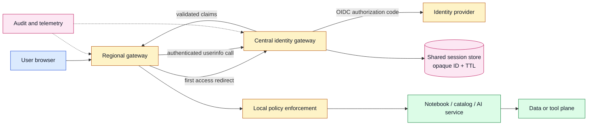
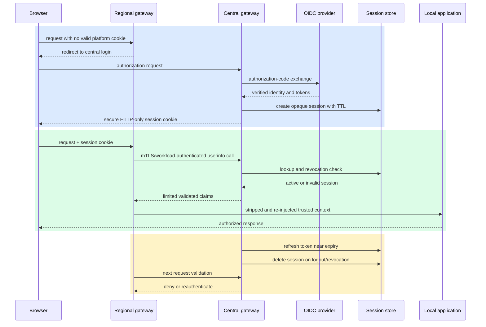

# Federated identity propagation for AI platforms
Status: emerging
Sources: [NVIDIA Technical Blog — 2026-09-03](https://developer.nvidia.com/blog/how-to-carry-user-identity-across-federated-kubernetes-and-ai-platforms/)

## In one sentence

Federated identity propagation separates one platform-wide user session from many regional enforcement points so that Kubernetes services and AI tools can authorize the same person without forwarding raw tokens or making every application implement its own OIDC flow.

This is an SDE2-level architecture lesson about a boundary that is easy to blur: a user authenticates at a control plane, but a notebook, catalog, query service, or AI assistant acts in a data plane. Single sign-on (SSO) solves the first login. It does not, by itself, tell a service in another cluster who the user is, whether the session is still valid, or whether a delegated action is allowed. The design in the source uses a central identity gateway as session owner, a shared session store, stateless regional gateways, and a small validation API. The regional gateway remains responsible for local enforcement; the application receives a controlled identity context rather than an unexamined browser token.

## Background: what existed before

The historical baseline is distributed authentication. Each cluster or application gateway integrates directly with an identity provider (IdP), runs an OpenID Connect (OIDC) authorization-code flow, creates a local session, refreshes tokens, and decides what to put in downstream requests. OIDC is an identity layer built on OAuth 2.0: it lets a client obtain an identity token and user claims from an issuer after an authorization flow. The protocol is not itself a complete multi-cluster session architecture.

Distributed ownership is reasonable when an organization has one application, one cluster, and a small number of access paths. It gives the application team local control and avoids a new central dependency. The problems appear as a platform becomes a collection of tools: a portal in one cluster opens a notebook in another, the notebook queries a governed dataset in a third, and an assistant invokes a tool hosted elsewhere. Each gateway can know that a browser authenticated, but each may have a different session record, refresh policy, group mapping, logout behavior, and audit vocabulary.

That baseline creates four kinds of duplication. First, the user may repeat an OIDC redirect for every tool. Second, each gateway may refresh the same upstream session independently, increasing IdP traffic and creating inconsistent expiry behavior. Third, logout is local unless all gateways coordinate. Fourth, downstream applications either parse tokens themselves or trust headers whose provenance is unclear. The last problem is the most dangerous: a header such as `X-User-Email` has no security value merely because it has a familiar name.

The closest earlier repository lessons have different boundaries. February’s agent-identity lesson focuses on a workload principal, delegated scope, audience, and expiry for an agent run. June’s revocation lesson focuses on withdrawing authority from active, queued, cached, and retried work. This lesson focuses on a human user principal crossing platform gateways and on session ownership, validation, header provenance, refresh, and logout. A regional gateway can use this pattern to enforce a user’s permissions; it should not turn the user identity into a broad agent credential or assume that central logout repairs every already-completed side effect.

## What changed and why now

NVIDIA’s September 3, 2026 engineering post describes a central identity gateway pattern for federated Kubernetes and AI platforms. The central gateway owns the OIDC login, platform session, refresh, and logout lifecycle. Regional or data-plane gateways call a small endpoint such as `/gateway/userinfo` to validate the platform session. They then inject a standardized identity context into the local request.

The source describes the session as an opaque identifier held in a secure, HTTP-only browser cookie, with session state stored in a shared system such as Redis and protected by an explicit time-to-live (TTL). The application does not need to parse the upstream token, refresh credentials, or call the IdP directly. A regional gateway authenticates its call to the central gateway, obtains claims such as user ID, email, groups, roles, and session metadata, and applies local policy before forwarding a request.

The change is therefore about ownership and trust boundaries, not about inventing a new identity protocol. OIDC remains the front-door protocol. The new platform contract is: one service owns session truth; regional gateways ask that owner for current identity; only an authenticated gateway may create downstream identity headers; applications consume a stable, limited interface.

NVIDIA reports that this approach reduced repeated login events by 55% across internal developer platforms spanning Kubernetes clusters in AWS and OCI. That is a publisher-reported result, not an independently reproduced benchmark or a guarantee for another deployment. The architectural reason it may reduce repeated login events is straightforward: later tools reuse the central session instead of starting separate browser redirects. The operational cost is equally important: the central gateway and session store become critical dependencies.

## Impact on current processing and architecture

The system now has two identity paths to design: the browser-to-central-gateway path and the gateway-to-gateway validation path. Keeping them separate makes request processing easier to reason about.



On the first request, the regional gateway sees no valid platform session and redirects the browser to the central gateway. The central gateway performs the OIDC authorization-code exchange server-side, associates the resulting session with the user, stores it with a TTL, and sets an HTTP-only cookie. HTTP-only means browser scripts cannot read the cookie; it does not by itself eliminate cross-site request forgery, fixation, or server-side session theft. The deployment still needs secure cookie attributes, origin checks appropriate to the application, and a clear same-site/cross-site design.

On a later request, the regional gateway sends the session cookie to the central `/gateway/userinfo` endpoint over an authenticated service-to-service connection. The central gateway checks the session record and returns only the claims needed for the local decision. The regional gateway maps those claims to local policy and forwards a request containing a fresh, internally generated identity context. This is an authorization pipeline, not a claim that every downstream application should trust every claim equally. A catalog may need a subject and tenant; an audit system may need the gateway decision ID; an AI tool may need a delegated purpose and resource scope.

The session store is part of the security state. It should contain an opaque session ID, subject, tenant, group or role references needed for policy, token-refresh state, issue and expiry metadata, and revocation status. Store only what the platform needs. Protect refresh tokens as secrets, encrypt transport, restrict store access, and avoid putting raw access tokens in application logs. A session TTL limits persistence, but it does not make a compromised active session harmless; logout and revocation must remove or invalidate it.

Identity headers need a hard boundary. The regional gateway must strip inbound copies of headers such as `X-Authenticated-User`, `X-User-Id`, `X-Tenant`, or a custom principal header before it injects its own values. The application should accept these headers only on a network path where the gateway is authenticated and authorized to speak for the user. If a service is reachable directly from an untrusted client, it must not trust those headers. Prefer a signed internal assertion or a mesh-provided identity when the environment supports it, and bind the assertion to audience, issuer, expiry, and request context.

OIDC validation and trusted-header propagation are related but distinct. OIDC verifies an identity response from a configured issuer using protocol checks such as issuer, client, redirect, nonce, state, token signature, audience, and expiry. A header is an internal transport representation after that validation. Passing an OIDC token through five applications does not replace the need for each trust boundary to verify its intended audience. Conversely, accepting an unverified header does not become safe because the original browser completed OIDC. The gateway is the translation boundary and must be tested as security-critical code.

The request sequence below shows refresh and logout as state transitions rather than incidental endpoints.



Refresh belongs to the central owner because independent regional refresh would recreate the original duplication. The central gateway can update the shared session record, so later validation calls observe one state. Logout deletes or invalidates the session record; the next regional validation fails. This gives platform-wide session invalidation, but not retroactive cancellation of a query already running or deletion of data already delivered. High-risk tools should combine session validation with local authorization and operation-level cancellation where necessary.

## Real-world applications and constraints

In a data catalog, the user may browse metadata in one cluster and launch a notebook in another. The catalog gateway can validate the platform session and pass a subject and tenant to the catalog service. The notebook gateway can repeat the same validation without requiring the user to paste a token into the notebook. The query engine must still enforce row- and column-level permissions; a propagated identity is an input to authorization, not a replacement for it.

In an AI assistant, a user asks a question that causes retrieval, a query, and a tool call across separate services. The assistant should not receive a broad platform service account merely because it needs to act on the user’s behalf. A gateway can establish the user principal and a narrowly defined purpose, while each tool checks whether that principal may read the requested resource. This is where the pattern complements, rather than replaces, agent identity: the user principal and the agent/workload principal should be recorded separately.

In a multi-cloud Kubernetes platform, one regional gateway may run in AWS and another in OCI or on-premises. A central session owner avoids requiring every regional component to implement the complete IdP integration. The trade-off is that a network partition between a regional gateway and the central service becomes an explicit availability/security decision. A read-only dashboard might tolerate a short validation cache. A destructive data operation should normally fail closed or require a fresh online decision.

In an embedded developer portal, multiple tools appear inside one shell. The browser experience benefits from one session, but cookie domain, redirect URI, cross-origin, and logout behavior require careful design. Do not widen a cookie’s domain merely to make an integration convenient. Keep the session cookie scoped to the intended platform and use gateway-to-gateway calls for server-side validation.

Operational constraints include latency, regional failure, store availability, claim freshness, group expansion, and audit volume. A validation call on every request can become a hot path. Caching can reduce latency but introduces stale authorization. If cached validation is permitted, define a maximum age by action risk, include tenant and subject in the cache key, and invalidate on logout or revocation events where practical. Never silently convert an identity-store timeout into an allow decision.

## Mental model

Use a hotel analogy with a strict security desk. The central identity gateway is the hotel’s guest registry: it checks the original identity document, issues one room-session record, renews it, and cancels it at checkout. Regional gateways are floor security desks: they decide whether a guest may enter a particular room or service. A floor desk may receive a trusted guest number from the registry, but it must not accept a guest number written on a stranger’s note.

The analogy also exposes scope. The registry says who the guest is and whether the stay is active. The floor desk still decides whether that guest may enter a particular room. A valid platform session does not imply access to every dataset, namespace, tool, or administrative action. The AI assistant is not allowed to turn a user’s general session into an unrestricted backstage pass.

## What changed this month

The September NVIDIA post turns this pattern into a concrete architecture for federated Kubernetes, data, and AI platforms. It names a central gateway, `/gateway/userinfo`, Redis-backed shared session state, stateless regional gateways, standardized downstream identity, coordinated refresh, and platform-wide logout. It also describes security guardrails: mutual TLS or workload identity between gateways, stripping inbound identity headers, explicit TTLs, protected refresh tokens, audit events, and deliberate fail-closed versus bounded-cache behavior.

The post reports a 55% reduction in repeated login events for NVIDIA’s internal developer platforms across AWS and OCI. Treat that as a source-reported deployment result. The portable lesson is not the percentage; it is the separation of session ownership from regional request enforcement. Teams should measure their own login redirects, validation latency, IdP load, logout propagation, stale-allow rate, and legitimate task completion.

## Engineering consequence

Make identity propagation a typed platform contract. Define the central gateway’s issuer and audience, the exact response schema for `/gateway/userinfo`, the claims each regional gateway may use, the identity headers or signed assertion it may create, and the local authorization responsibilities that remain downstream. Version this contract like an API.

Start with an inventory: list every OIDC client, local session store, refresh path, trusted header, direct token parser, logout endpoint, and data-plane service. Draw the trust boundary around each gateway. Then migrate one regional gateway while keeping its application-facing identity interface stable. Compare old and new decisions in shadow mode where possible, but do not shadow by forwarding untrusted headers into production services.

Define failure states explicitly: `unauthenticated`, `session_expired`, `session_revoked`, `identity_unavailable`, `gateway_not_authorized`, and `local_policy_denied`. These states should be distinguishable in metrics and audit events. A generic HTTP 403 hides whether the user lacks permission or the identity service is down; a generic 500 can accidentally encourage unsafe retries.

For AI workflows, record both the user subject and the workload or agent subject. Record the delegated purpose, target resource, policy version, gateway decision ID, and session state. This avoids the February lesson’s confused-deputy problem while preserving the September lesson’s federated session boundary. At the effect owner, recheck high-impact authorization rather than trusting a claim from an earlier planning step.

Revocation is a time-boundary problem. If a regional gateway caches an authorization result for TTL seconds, the worst-case stale-authorization window is approximately TTL plus clock skew and propagation delay; for a high-impact action, the acceptable window may be zero, requiring an online check. A rough availability trade-off is `P_success = P_gateway × P_session_store × P_local_policy` for a serial dependency chain, while adding a local cache can improve availability but increases stale-claim risk. Measure refresh success, token age at effect time, revocation propagation p95, clock skew, and local-denial rate.

## Limits and failure modes

**Central dependency outage.** If the central gateway or session store is unavailable, regional gateways cannot learn current session state. Choose fail closed, bounded cached validation, or degraded read-only behavior per operation class. Document the decision; do not let network timeouts decide it accidentally.

**Header spoofing.** A client sends its own identity header, or an internal service forwards one from an untrusted hop. Strip all inbound identity headers at the first trusted gateway and again at boundaries where an untrusted caller can enter. Authenticate gateway-to-gateway calls and restrict who may inject context.

**Audience confusion.** A token or internal assertion valid for one gateway is accepted by another service. Validate issuer, audience, signature, expiry, and intended action. A valid signature alone does not establish that this service should honor the claim.

**Stale authorization.** A user is removed from a group or logs out, but a regional cache continues to allow requests. Bound cache age, publish invalidation events where needed, and perform online checks immediately before irreversible operations.

**Session fixation or cookie theft.** An attacker obtains or sets a session identifier. Rotate the session identifier after login, use secure and HTTP-only cookie attributes, protect against cross-site request forgery where browser state is ambient, and revoke the server-side record on logout. Do not log cookies.

**Refresh-token exposure.** A central gateway compromise or overbroad store permissions can expose refresh capability. Minimize stored secrets, encrypt in transit and at rest, restrict administrative access, rotate keys, and alert on unusual refresh behavior.

**Claim overreach.** A regional gateway forwards every group, email, and role to every application. Minimize claims and map them to the local policy contract. More identity data is not automatically more authorization precision.

**Long-running work.** A query or agent tool may start while a session is valid and finish after logout. Session invalidation prevents later validation, but it does not undo a completed effect. Add operation-level cancellation or reauthorization for sensitive long-running work and record the session state at start and commit.

**Audit ambiguity.** Logs say “user allowed” without naming the gateway, policy revision, session ID hash, resource, or decision time. Record stable non-secret identifiers and the source of the identity decision. Keep personal data and tokens out of logs unless a retention and access policy explicitly permits them.

## Mini exercise (15–30 min)

Build a tiny gateway policy simulator. Model a central session registry, a regional gateway, and an application. Test a first login, a valid subsequent request, a revoked session, a spoofed inbound header, and an unavailable central registry. The expected result is that only the central registry can establish a subject, the regional gateway strips client-supplied identity, and an unavailable registry produces an explicit unavailable result rather than an allow.

Extend the example with a cache whose maximum age differs for a read and a destructive action. Then ask: what is the maximum stale-allow window, which component owns it, and how would you observe a logout that arrives during a request? Write the answers beside the test cases. The exercise is a policy and state simulation; it does not implement OIDC, cryptography, Redis, or a production gateway.

## Build it locally

1. Save the dependency-free Python example below as `identity_boundary.py` and run it with `python3 identity_boundary.py`.
2. Change the client-supplied `X-User` header and verify that the gateway ignores it rather than treating it as authenticated identity.
3. Change the session state from `active` to `revoked` and verify that the regional gateway returns `session_revoked`.
4. Set `central_available` to `False` and compare the explicit `identity_unavailable` result with a deliberately documented cached-read policy.
5. Add a `tenant` and `resource` to the session and require both to match the local request before forwarding identity.
6. Add a service audience and reject a validation response intended for another regional gateway.
7. Add synthetic audit events containing decision ID, subject hash, resource, policy version, and outcome, while ensuring no cookie or token value is printed.

```python
from dataclasses import dataclass

@dataclass
class Session:
    subject: str
    tenant: str
    state: str
    audience: str

class CentralIdentity:
    def __init__(self):
        self.sessions = {
            "s-1": Session("user-42", "tenant-a", "active", "regional-gateway")
        }
        self.available = True

    def userinfo(self, session_id, audience):
        if not self.available:
            return {"status": "identity_unavailable"}
        session = self.sessions.get(session_id)
        if session is None or session.state != "active":
            return {"status": "session_revoked"}
        if session.audience != audience:
            return {"status": "wrong_audience"}
        return {"status": "active", "subject": session.subject,
                "tenant": session.tenant}

class RegionalGateway:
    def __init__(self, central):
        self.central = central

    def forward(self, session_id, incoming_headers, resource_tenant):
        # The client cannot establish identity with a spoofed header.
        claims = self.central.userinfo(session_id, "regional-gateway")
        if claims["status"] != "active":
            return claims["status"]
        if claims["tenant"] != resource_tenant:
            return "local_policy_denied"
        trusted_headers = {
            "X-Authenticated-User": claims["subject"],
            "X-Tenant": claims["tenant"],
        }
        return {"status": "forward", "headers": trusted_headers,
                "ignored_client_headers": sorted(incoming_headers)}

central = CentralIdentity()
gateway = RegionalGateway(central)
spoofed = {"X-Authenticated-User": "attacker", "X-Tenant": "tenant-a"}
result = gateway.forward("s-1", spoofed, "tenant-a")
assert result["headers"]["X-Authenticated-User"] == "user-42"
assert result["headers"]["X-Authenticated-User"] != spoofed["X-Authenticated-User"]
print("active request:", result)

central.sessions["s-1"].state = "revoked"
assert gateway.forward("s-1", {}, "tenant-a") == "session_revoked"
print("after logout:", gateway.forward("s-1", {}, "tenant-a"))

central.sessions["s-1"].state = "active"
central.available = False
assert gateway.forward("s-1", {}, "tenant-a") == "identity_unavailable"
print("central outage:", gateway.forward("s-1", {}, "tenant-a"))
```

The example demonstrates the boundary, not real authentication. It has no signature verification, encrypted transport, cookie handling, OIDC state/nonce checks, Redis durability, key rotation, or distributed-consistency guarantees. Those omissions are deliberate: a local script should teach the decision flow without encouraging a reader to deploy toy code as an identity gateway.

## Interview Q&A

**Why is SSO not enough for federated AI platforms?** SSO authenticates the front-door interaction. A service in another cluster still needs a trusted, current user context, local authorization, logout behavior, and audit trail. SSO does not automatically propagate those semantics across data planes.

**Why centralize session ownership but retain regional gateways?** Central ownership coordinates login, refresh, and logout. Regional gateways remain close to services and enforce local policy, network controls, and resource-specific authorization. Centralizing every policy decision would create a larger latency and availability dependency.

**Should an application trust `X-User` from the client?** No. A client can send or modify it. The trusted gateway must strip inbound identity headers, authenticate the gateway-to-application path, and inject a controlled identity context after central validation.

**What does `/gateway/userinfo` replace?** It replaces repeated full OIDC flows for already-established platform sessions. It does not replace the initial OIDC protocol, local resource authorization, token/key validation responsibilities at the appropriate boundary, or audit controls.

**What happens if the session store is down?** The platform needs an explicit risk-based policy. It may fail closed, permit a narrowly bounded cached read, or expose a degraded mode. High-impact writes should not silently become allowed because validation timed out.

**How does this differ from agent identity?** Agent identity identifies the workload or run performing an action. Federated user identity identifies the human principal whose platform session is being propagated. A tool call may need both: user subject for delegation and agent subject for execution accountability.

**Does logout cancel an AI query already running?** Not necessarily. It invalidates future session validation. Long-running or irreversible operations need their own cancellation, lease, or commit-time authorization semantics.

## Glossary

- **Audience:** The service or class of service for which a token or internal assertion is intended.
- **Central identity gateway:** The service that owns the platform session, OIDC flow, refresh, validation API, and logout lifecycle.
- **Control plane:** Platform services that manage access, configuration, sessions, and orchestration.
- **Data plane:** Services and workloads that perform the actual query, computation, storage, or tool operation.
- **Federation:** Operating identity and services across multiple administrative, regional, cloud, or cluster boundaries.
- **Identity provider (IdP):** The system that authenticates users and issues identity-related protocol responses.
- **OIDC:** OpenID Connect, an identity layer on OAuth 2.0 used to obtain authenticated user claims.
- **Regional gateway:** A local enforcement point that validates a central session and applies data-plane policy.
- **Session TTL:** Time-to-live after which a server-side session is no longer accepted without renewal.
- **Trusted header:** A gateway-generated request attribute accepted only across an authenticated, controlled network boundary.
- **Workload identity:** A principal representing a service, agent, or running workload; it is distinct from the end user.

## References

- [NVIDIA Technical Blog: How to Carry User Identity Across Federated Kubernetes and AI Platforms — 2026-09-03](https://developer.nvidia.com/blog/how-to-carry-user-identity-across-federated-kubernetes-and-ai-platforms/)
- [OpenID Connect Core 1.0](https://openid.net/specs/openid-connect-core-1_0.html)
- [OAuth 2.0 Security Best Current Practice](https://datatracker.ietf.org/doc/html/draft-ietf-oauth-security-topics)
- [February lesson: Agent identity](../2026-02/03-agent-identity.md)
- [June lesson: Revocation](../2026-06/15-revocation.md)

## Claim ledger

| Claim | Source | Fact or inference |
|---|---|---|
| NVIDIA published the described federated identity article on September 3, 2026. | [NVIDIA Technical Blog](https://developer.nvidia.com/blog/how-to-carry-user-identity-across-federated-kubernetes-and-ai-platforms/) | Fact |
| The source describes central session ownership, stateless regional gateways, a `/gateway/userinfo` validation endpoint, and shared session storage such as Redis with TTLs. | [NVIDIA Technical Blog](https://developer.nvidia.com/blog/how-to-carry-user-identity-across-federated-kubernetes-and-ai-platforms/) | Fact |
| The source says central ownership coordinates refresh and platform-wide logout by changing shared session state. | [NVIDIA Technical Blog](https://developer.nvidia.com/blog/how-to-carry-user-identity-across-federated-kubernetes-and-ai-platforms/) | Fact |
| NVIDIA reports a 55% reduction in repeated login events across its internal AWS and OCI developer platforms. | [NVIDIA Technical Blog](https://developer.nvidia.com/blog/how-to-carry-user-identity-across-federated-kubernetes-and-ai-platforms/) | Publisher-reported fact, not independent verification |
| Regional gateways should strip inbound identity headers before injecting trusted headers. | [NVIDIA Technical Blog](https://developer.nvidia.com/blog/how-to-carry-user-identity-across-federated-kubernetes-and-ai-platforms/) | Source-backed engineering guidance |
| OIDC front-door validation and internal trusted-header propagation are separate trust boundaries. | OIDC Core plus systems/security analysis | Engineering inference |
| A central session store can increase blast radius and become an availability dependency. | Distributed-systems reasoning from the centralized design | Engineering inference |
| High-risk operations should fail closed or require a fresh online decision when identity validation is unavailable. | Risk-based authorization design | Engineering inference |
| A valid propagated user identity does not grant access to every downstream resource or make an AI assistant a broad service account. | Local authorization and least-privilege design | Engineering inference |
| The Python program demonstrates header stripping, session state, audience, tenant, and outage decisions; it does not prove production security. | The runnable example and its stated limitations | Fact about the example |
