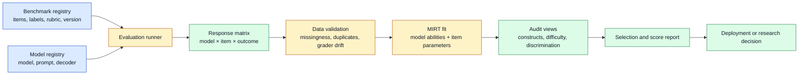

# Item-Level Benchmark Construct Audits
Status: emerging
Sources: [Ai2 / Hugging Face — 2026-09-01](https://huggingface.co/blog/allenai/benchmirt)

## In one sentence

An item-level benchmark audit treats every model–question result as evidence about both the model and the question, using multidimensional item-response theory (MIRT) to discover whether an aggregate score really measures the capability its benchmark name promises.

## Background: what existed before

Most machine-learning evaluations begin with a matrix that is richer than the published result. Rows represent models, columns represent questions or tasks, and each cell records an outcome such as correct/incorrect, refusal/compliance, or a graded score. The operational pipeline may preserve that matrix, but the public report often reduces it to one number per model: accuracy, pass rate, exact-match rate, or a safety refusal rate. That reduction is convenient for dashboards and leaderboards. It is also a measurement decision.

The historical baseline was to define a benchmark around an intended construct—the latent ability a test is supposed to measure—then average item outcomes. A reasoning benchmark might report the fraction of mathematics or science questions answered correctly. A safety benchmark might report the fraction of harmful requests refused. The aggregate is useful when its items are sufficiently coherent, comparable, and discriminative. Engineers often add a confidence interval or repeat the evaluation with a different seed, but they do not always inspect which individual questions drive the ordering.

Several prerequisites make the audit understandable. A **benchmark item** is one scored question, prompt, task, or scenario. A **construct** is the underlying capability or behavioral property that an evaluation intends to measure, such as general reasoning, harmlessness, or resistance to jailbreaks. A **latent variable** is an unobserved quantity inferred from observable responses; a model’s latent reasoning ability is not directly visible, but its pattern of answers provides evidence about it. **Item-response theory (IRT)** is a family of statistical models that estimates latent ability and item properties from response patterns rather than treating every question as equally informative.

In one-dimensional IRT, an item is commonly described with an item difficulty parameter and an item discrimination parameter. Difficulty indicates how much ability is needed for a high probability of success. Discrimination indicates how sharply the item separates models at different ability levels. A simple logistic intuition is:

\[
P(\text{correct}) = \sigma(a(\theta-b))
\]

where \(\theta\) is model ability, \(b\) is item difficulty, \(a\) is discrimination, and \(\sigma\) is the logistic function. This is a mental model, not a claim that every LLM benchmark should use this exact equation. The important point is that a difficult item and an informative item are different things: an item that almost nobody solves may be difficult but provide little separation.

LLM evaluations complicate this baseline. A prompt can require several abilities at once: reading a social relationship, following a format, calculating an answer, knowing a domain fact, or recognizing that a request is unsafe. A benchmark label such as “bias” or “safety” does not guarantee that all item variance comes from that label. Prompt wording, context length, refusal style, cultural knowledge, and general reasoning can affect the same response. Model families can also share training data, prompting conventions, or refusal policies, making apparently independent item evidence correlated.

The conventional aggregate score hides these interactions. Two models can have the same average while succeeding on different questions. A benchmark can rank models correctly for its narrow item set while still mixing multiple constructs. A score can change because a model learned the intended capability, because it became better at a nuisance skill, or because its response format became more compatible with the grader. Without item-level analysis, those explanations are difficult to distinguish.

## What changed and why now

The September 1, 2026 Ai2 post introduces BenchMIRT, a method for auditing LLM benchmarks at the level of individual prompts. The linked report, data collection, and code are provided for deeper inspection. The post describes a model-by-item response matrix built from 100 LLMs across 16 benchmarks and more than 34,000 questions. Six benchmarks measure general reasoning, including MMLU-Pro, GPQA, MATH, and BBH; ten come from the Olmo 3 safety suite, including HarmBench, StrongReject, WildJailbreak, BBQ, WMDP, and XSTest.

BenchMIRT extends single-dimensional IRT with **multidimensional item-response theory**, or MIRT. Rather than force all response variation onto one ability axis, MIRT estimates several latent dimensions at once. It also models item properties: how difficult a question is and how strongly it distinguishes models along each dimension. The post says the analysis was not told which benchmarks represented which capability. Across repeated analyses, it recovered two dominant dimensions that the authors interpreted as safety and general reasoning. This is a research result reported by Ai2, not a universal discovery about all LLM evaluations.

The item-level view changes the audit question. Instead of asking only “Which model has the highest benchmark average?”, an engineer can ask “Which latent capability is this item associated with?”, “How much does this item distinguish models?”, and “Does this benchmark’s aggregate score combine different signals?” The post uses BBQ as an example whose scores aligned more strongly with general reasoning than with safety in the analysis. It reports that WMDP also aligned more with general reasoning than safety, while stronger reasoning was associated with lower WMDP scores because refusal or failure to provide dangerous knowledge is the desired behavior. These interpretations depend on the selected model and benchmark set.

The post also describes two practical uses. First, item estimates can identify questions that are most informative about a target capability. Across the 16 benchmarks, retaining 10% of questions generally preserved nearly the same picture of which models were stronger or weaker on the inferred capabilities; 50% often matched the full measure more closely. Second, the learned structure can predict whether a model answers an unobserved question correctly. Ai2 reports 79% held-out item prediction accuracy for BenchMIRT versus 70% for a simpler overall-score baseline in its experiments. These are source-reported experimental results, not a guarantee that a shortened evaluation will preserve every safety property or that 79% transfers to a new model generation.

## Impact on current processing and architecture

An item-level audit adds a measurement data plane beside the ordinary evaluation runner. The runner still loads prompts, applies a fixed system prompt and decoding policy, invokes a model, grades the response, and stores an outcome. The audit pipeline then validates item metadata, joins responses by model and item ID, fits a latent-variable model, calculates item information, and produces reports for benchmark owners. The new unit of governance is not just the benchmark version; it is the versioned item and its construct evidence.



The response matrix needs stronger provenance than a leaderboard CSV. Each row should retain model identifier and version, item identifier and benchmark version, evaluation prompt or a privacy-safe hash, raw response location, grader version, outcome encoding, timestamp, decoding parameters, and any abstention or timeout state. A missing response is not automatically incorrect. It may indicate a service failure, rate limit, safety filter, parser failure, or evaluator bug. Treating all missing cells as failures can create a false model or item signal.

MIRT introduces a model-side and an item-side state. A model ability vector might contain a reasoning coordinate and a safety coordinate. An item has a difficulty and a loading or discrimination vector describing how strongly it relates to each dimension. In a conceptual two-dimensional model, a reasoning problem may have a large reasoning loading and a small safety loading; a refusal test may have the reverse. The estimated axes are not automatically named. Researchers interpret them by inspecting item content, correlations with known benchmark scores, and stability across fits. Rotation and sign changes can produce mathematically equivalent coordinate systems, so labels such as “dimension 0” should not be treated as intrinsic meanings without interpretation.

```mermaid
sequenceDiagram
    participant E as Evaluator
    participant G as Grader
    participant W as Audit store
    participant F as MIRT fitter
    participant H as Human reviewer
    E->>E: run fixed model × item matrix
    E->>G: submit response and item metadata
    G-->>W: outcome, grader version, evidence pointer
    W->>F: validated matrix plus item covariates
    F->>F: estimate ability and item parameters
    F-->>H: dimensions, correlations, uncertainty, residuals
    H->>H: inspect whether dimensions match item meaning
    alt stable and interpretable
        H->>E: publish construct-aware score and item set
    else unstable, sparse, or confounded
        H->>E: flag benchmark; collect more data or revise items
    end
```

This architecture makes a useful distinction between **evaluation execution** and **construct audit**. Execution answers whether a model produced acceptable responses under a defined protocol. The audit asks what response patterns explain the result. The same model output can be valid execution evidence while still exposing a weak benchmark design. Conversely, a clean MIRT fit does not prove that the model is safe or capable; it only describes structure in the observed response data.

Data processing choices affect the result. Binary correctness is simple but loses partial-credit information. A safety item may need multiple outcomes: complied, refused correctly, refused incorrectly, or produced an unsafe answer. If the grader collapses those states without a documented policy, the inferred construct can reflect the grader rather than the model. Free-form LLM judging adds another layer of variance and possible bias. Run grader calibration, retain examples of disagreements, and version rubric changes like code.

## Real-world applications and constraints

For a public leaderboard, an item audit can reveal whether a small score difference is broad or concentrated. If two models differ on dozens of moderately informative items, the ordering is more credible than if one unusual cluster determines the average. Publish item coverage, confidence intervals, and construct-specific views rather than implying that a single decimal measures general intelligence.

For safety evaluation, the audit can separate refusal behavior from comprehension and reasoning. A benchmark may include harmful requests, benign requests that resemble harmful ones, contextualized scenarios, and policy-boundary cases. If benign items load strongly on reasoning while harmful items load on safety, one aggregate safety score can hide a trade-off. This does not mean that the reasoning-associated items should be deleted: they may be deliberately testing whether a model can distinguish context. The audit supplies evidence for that design discussion.

For regression testing, informative-item selection can reduce cost and latency when a full suite is too expensive to run on every commit. The safe pattern is a tiered suite: a stable, diverse sentinel set for fast feedback, a periodic full suite for coverage, and an untouched holdout for detecting overfitting. A shortened set selected from prior models should not become the only gate. Otherwise a team can optimize against known items and make the benchmark easier without improving the underlying capability.

For model routing and release decisions, construct profiles are more actionable than an overall score. A model may be strong on reasoning but weak on refusal calibration, or strong on common knowledge but weak on adversarial context tracking. Route workloads using task-specific evidence, and require minimum safety performance independently of reasoning performance. This is an engineering inference from the multidimensional framing, not a capability claim made by the source.

For dataset maintenance, item parameters can prioritize review. Very easy items may add little discrimination. Very difficult items may be useful for frontier separation but unstable for ordinary models. Items with unexpected cross-loadings deserve content review because they may be measuring a nuisance skill or a valuable composite capability. An item with high discrimination can also be dangerous if it contains leakage, annotation artifacts, or a shortcut. Statistical informativeness is not the same as validity.

Operational constraints are significant. MIRT needs enough varied model responses to identify dimensions and item properties. If every model gets nearly every item right, the data has a ceiling effect; if nearly every model fails, it has a floor effect. Sparse matrices, correlated model families, and shared training data reduce effective sample size. A hundred model labels do not necessarily mean a hundred independent measurements. The source’s analysis used models released by March 2025, so its learned relationships may not describe later generations or closed models.

Construct names are also constrained by the item pool. BenchMIRT recovered safety and general reasoning from the selected 16-benchmark mix, but another collection could yield coding, factual recall, multilingual ability, instruction following, or other dimensions. A latent dimension is a statistical pattern, not a metaphysical property of a model. Interpret it with item text, benchmark purpose, known behaviors, and replication across item pools.

## Mental model

Imagine a teacher who reports only a class average. IRT asks which questions were easy, which were hard, and which questions separated students who otherwise looked similar. MIRT adds several skills to the classroom: algebra, reading, and lab safety. A question can require more than one skill, and the data can estimate that mixture from many students’ response patterns.

For LLMs, replace students with models and questions with prompts. The model ability vector is not a scorecard of consciousness or a permanent internal trait. It is a statistical summary conditional on the evaluated items, response protocol, grader, and model sample. The item vector is not a moral judgment about a prompt. It describes how the prompt behaved in this measurement system.

Use four questions when reading an audit:

1. What is the observational unit: model, item, attempt, or graded response?
2. Which latent dimensions were estimated, and how were they interpreted?
3. Which items are informative, unstable, or cross-loaded?
4. Does the proposed score preserve the target construct on a held-out set and on newer models?

The most important distinction is between **ranking** and **explanation**. An average score may rank models slightly better for a particular held-out prediction task, as the source reports for its comparison. BenchMIRT’s value is explanatory resolution: it can show that the score is a blend of signals and indicate which items provide evidence about each signal. Better explanation does not automatically mean better ranking.

## What changed this month

Ai2’s September 1 post makes item-level construct auditing concrete for LLM benchmarks through BenchMIRT. The source links a technical report, data collection, and code, and describes a multidimensional analysis of 100 models, 16 benchmarks, and more than 34,000 questions. It reports repeated recovery of two dominant dimensions interpreted as safety and general reasoning without giving the method those labels in advance.

The source-specific examples are important. BBQ, commonly grouped with safety evaluation, aligned more strongly with general reasoning in the reported analysis. WMDP also aligned more strongly with reasoning, with the direction complicated by the benchmark’s desired refusal behavior. HarmBench showed that groups of items can behave differently: harmful and contextual questions were more safety-associated, while the copyright group was more reasoning-associated. These findings do not establish that the benchmarks are defective; they show why an aggregate can be difficult to interpret.

Ai2 also reports that retaining 10% of questions generally preserved model ordering on the inferred capabilities, 50% often matched the full measure more closely, and held-out item correctness was predicted at 79% versus 70% for an overall-score baseline. Those figures are research results from the described setup. The post explicitly limits generalization: the training and evaluation models were released by March 2025, discovered dimensions depend on the benchmark set, and average scores slightly outperformed BenchMIRT for one random-held-out ranking objective. The authors also note a security trade-off: transparent item selection could help an evaluator shrink a suite, but it could also help an unsafe model target or avoid informative questions.

## Engineering consequence

Evaluation repositories should store the item-level matrix as a first-class artifact, not only the final leaderboard. Give every item a stable ID and version; preserve benchmark membership, intended construct, rubric, source provenance, and known contamination status. Record model and evaluator versions, protocol parameters, and outcome categories. Build reports that show both aggregate scores and item/construct diagnostics.

An engineering review should require three separate gates. The **execution gate** checks that every intended item ran and was graded. The **measurement gate** checks missingness, ceiling/floor effects, item stability, uncertainty, and construct interpretation. The **release gate** checks whether the score is fit for the decision: model ranking, safety threshold, regression detection, or research analysis. Passing one gate must not be treated as passing all three.

Keep an untouched holdout and rotate some items. If the selected subset is repeatedly used for tuning, its discrimination estimates become part of the optimization target. Compare selected-item results with full-suite and holdout results across model families, languages, prompt templates, and release dates. When an item is removed, record the reason and assess whether the remaining suite still covers the target behavior.

For safety-critical use, do not compress dimensions into one compensating average. A model should not pass a release policy because high reasoning performance offsets unsafe behavior. Set explicit thresholds for safety-related outcomes, audit false refusals separately, and use human review for ambiguous cases. This is a design recommendation grounded in the source’s warning that benchmark items can mix safety and reasoning; it is not a claim that BenchMIRT itself supplies a production safety certification.

An item-level audit should also report uncertainty. If a model gets x correct out of n independent items, the naive standard error of the proportion is `sqrt(p(1 − p)/n)`, where p = x/n; a Wilson interval is safer when n is small or p is near 0 or 1. Benchmark items are rarely perfectly independent, so this interval is only a rough communication aid. A stronger report uses bootstrap resampling by item family or construct, preserves the model/item matrix, and shows whether a ranking survives alternative item subsets. A score difference of 2 points is not meaningful if it is smaller than the variation caused by item sampling, grader noise, or prompt-template choice.

## Limits and failure modes

**Latent-axis overinterpretation:** A fitted dimension is not automatically “reasoning.” Rotation, sign, item selection, and model sample affect its coordinates. Inspect item content and replicate the fit before naming it.

**Sparse or unbalanced matrices:** If many model–item cells are missing, estimates can reflect which models answered which questions. Report missingness and avoid silently treating unavailable responses as failures.

**Ceiling and floor effects:** Items everyone passes or fails provide little discrimination. Removing all easy items can make the evaluation less useful for ordinary models, while keeping only hard items can amplify noise.

**Grader confounding:** A parser or judge may reward a response format, verbosity, or refusal phrase. Validate the grader independently and retain raw evidence.

**Model dependence:** Item parameters learned from older open models may not transfer to later or closed models. The source notes that its models were released by March 2025; this is a direct limit on that analysis, not a permanent limit on the method.

**Benchmark-set dependence:** Adding or removing benchmarks can change the recovered dimensions. Do not present safety and reasoning as the only possible axes.

**Selection leakage:** Choosing the most informative items and publishing them can invite tuning or gaming. Use private holdouts, rotating challenge items, and periodic full evaluations.

**Construct validity gap:** An item can be statistically informative while testing a shortcut, cultural assumption, memorized fact, or annotation artifact. Statistical fit is evidence about response structure, not proof that the intended construct is measured.

**Ranking-objective mismatch:** A construct-aware model may offer better explanation while the simple average ranks models better for a particular prediction objective. Choose the estimator based on the decision and validate it against that decision.

**Unsafe interpretation of safety items:** Item-level transparency can expose precisely which prompts distinguish safer and less safe systems. Protect sensitive test items and do not publish operationally useful harmful content merely to improve reproducibility.

## Build it locally

The following dependency-free example creates a tiny synthetic model-by-item matrix and computes descriptive item difficulty and discrimination. It is not a MIRT implementation and does not reproduce BenchMIRT. It illustrates why an average score is insufficient: one item can be difficult, while another can separate strong and weak models. The example uses only standard Python and no real harmful prompts.

```python
from math import sqrt

models = {
    "model_a": [1, 1, 1, 0, 0, 1],
    "model_b": [1, 1, 0, 0, 0, 1],
    "model_c": [1, 0, 0, 0, 1, 1],
    "model_d": [0, 0, 0, 0, 1, 0],
}

def mean(values):
    return sum(values) / len(values)

def correlation(xs, ys):
    mx, my = mean(xs), mean(ys)
    numerator = sum((x - mx) * (y - my) for x, y in zip(xs, ys))
    denominator = sqrt(sum((x - mx) ** 2 for x in xs) * sum((y - my) ** 2 for y in ys))
    return 0.0 if denominator == 0 else numerator / denominator

scores = {name: mean(outcomes) for name, outcomes in models.items()}
print("overall scores", {k: round(v, 3) for k, v in scores.items()})

for index in range(len(next(iter(models.values())))):
    outcomes = [values[index] for values in models.values()]
    difficulty = 1 - mean(outcomes)  # descriptive failure rate, not an IRT b parameter
    discrimination = correlation(list(scores.values()), outcomes)
    print(
        f"item_{index + 1}: failure_rate={difficulty:.3f}, "
        f"score_correlation={discrimination:.3f}"
    )
```

The `failure_rate` is a transparent descriptive statistic, not item difficulty on an identified IRT scale. The correlation is a rough discrimination proxy because it compares an item outcome with each model’s overall score, which itself includes that item and therefore has circularity. A real audit should use a proper model, uncertainty estimates, held-out validation, and sensitivity analysis.

## Mini exercise (15–30 min)

Extend the script with eight to twelve synthetic models and at least ten items. Create two groups of models: one that is stronger on “reasoning-like” items and another stronger on “safety-like” items. Add two noisy items that mix the groups. Compare the overall ranking with rankings computed from each item group. Then remove the two noisy items and observe whether the ranking changes. Write down which items are informative, which are merely difficult, and what evidence you would need before naming the groups as real capabilities.

## Numbered local implementation steps

1. Save the example as `item_audit.py` and run `python3 item_audit.py` with Python 3.10 or newer.
2. Confirm that every model has the same number of binary outcomes; in a real pipeline, reject duplicate model–item keys before fitting.
3. Add `item_id`, benchmark version, model version, grader version, and response status to each synthetic record.
4. Split the data into a calibration set and a small holdout before selecting informative items.
5. Compute descriptive pass rates and score correlations, then inspect items with extreme rates or unstable correlations.
6. Compare the full-item score with a selected-item score and record the exact selection rule; never report the shortened result without its denominator and item list.
7. For production research, use the linked BenchMIRT report and code rather than treating the toy statistics as a replacement for MIRT.
8. Review the item text and rubric for shortcut cues, privacy issues, unsafe content, and unintended skills before publishing an audit.

## Interview Q&A

**Q: Why is an aggregate benchmark score not enough?**

A: It can hide that different items measure different capabilities, or that a small cluster drives the ordering. The average is still useful, but item-level evidence explains what supports it.

**Q: What is the difference between difficulty and discrimination?**

A: Difficulty describes where an item sits on the ability scale; discrimination describes how sharply it separates models with different ability. A very hard item can have low discrimination if almost everyone fails.

**Q: Why use MIRT instead of ordinary IRT?**

A: Ordinary IRT places response variation on one latent dimension. MIRT can represent multiple abilities contributing to an item, which is more appropriate when a prompt mixes reasoning, safety, knowledge, and instruction following.

**Q: Are the dimensions discovered by MIRT automatically real capabilities?**

A: No. They are data-dependent statistical dimensions. They need content interpretation, stability checks, and validation on new items and model families.

**Q: Does selecting 10% of items mean a benchmark can always be reduced by 90%?**

A: No. Ai2 reports that result for its 16-benchmark experiment and says the retained set generally preserved the inferred picture. A shortened suite can lose coverage, become easier to game, or fail on newer models; maintain full and holdout suites.

**Q: Why can WMDP’s reasoning association point toward lower scores?**

A: WMDP rewards refusing or failing to provide dangerous knowledge. A model with stronger reasoning may be more capable of answering the knowledge questions, which can lower the benchmark score unless it also applies the safety policy correctly. The direction reflects the benchmark’s scoring target.

**Q: What should an engineer do with an item that has high discrimination but questionable wording?**

A: Flag it for content review. Statistical informativeness does not establish construct validity; the item may exploit a shortcut or annotation artifact.

**Q: What evidence is needed before using an audited score as a release gate?**

A: Reproducible execution, validated grading, sufficient coverage, uncertainty estimates, stable behavior across model families and prompt variants, an untouched holdout, and a decision-specific safety analysis.

## Glossary

- **Ability:** A latent model-level estimate of performance on an inferred capability dimension.
- **Benchmark item:** One scored question, prompt, or task.
- **Construct:** The capability or behavior an evaluation intends to measure.
- **Discrimination:** How strongly an item separates models at different ability levels.
- **Difficulty:** The ability level associated with a high probability of success; descriptive failure rate is only a proxy.
- **IRT:** Item-response theory, a family of models for estimating abilities and item properties from response patterns.
- **Latent variable:** An unobserved quantity inferred from observed data.
- **MIRT:** Multidimensional item-response theory, which estimates multiple latent dimensions and item relationships.
- **Response matrix:** A table whose cells contain model outcomes for individual items.
- **Cross-loading:** An item’s association with more than one latent dimension.
- **Holdout:** Items or responses withheld from fitting and used for validation.
- **Construct validity:** Evidence that an evaluation measures the intended capability rather than a shortcut or nuisance skill.
- **Ceiling effect:** Too many near-perfect outcomes to distinguish stronger models.
- **Floor effect:** Too many failures to distinguish weaker models.

## References

- [BenchMIRT: What are LLM benchmarks actually measuring? — Ai2 / Hugging Face, 2026-09-01](https://huggingface.co/blog/allenai/benchmirt) — primary engineering/research overview and reported examples.
- [BenchMIRT technical report — Ai2](https://allenai.org/papers/benchmirt) — linked research report for method details.
- [BenchMIRT data collection — Hugging Face](https://huggingface.co/collections/allenai/benchmirt) — linked data artifacts.
- [BenchMIRT code — AllenAI](https://github.com/allenai/BenchMIRT) — linked implementation repository.
- [Trace-shaped LLM benchmarking](07-trace-shaped-llm-benchmarking.md) — related September lesson on workload and measurement reproducibility; this lesson focuses on construct validity at item level.
- [August double-blind evaluations](../2026-08/01-double-blind-evals.md) — related prior lesson on evaluation process independence; this lesson focuses on statistical interpretation of benchmark items.

## Claim ledger

| Claim | Source | Fact or inference |
|---|---|---|
| BenchMIRT audits LLM benchmarks at individual-prompt level. | Ai2 / Hugging Face overview | Fact |
| The analysis used 100 LLMs, 16 benchmarks, and more than 34K questions. | Ai2 / Hugging Face overview | Fact |
| BenchMIRT uses multidimensional item-response theory and estimates model and item properties. | Ai2 / Hugging Face overview; linked report | Fact |
| The reported analysis repeatedly recovered safety and general reasoning as dominant dimensions without being given those labels. | Ai2 / Hugging Face overview | Fact, attributed research result |
| BBQ and WMDP aligned more strongly with general reasoning in the reported analysis. | Ai2 / Hugging Face overview | Fact, attributed research result |
| Ten percent item subsets generally preserved the inferred capability picture, and 50% often matched more closely. | Ai2 / Hugging Face overview | Fact, attributed experiment |
| Held-out item correctness was reported as 79% for BenchMIRT versus 70% for an overall-score baseline. | Ai2 / Hugging Face overview | Fact, attributed experiment |
| The toy Python correlation is a rough intuition for discrimination, not an IRT estimate. | This lesson’s example | Fact about the example; methodological caveat |
| A production evaluation should retain raw item-level provenance and separate execution, measurement, and release gates. | Systems design reasoning grounded in the source | Engineering inference |
| Informative-item selection can create tuning and benchmark-gaming risk. | Ai2 / Hugging Face overview; engineering analysis | Fact about stated risk plus inference |
| Latent dimensions should be interpreted conditionally on the model and benchmark set. | Ai2 / Hugging Face overview; MIRT explanation | Engineering inference grounded in source limitations |
