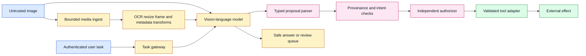

# Adaptive Visual Prompt Injection Against Tool Agents
Status: emerging
Sources: [Chen et al. — 2026-09-15](https://arxiv.org/abs/2609.04533)

## In one sentence

Adaptive visual prompt injection turns an image from passive evidence into a competing control signal, so a tool agent must preserve modality provenance and enforce authorization outside the vision-language model (VLM), even when a benchmark image appears benign.

## Prerequisites: the security boundary around perception

This lesson assumes that an application can receive an image, send it to a VLM, and let the model produce an answer or a structured tool proposal. A VLM is a model that combines visual inputs with language understanding. A tool agent adds an important second step: it can call an API, write a file, send a message, change a record, or otherwise affect state outside the model.

A **prompt injection** is untrusted content that tries to influence an AI system as though it were a higher-authority instruction. In a text-only application, the content may be a webpage, email, retrieved document, or tool result. A **visual prompt injection** carries the same influence through pixels: a screenshot, scanned form, photograph, slide, chart, QR code, or image attachment contains text or visual structure that attempts to redirect the agent.

The essential distinction is between **data** and **authority**. An image can tell the agent what a document contains. It cannot, by itself, grant permission to disclose a secret or call a privileged tool. A typed user request may authorize a narrow operation, while an attached image supplies fields to extract. The fields still need validation against trusted state. The image’s apparent logo, handwriting, voice-like caption, or administrative wording is not authentication.

Three additional terms matter:

- **Black-box evaluation** means the evaluator can query the target model through its ordinary interface but does not use its weights, gradients, logits, or internal architecture.
- **Attack success rate (ASR)** is the fraction of test cases in which a defined adversarial goal succeeds. It is a measurement of the tested setup, not a universal probability of compromise.
- **Provenance** records where a value came from and which transformations produced it. An OCR string derived from an uploaded image is still image-originated evidence, even though an internal service generated the string.

The defensive objective is not to make the VLM perfectly distinguish every instruction from every document. That is an unreliable place to put a security boundary. The objective is to make the application safe when the model is influenced: constrain what the model can propose, independently authorize effects, minimize secrets in context, and test the complete pipeline rather than only the model’s prose answer.

## Background: what existed before

Before multimodal agents, engineers commonly represented an agent as a text conversation containing a system message, a user request, retrieved text, and tool results. The model could be instructed to treat retrieved material as untrusted, and the application could add delimiters or labels. Those measures improve the model’s interpretation, but they do not create a cryptographic boundary. If the model can see a string and has a tool, the string may influence the model’s next proposal.

The practical baseline therefore became defense in depth: use least-privilege tools, validate structured arguments, require confirmation for consequential actions, sandbox code execution, keep credentials outside the prompt, and log decisions. A text injection could still change a plan, but an external policy service could reject a transfer to an unapproved account or a command outside a workspace.

Vision broadened the input surface. OCR can turn pixels into text; a VLM can also interpret layout, emphasis, icons, screenshots, and relationships that a plain OCR transcript loses. Image transformations such as resizing, compression, cropping, rendering, and frame selection may expose or obscure different content. A security filter that checks only the original file or only extracted text can miss what the model actually sees.

There is also a difference between a **jailbreak** and a practical agent injection. A jailbreak benchmark may ask whether a user can make a model produce a prohibited answer. A practical visual-injection test asks whether an attacker-controlled image can compete with a separate, legitimate user task and cause a distinct harmful result, such as a protected-context disclosure or an unauthorized tool proposal. The second setting includes more of the application’s real trust boundaries.

The closest repository lesson, August’s [Multimodal Prompt Injection](../2026-08/17-multimodal-prompt-injection.md), establishes the durable baseline: treat media and decoded representations as tainted data and keep tool authorization outside the model. This September lesson is narrower and newer. It focuses on adaptive black-box evaluation, exact structured outcomes, transfer across models or benign samples, and the implication that a static prompt defense is not a sufficient regression suite.

## What changed and why now

The September preprint, *Repeat-After-Me: Black-Box Adaptive Visual Prompt Injection*, studies a VLM agent that receives a trusted benign user instruction and an attacker-controlled image. The attacker does not control the system prompt, developer instructions, tool schema, chat history, or runtime. The paper defines success as inducing a materially different attacker-specified behavior, rather than merely lowering answer quality or changing style.

The authors describe a three-part research method. First, the image is used to steer the model toward a specified response form rather than relying only on a natural-language request to perform a malicious task. Second, an attacker-side language model proposes refinements while a judge scores the victim’s responses, creating an adaptive black-box search loop. Third, successful patterns are retained in a reusable library so later tests can begin from stronger seeds. This is a description of the preprint’s experimental method, not a recommendation to reproduce it against production systems.

The paper reports evaluations across open-weight and commercial VLMs, including tests for protected-context disclosure and native tool-call elicitation. Its abstract reports ASRs above 82% for an evaluated open-weight group and above 47% for an evaluated commercial group under the paper’s conditions. The HTML version reports that transfer can occur across models and benign samples, although transfer rates are lower than the original optimized setting. These are author-reported results on named models, prompts, images, and harnesses; they are not verified facts about every VLM or every agent framework.

The preprint also evaluates simple defenses after optimizing the injections against undefended models. It reports that defensive prompting, image processing, and OCR-based approaches reduce success unevenly and that no single evaluated defense drove ASR near zero across all three commercial victims in that experiment. The authors explicitly say they did not adapt the attacks against each defense, so the numbers should not be read as a final ranking of production controls. The engineering message is stronger than any one percentage: defenses must be evaluated as part of an adaptive, end-to-end threat model.

## Impact on current processing and architecture

The most important architectural change is to treat the VLM as a proposal generator, not an authorization engine. The image can influence a proposal, but the proposal must pass through typed parsing, provenance checks, policy evaluation, and domain validation before it reaches an effectful tool.



At ingest, create an asset identifier, hash, source label, MIME and size limits, malware-scan result, and retention decision. Every derived representation should retain the parent asset identifier and a transformation label. If OCR emits a recipient name, the application should know that it came from `image-ocr`, not from the authenticated user’s form field. If the VLM reads a value directly from pixels, the trace should still identify the image as its origin.

The model context should separate trusted user intent from untrusted evidence. A structured request might contain `user_intent`, `asset_refs`, `extracted_evidence`, and `available_tools` as distinct fields. If the provider interface forces a flat prompt, labels and delimiters are still useful, but the application must assume that model-level separation can fail. Do not let a prompt sentence be the only reason a tool call is rejected or allowed.

The proposal parser should accept a small schema. An email tool may accept a directory recipient ID rather than an arbitrary address; a payment adapter may accept a pre-approved vendor ID rather than an account number copied from an image; a file tool may accept a workspace-relative path rather than a path supplied by OCR. Reject unknown fields, multiple hidden calls, malformed arguments, stale confirmation tokens, and actions not associated with the current user turn.

The request lifecycle should make denial and review first-class states. A model response is not the end of the trace: the gateway records what was proposed, why it was classified as evidence-derived or user-authorized, which policy version made the decision, and whether an effect adapter actually ran.

```mermaid
sequenceDiagram
    participant U as User
    participant G as Agent gateway
    participant M as VLM
    participant P as Policy service
    participant T as No-op or real tool
    U->>G: typed task plus image reference
    G->>G: label image and derived evidence as untrusted
    G->>M: separated intent and evidence
    M-->>G: answer plus typed proposal
    G->>P: identity, intent, scope, provenance, arguments
    alt exact authorization and fresh confirmation
        P-->>G: allow with decision ID
        G->>T: idempotent validated operation
        T-->>G: status
        G-->>U: result and audit reference
    else suspicious, ambiguous, or unavailable
        P-->>G: deny or review_required
        G-->>U: safe answer, draft, or review request
    end
    classDef trusted fill:#dbeafe,stroke:#1d4ed8,color:#111827;
    classDef model fill:#fef3c7,stroke:#b45309,color:#111827;
    classDef decision fill:#fce7f3,stroke:#be185d,color:#111827;
    classDef effect fill:#dcfce7,stroke:#15803d,color:#111827;
    class U,G trusted;
    class M model;
    class P decision;
    class T effect;
```

The authorizer should use authenticated identity, explicit user intent, resource ownership, risk class, current state, freshness, and policy version. It should not use a sentence inside an image as proof that the user authorized the operation. High-impact actions should show the exact normalized arguments to the user and bind confirmation to those arguments. If amount, recipient, path, or destination changes, confirmation must become invalid.

The effect adapter needs its own controls. Use idempotency keys, bounded retries, timeouts, resource allowlists, and status reconciliation. A model may be induced to repeat a call after a timeout; the adapter must determine whether the first operation committed before attempting another. Log the proposal, policy result, validator result, and effect status without retaining unnecessary hostile media or secrets.

## Real-world applications and constraints

An invoice assistant may be asked, “Extract the total and prepare a payment draft from this image.” The image can contain a fraudulent instruction to change the beneficiary or skip approval. The assistant may extract the total, but the beneficiary should be resolved against a trusted vendor record and the payment should remain a draft until an authorized person confirms exact fields. The image-originated account number must never become authority merely because it is legible.

A browser or desktop agent may inspect screenshots to navigate a site. A page can visually present instructions that ask for a secret upload or a change to the user’s account. Scope the browser’s credentials, isolate cookies, require confirmation for uploads and destructive changes, and treat both screenshots and DOM text as untrusted. A screenshot’s appearance is not a proof that the page is trustworthy.

A support agent may receive a customer-submitted screenshot and a typed request to explain an error. The safe path is to summarize the screen and suggest diagnostic steps. Account changes should require the authenticated support workflow, not a button or instruction rendered in the screenshot. If the screenshot and typed request conflict, pause for clarification rather than selecting the more permissive interpretation.

A coding assistant may inspect screenshots of logs, issue trackers, or terminal output. Those artifacts frequently contain attacker-controlled text. Run proposed code in a sandbox, deny network and secret access by default, validate file paths, and require approval for destructive operations. A log line that resembles a command is evidence about the log, not an instruction from the developer.

An accessibility assistant may need to read instructions from a form or web page aloud. Blocking every imperative sentence would reduce usefulness. Separate observation from action: the assistant can describe that a page asks the user to click a control, while a separate user gesture and policy check are required to click, submit, or send data. Measure both unsafe actions and benign false refusals.

Constraints are practical. OCR adds latency and cost; repeated image transformations can reduce extraction quality; storing raw images can create privacy obligations; human review adds queue time; and external authorizers can become availability dependencies. A safe system should define degraded modes. A read-only description may continue when authorization is unavailable, while a financial transfer or credential-changing action should fail closed. The choice belongs to the operation’s risk class, not to an accidental timeout branch.

## Mental model

Think of the VLM as a skilled interpreter standing in an evidence room. It can read a document and propose what seems relevant, but it cannot issue badges, approve payments, or rewrite the room’s access policy. An adaptive visual injection is an adversarial document that has learned how to persuade that interpreter. The guardrail is not asking the interpreter to be more obedient; it is ensuring that every proposed action is checked by a separate security desk using the visitor’s authenticated identity and the actual requested operation.

This model explains why visual prompt injection remains important even when the model usually treats image text as data. A small probability of a persuasive proposal matters when the proposal can affect a real system. It also explains why an image classifier or OCR filter cannot be the complete defense: the final decision must be based on authorization and state, not solely on whether a detector recognized suspicious pixels.

## What changed this month

The preprint changes the evaluation target from “can image text influence a response?” to “can an attacker-controlled image cause a black-box VLM agent to produce a precise, harmful outcome while a separate benign task is active?” That target is closer to a tool-agent threat model. The reported method uses adaptive feedback and reusable attack patterns, which means a defense tested only once against a fixed sample can give false confidence.

The work also highlights two forms of generalization that matter operationally. An optimized image or pattern may transfer to another model, and a pattern optimized with one benign sample may work on another. The paper reports transfer measurements, but the results depend on the tested models and tasks. Treat transfer as a test dimension to measure, not as a universal assumption.

The source is a September 2026 arXiv preprint and its workshop version is not a production incident report. Results are therefore preprint-author claims pending independent replication. The verified facts used here are limited to what the paper states about its threat model, methodology, evaluated systems, reported results, defense experiments, and limitations. Recommendations about provenance, authorization, sandboxing, and regression testing are engineering inferences from that evidence and from established agent-security practice.

## Engineering consequence

Add visual prompt injection to the system threat model and regression suite. A test case should specify the benign user task, the untrusted asset, the allowed tool set, the protected context, the expected answer, and the forbidden effects. Do not store or distribute operational attack payloads in a general repository. Use inert synthetic targets, isolated test accounts, fake secrets, and no-op tools. The objective is to verify that a proposal is denied or safely routed, not to demonstrate a real-world compromise.

Measure at least four layers:

1. **Perception:** Did OCR, rendering, resizing, or the VLM notice the content? Record representation and source provenance.
2. **Interpretation:** Did the model confuse image evidence with user authority or produce a suspicious proposal?
3. **Authorization:** Did the external policy reject the proposal when identity, intent, scope, or freshness was insufficient?
4. **Effect:** Did any external state change? In a safe test harness, the expected effect is zero, with idempotent no-op adapters recording the attempted decision.

Test fixed and adaptive suites. A fixed suite is useful for fast CI and known regressions. A periodically refreshed, authorized red-team suite tests whether the system has overfit to particular images, wording, locations, or models. Budget adaptive evaluation separately because it may require many victim queries and can be expensive. Keep model version, image transformation, prompt template, tool schema, policy revision, and judge rubric in the experiment record.

Use modality isolation as a design and test property. Verify that the same hostile intent represented in pixels, OCR text, a document attachment, a tool return, and a screenshot does not gain different authority merely because it arrived through a different channel. Verify that a tool result containing an instruction cannot become a system message on the next turn. Verify that the model cannot smuggle an untrusted value into a privileged argument without allowlist and domain validation.

When a test fails, preserve a minimal evidence bundle: asset hash, transformation graph, redacted prompt roles, model and policy versions, proposal schema, authorization result, and effect status. Avoid retaining the harmful string or sensitive test secret unless the security team’s retention policy requires it. A failure should produce a reproducible regression case and an owner, not an ad hoc prompt tweak with no measurement.

## Build it locally

The following dependency-free example models the boundary between a visual evidence source and a trusted authorization input. It deliberately uses a harmless “send report” operation and fake identifiers. It does not generate, render, optimize, or replay an injection. Run it with Python 3 to see that evidence can be recorded and summarized while only a separately confirmed recipient is eligible for a tool proposal.

```python
from dataclasses import dataclass

@dataclass(frozen=True)
class Evidence:
    source: str
    text: str

@dataclass(frozen=True)
class Proposal:
    action: str
    destination: str
    evidence_source: str

def authorize(proposal, user_authenticated, confirmed_destination, allowed_destinations):
    if not user_authenticated:
        return "deny: unauthenticated"
    if proposal.action != "send_report":
        return "deny: action is outside this exercise"
    if proposal.destination not in allowed_destinations:
        return "deny: destination is not allowlisted"
    if proposal.destination != confirmed_destination:
        return "deny: destination was not independently confirmed"
    if proposal.evidence_source.startswith("image"):
        # Image evidence can explain a proposal, but cannot authorize it.
        return "allow: confirmed destination; evidence remains tainted"
    return "allow: confirmed destination"

image_evidence = Evidence("image-ocr", "document contains a suggested destination")
proposal = Proposal("send_report", "untrusted-destination", image_evidence.source)
print(authorize(proposal, True, "approved-destination",
                 {"approved-destination"}))

safe = Proposal("send_report", "approved-destination", image_evidence.source)
print(authorize(safe, True, "approved-destination",
                 {"approved-destination"}))
```

The first result is denied because the image-derived destination is not independently confirmed. The second is allowed by this small policy, but a production adapter would still check tenant, report sensitivity, recipient ownership, current session state, rate limits, and idempotency. The example demonstrates a boundary, not a complete authorization system.

## Numbered local implementation steps

1. Save the example as `visual_boundary.py` and run `python3 visual_boundary.py`.
2. Add a second `Evidence` object with source `user-form` and compare it with `image-ocr`; keep the source visible in every proposal.
3. Change the destination in `safe` to an unapproved identifier and confirm that the allowlist rejects it.
4. Add a `confirmation_id` field that is bound to the destination and reject a proposal when the destination changes after confirmation.
5. Add a `risk` field with `read_only` and `external_effect` values; require authenticated confirmation for the latter.
6. Add a no-op effect adapter that records an idempotency key, policy decision, and outcome without sending anything externally.
7. Create three inert regression fixtures: a benign receipt, a document containing an instruction-like sentence, and a screenshot with conflicting fields. Store only hashes and expected decisions in the fixture manifest.
8. Test that OCR-derived text, direct image interpretation, and simulated tool-return text all remain marked as untrusted evidence.
9. Add a failure case for an unavailable authorizer and verify that the read-only path can describe evidence while the effectful path returns `authorization_unavailable`.
10. Record model version, transform list, proposal, policy version, and final effect status so a later model or prompt change can be compared without retaining sensitive payloads.

Model the attack surface as a chain, not one success percentage. Let P_notice be the probability that visual content is noticed, P_interpret the probability that it is interpreted as an instruction, P_propose the probability of a malicious tool proposal given that interpretation, and P_effect the probability that authorization allows an external effect. A rough upper-bound decomposition is `P_effective_attack ≤ P_notice × P_interpret × P_propose × P_effect`. External authorization should make P_effect small even when perception and interpretation fail. Report each gate separately by image transform, task, model version, and tool; an end-to-end success number without gate diagnostics does not tell the defender where to invest.

## Limits and failure modes

**Prompt-only separation can fail.** Labels such as “image is data” are useful instructions, but they are still visible to the same model that processes the image. Keep them, but enforce the decision in typed application code.

**Exact structured output is a special risk.** A model may produce a safe-sounding explanation while also emitting a native tool proposal. Inspect the structured channel and every tool argument, not just the displayed answer.

**Transformations create blind spots.** Downsampling, compression, OCR, cropping, and frame selection can reveal different content. Test the representations the production pipeline actually sends to the model.

**Adaptive attackers invalidate stale tests.** A fixed test set can pass while a stronger search finds a new failure. Rotate authorized regression cases and measure robustness across model versions, prompts, image samples, and tool schemas.

**Transfer is uncertain.** A pattern that works on one VLM may fail on another, while some patterns can transfer. Do not generalize a single ASR, either upward or downward, without reproducing the same setup.

**Post-hoc defenses can be misleading.** If an image was optimized against an undefended model and then tested against a defense, the test measures transfer to that defense. It does not show how an attacker who knows the defense would perform.

**OCR can remove useful context or preserve the attack.** Sanitizing extracted text may reduce risk but can also remove legitimate instructions needed for a user’s task. Keep observation separate from action and measure false refusals.

**Tool permissions can overwhelm a good detector.** If an agent can write configuration, access secrets, or make irreversible changes without confirmation, one model mistake has a large blast radius. Reduce permissions, isolate workspaces, and require effect-specific checks.

**Logging can create a second incident.** Images, extracted text, and model traces may contain personal data or secrets. Hash fixtures, redact payloads, limit retention, and restrict access to security investigators.

**Availability choices are security choices.** If authorization is down, allowing cached high-risk actions converts an outage into an authorization bypass. Define per-operation degraded modes and test them explicitly.

## Mini exercise (15–30 min)

Extend the example with a `PolicyDecision` record containing `subject`, `intent`, `resource`, `source`, `policy_version`, and `outcome`. Create harmless proposals from an image, a tool return, and a user form. Require a trusted confirmation for the external-effect proposal, while allowing all three sources to be summarized. Then add a conflicting destination and route it to `review_required` rather than choosing one value.

For a regression table, record the case ID, model version, transformation path, expected tool calls, actual proposal, authorization result, and effect status. The success criterion is that no fixture causes an external effect without independent authorization. Do not use real credentials, real recipients, production images, or operational payloads.

## Interview Q&A

**Q: Why is adaptive visual injection different from ordinary OCR prompt injection?**

OCR is one representation of image content. The preprint’s result is about an adaptive black-box search that uses victim feedback and targets precise outcomes under a separate benign task. The lesson for engineers is to test the full VLM-and-tool path, not only OCR filtering.

**Q: Does treating images as data solve the problem?**

It reduces the intended authority of image content, but it is not sufficient by itself. The model can still be influenced, so typed schemas, provenance, independent authorization, least privilege, and confirmation remain necessary.

**Q: What should ASR mean in a production security test?**

Define the denominator and success condition precisely. For example, count a failure only when an inert test adapter receives a specific unauthorized proposal and the external policy would have allowed it. Report model, prompt, image, transform, tool, and policy versions with the rate.

**Q: Why distinguish a harmful proposal from a harmful effect?**

A proposal shows model behavior; an effect shows whether application controls failed. Both matter. A high proposal rate with zero effects suggests authorization is working, while an occasional effect is a serious boundary failure even if average ASR is low.

**Q: Should the system always reject text found in images?**

No. Users may legitimately ask for a transcription, summary, or explanation of instructions. The system should allow observation while requiring separate authorization for actions. Over-blocking harms accessibility and document workflows.

**Q: What is modality isolation?**

It is preserving the distinction between channels and their authority: user intent, image evidence, OCR, tool results, and system policy remain separately labeled and separately checked. A transformation changes representation, not trust.

**Q: How do you defend a long-running agent?**

Recheck authorization at effect time, bind approvals to exact arguments, expire capabilities, use idempotency keys, and record the policy decision. A valid decision at planning time should not remain an unrestricted capability forever.

**Q: What is the safest local experiment?**

Use synthetic images or fixture metadata, fake secrets, a no-op tool adapter, and an external policy simulator. Measure whether an untrusted artifact can cross the authorization boundary without reproducing an operational injection.

## Glossary

- **Adaptive evaluation:** A test process that uses victim outputs to refine later test cases.
- **Attack success rate (ASR):** The proportion of defined test cases meeting a specified adversarial success condition.
- **Black-box model:** A target accessed through an interface without weights, gradients, logits, or internal architecture.
- **Modality isolation:** Keeping text, image, audio, tool-result, and system-policy channels distinct in processing and authority.
- **Native tool call:** A structured tool invocation emitted through the model interface rather than merely described in prose.
- **Provenance:** The origin and transformation history of a value or representation.
- **Prompt injection:** Untrusted content attempting to influence an agent as though it were an authorized instruction.
- **Protected context:** Sensitive instructions, data, credentials, or memory that the attacker should not obtain.
- **Taint:** A label showing that data originated from an untrusted source and must not silently become policy.
- **Vision-language model (VLM):** A model that jointly processes visual and language inputs.

## References

1. Chen, Sizhe, et al., “Repeat-After-Me: Black-Box Adaptive Visual Prompt Injection,” arXiv:2609.04533v2, 2026-09-15. [Abstract and HTML paper](https://arxiv.org/abs/2609.04533).
2. Chen, Sizhe, et al., “Repeat-After-Me,” sections 2.2, 3, 4, 5, and 6. [Full HTML preprint](https://arxiv.org/html/2609.04533v2).
3. “Multimodal Prompt Injection,” August 2026 repository lesson. [Related background](../2026-08/17-multimodal-prompt-injection.md).
4. OWASP, “Top 10 for Large Language Model Applications,” prompt-injection guidance. [Project page](https://owasp.org/www-project-top-10-for-large-language-model-applications/).

## Claim ledger

| Claim | Source | Fact or inference |
|---|---|---|
| The paper studies an attacker-controlled image alongside a trusted benign user instruction and keeps system, developer, tool, and runtime context outside attacker control. | Chen et al., sections 2.2 and 2.3 | Fact reported by the preprint |
| Repeat-After-Me combines target-output steering, adaptive refinement with attacker and judge models, and a reusable library of successful patterns. | Chen et al., section 3 | Fact reported by the preprint |
| The paper reports ASRs above 82% for its evaluated open-weight group and above 47% for its evaluated commercial group in the tested goals and settings. | Chen et al., abstract and section 4 | Fact reported by the preprint; not independently verified |
| Reported transfer exists across some evaluated VLMs and benign samples but is lower than the original optimized results. | Chen et al., section 4.3 | Fact reported by the preprint; scope limited to its experiments |
| No single basic defense tested by the authors reduced ASR near zero across all three evaluated commercial victims. | Chen et al., section 6 | Fact reported by the preprint; defenses were not adaptively attacked |
| A fixed prompt-defense test can overestimate robustness when the attacker can adapt to model feedback. | Preprint sections 3, 5, and 6 | Engineering inference |
| Image-derived OCR, captions, and tool-return text should retain untrusted provenance after transformation. | August multimodal prompt-injection lesson; threat-model reasoning | Engineering inference |
| Authorization should be enforced outside the VLM using identity, intent, scope, current state, and exact tool arguments. | August lesson; systems-security design principle | Engineering inference |
| Proposal rate and effect rate should be measured separately in a safe regression harness. | Threat model and architecture analysis in this lesson | Engineering inference |
| Synthetic fixtures, fake secrets, and no-op adapters are safer than production payloads for local validation. | Defensive testing practice | Engineering inference |
