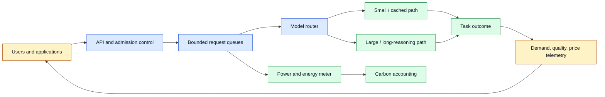
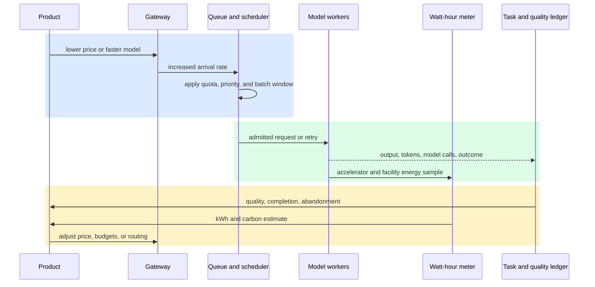

# Jevons Paradox in AI Systems
Status: durable
Sources: [William Stanley Jevons — 1865, The Coal Question](https://oll.libertyfund.org/titles/jevons-the-coal-question?html=true); [Pilz, Heim, and Brown — 2024, Increased Compute Efficiency and the Diffusion of AI Capabilities](https://arxiv.org/abs/2311.15377); [Oviedo et al. — 2026, Energy Use of AI Inference, Efficiency Pathways, and Test-Time Scaling](https://arxiv.org/abs/2509.20241)

## In one sentence

Jevons paradox is the possibility that making an AI operation cheaper or more energy-efficient increases total demand enough to raise aggregate compute and energy use, so an efficient model is not automatically a low-impact system.

## Background: what existed before

An AI team usually begins with a local optimization question: how many requests can one accelerator serve, how many tokens can be generated per dollar, or how many watt-hours (Wh) does one answer consume? Those are useful measurements. A **unit metric** describes one item of work; examples include dollars per request, joules per output token, or tokens per second per GPU. A **system metric** describes the fleet: total requests, accelerator-hours, electricity, queue delay, and carbon emissions over a day or month. Confusing the two is the starting point for many bad capacity plans.

The historical baseline comes from nineteenth-century coal use. In *The Coal Question*, William Stanley Jevons examined improvements in the efficiency of coal-consuming engines. His argument was not that every efficiency improvement must increase resource consumption. It was that cheaper and more productive use of coal could expand the economic uses of coal, so aggregate consumption could rise even while each unit of output used less coal. This is now called the **Jevons paradox** or the rebound effect. The Online Library of Liberty describes the book as a warning about rising coal costs as industrialization spread; its contents include a chapter on the economy of fuel and another on the growth of coal consumption.

The AI analogy is not a claim that GPUs are steam engines or that electricity markets behave exactly like nineteenth-century coal markets. It is a systems hypothesis: if inference becomes cheaper, products may lower prices, add features, increase quality through longer reasoning, serve more users, or run more background jobs. Demand can rise faster than efficiency improves. There are also **direct rebound effects**, where the same user calls a cheaper service more often, **indirect effects**, where savings fund another compute-heavy feature, and **scale effects**, where a product reaches a new population.

Before modern accelerators, serving capacity was commonly planned around a relatively fixed request volume and a model whose cost was treated as a property of its architecture. That assumption is weak for APIs and agent systems. A request may invoke a model several times, retry after a timeout, call tools, generate a long answer, or launch parallel subagents. A lower per-call price can change the application design itself. The relevant unit is often not “one completion” but “one successful task,” including failed attempts, orchestration, retrieval, tool calls, monitoring, and human review.

Three prerequisites help with this lesson. First, understand a queue: requests wait when arrival rate approaches service capacity, and p95 latency can rise before average utilization looks alarming. Second, understand capacity planning: hardware, power delivery, cooling, network links, model memory, and concurrency are finite. Third, distinguish electricity from carbon. Electricity is measured in Wh or kWh; carbon depends on the emissions intensity and timing of the electricity supply, plus the accounting boundary. A lower-energy request can still cause more total emissions if request volume expands, and a high-energy request may have a different carbon impact in a different region or hour.

## What changed and why now

AI efficiency is improving along several independent axes. Hardware delivers more operations per dollar and often more operations per watt. Algorithms may reach a target capability with fewer operations. Quantization reduces numerical precision and often memory traffic. Batching shares overhead across requests. KV caching reuses attention state. Distillation and smaller models move some tasks to cheaper runtimes. Routing sends easy requests to smaller models. These changes reduce the resource required for a chosen unit of work, but they also make more workloads economically viable.

Pilz, Heim, and Brown describe this broader phenomenon as increasing **compute investment efficiency**: the conversion from money invested in training compute to model performance improves through hardware and algorithmic progress. Their paper separates an **access effect**, in which less investment is required to reach a given performance, from a **performance effect**, in which a given investment produces more performance. The paper is mainly about training and diffusion of capabilities, not a measurement of production inference energy. Its relevance here is the mechanism: efficiency can lower entry barriers while giving large investors more capability at the same budget.

Inference adds another feedback loop. If a model costs $0.01 per useful task, a product may serve a customer who was uneconomic at $0.10. If the product instead spends the savings on a ten-times-longer answer, the unit energy can increase rather than decrease. If price falls and demand grows by more than the inverse efficiency gain, total resource use rises. The algebra is simple, but the system causes are not.

Let baseline demand be Q₀, baseline energy per task be e₀, and new energy per task be e₁ = e₀/r, where r is the efficiency improvement. Let demand grow by g, so Q₁ = gQ₀. Then the direct-energy ratio is `E₁ / E₀ = (Q₁ × e₁) / (Q₀ × e₀) = g / r`.

Total direct energy falls only when g < r. If a runtime is twice as efficient (r = 2) but tasks become three times as numerous (g = 3), fleet energy becomes 3/2, or 1.5 times, the baseline. If task count doubles exactly with a two-times efficiency gain, direct energy is flat before considering data movement, idle power, cooling, storage, and network overhead. This ratio is a screening test before a team builds a detailed capacity model.

Demand sensitivity can be expressed with a price elasticity estimate. If request price changes from p₀ to p₁ and volume changes from Q₀ to Q₁, the arc elasticity approximation is `ε = ((Q₁ − Q₀) / ((Q₁ + Q₀)/2)) / ((p₁ − p₀) / ((p₁ + p₀)/2))`. A negative ε is normal for a price reduction. The efficiency rollout is a rebound risk when the observed volume increase is large enough that g/r ≥ 1; elasticity helps explain why, but it does not prove causality because new features, customers, and seasonality may move Q at the same time.

This is a planning model, not a universal law. Demand may be capped by market size, regulation, data availability, user attention, or a hard power limit. A product may keep a fixed request budget and pocket the savings. A smaller model may fail quality tests, causing users to retry or escalate to a larger model. A more efficient algorithm may increase memory, network traffic, or monitoring overhead. Substitution matters too: an AI workflow could replace a more energy-intensive process, or it could create new work that did not exist before.

## Impact on current processing and architecture

An efficiency change should enter the architecture as a versioned workload change, not only as a model-runtime upgrade. Record the request class, model and quantization version, input and output tokens, reasoning or test-time-scaling budget, number of model calls, cache state, accelerator time, facility overhead, and outcome quality. A single “Wh per query” number hides the difference between a short cached classification and an agent that retries four tool calls.



The request path needs a demand-control contract. A router can reduce energy per successful task by choosing a smaller model for easy requests, but it must not silently reduce quality below the task’s acceptance test. An admission controller can protect a power or latency budget by delaying low-priority work, applying per-tenant quotas, or returning a typed overload response. A queue is not an energy-saving device by itself: it changes when work runs and can improve batching, but it can also increase stale requests, retries, and abandoned work.

Capacity planning should include at least four layers. **Compute capacity** is accelerator time and memory. **Service capacity** is requests or successful tasks per second at an SLO. **Facility capacity** is power, cooling, and rack or regional limits. **Demand capacity** is the volume the product will accept after price, latency, and quality change. An efficiency rollout that doubles service capacity but also causes a fourfold demand increase creates a larger power and queue problem. Forecast the demand response explicitly, even if the forecast is a range.



The sequence shows why a benchmark result is not a capacity plan. The product changes price or latency; the gateway sees a new arrival pattern; the scheduler changes batching and queue wait; workers perform more or longer calls; and telemetry reveals whether the intended task actually completed. If quality falls, users may retry, ask follow-up questions, or switch to a larger model. The effective energy per successful task can rise even when raw energy per generated token falls.

At the queue boundary, the useful quantity is **goodput**, not merely throughput. Let λ be admitted arrivals per second and μ be service completions per second. In a simple single-server approximation, utilization is ρ = λ/μ. As ρ approaches 1, waiting time becomes highly sensitive to small demand changes; a rough M/M/1 expected-system-time approximation is `W = 1 / (μ − λ)`. Real model serving is not an M/M/1 queue—it has batching, multiple workers, variable token lengths, and priorities—but the equation explains why a 10% demand increase near saturation can create a much larger latency problem than the same increase at low utilization. Replace the approximation with measured load tests and percentile SLOs for production planning.

Energy accounting should use a clear boundary. A narrow measurement may include GPU board power during inference. A wider one can include CPU, memory, network, storage, cooling, and power-usage effectiveness (PUE). For a first service estimate, calculate `E_total = N × E_task`, then document whether E_task is measured at the device, node, or facility boundary. If the measurement covers IT power and the facility has PUE pue, a rough facility estimate is `E_facility ≈ E_IT × pue`. Carbon can be approximated as `C = E_kWh × I`, where I is an emissions factor in kgCO2e/kWh, but the factor depends on region, time, procurement, and accounting method. Treat a result as an estimate and preserve the assumptions.

## Real-world applications and constraints

An enterprise coding assistant may become cheaper per accepted change after quantization, caching, and better batching. The organization can then enable it for every pull request, run more continuous scans, or give it a larger context window. Compute per scan falls, but scans per day and output length grow. The correct dashboard includes accepted changes, false-positive review time, model calls per change, queue delay, and total kWh—not only tokens per second.

A customer-support agent may use a small model for routing and a larger model for difficult cases. If the small model lowers cost, the business may offer 24-hour coverage or translate every interaction into multiple languages. This can create indirect demand and more storage, retrieval, and speech processing. Capacity plans should allocate budgets by workflow and measure successful resolution, escalation, and repeated customer messages.

Test-time scaling is a particularly clear AI rebound mechanism. The Oviedo et al. paper’s 2026 version presents a bottom-up framework using token throughput, node power, and overhead under large-scale deployment assumptions. The authors estimate a median 0.31 Wh per query for frontier-scale models over 200 billion parameters on H100 nodes, with an interquartile range of 0.16–0.60 Wh. They estimate that queries 15 times longer under test-time scaling reach a median 3.91 Wh, or roughly 13 times the median in their scenario. They also estimate 0.7 GWh per day for one billion queries, rising to 1.7 GWh when 10% are long queries. These are author estimates under stated assumptions, not a universal meter reading for every model or datacenter.

Those estimates change the architecture question. A product can use efficiency interventions to offset some long-query demand, but it cannot assume that more reasoning is free. Put a reasoning budget in the API, expose it to the scheduler, and record whether extra tokens improve the accepted-task rate. Use an asynchronous queue for work that does not need interactive latency, and reserve capacity for interactive traffic. If long jobs share a worker pool with short jobs, use separate queues or admission classes so tail latency does not become the hidden cost of quality.

For a data-center operator, efficiency may release power headroom that is immediately consumed by new tenants or higher utilization. That is economically rational, but it means local energy intensity and fleet energy can diverge. A regional power constraint may turn the paradox into a hard admission problem: the system can be compute-efficient and still unable to accept the forecast arrival rate. Track peak MW as well as monthly kWh, because transformers, cooling loops, and grid interconnection are capacity constraints.

## Mental model

Treat AI efficiency as a lower toll on a road. The toll reduction can make each trip cheaper, improve throughput, and reduce fuel per trip. It can also make people take more trips, move farther, or build businesses that depend on the road. For an AI service, the “trip” is a successful business task, not a token. The product owner controls price, feature availability, context and reasoning budgets, and retry policy; the platform team controls queues, routing, batching, hardware, and power; the sustainability team controls measurement boundaries and emissions factors. All three must be in the same feedback loop.

Use four questions for every optimization:

1. What resource falls per accepted task?
2. What new demand becomes economically or operationally possible?
3. Does demand grow faster than unit efficiency improves?
4. What quality, queue, facility, and carbon constraints limit the new workload?

The important word is **accepted**. A request that times out, is retried, or is discarded after expensive generation consumed resources without delivering the product outcome. Conversely, an AI task may replace a larger baseline activity, in which case total system impact requires a counterfactual comparison rather than simply adding AI energy.

## What changed this month

No September source in this lesson claims that a particular current AI release has caused a measured Jevons rebound. This September lesson adds a systems lens to the month’s serving and capacity topics: efficiency should be evaluated together with demand, queues, and facility constraints. The cited 2026 inference-energy paper makes test-time scaling and production-scale accounting concrete, while the compute-efficiency paper explains access and performance effects for diffusion. The historical source supplies the caution that lower resource use per unit does not settle the aggregate resource question.

For this month’s engineering work, the practical change is to make demand a first-class variable in an efficiency experiment. A rollout report should state the before-and-after unit metric, request volume, task success rate, output and reasoning lengths, retries, queue percentiles, accelerator-hours, kWh, and carbon assumptions. If only the first metric is available, the result is an incomplete efficiency claim.

## Engineering consequence

Define a service-level unit such as “successful grounded answer,” “accepted code change,” or “resolved support case.” Report both unit and aggregate metrics:

| Layer | Useful metric | Question it answers |
|---|---|---|
| Model | Wh per output token or call | Did the runtime become more efficient? |
| Task | Wh per successful task | Did quality and retries preserve the gain? |
| Service | kWh per day, p95 latency, queue age | Can the API sustain actual arrivals? |
| Facility | peak MW, cooling load, regional kWh | Can the site accept the workload? |
| Climate | kgCO2e per task and total kgCO2e | What accounting boundary and grid factor apply? |

Run a controlled rollout with a holdout cohort. Keep model quality tests, token limits, routing rules, and retry behavior visible. Compare the same task mix before and after the optimization, then separately measure demand changes after price, latency, or feature exposure changes. Use a queue simulator or load test to explore arrival-rate scenarios rather than assuming today’s traffic remains fixed.

The policy response need not be “never optimize.” Efficiency is valuable: it can lower cost, expand access, reduce per-task energy, and make useful services possible. The consequence is to pair it with guardrails. Set budgets for background work, cap unnecessary test-time scaling, expire abandoned jobs, prioritize useful outcomes over raw token production, and reserve power and latency for critical traffic. When a task has a genuine replacement effect, measure the displaced process and include it in the comparison.

## Limits and failure modes

**Jevons is not a universal law.** Efficiency can reduce total resource use when demand is fixed, constrained, or insufficiently price-sensitive. A team may use savings to retire hardware or keep a fixed quota. Call the result a rebound risk or hypothesis unless aggregate evidence shows otherwise.

**Substitution changes the counterfactual.** AI might replace travel, manual search, or another compute process, or it might add a new service. Counting only AI electricity cannot establish whether the broader activity increased or decreased.

**Income and scale effects are hard to separate.** Lower prices can increase use, but product growth, new customers, and new features can increase it too. A before-and-after comparison needs demand, price, feature, and population context.

**Quality failures create hidden energy.** A smaller or more aggressively quantized model may generate wrong answers that trigger retries, human review, or escalation to a larger model. Measure successful outcomes and rework.

**Energy estimates have boundaries.** Device power, node power, facility power, embodied hardware impacts, and carbon accounting are different scopes. The inference-energy paper’s estimates depend on model, hardware, throughput, overhead, and workload assumptions. Do not copy them into a product SLO without calibration.

**Carbon is not electricity.** Location and time change the emissions factor. Renewable procurement claims, marginal grid emissions, and average grid factors answer different questions. State which one is used.

**Queues can turn efficiency into latency regression.** More affordable work can push utilization toward saturation. As arrival rate approaches service rate, wait time grows nonlinearly. Split interactive and batch queues, cap concurrency, and shed low-value work before the system spends energy on requests likely to time out.

**Efficiency can increase capability diffusion.** The compute-efficiency paper discusses more actors reaching a given performance while large investors may continue moving the frontier. Broader access can produce benefits and safety challenges. A lower training or serving barrier does not by itself establish misuse or capability risk; evaluate the actual system and deployment.

**Local optimization can move the bottleneck.** Lower GPU energy may increase network, storage, CPU, cooling, or monitoring load. Include those components when the optimization changes architecture or request volume.

## Build it locally

This dependency-free simulation models a service before and after an efficiency rollout. It varies demand growth, energy per task, task-success rate, retry work, queue capacity, and grid intensity. It is not a datacenter power model; it is a transparent accounting exercise that makes the rebound threshold and successful-task metric testable.

```python
from dataclasses import dataclass


@dataclass(frozen=True)
class Scenario:
    name: str
    requests: int
    energy_per_attempt_wh: float
    success_rate: float
    queue_capacity_per_day: int
    carbon_kg_per_kwh: float


def evaluate(scenario):
    admitted = min(scenario.requests, scenario.queue_capacity_per_day)
    successful = int(admitted * scenario.success_rate)
    attempts_for_success = admitted
    total_wh = attempts_for_success * scenario.energy_per_attempt_wh
    kwh = total_wh / 1000
    carbon = kwh * scenario.carbon_kg_per_kwh
    return {
        "admitted": admitted,
        "successful": successful,
        "total_kwh": kwh,
        "kgco2e": carbon,
        "wh_per_success": total_wh / successful if successful else float("inf"),
    }


baseline = Scenario("baseline", 1000, 1.0, 0.95, 2000, 0.4)
efficient_but_more_demand = Scenario("efficient + demand", 2200, 0.45, 0.95, 3000, 0.4)
efficient_with_budget = Scenario("efficient + budget", 1400, 0.45, 0.95, 3000, 0.4)

for scenario in (baseline, efficient_but_more_demand, efficient_with_budget):
    result = evaluate(scenario)
    print(scenario.name, result)

old = evaluate(baseline)
rebound = evaluate(efficient_but_more_demand)
budgeted = evaluate(efficient_with_budget)
assert rebound["wh_per_success"] < old["wh_per_success"]
assert rebound["total_kwh"] < old["total_kwh"]
assert budgeted["total_kwh"] < old["total_kwh"]
print("unit efficiency improves; demand policy determines aggregate energy")
```

The scenarios intentionally separate two ideas. The efficient service uses less energy per attempt. In this particular parameterization, demand grows to 2.2 times baseline while energy per attempt falls to 0.45 times baseline, so aggregate energy still falls, but by much less than unit energy. Change `requests` to 2600 and observe aggregate energy exceed baseline: that is the simple rebound threshold. Then lower `success_rate` and see why energy per successful task can worsen even when energy per attempt improves.

## Numbered local implementation steps

1. Save the code as `jevons_ai.py` and run `python3 jevons_ai.py`.
2. Change `requests` in `efficient_but_more_demand` to 2600 and record the aggregate-energy crossover.
3. Add a `retry_rate` field and count an extra attempt for each failed task; compare energy per successful task.
4. Add `input_tokens` and `output_tokens`, then report energy per output token and per successful task separately.
5. Replace the fixed queue capacity with two capacities: interactive and batch. Admit work into each queue independently.
6. Add a second region with a different `carbon_kg_per_kwh` and route only batch work there; explain why kWh and kgCO2e rankings can differ.
7. Add a `facility_overhead` multiplier for CPU, cooling, and power-delivery overhead. Document whether it is a measured value or an assumption.
8. Add a quality threshold so a request below the threshold escalates to a larger model with a second energy cost.
9. Generate five demand-growth scenarios and print the first growth factor at which total kWh exceeds baseline.
10. Write a one-page rollout decision containing unit energy, successful-task energy, total kWh, peak queue size, p95 wait, and carbon-accounting assumptions.

## Mini exercise (15–30 min)

Extend the simulator with two model routes: a small route using 0.4 Wh per attempt and succeeding on 88% of tasks, and a large route using 1.5 Wh and succeeding on 97%. Route failed small-model tasks to the large model. Then vary demand from 0.5x to 4x baseline and add an interactive queue limit. Plot or print total kWh, Wh per successful task, successful tasks, and rejected tasks. Decide whether the small route is an efficiency improvement under three policies: fixed demand, unlimited demand, and a hard daily energy budget. Explain which conclusions are measurements from your simulation and which are inferences about a real service.

## Interview Q&A

**1. What is Jevons paradox in an AI serving context?**

It is the possibility that lower resource use per AI task lowers cost or expands capability, causing enough additional demand that total compute or energy rises. It is a possible rebound mechanism, not a guaranteed outcome.

**2. How do you test whether an optimization caused a rebound?**

Measure a matched baseline and rollout: energy per attempt, energy per successful task, request volume, task success, retries, output and reasoning length, queue behavior, and aggregate kWh. Track changes in price, feature exposure, and user population. A unit improvement alone cannot answer the aggregate question.

**3. Why is energy per token a weak primary KPI?**

Tokens are not equivalent tasks. A longer answer may be more useful, while a short wrong answer may cause retries and escalation. Use a business or engineering unit such as successful grounded answer, accepted code change, or resolved case, and retain token metrics as diagnostic measures.

**4. What is the difference between direct and indirect rebound?**

Direct rebound is using the cheaper service more often for the same general purpose. Indirect rebound is spending savings on another activity, such as longer reasoning, more agents, wider coverage, or a new feature. Both can increase aggregate resource demand.

**5. How do queues relate to the paradox?**

Efficiency can increase the arrival rate a product accepts, pushing utilization toward saturation. Once service rate is close to arrival rate, queue wait and tail latency can grow sharply. Admission control, quotas, separate batch and interactive queues, and overload policies make the demand response explicit.

**6. Does a lower energy estimate prove lower carbon emissions?**

No. Carbon depends on total kWh, location, time, emissions factor, and accounting boundary. A service can lower energy per task while increasing total kWh and emissions through volume growth. Conversely, a workload shift to a cleaner region or time may change carbon without changing kWh.

**7. Is Jevons paradox a law of AI economics?**

No. Demand may be capped, savings may not be passed to users, quality may limit adoption, or a fixed quota may hold total work constant. Substitution effects and counterfactuals can also make the broader impact decrease. Treat it as a hypothesis to test with demand and system data.

## Glossary

- **Admission control:** A policy that accepts, delays, routes, or rejects work before it consumes scarce service capacity.
- **Carbon intensity:** Emissions associated with one unit of electricity, commonly kgCO2e/kWh under a stated accounting method.
- **Compute efficiency:** Resource or investment required to reach a specified model performance or useful task outcome.
- **Direct rebound:** Increased use of a service because its effective price or cost fell.
- **Embodied impact:** Energy and emissions associated with manufacturing, transporting, and retiring hardware rather than operating it.
- **Facility overhead:** Power used outside the accelerator itself, including CPUs, networking, storage, cooling, and power delivery.
- **Goodput:** Useful completed work that satisfies a declared latency, quality, or correctness objective.
- **Indirect rebound:** New resource demand created when savings enable other activities or features.
- **Jevons paradox:** The possibility that efficiency lowers per-unit resource use but increases aggregate resource consumption through expanded demand.
- **PUE:** Power usage effectiveness, a ratio describing total facility power relative to IT equipment power.
- **Queue utilization:** The share of service capacity occupied over time; high utilization can produce disproportionate wait-time growth.
- **Rebound effect:** A broader term for behavior or market responses that offset part of an efficiency gain.
- **Successful task:** A product-specific unit that meets the required quality and completion criteria, not merely a returned model response.
- **Test-time scaling:** Spending additional inference computation, such as longer reasoning or more search, to improve an answer or task result.
- **Unit energy:** Energy assigned to one attempt, token, request, or successful task under a defined measurement boundary.

## References

1. William Stanley Jevons, *The Coal Question* (1865), Online Library of Liberty, especially the chapters on the economy of fuel and coal consumption: [https://oll.libertyfund.org/titles/jevons-the-coal-question?html=true](https://oll.libertyfund.org/titles/jevons-the-coal-question?html=true). Historical primary source.
2. Konstantin Pilz, Lennart Heim, and Nicholas Brown, “Increased Compute Efficiency and the Diffusion of AI Capabilities,” arXiv:2311.15377, revised 2024-02-13: [https://arxiv.org/abs/2311.15377](https://arxiv.org/abs/2311.15377). Research paper; claims about access and performance effects are attributed to the authors.
3. Felipe Oviedo et al., “Energy Use of AI Inference, Efficiency Pathways, and Test-Time Scaling,” arXiv:2509.20241, revised 2026-06-09; journal reference *Joule* (2026): [https://arxiv.org/abs/2509.20241](https://arxiv.org/abs/2509.20241). Research paper; energy figures are author estimates under stated assumptions.
4. The architecture, KPI recommendations, queue policies, and simulator in this lesson are engineering analysis and inference, not measurements from the cited sources.

## Claim ledger

| Claim | Source | Fact or inference |
|---|---|---|
| Jevons’s 1865 book examined fuel economy, coal consumption, and the economic consequences of industrial growth. | [The Coal Question](https://oll.libertyfund.org/titles/jevons-the-coal-question?html=true) | Historical fact |
| Efficiency can expand the economically useful demand for a resource, so per-unit savings do not determine aggregate consumption. | Jevons, *The Coal Question*, interpreted as the historical mechanism discussed in this lesson | Historical interpretation |
| Increasing compute efficiency can create an access effect and a performance effect. | [Pilz, Heim, and Brown, arXiv:2311.15377](https://arxiv.org/abs/2311.15377) | Paper-author claim |
| The compute-efficiency paper focuses on training investment and capability diffusion, not a universal production-inference energy law. | [Pilz, Heim, and Brown, arXiv:2311.15377](https://arxiv.org/abs/2311.15377) | Source-scope fact |
| The inference-energy paper uses a bottom-up framework based on token throughput, node power, and overhead. | [Oviedo et al., arXiv:2509.20241](https://arxiv.org/abs/2509.20241) | Paper-author claim |
| The paper estimates a median 0.31 Wh/query for its frontier-scale H100 scenario and 3.91 Wh for its 15x-longer test-time-scaling scenario. | [Oviedo et al., arXiv:2509.20241](https://arxiv.org/abs/2509.20241) | Paper-author estimate |
| Demand growth greater than the efficiency ratio can make aggregate energy rise. | Algebraic model defined in this lesson | Engineering inference |
| Energy per successful task is more informative than energy per attempt when failures trigger retries or escalation. | Service-accounting analysis in this lesson | Engineering inference |
| Queue saturation, power limits, and carbon-accounting boundaries should be included in an AI efficiency rollout. | Distributed-systems and energy-accounting analysis in this lesson | Engineering inference |
| Jevons paradox is not universal; fixed demand, limited adoption, substitution, and income effects can change the outcome. | Jevons mechanism plus economic counterexamples; no cited source establishes universality | Inference and limitation |
