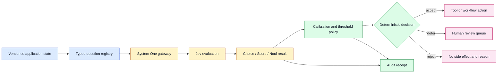
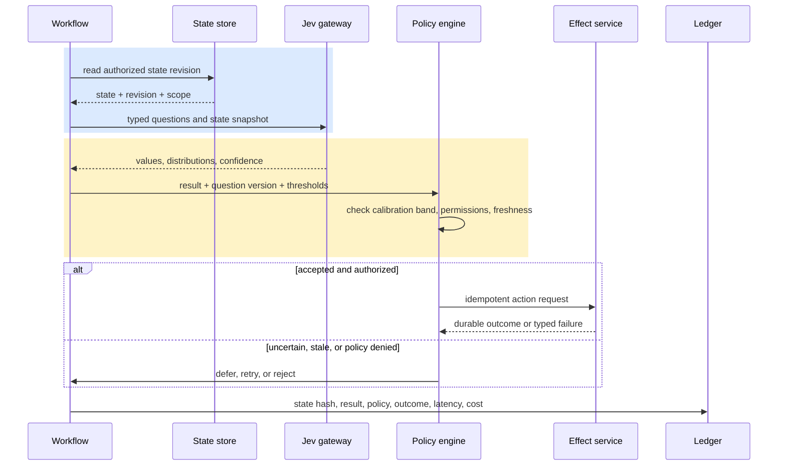
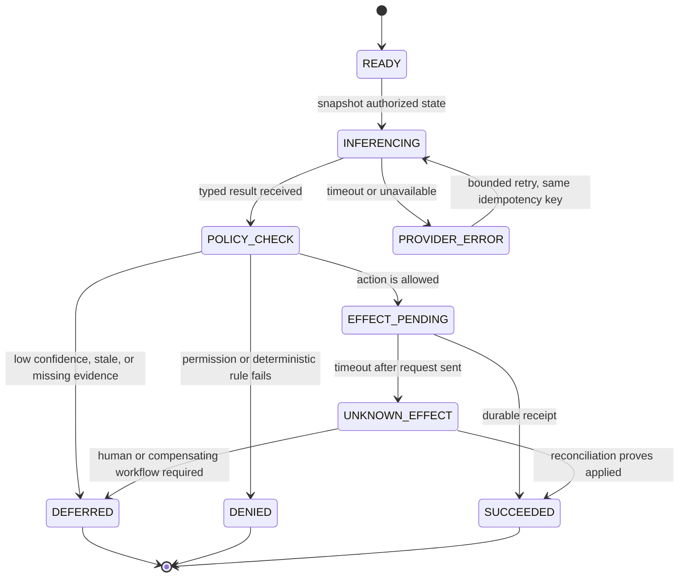

# System One Models and Jev: Typed Probabilistic Decisions
Status: emerging
Sources: [TypeSafe AI — 2026-09-15](https://typesafe.ai/blog/introducing-system-one-models-and-jev); [TypeSafe AI documentation — 2026-09](https://docs.typesafe.ai/introduction); [TypeSafe AI workflow evaluations — 2026-09](https://evals.typesafe.ai/)

## In one sentence

Jev is TypeSafe AI’s first public **System One Model**, presented as a model that evaluates typed questions against application state and returns structured values, probabilities, and confidence for software-controlled branching instead of generating a string that application code must parse.

## Background: what existed before

Most production software that uses a generative large language model (LLM) begins with a mismatch. The application owns a state object—an incident, invoice, support thread, policy record, or tool result—but the model is optimized to continue text. Engineers place the state and instructions in a prompt, ask for JSON, then convert the response back into a typed object. The surrounding system adds a schema, a parser, validation rules, retries, and a fallback. This pattern is useful, but the text-generation boundary remains part of the reliability surface.

Consider an invoice workflow. A conventional implementation might ask an LLM, “Should this invoice be paid, held, or rejected? Return JSON with an action and confidence.” The response can be valid JSON but still contain an unsupported action, a confidence outside the allowed range, a missing field, or a confident decision that does not match the company’s policy. A JSON schema can reject malformed shape, but it does not establish that the judgment is correct, calibrated, authorized, or safe to execute. The application therefore needs at least two layers: an uncertain model proposal and deterministic policy code that decides whether to accept it.

**Structured output** means data arranged according to a declared shape, such as an object with an enum field and a number. **Type safety** means that values crossing an interface satisfy the interface’s allowed types and constraints. Neither term means that the underlying judgment is true. A perfectly shaped `{"action": "approve"}` can still be the wrong business decision. That distinction is central to this lesson.

There are three common pre-System-One designs. In the first, the model emits free text and application code uses regular expressions or a parser. This is flexible but brittle: wording changes can break extraction, and malformed output may be interpreted as a valid but unintended command. In the second, the model emits schema-constrained JSON through a provider feature. This reduces structural errors, but the application still asks a text-oriented model to express a decision in a serialization format. In the third, a team decomposes the task into classifiers, rules, and validators. This is more operationally explicit, but the team must build or operate a model for each judgment and often lacks a native uncertainty interface.

The practical baseline is therefore not “LLMs are unusable.” It is that software has had to wrap a generative interface with parsers and validators. The wrapper owns schema validation, enum checks, thresholding, retries, authorization, audit logging, and human escalation. These controls remain necessary even when a model’s output is typed. A typed answer is an improved boundary, not a complete reliability argument.

Prerequisites for understanding Jev are modest. Know how an API request carries state and receives a response; know that a probability distribution assigns relative mass to possible outcomes; know that a threshold turns a continuous signal into a discrete branch; and know that calibration asks whether predicted probabilities correspond to observed frequencies. If a system says “0.8 confidence” on a group of decisions, a calibrated interpretation is that roughly 80% of comparable decisions should be correct—not that this individual answer is guaranteed.

## What changed and why now

On September 15, 2026, TypeSafe announced Jev as its first public System One Model and opened it in early access. The announcement defines System One models as a new class focused on fast, structured decisions that software can use directly. The official documentation describes Jev as receiving state and typed questions, then returning structured answers and probability information without a text-generation-and-parsing step.

The phrase **System One** is TypeSafe’s product and model-class framing, inspired by the fast, intuitive side of Daniel Kahneman’s “System 1” and “System 2” distinction. It should not be read as a general scientific proof that Jev performs human cognition or that fast decisions are universally safer. In the TypeSafe framing, the model’s job is a narrow judgment inside a workflow; composition, policy, and longer reasoning live in ordinary code and in the surrounding system.

The interface is best represented as:

```text
application state + typed questions -> typed answers + probabilities/confidence
```

For example, state might contain a support conversation, account facts, and recent tool results. A workflow can ask whether the request is urgent, choose one of three routing queues, and score evidence quality. The model returns values that code can compare and combine. TypeSafe’s documentation says its primitives can be mixed in a single call and evaluated independently against the same state. The intended engineering move is to ask small questions and compose the result in code rather than asking one broad prompt to perform all policy logic.

The official documentation names three primitives:

| Primitive | Decision shape | Returned information |
|---|---|---|
| `Choice` | one option from a declared list | selected choice, probabilities, confidence |
| `Score` | a score on a declared rubric | score, probabilities, confidence |
| `Noul` | whether a statement is true | a value from 0 to 1 |

The names and semantics above are official TypeSafe terminology. The most important design property is not the branding; it is that the question’s output domain is declared before the model answers. A `Choice` cannot invent a fourth queue in the returned domain. A `Score` can be used as a graded signal rather than forcing an early yes/no branch. A `Noul` value can represent the model’s estimate for one proposition, while deterministic code decides what probability is sufficient to act.

TypeSafe also attributes Jev’s training and serving stack to two ideas: Reinforcement Learning for Calibrated Decisions (RLCD) and a parallel sampler. RLCD is presented by TypeSafe as a training method oriented toward calibrated decisions rather than human-preferred text. The parallel sampler is presented as producing outputs in parallel rather than autoregressively generating one token after another. These are vendor descriptions of the released system; the announcement is not an independent peer-reviewed validation of the training method, calibration across domains, or speed claims.

The announcement makes stronger claims about speed, efficiency, cost, and hallucination/type errors. TypeSafe includes important qualifications: its speed measurements were generally made from laptops on the US West Coast, pricing sustainability is not proven, and the no-type-error property refers to the constrained schema rather than empirical correctness. This lesson therefore treats those statements as release-specific vendor claims. A production team should measure its own workload, region, network path, concurrency, retries, calibration, and business outcomes.

## Impact on current processing and architecture

Jev changes the boundary between uncertain inference and deterministic processing. With a generative LLM, the boundary is usually a text response followed by parsing. With a System One-style interface, the intended boundary is a typed decision response followed by policy evaluation. The model still supplies uncertain evidence; the application still owns side effects.



The question registry is an important new component. It should version each question’s name, type, options or rubric, purpose, state fields, owner, threshold policy, and evaluation set. A question is an API contract, not merely a prompt fragment. If an option is renamed, a score rubric changes, or a state field gains a new meaning, the system needs a compatibility and evaluation path. Store the question version with every decision receipt.

The state sent to a model also deserves explicit design. State should be bounded, authorized, and reproducible enough to explain what the model saw. Include a correlation ID, tenant or subject scope, source timestamps, and a content hash. Redact secrets and unrelated personal data before inference. Do not let a tool result silently mutate the state between questions; either snapshot the state or record the exact revision used. Independent questions are easier to reason about when they share a known snapshot.

The response should be separated into three layers. First is the model result: selected label, score, probability distribution, confidence, and provider metadata. Second is policy interpretation: thresholds, abstention bands, eligibility rules, and authorization. Third is the side effect: a queue write, tool call, payment action, or customer message. This separation prevents a high-confidence model result from becoming an implicit permission to act.

Thresholds are not universal constants. Suppose a fraud workflow uses a `Noul` probability that a transaction is suspicious. A threshold of 0.9 may send fewer cases to review but miss more fraud; a threshold of 0.6 may catch more suspicious cases while creating an expensive queue. The team should choose thresholds against measured false-positive and false-negative costs, capacity, and regulatory obligations. For `Choice`, the top probability alone may be insufficient: a close distribution between two queues should often defer. For `Score`, a score can trigger a review band rather than a binary action.

Calibration should be checked by slice. Compare predicted confidence or probabilities with observed outcomes over time, tenant, language, input length, product surface, and policy version. Reliability diagrams, expected calibration error, Brier score, confusion matrices, and abstention coverage can help, but no metric substitutes for domain labels. If the labels are noisy or the action changes user behavior, measure those effects explicitly. A model’s confidence can be useful while being miscalibrated for a new population.

For a binary `Noul`-style question, a basic calibration score is the Brier score: `Brier = (1/n) × Σᵢ (pᵢ − yᵢ)²`, where pᵢ is the returned probability and yᵢ is the observed label, 0 or 1. Lower is better, but the score mixes calibration and discrimination. A reliability table adds the operational view: group predictions into probability bins, compare each bin’s mean p with its observed positive rate, and report how many examples support the estimate. Expected calibration error is often summarized as `ECE = Σ_b (n_b/n) × |accuracy_b − confidence_b|`; it is useful as a summary but can hide sparse or strategically important slices. For a `Choice`, evaluate one-vs-rest calibration per option and also measure confusion and abstention coverage.

Thresholds should be chosen from expected loss, not from a vendor default. If an unsafe approval costs 20 units and a human review costs 2, a rough break-even safe-probability threshold is `τ = 1 − 2/20 = 0.90`, before capacity, asymmetric harm, and calibration uncertainty are included. This is a decision-theory starting point, not permission to automate a high-impact decision. The production policy should also cap review volume and use a separate, stricter gate for irreversible effects.



The state machine below makes an often-missed distinction visible: a typed model response can be valid while the workflow is still unable to act. `UNKNOWN_EFFECT` is not a retry instruction; it is a reconciliation state for a request whose remote outcome cannot yet be proved.



The failure flow matters because a typed response can still be operationally invalid. A timeout should not be interpreted as a negative decision. A malformed or incomplete response should enter a provider-error path, even if the SDK normally prevents it. A stale state revision should be rejected or re-evaluated. A low-confidence result should be an explicit `defer` state. A policy denial is different from a model failure, and both are different from a downstream tool failure. Use idempotency keys so a retry cannot duplicate a side effect.

The architecture also changes latency and cost accounting. The relevant measurement is end-to-end time from state read through policy and effect, not only model service time. Record network latency, queue wait, model evaluation, policy evaluation, retries, and tool execution separately. If multiple atomic questions can be sent together, compare one multi-question call with several sequential calls, but validate the provider’s independence and failure behavior. TypeSafe says adding questions barely changes response time in its interface; treat that as a vendor claim to verify under your state size, concurrency, and network conditions.

## Real-world applications and constraints

In customer support, `Choice` can select billing, account access, technical issue, or safety escalation. `Score` can estimate evidence completeness, and `Noul` can evaluate whether the customer explicitly requested a refund. Code can combine these outputs with account permissions and service-level timers. The model should not directly issue a refund. A deterministic authorization service should check eligibility, amount limits, prior refunds, and idempotency.

In security operations, a workflow can ask whether an alert is likely benign, score evidence quality, and choose close, analyst review, or containment. The state should include the alert and authorized machine context, not arbitrary untrusted text from a ticket. A low-confidence or conflicting result should preserve the alert and request analyst review. Since false containment can interrupt production, the action threshold must be stricter than the threshold for creating a review case.

In document processing, `Choice` can identify document class, `Score` can rate extraction quality, and `Noul` can test whether a required clause appears. A typed decision does not prove the clause exists. Keep the source span or retrieval evidence, run deterministic checks where possible, and route low-quality scans to OCR or human review. Store the original document hash and model question version for audit.

In agent traces, atomic questions can assess whether a tool call matched an allowlisted purpose, whether the user’s request was fulfilled, and whether a human should inspect the run. The output can prioritize review, but the agent runtime should enforce permissions independently. A model that says a tool call is safe is not itself a capability token.

Operational constraints are substantial. Early access may have changing availability, quotas, SDK behavior, and pricing. Data residency, retention, encryption, and tenant isolation must be confirmed for the actual deployment rather than inferred from a product announcement. High-cardinality choices may require decomposition or a two-stage score-and-select design; TypeSafe’s announcement describes such a pattern for larger choice sets. State size, sensitive data, and network distance can dominate an advertised model latency. Calibration can drift when policy, users, or upstream sensors change.

## Mental model

Think of Jev as a typed sensor for software decisions, not as an autonomous executor. The state is the observation packet. A typed question is the measurement request. The returned value is an uncertain signal with a declared domain. The policy engine is the controller that decides whether the signal is strong enough, fresh enough, and authorized enough to cause an action. The audit ledger is the flight recorder.

This model clarifies what System One does and does not replace. It can replace some “ask for JSON, parse JSON, retry malformed output” plumbing. It does not replace business rules, access control, state management, evaluation, calibration, rate limits, human review, or safe tool wrappers. It may make a fuzzy judgment easier to compose because the output domain and uncertainty are explicit. The application still decides how much uncertainty it can tolerate.

## What changed this month

The September change is the public announcement of Jev and the System One framing, not a claim that the entire industry has adopted a new model interface. TypeSafe made an early-access product available and published documentation for typed questions and structured probabilistic answers. The announcement also published a workflow-evaluation approach in which narrow questions are decomposed and combined by code.

The engineering shift is from “make a generative model emit a parseable answer” toward “ask a declared decision question and consume a typed uncertain result.” That shift is meaningful only when the question registry, threshold policy, calibration set, and audit trail are treated as production artifacts. It also changes what to benchmark: parser failures may decline, while state quality, question design, calibration, drift, and policy mistakes become more visible.

## Engineering consequence

Adopt a typed-decision boundary only for decisions that can be decomposed, evaluated, and safely deferred. Start with read-only or recommendation workflows. Keep deterministic rules around permissions, money movement, destructive actions, and safety-critical operations. Establish a shadow mode that records Jev’s result without changing the existing decision, then compare calibration, coverage, cost, latency, and operator workload.

For each question, maintain a small contract:

| Contract field | Example | Why it matters |
|---|---|---|
| State schema | alert, asset, owner, recent events | limits context and supports replay |
| Question type | `Choice` with three queues | prevents ambiguous output domains |
| Version | `triage.v3` | ties decisions to a stable meaning |
| Action bands | accept, defer, reject | makes uncertainty operational |
| Evidence label | analyst disposition within 24 hours | enables calibration measurement |
| Side-effect policy | analyst queue only | limits blast radius during rollout |

Do not compare Jev with an LLM only on token latency. Compare complete workflows: same state, same decision decomposition, same labels, same thresholds, same retry budget, and same downstream actions. Include a parser-and-validator baseline because that is the system Jev is intended to simplify. Report valid-response rate, semantic accuracy, calibration/Brier score, abstention coverage, p50/p95 end-to-end latency, cost per accepted decision, review volume, and side-effect error rate. Record provider claims separately from measurements made by the team.

## Limits and failure modes

Type safety does not imply semantic correctness. A declared `Choice` set can prevent an unsupported label while preserving a wrong supported label. A confidence value can be useful but miscalibrated for a slice. The phrase “cannot hallucinate” in TypeSafe’s announcement should not be generalized to “cannot be wrong,” “cannot invent evidence,” or “cannot be manipulated by input.” A typed model can still misinterpret state, over-weight a misleading field, or make an unsafe recommendation.

State poisoning is a major risk. If an email, webpage, ticket, or tool result contains instructions, the workflow must treat it as data and preserve provenance. Do not allow state text to redefine the question, thresholds, or tool permissions. Separate user-controlled fields from system policy and test prompt-injection-like content even when the model does not return prose.

Calibration can fail under distribution shift, sparse labels, selective review, and feedback loops. If only low-confidence cases reach humans, the observed labels do not describe the whole population. If an automated action changes future data, old calibration results may no longer apply. Recalibrate or revert when slice error, abstention rate, or disagreement exceeds a pre-set bound.

Parallel question evaluation can hide dependency mistakes. Two questions may be syntactically independent but logically coupled. If question B needs the result of question A, run B after A or encode the dependency in deterministic code. Do not assume “parallel” means the model considered every question jointly or that adding questions is free in every network and quota regime.

Latency and cost claims are workload-specific. State serialization, transport, queueing, retries, regional distance, and logging can dominate the model call. Early-access quotas or pricing may change. Use a circuit breaker, bounded concurrency, request deadlines, and a fallback path. A fallback to a generative LLM should still use schema validation and the same policy engine; a fallback to “approve” is not a reliability strategy.

Finally, narrow typed decisions are a poor fit for open-ended writing, long-form explanation, novel planning, or tasks whose correct output cannot be expressed as a stable domain. For those tasks, a generative model may remain the appropriate component, with structured outputs and validators around it. System One is a new boundary for selected decisions, not a universal replacement for language models.

## Build it locally

The following dependency-free example simulates a typed decision service. It does not call TypeSafe, an LLM, or a paid API. The `simulate_jev` function stands in for a model and returns a `Choice` distribution, a `Score`, and a `Noul` probability. The policy layer then applies thresholds, freshness checks, and a safe defer path. The point is to make the interface and controls observable before connecting a real provider.

```python
from dataclasses import dataclass
from typing import Dict, List


@dataclass
class Decision:
    choice: str
    probabilities: Dict[str, float]
    confidence: float
    evidence_score: float
    suspicious_probability: float


def simulate_jev(state: Dict[str, object]) -> Decision:
    """Deterministic stand-in for a typed probabilistic model."""
    amount = float(state["amount"])
    receipt_match = bool(state["receipt_match"])
    if amount > 75 and not receipt_match:
        probabilities = {"approve": 0.08, "review": 0.87, "reject": 0.05}
        choice = "review"
    elif receipt_match:
        probabilities = {"approve": 0.91, "review": 0.07, "reject": 0.02}
        choice = "approve"
    else:
        probabilities = {"approve": 0.48, "review": 0.44, "reject": 0.08}
        choice = "approve"
    evidence_score = 0.9 if receipt_match else 0.45
    suspicious_probability = 0.2 if receipt_match else 0.78
    return Decision(
        choice=choice,
        probabilities=probabilities,
        confidence=max(probabilities.values()),
        evidence_score=evidence_score,
        suspicious_probability=suspicious_probability,
    )


def apply_policy(state: Dict[str, object], result: Decision) -> str:
    """Keep model output separate from authorization and side effects."""
    if state["state_version"] != "v1":
        return "defer: stale state"
    if result.confidence < 0.80:
        return "defer: low confidence"
    if result.evidence_score < 0.70:
        return "defer: insufficient evidence"
    if result.choice == "approve" and result.suspicious_probability >= 0.50:
        return "defer: suspicious signal"
    if result.choice not in {"approve", "review", "reject"}:
        return "reject: invalid choice"
    return result.choice


cases: List[Dict[str, object]] = [
    {"amount": 40, "receipt_match": True, "state_version": "v1"},
    {"amount": 120, "receipt_match": False, "state_version": "v1"},
    {"amount": 40, "receipt_match": False, "state_version": "v1"},
    {"amount": 40, "receipt_match": True, "state_version": "old"},
]

for state in cases:
    decision = simulate_jev(state)
    print(decision)
    print("policy result:", apply_policy(state, decision))
```

### Numbered local steps

1. Save the example as `typed_decisions.py` and run `python3 typed_decisions.py` with Python 3.9 or newer.
2. Add a `question_version` field to the state and include it in every printed receipt.
3. Change the low-confidence threshold from `0.80` to `0.95`; observe that more cases defer instead of acting.
4. Add a second simulated question, such as `receipt_is_readable`, and require both evidence signals before approval.
5. Generate 100 synthetic cases with known labels. Bin confidence into ranges such as 0.5–0.6 and 0.9–1.0, then compare average confidence with accuracy in each bin.
6. Add a deliberate stale-state case and verify that it cannot produce an approval.
7. Replace the final string with an idempotent action record containing a correlation ID, state hash, question version, result, policy decision, and reason.
8. Sketch the provider adapter you would need for a real API, but keep the policy function provider-independent so a timeout or migration cannot silently change authorization.

## Interview Q&A

### How is a System One model different from JSON mode?

JSON mode or structured output asks a generative model to serialize an answer into a schema and then lets application code parse it. TypeSafe presents Jev as directly evaluating typed questions and returning typed values with probability information. The difference is an interface and model objective claim, not a guarantee that the decision is correct. Both designs still need policy, calibration, authorization, and fallbacks.

### Why return probabilities instead of only the top choice?

Probabilities expose ambiguity. A top choice with 0.91 mass supports a different action policy from a top choice with 0.38 mass and a close second. The application can defer, request review, or gather more evidence rather than treating every classification as equally certain. The probabilities must be evaluated for calibration before being used as risk estimates.

### What should be in code and what should be in a question?

Put stable, auditable rules, permissions, arithmetic, thresholds, and side-effect sequencing in code. Put a narrow judgment that depends on messy state in a typed question. If a question combines several independent factors, split it into atomic questions and combine the results with an explicit formula or policy. This keeps policy changes reviewable and makes evaluation labels more specific.

### Does a type-safe result prevent hallucination?

No. It can constrain the result domain and prevent some structural errors, but it does not prove that state was interpreted correctly, evidence exists, or the selected label is true. TypeSafe uses stronger language in its announcement; that is a vendor claim about its interface and model. Engineers should continue to test adversarial state, provenance, calibration, and semantic accuracy.

### When should a workflow defer instead of retry?

Retry transient infrastructure errors such as a timeout when the request is still valid and the retry budget permits. Defer low confidence, conflicting signals, stale state, missing evidence, or a policy ambiguity to a human or later queue. Retrying an uncertain judgment without changing evidence can add cost without improving correctness.

### What is the main operational risk in adopting Jev?

The main risk is turning a clean typed interface into an unexamined automation path. Teams may trust the shape, confidence, or vendor speed claim and omit calibration, authorization, state freshness, idempotency, and audit records. Treat the model response as evidence in a controlled workflow, not as permission to act.

## Glossary

- **Atomic question:** A narrowly scoped judgment evaluated independently, such as whether a receipt matches an expense.
- **Calibration:** Agreement between predicted probabilities and observed frequencies over a defined population.
- **Choice:** A TypeSafe primitive that selects one option from a declared set and returns probabilities and confidence.
- **Confidence:** A reported measure of certainty associated with a typed answer; it requires local validation before operational use.
- **Noul:** TypeSafe’s primitive for evaluating whether a statement is true, returning a value from 0 to 1.
- **Policy engine:** Deterministic code that applies thresholds, permissions, freshness, and action rules to uncertain model results.
- **Probabilistic decision:** A typed answer accompanied by a distribution or scalar uncertainty signal rather than only a hard label.
- **RLCD:** TypeSafe’s name for Reinforcement Learning for Calibrated Decisions, described by the vendor as its training method for calibrated decisions.
- **Score:** A TypeSafe primitive that rates state on a declared scale and returns score-related probability information and confidence.
- **State:** The bounded, versioned application context evaluated by the model.
- **System One model:** TypeSafe’s term for models designed to make fast, structured decisions software can consume directly.
- **Typed output:** A result constrained to a declared data type or domain; it does not imply semantic correctness.

## References

1. TypeSafe AI, “Introducing System One Models & Jev,” September 15, 2026. Primary announcement and source for the System One framing, Jev release, RLCD, parallel sampling, pricing, speed, and capability claims: https://typesafe.ai/blog/introducing-system-one-models-and-jev
2. TypeSafe AI, “Introduction,” official documentation. Source for state-in/typed-decision-out behavior and Choice, Score, and Noul primitives: https://docs.typesafe.ai/introduction
3. TypeSafe AI, “Workflow evals.” Source for the vendor’s decomposition and workflow-evaluation methodology: https://evals.typesafe.ai/
4. TypeSafe AI, “System One Adapter for Python,” official GitHub repository. Useful reference for the contrast between a TypeSafe client and an LLM-backed compatibility adapter: https://github.com/typesafe-ai/system-one-adapter-python
5. Kahneman, Daniel, *Thinking, Fast and Slow*. The conceptual work named by TypeSafe as inspiration for the System One terminology; this lesson does not treat the analogy as a model-performance result.

## Claim ledger

| Claim | Source | Fact or inference |
|---|---|---|
| TypeSafe announced Jev as its first public System One Model on September 15, 2026. | TypeSafe announcement | Fact: release-specific source claim |
| Jev evaluates typed questions against state and returns structured answers and probabilities. | TypeSafe documentation | Fact: official product behavior claim |
| Choice, Score, and Noul are the documented TypeSafe primitives. | TypeSafe documentation | Fact: official documentation |
| Typed outputs reduce the need for application-side parsing of generated text. | TypeSafe announcement and documentation | Fact about the documented interface; engineering implication is inferred |
| Type safety does not establish semantic correctness, authorization, or calibration. | Interface definition plus systems analysis | Inference: engineering consequence |
| RLCD is TypeSafe’s training method for calibrated decisions. | TypeSafe announcement | Fact: vendor attribution, not independently verified |
| Jev uses a parallel sampler and is faster or more efficient than LLM baselines. | TypeSafe announcement | Fact: vendor claim with release-specific measurement caveats, not independently verified |
| Jev cannot hallucinate. | TypeSafe announcement | Fact: vendor claim about the product; this lesson explicitly does not generalize it to correctness or truth |
| A probability threshold should be selected using error costs, capacity, and observed calibration. | Systems design practice | Inference |
| State, question version, policy version, and outcome should be recorded for replayable audits. | Architecture analysis | Inference: recommended engineering control |
| Independent typed questions can be composed in ordinary code. | TypeSafe documentation | Fact: documented design; safety and reliability depend on implementation |
| A real integration needs fallback, freshness checks, idempotency, and authorization outside the model. | Systems design analysis | Inference |
| Workflow comparisons should use the same state, decomposition, labels, thresholds, and downstream policy. | Evaluation methodology | Inference: fair comparison requirement |
