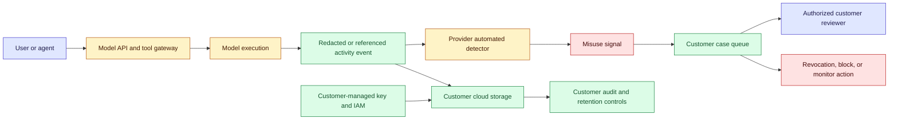
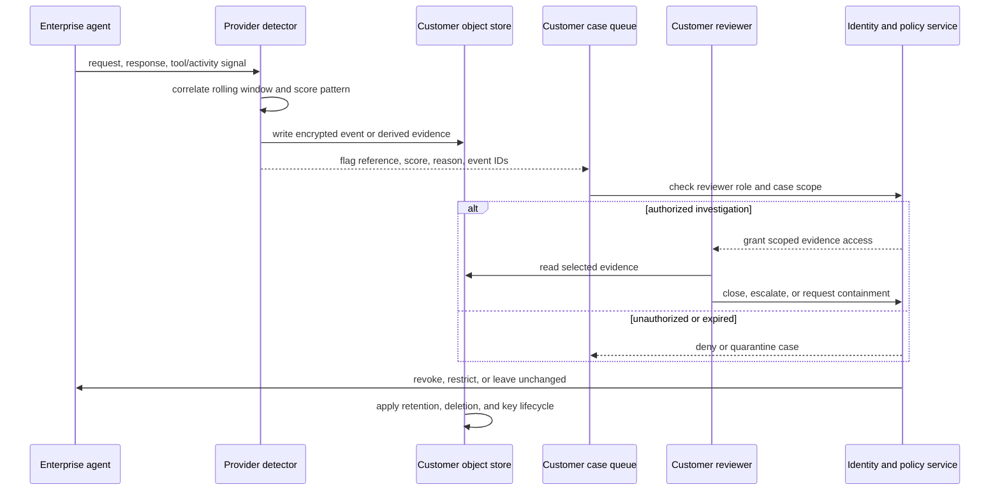

# Customer-cloud safety monitoring
Status: emerging
Sources: [Anthropic — Developing Enterprise Frontier Safeguards with our customers — 2026-09-01](https://www.anthropic.com/news/enterprise-frontier-safeguards)

## In one sentence

Customer-cloud safety monitoring separates model-provider detection from enterprise custody: automated misuse analysis can run over a rolling window while activity data, encryption keys, access policy, audit logs, and human review remain in the customer’s cloud environment.

## Background: what existed before

An AI provider normally has two ways to operate safety monitoring. It can inspect requests and responses while the request is being served, or it can retain activity records and analyze them later for patterns that are invisible in one interaction. The first approach supports low-latency blocking but has limited history. The second can correlate sessions, identities, accounts, and time, but retention creates a privacy, residency, access-control, and contractual obligation.

This tension is especially sharp for enterprise agents. A single request to a coding agent may look harmless. Across a week, the same organization may make many requests that read credentials, enumerate infrastructure, alter code, and contact external systems. A monitoring system that discards every event immediately cannot reliably correlate those steps. Yet a regulated customer may not allow a provider to retain raw prompts, code, incident material, or employee identifiers in the provider’s own storage. “No data retention” protects one class of privacy requirement while limiting the evidence available for another class of safety control.

The historical baseline was therefore a provider-centered trust boundary: the provider held the logs, ran automated classifiers, decided which employees could investigate flags, and exposed a policy or support interface to the customer. Some enterprise deployments instead used customer-owned gateways and SIEM pipelines, but these required customers to duplicate provider-specific monitoring signals and often lost visibility into model-side abuse patterns. A contractual promise not to train on customer data also did not answer the separate question of whether operational safety systems could retain and analyze activity.

Several terms need precise separation. **Zero data retention (ZDR)** means the provider does not retain the covered request data in its ordinary service operation, subject to the actual product contract and exclusions. **Safety monitoring** is analysis for abuse, misuse, anomalous behavior, or policy violations; it is not the same as model training. **Customer-managed keys** are encryption keys controlled by the customer or its key-management service. **Data custody** means who controls storage, access policy, retention, deletion, and audit—not merely where a compute process happens. A customer-owned bucket is not automatically private if a broad role, unreviewed service account, or unredacted log sink can read it.

The prerequisite is a distributed-systems view of evidence. An event has an identity, timestamp, session, model, tenant, payload or payload reference, retention class, and provenance. A detector consumes events and emits a signal. A case-management service turns a signal into a review state. A human or automated response may then revoke a credential, suspend a session, or notify an incident team. Each transition needs authorization and an audit record. The system must preserve enough evidence to explain a decision without making every analyst a reader of every customer’s raw content.

## What changed and why now

On September 1, 2026, Anthropic announced **Enterprise Frontier Safeguards (EFS)**. The announcement describes a phased design that combines ZDR with safety detection while storing activity data in cloud infrastructure controlled by the customer rather than Anthropic. Anthropic says the rollout will begin later in the fall and that eligible customers would receive ZDR on Fable 5 and Fable 5.1 until EFS is ready. These are release-specific availability statements, not evidence that every customer can use the feature immediately.

The source says EFS is intended to work across Claude Code, Claude Enterprise, the Claude Platform, Amazon Bedrock, Claude Platform on AWS, Google’s Agent Platform, and Microsoft Foundry. It names AWS, Google Cloud, and Microsoft Azure as cloud partners for equivalent controls. The provider’s announcement says automated systems analyze a rolling window of traffic for serious misuse signals, including attempts related to offensive cyber or biological capabilities and signs of stolen or leaked credentials. The flags go directly to the customer, and no Anthropic human review is required under the described design.

The important architectural change is not “the provider stops monitoring.” It is that detection and custody are split. Anthropic describes operating the detection while the customer controls where monitoring data is stored, how it is encrypted, which roles can read it, how it is audited, and which customer personnel investigate a flag. The source specifically mentions customer cloud storage such as Amazon S3, Azure Blob Storage, or Google Cloud Storage, customer-managed encryption keys, access policies, and audit logging.

The announcement also says customer-owned storage, customer-managed encryption keys, and fully automated review are opt-in. It says these controls do not change model behavior, API pricing, or rate limits; customers choosing cloud storage still pay their cloud provider for storage, reads, writes, and egress. Those details matter because the feature changes the control plane and cost boundary, not necessarily the model endpoint’s inference latency or quota.

The source includes customer and partner statements about confidentiality, regulated workloads, and control. Those statements show why the architecture is attractive, but they are testimonials rather than independent security audits or evidence of detection accuracy. The announcement does not publish detector precision, recall, retention defaults for every integration, event schemas, false-positive rates, or a complete threat model. An implementation must verify those contracts before treating EFS as a production safeguard.

## Impact on current processing and architecture

The system becomes a split-plane pipeline. The model-serving path must emit enough activity metadata for monitoring, but raw evidence is written into a customer-controlled data plane. The provider’s detector may need access to a rolling window without granting a provider employee unrestricted access to the customer’s entire lake. The customer’s security team receives a signal and decides whether to inspect, contain, or close it.



This diagram shows four boundaries that teams often collapse into one. The API authorization boundary decides whether a request may use a model. The monitoring boundary decides what activity is analyzed. The storage boundary decides where evidence is retained and who can retrieve it. The response boundary decides whether a signal changes access or merely opens a case. A detector’s ability to identify suspicious behavior must not silently grant it permission to invoke customer tools. Conversely, a customer’s ability to read its own activity data does not mean every employee or application should read sensitive prompts.

Design the event schema before connecting the detector. A useful envelope includes event ID, tenant ID, subject or service identity, session ID, model and deployment version, timestamp, region, connector or tool, classification, payload reference, sensitivity label, retention deadline, key version, and correlation ID. Keep raw content and derived features separate. A derived signal such as “credential exposure pattern detected” may be routed to a case queue while the raw prompt remains encrypted and accessible only through a break-glass workflow. Preserve hashes and source pointers so a reviewer can prove which event was evaluated.

The rolling window is a stateful data structure, not a log query glued to a dashboard. Let the window be W days and let event rate be r events per second. A rough event count is `N = r × W × 86,400`; storage is then approximately `N × (metadata_bytes + payload_reference_bytes + derived_feature_bytes)`, before replication and indexes. If raw payload size is large, storing references and encrypted objects separately may reduce hot-store cost, but it adds lifecycle and permission joins. If the detector needs cross-session correlation, the join key must be stable enough to link events and narrow enough to avoid cross-tenant contamination.

Retention policy is also a safety parameter. A longer window can improve campaign correlation but increases exposure, storage cost, legal discovery surface, and deletion complexity. A shorter window reduces those risks but may miss slow, distributed misuse. Write down the purpose for each retained field: detection, audit, customer support, regulatory evidence, or debugging. A field without an owner, retention class, and deletion path becomes accidental permanent memory.



The sequence makes the human boundary explicit. The detector can create a signal, but the customer’s identity and policy service decides who may inspect evidence. A case should contain a reason and references, not automatically include the entire conversation. If the reviewer requests raw content, the access event should include case ID, reviewer identity, purpose, scope, and expiry. A reviewer action may close a false positive, escalate an incident, or trigger a separately authorized containment workflow.

Failure semantics need their own states. If object storage is unavailable, the system must decide whether to fail closed, continue inference without monitoring, buffer encrypted events, or route to a degraded policy. If the detector is unavailable, a customer may choose to block high-risk workloads, permit only low-risk read-only tasks, or continue with an explicit monitoring gap. “No flag” is not equivalent to “safe”; it may mean the detector did not receive the event. Emit `monitoring_unavailable` as a distinct state and alert on it.

## Real-world applications and constraints

In financial services, a bank may require logs to stay in its own account under its own keys while allowing automated analysis for credential theft or cyber misuse. The bank’s security team may inspect a flag, but a general support engineer should not receive unrestricted access to privileged legal material or non-public information. The architecture supports separation of storage, detection, and human review, but the bank still owns IAM design, key rotation, cross-account role restrictions, retention schedules, and evidence export.

In healthcare, the customer may need to classify prompts and outputs containing protected health information. A detector that sees raw content can itself become a sensitive processor. Apply field-level sensitivity labels, minimize payloads, tokenize identifiers where correlation permits, and document whether the provider receives content, embeddings, hashes, or only derived features. A customer-controlled bucket does not remove obligations around access logging, deletion, incident response, or downstream subprocessors.

In software engineering, an autonomous coding agent may access repositories, tickets, package registries, and deployment tools. A rolling detector can identify unusual credential exposure or a multi-session attempt to reach a production system. The customer should still isolate build credentials from deploy credentials, bind tool calls to repository and branch scope, and require an independent authorization check for release actions. Safety monitoring is an observation and response layer, not a replacement for least privilege.

In a public-sector deployment, residency and procurement may require storage in a named region or account. The customer must verify where transient buffers, detector features, backups, support traces, and failure queues live. “Customer cloud” can still cross regions through replication or egress. Include those paths in the data-flow inventory and test deletion across primary, replica, cache, and backup lifecycles.

The main operational cost is not only storage. If the cloud account receives writes at rate r, stores each event for W days, replicates it k times, and produces q derived index bytes per event, rough storage growth is `r × 86,400 × W × k × (event_bytes + q)`. Reads for investigations and detector feature extraction may create egress charges. A detector that correlates across accounts may require indexes or a secure computation path that changes latency and cost. Anthropic’s source says the safeguards themselves do not change API pricing or rate limits, but the customer’s cloud storage, reads, writes, and egress are still billable resources.

## Mental model

Think of customer-cloud safety monitoring as a smoke detector whose control panel is in the building owner’s security room. The detector manufacturer may provide the sensor and detection algorithm, but the building owner controls the wiring cabinet, keys, alarm history, authorized responders, and decision to evacuate. The owner must still verify that the sensor is connected, that timestamps are trustworthy, that batteries and network paths work, and that an alarm is not silently treated as “all clear” when the sensor is offline.

The model also clarifies the distinction between custody and visibility. The provider may operate detection without owning the customer’s storage. The customer may own storage without being able to infer that monitoring is complete. A useful contract therefore exposes health and provenance: event delivery status, detector processing status, window coverage, lag, dropped-event count, signal ID, evidence references, retention deadline, and last successful policy check.

Ask five questions for every safety signal:

1. What exact activity was observed, and over what time window?
2. Which identity, tenant, model, tool, and deployment version were involved?
3. Where is the supporting evidence stored, under which key and policy?
4. Who may inspect it, for which case, and for how long?
5. What action follows the signal, and how can a false positive be reversed?

## What changed this month

September’s change is Anthropic’s announcement of EFS as a phased architecture for combining ZDR with misuse detection in customer-controlled cloud infrastructure. The source says the design was developed with more than 100 customers and cloud partners, supports named Claude and partner platforms, sends monitoring signals directly to customers, and does not require Anthropic human review. It also says customer-owned storage, customer-managed keys, and fully automated review are opt-in and that customer cloud providers bill storage and data-transfer operations.

The durable engineering concept is deployment-boundary composition. Safety is no longer modeled only as a provider-side classifier or only as a customer-side SIEM. Detection, evidence custody, reviewer identity, retention, and response can be separate components with explicit contracts. That creates more deployment choices, but it also creates more failure modes: missing telemetry, inconsistent identity, incompatible retention, stale permissions, key loss, detector lag, and ambiguous containment ownership.

## Engineering consequence

Treat the feature as a safety data plane with an explicit control plane. Define the event contract, storage locations, key ownership, reviewer roles, retention classes, detector health states, and containment API before enabling a high-risk workload. Run in shadow mode first: receive and store signals without automatically revoking access, then measure coverage, latency, false positives, reviewer load, and deletion behavior.

For a monitoring SLO, separate four quantities: delivery coverage, detector freshness, signal latency, and response latency. If N expected events are generated and n arrive at customer storage, coverage is `n/N`. If event timestamp is t_event and signal timestamp is t_signal, detector latency is `t_signal − t_event`; if a reviewer or control action happens at t_action, response latency is `t_action − t_signal`. Report p95 and maximums, not only averages. A perfect detector that receives 70% of events is not a reliable safety control.

Use least privilege at every hop. The provider should receive only the data required by the detector contract. The detector should write to a narrow customer endpoint, not assume broad object-store access. The case queue should carry references and derived reasons. Reviewers should receive time-limited, case-scoped access. The containment service should accept a typed action with a target, reason, expiry, and idempotency key, then independently verify authorization.

Test the negative paths: storage outage, key denial, detector lag, duplicate event, clock skew, stale reviewer role, deleted evidence, cross-tenant reference, duplicate containment, and provider/customer disagreement about whether an event was delivered. Record a monitoring gap as an incident-worthy state. Do not let a retry duplicate a revocation or make a case appear newly detected when it is only being reprocessed.

## Limits and failure modes

EFS is an official provider announcement and a phased design, not a published independent security audit. The announcement does not establish detector accuracy, complete retention semantics for every supported platform, regional behavior, event schemas, or guaranteed availability. Treat claims about safeguards, customer collaboration, and supported integrations as release-specific source claims until verified in the actual contract.

Zero data retention and safety monitoring are not logically identical. A provider can avoid retaining ordinary request data while a customer retains activity data, but the monitoring path still needs a defined data-processing relationship, access policy, encryption boundary, and deletion behavior. A customer-controlled storage account can be misconfigured. Customer-managed keys can be unavailable or rotated without a coordinated reader update. A customer reviewer can be overprivileged. These are deployment risks, not solved by the label “customer cloud.”

Rolling-window detection can miss slow attacks that exceed the window, while a longer window can increase false correlations and privacy exposure. Correlating across sessions and accounts requires stable identity and careful tenant scoping; joining on a reused or ambiguous identifier can merge unrelated activity. A detector can also become stale as tools, attack patterns, model behavior, or customer workflows change. Maintain evaluation fixtures and monitor drift.

The response path can create harm. Automatically revoking a shared service identity may interrupt a critical workflow. Sending raw evidence to a broad case queue may expose privileged material. A false positive may trigger regulatory reporting or customer notification. Use graduated actions—observe, request review, restrict a tool, suspend a session, revoke a credential—and make reversibility and blast radius explicit.

Finally, monitoring cannot replace preventive controls. Least privilege, scoped credentials, network restrictions, approval boundaries, sandboxing, secure logging, and ordinary incident response remain necessary. Detection tells a team that a suspicious pattern may exist; it does not undo a side effect or prove that every unsafe action was observed.

## Mini exercise (15–30 min)

Build a dependency-free simulator for customer-cloud monitoring. Generate events with tenant, session, timestamp, sensitivity, and tool fields. Route them into a customer-owned event store, maintain a rolling window, emit a derived signal for a suspicious multi-step pattern, and require a scoped reviewer token before reading raw evidence. Simulate storage outage and duplicate containment. The example does not call Anthropic, inspect real content, or provide security isolation; it teaches the custody/detection/review boundary.

## Runnable low-cost example

```python
from dataclasses import dataclass
from typing import Dict, List, Set


@dataclass(frozen=True)
class Event:
    event_id: str
    tenant: str
    session: str
    timestamp: int
    tool: str
    sensitivity: str


class CustomerStore:
    def __init__(self):
        self.events: Dict[str, Event] = {}
        self.signals: List[dict] = []
        self.contained: Set[str] = set()
        self.available = True

    def write_event(self, event: Event) -> None:
        if not self.available:
            raise RuntimeError("customer storage unavailable")
        self.events.setdefault(event.event_id, event)  # idempotent write

    def read_case(self, signal: dict, reviewer_tenant: str, reviewer_scope: str):
        if reviewer_scope != "misuse-review" or reviewer_tenant != signal["tenant"]:
            raise PermissionError("case-scoped reviewer access required")
        return [self.events[eid] for eid in signal["event_ids"]]

    def contain(self, signal: dict) -> str:
        case_id = signal["case_id"]
        if case_id in self.contained:
            return "already-contained"
        self.contained.add(case_id)
        return "contained"


def detect(events: List[Event], now: int, window: int = 300):
    recent = [e for e in events if now - window <= e.timestamp <= now]
    by_session: Dict[str, List[Event]] = {}
    for event in recent:
        by_session.setdefault(event.session, []).append(event)
    signals = []
    for session, session_events in by_session.items():
        tools = {e.tool for e in session_events}
        if {"read_secret", "external_upload"} <= tools:
            latest = max(session_events, key=lambda e: e.timestamp)
            signals.append({
                "case_id": f"case-{session}",
                "tenant": latest.tenant,
                "session": session,
                "event_ids": [e.event_id for e in session_events],
                "reason": "secret-read followed by external upload",
            })
    return signals


store = CustomerStore()
events = [
    Event("e1", "acme", "s1", 100, "read_secret", "restricted"),
    Event("e2", "acme", "s1", 160, "external_upload", "restricted"),
    Event("e3", "other", "s2", 160, "read_secret", "restricted"),
]

for event in events:
    store.write_event(event)

signals = detect(list(store.events.values()), now=200)
for signal in signals:
    evidence = store.read_case(signal, "acme", "misuse-review")
    print(signal["case_id"], signal["reason"], [e.event_id for e in evidence])
    print(store.contain(signal))
    print(store.contain(signal))  # duplicate action is harmless
```

## Build it locally

### Numbered local steps

1. Save the example as `customer_cloud_monitor.py` and run it with Python 3.9 or newer.
2. Add an event from tenant `other` to the `acme` session and verify the detector does not combine tenants.
3. Change the reviewer tenant to `other` and confirm that raw evidence access raises `PermissionError`.
4. Set `store.available = False` before writing an event. Add a `monitoring_unavailable` result rather than treating the event as safely processed.
5. Add a duplicate event with the same ID and verify that the idempotent store does not create a second record.
6. Change `window=300` to `window=30` and move the second event outside the window; explain the detection trade-off.
7. Add a `retention_deadline` field and write a function that deletes expired events only after recording a deletion audit event.
8. Replace `contain` with a typed action record containing case ID, tenant, target, reason, policy version, expiry, and idempotency key.
9. Add counters for expected events, stored events, signals, reviewer denials, and containment attempts; calculate coverage and duplicate-action rate.

## Interview Q&A

### What problem does customer-cloud safety monitoring solve?

It addresses the tension between retaining enough activity history to detect multi-session misuse and keeping sensitive enterprise data under the customer’s storage, keys, access policies, and audit controls. It does not eliminate the need for customer security engineering or prove that detection is accurate.

### Is zero data retention the same as no monitoring?

No. ZDR describes a retention boundary for covered service data. A design can analyze activity and store monitoring evidence in a customer-controlled environment, but the exact data flow, processor relationship, retention, and deletion behavior must be verified for the deployment.

### Why is a rolling window necessary?

Some misuse patterns are distributed across sessions, accounts, and time. A single request may not be suspicious, while a sequence is. A rolling window provides correlation state, but its duration affects storage cost, privacy exposure, false linkage, and the kinds of slow behavior it can detect.

### Does customer-owned storage make the system secure?

No. It improves custody and lets the customer apply its own keys, IAM, logging, and retention, but misconfigured roles, broad reviewer access, cross-region replicas, stale keys, or missing deletion paths can still expose data.

### Who should decide whether a flag becomes a containment action?

The answer depends on risk and policy. The detector should emit evidence and a reason; a customer policy service or authorized reviewer should decide. High-impact actions need independent authorization, idempotency, expiry, and a reconciliation path.

### What should happen if monitoring is unavailable?

It should become an explicit state with an owner and policy. Low-risk read-only work may continue with a recorded gap; high-risk or effectful work may pause or fail closed. Never report “no misuse detected” when the detector did not receive the event.

### What should be measured?

Measure event coverage, detector lag, signal latency, reviewer workload, false-positive rate where labels exist, evidence-access denials, retention/deletion success, key errors, containment latency, and duplicate or unknown-effect actions. Separate provider detector metrics from customer storage and response metrics.

## Glossary

- **Customer-managed key:** An encryption key controlled through the customer’s key-management boundary.
- **Customer-cloud safety monitoring:** A deployment pattern in which automated safety detection operates with activity data stored in customer-controlled cloud infrastructure.
- **Data custody:** Control over storage, access, retention, deletion, encryption, and audit of data.
- **Derived signal:** A detector output such as a risk label, score, reason, or event reference that is not the complete raw activity record.
- **Enterprise Frontier Safeguards (EFS):** Anthropic’s announced September 2026 design for combining ZDR with customer-controlled monitoring data and automated misuse detection.
- **Monitoring gap:** A period or event range for which the detector did not receive, process, or durably record expected activity.
- **Rolling window:** A bounded recent time interval used to correlate events as new activity arrives.
- **Safety monitoring:** Analysis intended to identify misuse, anomalous behavior, or policy violations; it is separate from model training.
- **Zero data retention:** A contractual or product configuration in which covered request data is not retained by the provider under the stated service terms.

## References

1. Anthropic, “Developing Enterprise Frontier Safeguards with our customers,” September 1, 2026. Primary source for EFS, customer-controlled storage, ZDR, rolling-window monitoring, customer review, supported platforms, opt-in controls, and cloud storage costs: https://www.anthropic.com/news/enterprise-frontier-safeguards
2. Anthropic, “Improving our alignment and security efforts,” July 30, 2026. Related incident and safeguards context linked from the primary announcement: https://www.anthropic.com/news/improving-our-alignment-and-security-efforts
3. The event schema, storage model, metrics, simulator, and failure-state recommendations in this lesson are engineering analysis and inference, not independently verified EFS behavior.

## Claim ledger

| Claim | Source | Fact or inference |
|---|---|---|
| Anthropic announced Enterprise Frontier Safeguards on September 1, 2026. | Anthropic announcement | Release-specific source fact |
| EFS is designed to combine ZDR with misuse detection while storing data in customer-controlled cloud infrastructure. | Anthropic announcement | Vendor architecture description |
| The source describes automated monitoring over a rolling traffic window and signals sent directly to customers. | Anthropic announcement | Release-specific source fact |
| The described design does not require human review by Anthropic employees. | Anthropic announcement | Release-specific source claim |
| Customer-owned storage, customer-managed keys, and fully automated review are opt-in. | Anthropic announcement | Release-specific source fact |
| The safeguards do not change model behavior, API pricing, or rate limits, while customer cloud storage and data transfer may incur cloud-provider charges. | Anthropic announcement | Release-specific source claim |
| Customer-cloud storage improves custody but does not guarantee secure configuration or correct deletion. | Source architecture plus security analysis | Engineering inference |
| A detector outage must be represented as a monitoring gap rather than as a clean safety result. | Reliability analysis | Engineering inference |
| Event coverage, detector lag, and response latency should be measured separately. | Distributed-systems analysis | Engineering inference |
| The Python example provides no real isolation, encryption, or provider integration. | This lesson’s example | Explicit limitation |
