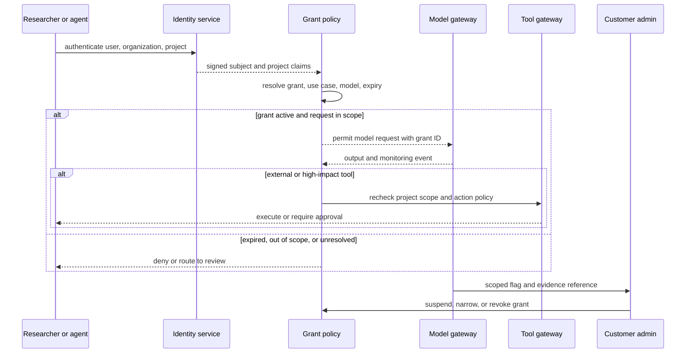

# Verified high-risk life-sciences access
Status: emerging
Sources: [Anthropic — Introducing the Life Sciences Verification Program — 2026-09-17](https://www.anthropic.com/news/life-sciences-verification-program)

## In one sentence

A verified high-risk access program treats model permissions as a versioned grant over an organization, project, use case, and review obligation, allowing more capable biology work only after identity, credentials, security, and ethical oversight are checked.

## Background: what existed before

Most software authorization begins with a principal and a resource. A user presents an identity, the application checks a role, and a policy engine returns allow or deny. That model works well when the resource is a document, database table, or API operation. Frontier AI creates a harder case: the same model can support benign education, ordinary research, clinical development, or work that creates serious dual-use risk. The danger is not only a bad user at the login screen. A legitimate account can be compromised, an employee can misuse access, or an agent can take an unintended action over a long task.

The usual baseline is a global content filter applied per request. The classifier sees the prompt, blocks categories that exceed a risk threshold, and permits the rest. This is simple to operate but has two weaknesses. First, it may block legitimate expert work because a dangerous topic and a beneficial topic can share vocabulary. Second, a request-by-request decision lacks the context of the organization’s stated purpose, project scope, security controls, and response team. A binary filter also makes it difficult to express graduated trust: a university lab may need broad access for one audited project but only ordinary access for everything else.

An organization-level allowlist is an improvement, but it can become too broad. If every employee receives the same permission, a grant intended for a single project can leak into unrelated work. A project-only exception can be safer, but it must be bound to a stable project identity, expiration, model set, and monitoring rule. This is the same principle used in cloud IAM: a permission should be scoped to the smallest resource, action, principal, and time window that makes the task useful.

Three terms matter. **Verification** is evidence-based review of the applicant’s identity, research credentials, security standards, and ethical oversight. **Grant** is a policy object that authorizes a defined access level. **Dual use** describes work that can create beneficial outcomes or be repurposed for harm. A verified identity is not proof of benevolent intent, and a grant is not a guarantee that every future request is safe. It is a control that combines pre-access evidence with continuous monitoring and incident response.

The prerequisite is stateful authorization. The system must know the caller, organization, project, declared use case, model, grant version, expiration, and current incident status. The policy decision must be reproducible from those inputs. A model response should never be allowed to invent or broaden its own grant.

## What changed and why now

On September 17, 2026, Anthropic announced the Life Sciences Verification Program (LSVP) in beta for teams and institutions. The announcement says the program gives verified life-science professionals access to Mythos, Opus, and Sonnet models with safeguards more permissive for biology-related work than generally available Fable models. It names applications including drug discovery, research biology, clinical development, manufacturing, quality assurance, regulatory affairs, investing, and diligence.

The program defines two grant types. **Standard Use** grants are intended for most life-science work, can cover an entire team, and are renewed annually. **High-risk Use** is an add-on grant for work blocked under Standard Use; it applies to a single research project and must be renewed every six months. The source gives the example of a researcher having broad Standard Use access plus one or more narrowly scoped High-risk grants for specific dual-use projects.

Anthropic says applicants are reviewed for research credentials, security standards, and ethical research oversight. It also says access is tied to use cases specified in the grant application, and traffic is continuously monitored for behavior outside the stated safe scope. Flags can be sent to organization administrators for triage and remediation under pre-agreed timeframes. The source names three threat models: access compromise, insider threat, and agent misuse.

The program shifts some safety enforcement from real-time blocking to offline monitoring. Anthropic says this can allow legitimate work to proceed with fewer interruptions while retaining data associated with flagged activity for review. The announcement states that LSVP traffic requires 30-day retention for this monitoring, with data compartmentalized and not used for model training or accessed by life-sciences research teams. These are release-specific provider claims; customers still need to confirm their contract, residency, compliance, and incident obligations.

At launch, LSVP is available in Anthropic’s first-party API console and Claude Enterprise and Team plans, but not third-party platforms; the announcement says individual plans are not yet supported. It also says the beta is not available for BAA-enabled organizations, so PHI workloads should not be moved into the program as though the beta were a HIPAA deployment. Availability and product behavior may change.

## Impact on current processing and architecture

The access decision becomes a multi-stage policy evaluation. First, authenticate the organization and user. Second, resolve the project and declared use case. Third, select the grant that applies to this request. Fourth, decide whether the model and operation are allowed. Fifth, attach monitoring and retention obligations. At any point, a missing or expired grant should produce a typed denial or review state, not a silent fallback to a broader grant.

```mermaid
flowchart LR
    A[Applicant and organization] --> V[Credential, security, ethics verification]
    V --> G[Versioned grant registry]
    G --> U[User + project + use-case binding]
    U --> P[Policy decision]
    P -->|Standard Use| S[Team-scoped model access]
    P -->|High-risk Use| H[Project-scoped elevated access]
    S --> M[Continuous monitoring]
    H --> M
    M --> Q[Customer admin case queue]
    Q --> R[Revoke, restrict, or remediate]
    classDef identity fill:#dbeafe,stroke:#1d4ed8,color:#172554;
    classDef control fill:#dcfce7,stroke:#15803d,color:#14532d;
    classDef high fill:#fef3c7,stroke:#b45309,color:#451a03;
    classDef response fill:#fee2e2,stroke:#b91c1c,color:#450a0a;
    class A,V,G,U identity;
    class P,S,M,Q control;
    class H high;
    class R response;
```



The grant registry should store organization ID, project ID, approved use-case description, permitted model family, grant type, approvers, evidence references, issued and expiry times, renewal interval, monitoring mode, retention class, and revocation status. The use-case description should be a high-level operational statement, not a secret or a prompt containing intellectual property. A grant is a policy artifact with a lifecycle: draft, under review, active, suspended, expired, revoked, and archived.

Bind the grant to a project identity rather than a free-form prompt. If a researcher says “this is the approved viral-vector project” in text, the gateway should not trust the text. The authenticated project context, repository, billing account, or workflow identity must carry the binding. A model can help classify whether a request appears within scope, but a deterministic service should decide whether the requester is actually entitled to the grant.

Use different permissions for different operations. Reading literature, summarizing an experiment, designing a protocol, generating a biological sequence, executing code, calling an external synthesis provider, and publishing a result have different blast radii. A High-risk grant should not automatically authorize every tool connected to a workspace. Keep model inference authorization separate from tool authorization and require a fresh check for external effects.



Continuous monitoring introduces a temporal distinction. Real-time blocking evaluates one request before completion. Offline monitoring can correlate a sequence after the fact, which improves context but creates a response delay. Let `T_detect = T_event_to_storage + T_window_wait + T_detector + T_case_delivery`. If the containment target is Δ seconds, the architecture must prove `T_detect ≤ Δ` for the relevant threat class or explicitly admit that the control is retrospective. A 30-day retention period is a storage window, not a 30-day response guarantee.

The monitoring system should distinguish normal usage, suspicious out-of-scope usage, detector unavailable, administrator not notified, case open, and containment complete. If the grant allows high-risk work only under continuous monitoring, a telemetry outage may require suspension or a degraded policy. “No flag” is not the same as “monitoring healthy.”

## Real-world applications and constraints

An academic lab may need Standard Use access for literature review and protein-structure analysis but a High-risk grant for one dual-use project. The lab’s platform should map the research project to a separate workspace, credentials, artifact bucket, and monitoring policy. A student who joins the lab should not inherit the high-risk grant merely because they have a lab email. Access should be approved, logged, and removed when the project ends.

A pharmaceutical company may have several teams with different regulatory and IP boundaries. Annual Standard Use renewal can verify that the team, intended use, and security posture remain current. A six-month High-risk grant can require project-level review and a named principal investigator. The company must also reconcile the provider’s monitoring data with its own security operations and ensure that incident evidence is not copied into an overly broad SIEM index.

An agent pipeline may search papers, write code, call a simulation tool, and produce a candidate experiment. The grant should cover the model decision but not imply permission to order materials, contact an external synthesis provider, or change a regulated record. Use a capability manifest for tools and a human checkpoint before irreversible effects. Agent logs should include grant ID, project ID, tool policy version, and the evidence that supported the action.

The program’s platform constraints matter. If third-party platforms are not supported at launch, a team cannot assume the same grant semantics through every cloud reseller. If a beta is not available for BAA-enabled organizations, PHI handling needs a separate approved architecture. If users can switch between grants in the API console but a product surface applies only a preselected default, test that surface explicitly; a policy design is unsafe when users think they are operating under one grant while the gateway applies another.

## Mental model

Think of a grant as a temporary lease on a capability, not as a trust badge. The lease has a tenant, project, purpose, model, actions, evidence, expiry, reviewer, and monitoring obligation. Standard Use is a broad lease for ordinary work; High-risk Use is a narrower lease for a named project. A lease can be suspended when the credential is compromised or the observed behavior leaves the declared scope.

The lease model gives an SDE2 a concrete design checklist: who issued it, what resource it names, what action it permits, how the application proves possession, how long it lasts, where it is logged, and what happens when the policy service or detector is unavailable. It also makes the shared-responsibility boundary visible: the provider verifies and monitors parts of the access, while the customer controls internal users, tools, secrets, project governance, and remediation.

## What changed this month

September introduced a beta access model that makes verification, project scope, and continuous monitoring first-class for high-risk life-sciences capabilities. It is more precise than a global allowlist and more contextual than a per-request content filter. The source specifically differentiates team-wide Standard Use from project-specific High-risk Use, preserves other safeguards such as cyber classifiers, and names access compromise, insider threat, and agent misuse as threat models.

The engineering lesson is to make capability access a stateful contract. A grant should be evaluated with identity, project, use case, tool, model, time, and monitoring health. The product’s flexibility does not remove the need for customer-side segmentation, audit, key management, and response.

## Engineering consequence

Implement a grant-aware gateway before enabling elevated model access. Never put the decision only in a prompt or UI dropdown. Store the grant version with every request, output, tool call, and incident. Use shadow mode to compare intended grant routing with actual routing, then test expiry, renewal, suspension, compromised identity, out-of-scope behavior, offline-monitoring gaps, and unsupported platform surfaces.

Use a simple access-risk budget. If a grant has exposure weight e, session duration d, tool authority a, and monitoring coverage c, a rough operational risk score can be represented as `R = e × d × a × (1 − c)`. This is not a scientific risk probability; it is a prioritization heuristic. It encourages teams to reduce duration, authority, or unmonitored time rather than arguing over a single binary safe/unsafe label. For external effects, set a separate threshold and require approval regardless of model confidence.

## Limits and failure modes

The source is a provider announcement, not an independent audit of verification quality, classifier performance, or customer implementation. High-risk access can be compromised after approval. A credential review does not detect a coerced insider, a malicious collaborator, or a hijacked agent. Continuous monitoring can reduce risk but can miss encrypted, off-platform, or novel behavior.

Offline monitoring improves sequence context at the cost of response time and retention. A 30-day event requirement creates privacy, storage, access, deletion, and incident-discovery obligations. A false positive can interrupt legitimate research; a false negative can leave dangerous activity undetected. Define appeal, correction, and emergency suspension paths.

Do not treat a grant as universal tool permission. A model may be authorized for a project while a connected database, synthesis service, or deployment tool is not. Keep provider and customer policies separate, test default-grant behavior on every product surface, and fail closed when project identity or monitoring health is unknown for high-impact actions.

## Mini exercise (15–30 min)

Build a local grant evaluator. Define a standard team grant and a high-risk project grant, bind them to users and projects, enforce expiry and action scopes, and emit monitoring-gap decisions. Keep the model and biology abstract; the exercise teaches authorization state, not biological experimentation.

## Build it locally

```python
from dataclasses import dataclass
from datetime import datetime, timezone

@dataclass(frozen=True)
class Grant:
    grant_id: str
    organization: str
    project: str
    kind: str
    actions: frozenset
    expires_at: int
    monitoring_required: bool

def decide(grant, organization, project, action, now, monitoring_healthy):
    if grant.organization != organization or grant.project != project:
        return "deny: identity-or-project-mismatch"
    if now >= grant.expires_at:
        return "deny: expired"
    if action not in grant.actions:
        return "deny: action-out-of-scope"
    if grant.monitoring_required and not monitoring_healthy:
        return "pause: monitoring-gap"
    if grant.kind == "high-risk" and action == "external_effect":
        return "review: high-impact action"
    return "allow"

now = int(datetime.now(timezone.utc).timestamp())
standard = Grant("std-1", "lab-a", "team", "standard",
                 frozenset({"literature", "analysis"}), now + 3600, False)
high = Grant("high-7", "lab-a", "virus-project", "high-risk",
             frozenset({"analysis", "external_effect"}), now + 3600, True)

tests = [
    (standard, "lab-a", "team", "analysis", True),
    (standard, "lab-a", "virus-project", "analysis", True),
    (high, "lab-a", "virus-project", "analysis", False),
    (high, "lab-a", "virus-project", "external_effect", True),
]
for grant, org, project, action, healthy in tests:
    print(grant.grant_id, decide(grant, org, project, action, now, healthy))
```

### Numbered local steps

1. Save the example as `grant_policy.py` and run it with Python 3.9 or newer.
2. Add a `grant_version` and include it in every decision receipt.
3. Add a suspended state and verify that suspension overrides a valid expiry and action scope.
4. Add a `tool_name` argument and ensure an allowed model action does not imply an allowed external tool.
5. Change the clock so the high-risk grant is expired and confirm that it cannot fall back to Standard Use.
6. Add a monitoring heartbeat timestamp and reject high-risk work when the heartbeat is stale.
7. Emit JSON-like audit records with user, organization, project, grant, action, decision, reason, and policy version.
8. Add a renewal function that creates a new grant ID rather than mutating historical decisions.

## Interview Q&A

### Why not use one global biology allowlist?

Because organization, project, user, and use-case risk differ. A global allowlist is hard to audit and can grant more authority than a team needs. Scoped grants make the intended use and review obligation explicit.

### Does verification prove a researcher is safe?

No. It establishes evidence about credentials, security, and oversight at a point in time. Compromise, insider misuse, and agent misuse remain possible, so the system needs monitoring, expiry, revocation, and incident response.

### Why move some enforcement offline?

Offline analysis can correlate behavior across sessions and requests, reducing false interruptions for legitimate work and exposing sequences that a single-request filter cannot see. The trade-off is retention, detection delay, and the need to handle flagged evidence securely.

### Should the model decide whether a request is inside the grant?

It can provide a risk or classification signal, but deterministic policy must bind the authenticated identity, project, grant, tool, and expiry. Model output is evidence, not authorization.

### Why is High-risk Use project-scoped?

Project scope limits blast radius and creates a reviewable object with an owner, purpose, and end date. Team-wide permission would make it harder to distinguish approved dual-use work from unrelated activity.

## Glossary

- **Dual use:** Work that can support beneficial or harmful outcomes.
- **Grant:** A versioned authorization object defining who may use which capability, for what purpose, and for how long.
- **High-risk Use:** LSVP’s project-scoped add-on grant for work blocked under Standard Use.
- **Offline monitoring:** Analysis of retained activity across a window rather than blocking every request in real time.
- **Standard Use:** LSVP’s team-oriented grant for most life-science workflows.
- **Use-case binding:** Linking access to an approved description of intended work.
- **Verification:** Review of identity, credentials, security, and ethical oversight before access.

## References

1. Anthropic, “Introducing the Life Sciences Verification Program,” September 17, 2026. Primary source for verification, Standard Use and High-risk Use grants, threat models, offline monitoring, 30-day retention, platform availability, and beta limitations: https://www.anthropic.com/news/life-sciences-verification-program
2. The grant schema, risk heuristic, simulator, and operational controls in this lesson are engineering analysis and inference, not independent validation of LSVP.

## Claim ledger

| Claim | Source | Fact or inference |
|---|---|---|
| Anthropic announced LSVP on September 17, 2026 as a beta for teams and institutions. | Anthropic announcement | Release-specific source fact |
| Applicants are reviewed for credentials, security standards, and ethical research oversight. | Anthropic announcement | Release-specific source claim |
| Standard Use is team-oriented and High-risk Use is project-scoped with different renewal periods. | Anthropic announcement | Release-specific source fact |
| LSVP monitors traffic against stated use cases and can flag administrators. | Anthropic announcement | Provider architecture claim |
| LSVP uses offline monitoring and requires 30-day retention for LSVP traffic. | Anthropic announcement | Release-specific source claim |
| Cyber classifiers and other safeguards remain in place. | Anthropic announcement | Provider claim |
| A grant must not be treated as a tool authorization or correctness guarantee. | Authorization analysis | Engineering inference |
| Monitoring health, expiry, and project binding should be explicit policy inputs. | Systems design analysis | Engineering inference |
