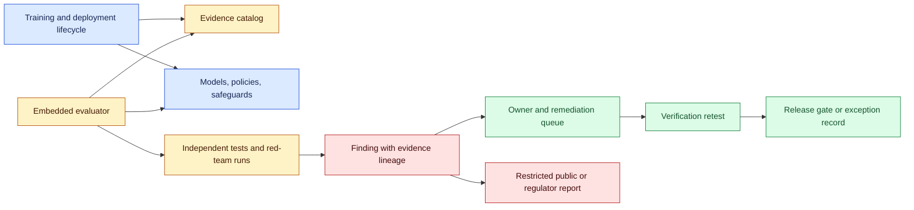
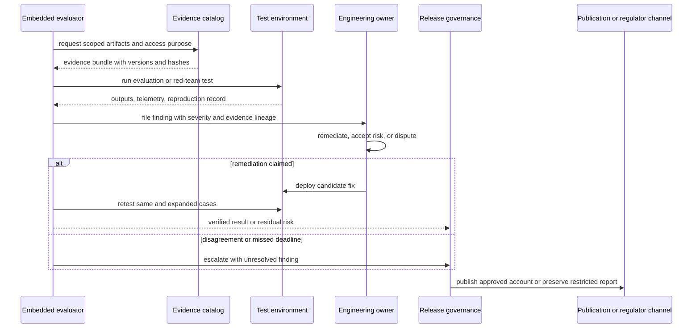

# Embedded independent evaluation
Status: emerging
Sources: [Anthropic — Partnering with Accenture on embedded evaluation — 2026-09-18](https://www.anthropic.com/news/accenture-embedded-evaluation)

## In one sentence

Embedded independent evaluation places external evaluators inside an AI lab’s development lifecycle with employee-comparable access, turning safety review from a point-in-time external test into an ongoing evidence and governance function.

## Background: what existed before

An AI evaluation is often treated as a test run: choose a benchmark, send prompts to a model, score outputs, and publish a report. This is valuable for capability and safety measurement, but the evaluator usually sees a released model, a documented interface, and a limited set of artifacts. The evaluator may not see training-data decisions, post-training changes, internal incident reports, deployment gates, model-routing logic, or why a safeguard was accepted despite a known failure.

External red teams improve coverage by trying to break the system from outside. Independent labs can reproduce findings and reduce the risk that the developer’s own team grades itself. Yet external access can be narrow, expensive, or delayed. A public evaluation may reveal what happened without revealing which internal decision created the gap. A lab can fix the tested prompt while leaving the process that produced the vulnerability unchanged.

The baseline governance pattern therefore separates development and evaluation. Engineers train and deploy the model; an external group receives a checkpoint or API; the evaluator submits tests; the lab decides whether to act. Independence is clearer, but the evaluator has limited context. Internal review has context and speed, but it can suffer from incentive conflicts, organizational blind spots, and selective evidence.

Embedded evaluation is not the same as ordinary internal QA. An embedded evaluator may sit inside the company’s working environment while retaining an independent mandate, access rights, reporting channel, and ability to challenge decisions. The goal is to inspect not only model behavior but also the process and controls around training, safeguards, and deployment. The hard engineering problem is to give enough access for meaningful verification without turning the evaluator into an employee whose findings are subject to the same incentives.

Prerequisites are simple but important. **Independence** means the evaluator can reach conclusions without the developer controlling the result. **Access** is the concrete ability to inspect artifacts, systems, people, and decisions. **Assurance** is evidence that a process or control operated as claimed. A test finding is not automatically an incident; a clean test is not proof of safety. A governance system needs evidence lineage, scope, confidentiality, escalation, and remediation tracking.

## What changed and why now

On September 18, 2026, Anthropic announced a partnership with Accenture’s specialist AI business, Faculty, for independent evaluation of frontier AI. The announcement says the work will include evaluating and red-teaming models, conducting alignment assessments, and testing model safeguards. Anthropic says the partnership follows a commitment to embed evaluators within the lab.

The new element is the evaluator’s position. Unlike today’s external evaluators, the announcement says embedded evaluators will work inside AI companies with access comparable to an employee’s. They can watch models take shape in training, follow decisions governing how models are built and deployed, and speak directly to employees. The stated purpose is to make safety commitments more verifiable, identify blind spots, report incidents, and inform the public about benefits and risks.

The announcement is careful about the limits. It says embedded evaluation is new, that there are no settled standards for what information evaluators should access or how findings should be reported, and that there is no settled funding system. Anthropic says it will fund Accenture’s work directly while engaging with METR and other nonprofit evaluators. It also says the partnership is non-exclusive and expects multiple evaluators and shared standards over time.

Anthropic and Accenture each expect to invest at least $1 billion in building capacity over five years. That is a release-specific commitment statement, not evidence that the resulting evaluations are independent, accurate, or effective. Funding source, evaluator access, publication rights, confidentiality, and escalation rules must be audited separately.

## Impact on current processing and architecture

Embedded evaluation adds an assurance plane to the model lifecycle. The evaluator needs controlled read access to training and deployment evidence, the ability to run tests, a protected finding store, and a route to challenge or escalate decisions. The development team needs to respond without rewriting the evidence. The public may eventually receive a report, but sensitive details may remain restricted.



The evidence catalog is the foundation. It should index model versions, data and post-training runs where access is permitted, safety specifications, policy versions, evaluation datasets, deployment configurations, incident tickets, and release decisions. Each artifact needs an owner, sensitivity class, timestamp, hash or immutable version, and allowed audience. The evaluator should be able to prove which artifact was inspected without copying all sensitive content into a separate uncontrolled workspace.

Access should be capability-based and auditable. A finding about a training run may require read access to configuration and metrics but not all customer prompts. A deployment review may require routing rules, tool permissions, rollback procedures, and observed telemetry. A red-team exercise may need a model endpoint and test account. Package access into scopes such as `model:read`, `safeguard:test`, `incident:read`, and `deployment:read`; attach expiry and purpose. Do not grant an evaluator unrestricted production credentials merely because independence requires broad visibility.

Independence also needs a protected reporting path. If the evaluator’s report must be approved by the team being evaluated, the evaluator is not independent at the reporting boundary. Use a finding store whose authorship, edits, acknowledgements, and publication decisions are append-only. Allow the evaluator to record disagreement with an owner’s risk acceptance. A final report can redact secrets, but it should preserve the existence, severity, disposition, and evidence lineage of a material finding.



The state machine behind a finding should distinguish `observed`, `reproduced`, `triaged`, `mitigation_in_progress`, `verified`, `risk_accepted`, `disputed`, `escalated`, and `closed`. “Closed” must not mean “the team changed a prompt.” It should point to a retest, a justified residual-risk decision, or an explicit statement that reproduction was not possible. If the model changes before retesting, preserve the old artifact and classify the result as a new verification problem.

Quantify review capacity. If an evaluator creates f findings per week and owners close c findings per week, backlog grows at `B_next = max(0, B_current + f − c)`. A release program that only funds tests but not remediation can create a queue of unverified risk. If each finding has probability p of being material and review takes h hours, expected review demand is `f × p × h`; use this to size evaluator, engineering, legal, and incident-response capacity. These are planning equations, not measures of model safety.

## Real-world applications and constraints

For a frontier-model release, embedded evaluators can inspect whether a safety specification was translated into a testable acceptance criterion, whether the test set covers known threat models, and whether a failed evaluation was accepted as residual risk. They can compare the release candidate with earlier checkpoints and ask why a capability or failure changed. They should not assume internal access makes every claim true; the evidence catalog and audit log still matter.

For agent safeguards, evaluators need to test the full path: model proposal, tool schema, identity, policy decision, sandbox, external effect, and recovery. A model-only red team may find a dangerous action while missing that the gateway rejects it. Conversely, a clean model test does not show that production routing or customer-specific permissions are safe. The evaluator should record environment, tool, policy, and state versions with every run.

For incident disclosure, embedded evaluators can inspect internal traces and compare the public description with raw evidence. Confidentiality and privacy require restricted access, redaction, and legal review, but legal review should not silently erase the fact that a finding existed. Use two artifacts: a protected evidence bundle and a public-facing claim package with explicit uncertainty.

For procurement or regulation, a customer may ask whether the lab has an evaluator who can inspect training, safeguards, and deployment practice. “We ran a benchmark” is weaker evidence than a repeatable evaluation process with independent access, finding ownership, remediation verification, and escalation. Still, a customer should request the evaluator’s mandate, access scope, funding relationship, publication policy, and unresolved findings rather than accepting a partnership announcement as certification.

## Mental model

Think of an embedded evaluator as an independent quality engineer placed inside the factory, with a badge that opens the relevant doors but not every room. They can inspect the process, test the product before shipment, interview operators, record a defect, and verify the repair. The factory still owns the product and the final release decision; the evaluator’s value is making the claim auditable and the blind spots harder to hide.

The key distinction is between access and authority. Access lets the evaluator inspect and test. Authority lets the evaluator block a release, require remediation, publish a finding, or notify an external body. A credible program must define which of those powers exist. Without reporting and escalation independence, employee-comparable access may only produce a more detailed internal QA report.

## What changed this month

September’s announcement makes embedded evaluation a concrete governance pattern: evaluator access inside the lab, model and safeguard testing, alignment assessment, and an intent to make safety commitments verifiable. It also openly identifies missing standards for evaluator information, reporting, and funding. The correct engineering response is not to treat the partnership as proof of safety; it is to design the evidence, authority, confidentiality, remediation, and publication contracts that would make the arrangement meaningful.

## Engineering consequence

Create an evaluation charter before granting access. It should specify independence, funding disclosure, artifact access, test authority, protected reporting, incident escalation, confidentiality, publication rights, deadlines, and conflict resolution. Assign every finding an owner and a release impact. Require retesting or a documented risk-acceptance decision before closure.

Track metrics such as evidence-request latency, evaluator access denials, unique failure modes, reproduction rate, remediation time, retest pass rate, unresolved critical findings, and the percentage of release decisions with independent review. These metrics measure process health, not model alignment. Keep the evaluator’s raw notes and the public report on separate access paths.

## Limits and failure modes

Embedded evaluation can lose independence through funding dependence, restricted access, prepublication vetoes, employment-like incentives, or selection of only favorable evaluators. Employee-comparable access is meaningful only if the evaluator can inspect the decisions that matter and report disagreements safely. The announcement explicitly says standards are not settled, so teams should not infer a mature certification regime.

The evaluator may be overwhelmed by model versions, deployment surfaces, and incident volume. A finding can become stale when the model, prompt, policy, tool, or environment changes. Reproduction can expose sensitive data or dangerous capabilities. Use isolated test accounts, capability-limited environments, redacted evidence, and versioned test fixtures.

Finally, independent evaluation does not transfer accountability. Anthropic’s announcement states that model safety remains the company’s responsibility. An evaluator can improve verifiability and identify blind spots, but it cannot guarantee that a developer will remediate every finding or that unknown failures do not exist.

## Mini exercise (15–30 min)

Build a local finding ledger. Create a versioned artifact catalog, scoped evaluator access, a finding state machine, an owner response, and a retest record. Simulate a disputed finding and a model-version change between remediation and retest. The exercise teaches assurance workflow, not model testing at frontier scale.

## Build it locally

```python
from dataclasses import dataclass, replace

@dataclass(frozen=True)
class Finding:
    finding_id: str
    model_version: str
    severity: str
    state: str
    owner: str
    evidence_hash: str

def transition(finding, event):
    allowed = {
        "observed": {"reproduced", "disputed"},
        "reproduced": {"triaged", "disputed"},
        "triaged": {"mitigation_in_progress", "risk_accepted"},
        "mitigation_in_progress": {"verified", "disputed"},
        "verified": {"closed"},
        "risk_accepted": {"closed", "escalated"},
        "disputed": {"escalated", "reproduced"},
        "escalated": {"closed"},
    }
    if event not in allowed.get(finding.state, set()):
        raise ValueError(f"invalid transition {finding.state} -> {event}")
    return replace(finding, state=event)

finding = Finding("F-1", "model-v1", "high", "observed", "team-a", "abc123")
for event in ["reproduced", "triaged", "mitigation_in_progress", "verified", "closed"]:
    finding = transition(finding, event)
    print(finding)

try:
    transition(finding, "verified")
except ValueError as error:
    print("blocked:", error)
```

### Numbered local steps

1. Save the example as `embedded_finding_ledger.py` and run it with Python 3.9 or newer.
2. Add an artifact table containing version, owner, sensitivity, and hash; require a hash before a finding can reach `reproduced`.
3. Add `evaluator_id`, `access_scope`, and `purpose` to every transition record.
4. Add a `model_version` check that prevents a retest from closing a finding against a different model without recording a new baseline.
5. Add a deadline and calculate backlog using `B_next = max(0, B_current + findings − closures)`.
6. Add a `risk_accepted` path requiring approver identity, rationale, expiry, and escalation contact.
7. Add a redacted public report object that contains claim, evidence reference, state, and uncertainty but not raw test data.
8. Test that an evaluator can record a dispute without the owner deleting or rewriting the original finding.

## Interview Q&A

### What makes embedded evaluation different from internal QA?

The intended difference is an independent mandate and protected access/reporting relationship. An embedded evaluator can inspect development and deployment decisions while remaining able to challenge them. The exact independence contract must be defined; location alone is not enough.

### Does independent evaluation transfer accountability?

No. The developer remains responsible for the model and deployment. Evaluators provide evidence, identify blind spots, and make commitments more verifiable.

### Why does access to training and deployment matter?

A released model test may show a failure without revealing why it was introduced or whether a mitigation is consistently applied. Lifecycle access lets an evaluator connect behavior to data, post-training, safeguard, routing, and release decisions.

### How should a finding be closed?

By a verified retest or a documented, time-bounded risk-acceptance decision. “Prompt changed” is not enough; preserve model, policy, tool, and environment versions.

### What are the main independence risks?

Funding dependence, restricted evidence access, publication vetoes, selection bias, employment-like incentives, and unclear escalation authority can make an embedded evaluator functionally internal.

## Glossary

- **Embedded evaluator:** An external evaluator working inside an AI lab with access comparable to an employee’s for testing and assurance.
- **Evidence lineage:** The chain connecting a finding to artifact versions, test runs, outputs, and decisions.
- **Finding:** A documented observation with severity, evidence, owner, state, and remediation path.
- **Independent evaluation:** Assessment intended to be insulated from the developer’s incentives and able to report disagreement.
- **Risk acceptance:** An explicit decision to operate with a known residual risk under an owner, rationale, and expiry.
- **Safety assurance:** Evidence that safeguards and release processes operate as claimed.

## References

1. Anthropic, “Partnering with Accenture on embedded evaluation,” September 18, 2026. Primary source for Faculty/Accenture partnership, evaluator access, testing scope, funding, independence limits, and missing standards: https://www.anthropic.com/news/accenture-embedded-evaluation
2. The evidence catalog, state machine, metrics, and simulator in this lesson are engineering analysis and inference, not a description of a finalized evaluator standard.

## Claim ledger

| Claim | Source | Fact or inference |
|---|---|---|
| Anthropic announced a partnership with Accenture’s Faculty on September 18, 2026. | Anthropic announcement | Release-specific source fact |
| The work includes model evaluation, red teaming, alignment assessment, and safeguard testing. | Anthropic announcement | Release-specific source claim |
| Embedded evaluators are intended to have employee-comparable access and observe training and deployment decisions. | Anthropic announcement | Provider description |
| Standards for evaluator access, reporting, and funding are not settled. | Anthropic announcement | Release-specific source fact |
| The partnership is non-exclusive and Anthropic says safety remains its responsibility. | Anthropic announcement | Release-specific source claim |
| An evidence catalog and protected finding state are required for repeatable assurance. | Systems design analysis | Engineering inference |
| Access without reporting and escalation independence is insufficient. | Governance analysis | Engineering inference |
