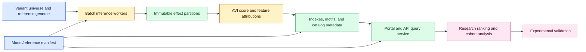
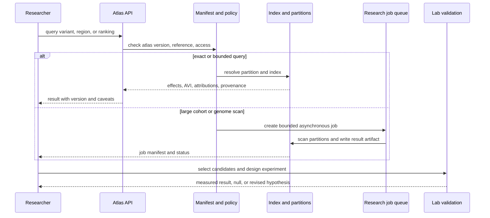

# Precomputed genome-scale model outputs
Status: emerging
Sources: [Google DeepMind — AlphaGenome Atlas: A predictive map of every possible DNA letter change in the human genome — 2026-09-08](https://deepmind.google/blog/alphagenome-atlas-a-predictive-map-of-every-possible-dna-letter-change-in-the-human-genome/)

## In one sentence

A precomputed scientific model product turns expensive per-variant inference into a searchable, versioned data plane: users rank and inspect billions of predictions quickly, but must treat scores as model outputs with provenance, uncertainty, and experimental validation requirements.

## Background: what existed before

Scientific machine-learning systems often expose a model API. A researcher submits a sequence, image, molecule, or genomic variant; the service runs inference; the result is returned. This keeps storage manageable and lets the model owner update weights centrally, but it makes large-scale scanning expensive and slow. If a study needs to examine millions or billions of candidates, repeated API calls create queueing, quota, data-transfer, and reproducibility problems.

Genomic variant interpretation illustrates the issue. The human genome contains roughly 9 billion possible single-nucleotide variants. A single-letter change may alter protein sequence, RNA splicing, gene expression, chromatin accessibility, or nothing measurable. Wet-lab testing of every possibility is impractical, while an on-demand model call for every variant can still be too slow for exploratory analysis. Researchers need a way to search the space, identify candidates, inspect contributing features, and then select a smaller set for experimental work.

The baseline architecture is a stateless prediction endpoint plus a local notebook. That design is simple but leaves each researcher responsible for batching, caching, model-version capture, retries, and result storage. Two analysts may query the same variant at different times and get different results after a model update. A local cache may be fast but not discoverable or consistently labeled. A leaderboard or single score can obscure the input sequence, cell type, tissue, reference genome, and model version that produced it.

**Precomputation** moves inference ahead of the user request. The provider runs the model over a defined universe, stores outputs, and exposes an index, portal, or API. It changes the product from a model endpoint into a scientific data product. The resulting latency is mostly lookup and filtering, but the cost shifts to a large storage footprint, indexing, data governance, update policy, and interpretation.

## What changed and why now

On September 8, 2026, Google DeepMind announced AlphaGenome Atlas. The announcement says the atlas contains predictions for the effects of 9 billion single-nucleotide variants, is a 1-petabyte dataset, and is available for academic research through a website portal. It also introduces an AlphaGenome Variant Impact (AVI) score combining AlphaGenome predictions with AlphaMissense protein-impact predictions into one ranking value.

The source says the atlas links thousands of molecular-effect predictions across cell types and tissues, AVI feature attributions, DNA sequence motifs, and variant records. It covers coding and non-coding regions; the announcement describes coding DNA as about 2% of the genome and non-coding DNA as the remaining 98%. It also says the resource is available through a portal, AlphaGenome API, and an Antigravity skill, with non-commercial access immediately and commercial Cloud availability planned.

Google DeepMind reports examples in which collaborators used AVI to prioritize rare-disease variants and identify associations in more than 54,000 UK Biobank participants. It reports a 22% increase in detected non-coding associations in one collaborator analysis and describes experimental validation of a DNM1 variant. These are publisher-reported research results, not a guarantee that every ranking is causal or clinically actionable.

The engineering change is the serving and reproducibility boundary. Instead of asking the model to compute a prediction during every exploratory query, the system serves a stable, linkable record of a precomputed result. A researcher can rank candidates across a genome, then retrieve explanations and feature attributions for selected variants. The system must expose model version, genome/reference version, feature definitions, missingness, and update timestamps because a score without those fields is not a reproducible scientific observation.

## Impact on current processing and architecture

The atlas is a batch-to-query pipeline. A precomputation job enumerates variants, runs inference, writes immutable partitions, derives scores and attributions, builds indexes, and publishes a version manifest. A query service resolves a variant or region, applies filters, returns linked records, and records access metadata. A downstream research notebook joins scores with phenotype, pedigree, or population data and produces a hypothesis for experimental validation.



Partition by a stable genomic key, such as chromosome and coordinate range, while preserving variant identity and reference-build version. A partition should be immutable after publication. Corrections or model updates should create a new atlas version rather than silently overwriting rows. Store checksums, row counts, schema version, model commit or release, input-reference hash, and generation date in a manifest.

Storage planning is substantial. If N variants each have k numeric outputs of b bytes plus metadata m bytes, raw payload is approximately `N × (k × b + m)`. For 9 billion variants, even 20 float32 outputs are about 720 GB before indexes, replicas, compression, attributions, and multiple cell-type dimensions. A 1-petabyte published dataset indicates that the output space includes many linked predictions and metadata, not simply one score per variant. Query design must avoid scanning the entire dataset for common operations.

The API should distinguish exact lookup, range query, ranking, and cohort join. An exact variant lookup can use a key-value index. A genomic interval query can use sorted partitions. A top-k impact query may require precomputed rankings or an inverted index. A cohort analysis may join external identifiers and require strict data-use controls. Do not let an interactive request trigger a full genome scan; route it to an asynchronous job with a result manifest.



The result object should carry the atlas version, variant identity, reference genome, model version, cell or tissue context, raw model outputs, derived AVI score, attribution fields, quality flags, and links to supporting documentation. Treat AVI as a ranking feature, not a probability of pathogenicity unless calibration and labels support that interpretation. A high-impact score may reflect model sensitivity to a motif or coding change without proving disease causality.

Scientific provenance also includes negative results and selection bias. If a researcher retrieves only the top 1% of variants and validates those, the atlas becomes part of a selection pipeline. Record the query, filters, score version, cutoff, and candidate set so a later analyst can reproduce how a variant entered the lab. Preserve the distinction between “model predicted impact,” “statistical association,” and “experimental effect.”

## Real-world applications and constraints

In rare-disease research, a clinician-scientist may rank variants from a patient genome and inspect predicted effects. The atlas can reduce search time, but clinical interpretation requires validated pipelines, population frequency, inheritance, phenotype, laboratory evidence, and expert review. Do not convert AVI directly into a medical diagnosis or treatment recommendation.

In population genetics, researchers can group rare non-coding variants by predicted molecular effect before testing associations. This may improve statistical power by reducing a vast search space into biologically informed groups. The grouping rule must be pre-specified or corrected for selection; otherwise, the model-driven filter can inflate false discoveries.

In regulatory genomics, feature attributions and motifs can suggest which transcriptional process a variant affects. Attributions are explanations of model behavior, not direct biochemical measurements. Use orthogonal assays, perturbation experiments, and held-out cell types before treating a motif as causal.

For data engineering, a petabyte-scale public atlas needs lifecycle, cost, and access planning. Researchers may want only a small chromosome range, while a benchmark team wants full exports. Provide column projection, compression, signed manifests, pagination, and asynchronous bulk jobs. Log downloads and respect non-commercial or data-use terms described by the provider.

## Mental model

Think of the atlas as a weather map produced by a numerical model. It lets a scientist inspect a location without rerunning the entire atmosphere simulation, but the map has a model version, resolution, coordinate system, uncertainty, and forecast horizon. A colored contour is useful for triage; it is not the weather station, and it is not a guarantee about what will happen at one house.

The atlas has three layers: prediction, retrieval, and validation. Prediction produces model outputs. Retrieval makes outputs usable at interactive scale. Validation determines whether a selected hypothesis survives biological measurement. Confusing these layers leads to overclaiming: a fast API lookup is not experimental evidence, and a high score is not a clinical conclusion.

## What changed this month

September’s announcement turns genome-scale variant prediction into a precomputed, linked data product with 9 billion single-nucleotide variants, the AVI ranking score, feature attributions, motifs, a portal, and API access. The model output becomes reusable infrastructure for ranking and hypothesis generation. The operational challenge shifts from per-request inference to data versioning, partitioning, cost, provenance, and validation.

## Engineering consequence

Build a manifest-first scientific data plane. Make every result addressable by atlas version, reference build, variant ID, context, and score definition. Provide exact lookup and bounded asynchronous jobs; reject unbounded scans from interactive endpoints. Track cache hit rate, partition scan bytes, p95 lookup latency, job completion time, data freshness, missingness, and query-to-experiment provenance.

Use a ranking quality checklist: compare score stability across versions, evaluate calibration where labels exist, measure enrichment at top-k, inspect false negatives, and test population or cell-type slices. Keep a holdout set for model updates. A model improvement that changes rankings can invalidate downstream study selection even if aggregate benchmark scores rise.

## Limits and failure modes

The atlas is a provider-described scientific resource. Its performance claims and collaborator results are not independent clinical validation. Precomputed outputs can become stale, inherit model bias, or be misinterpreted outside their training distribution. A score may rank candidates efficiently while missing a causal variant or elevating a benign one.

Reference-build mismatches can make coordinates and variant IDs wrong. Schema or model updates can silently change derived scores if version fields are omitted. Compression, approximate indexes, and caching can return incomplete results if query boundaries are wrong. A huge public dataset can also create access and egress costs for users.

The biggest scientific failure is treating prediction as proof. Preserve uncertainty, selection history, and negative results. Use experimental validation and domain expertise for claims about molecular mechanism, disease, or treatment.

## Mini exercise (15–30 min)

Build a local miniature atlas with synthetic variants, model outputs, derived impact scores, versioned manifests, exact lookup, top-k ranking, and an asynchronous full scan. Compare how a score cutoff changes candidate selection and record the provenance needed to reproduce it.

## Build it locally

```python
from dataclasses import dataclass

@dataclass(frozen=True)
class Variant:
    variant_id: str
    chromosome: str
    position: int
    model_version: str
    effect: float
    avi: float

atlas = [
    Variant("v1", "1", 100, "ag-v1", 0.22, 0.31),
    Variant("v2", "1", 130, "ag-v1", 0.91, 0.88),
    Variant("v3", "2", 210, "ag-v1", 0.67, 0.72),
    Variant("v4", "2", 240, "ag-v1", 0.08, 0.14),
]

def rank(variants, chromosome=None, minimum=0.0):
    rows = [v for v in variants if v.avi >= minimum]
    if chromosome is not None:
        rows = [v for v in rows if v.chromosome == chromosome]
    return sorted(rows, key=lambda v: v.avi, reverse=True)

print("top variants:", rank(atlas, minimum=0.5))
print("chr1:", rank(atlas, chromosome="1"))
print("manifest:", {"atlas_version": "mini-2026-09", "model": "ag-v1", "rows": len(atlas)})
```

### Numbered local steps

1. Save the example as `mini_atlas.py` and run it with Python 3.9 or newer.
2. Add a `reference_build` field and reject queries that use a different build.
3. Add a `feature_attributions` dictionary and preserve it with every ranked result.
4. Add a second model version with changed scores; compare the top-k set and record changed rankings.
5. Add a `query_id`, cutoff, chromosome filter, and result hash to a provenance record.
6. Simulate a large scan by iterating over the atlas and write the result to a named job artifact rather than printing every row.
7. Add a synthetic experimental label and calculate precision among the top-k candidates; explain why this does not prove biological causality.

## Interview Q&A

### Why precompute model outputs?

Precomputation amortizes expensive inference over many users and makes large-scale ranking interactive. It shifts complexity to storage, indexing, versioning, updates, and provenance.

### Is AVI a probability of disease?

Not by itself. It is a provider-defined impact score that combines model predictions. Its interpretation depends on calibration, labels, context, and experimental evidence.

### What must be versioned?

The model, reference genome, feature definitions, atlas release, schema, derived-score formula, query filters, and candidate-selection cutoff.

### Why not let an API scan the whole genome synchronously?

It creates unpredictable latency, resource contention, and cost. Route large scans to bounded asynchronous jobs with manifests and progress.

## Glossary

- **Atlas:** A searchable, precomputed collection of model outputs and linked metadata.
- **AVI:** AlphaGenome Variant Impact score described by Google DeepMind as a combined variant-impact ranking.
- **Attribution:** A model-derived indication of features contributing to a score; not automatically causal evidence.
- **Precomputation:** Running inference before a user query and storing the outputs for later retrieval.
- **Reference build:** A versioned coordinate and sequence system used to identify genomic locations.
- **Variant:** A DNA sequence difference, here especially a single-nucleotide change.

## References

1. Google DeepMind, “AlphaGenome Atlas: A predictive map of every possible DNA letter change in the human genome,” September 8, 2026. Primary source for the 9-billion-variant atlas, 1-petabyte scale, AVI score, attributions, motifs, portal/API access, and collaborator examples: https://deepmind.google/blog/alphagenome-atlas-a-predictive-map-of-every-possible-dna-letter-change-in-the-human-genome/
2. The data-plane architecture, formulas, provenance requirements, and simulator are engineering analysis and inference, not independent validation of AlphaGenome Atlas.

## Claim ledger

| Claim | Source | Fact or inference |
|---|---|---|
| AlphaGenome Atlas contains predictions for 9 billion single-nucleotide variants. | Google DeepMind announcement | Release-specific source fact |
| The atlas is described as a 1-petabyte dataset with portal and API access. | Google DeepMind announcement | Provider description |
| AVI combines AlphaGenome and AlphaMissense predictions into one score. | Google DeepMind announcement | Release-specific source fact |
| The atlas links effects, attributions, motifs, and variant records. | Google DeepMind announcement | Provider description |
| Collaborator findings and the reported 22% association increase are publisher-reported research results. | Google DeepMind announcement | Source-attributed result, not independent verification |
| Precomputed outputs require versioned manifests, indexes, and provenance. | Data engineering analysis | Engineering inference |
| A high impact score is not automatically a causal or clinical conclusion. | Scientific reasoning | Engineering/scientific inference |
