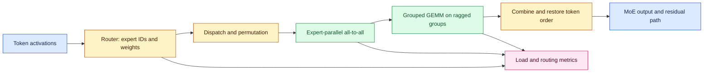
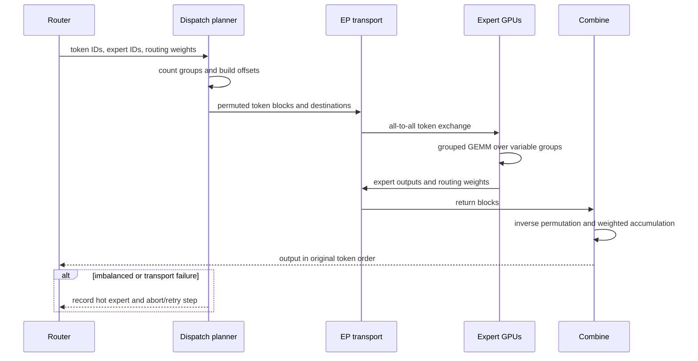

# Dropless MoE dispatch at scale
Status: emerging
Sources: [NVIDIA — Accelerating Dropless MoE Training in JAX with NVIDIA Transformer Engine — 2026-09-14](https://developer.nvidia.com/blog/accelerating-dropless-moe-training-in-jax-with-nvidia-transformer-engine/)

## In one sentence

Dropless mixture-of-experts training preserves every routed token instead of trimming or padding expert capacity, but it requires ragged kernels, efficient dispatch/combine communication, and routing-aware observability to keep irregular work from idling the cluster.

## Background: what existed before

A dense feed-forward network sends every token through the same weights. A mixture-of-experts (MoE) layer contains multiple expert feed-forward blocks and a router that chooses a small number of experts for each token. Sparse activation can increase total model capacity without applying every expert to every token, but it turns regular matrix multiplication into a variable-size distributed workload.

Capacity-based MoE systems make that workload easier to schedule. Each expert receives a fixed token capacity per batch. If too many tokens choose an expert, overflow tokens may be dropped; if fewer arrive, padding fills unused slots. Fixed shapes help kernels and collective communication, but token dropping can change training signal and padding wastes memory and compute. Increasing capacity reduces drops but increases worst-case memory and communication.

Dropless MoE chooses a different trade-off: every routed token is processed, with no overflow trimming and no padding to a fixed expert shape. This is attractive for model quality, but the system must handle ragged token groups. Expert 1 may receive 100 tokens while expert 2 receives 1,000. A loop of ordinary GEMMs adds launch and host-synchronization overhead; a fixed batched GEMM computes work for tokens that do not exist.

The prerequisites are routing, dispatch, and combine. **Routing** maps each token to expert IDs. **Dispatch** permutes and transfers tokens to the device holding the selected expert. **Expert computation** applies the expert MLP. **Combine** sends results back and restores original token order. **Expert parallelism** distributes experts across devices. A correct implementation must preserve token identity, routing weights, order, gradients, and duplicate assignments.

## What changed and why now

NVIDIA’s September 14, 2026 engineering post describes Transformer Engine optimizations for dropless MoE training in JAX. It says dropless MoE processes every token without dropping or padding and requires block-sparse kernels, grouped GEMM, and optimized dispatch/combine primitives. The post describes group-aware MXFP8 quantization, MXFP8 grouped GEMM, optimized expert-parallel operations, JAX host offloading, and multistreaming collectives.

NVIDIA reports a 10.4x throughput improvement for MoE training on NVIDIA GB200, raising a DeepSeek-V3 configuration from 103 to 1,068 TFLOPS/GPU. It also reports roughly 10x throughput improvement and 97% scaling efficiency to 1,024 GPUs for DeepSeek-V3 671B. These are vendor measurements for stated configurations, not portable guarantees. The post recommends starting with a reference configuration, validating correctness on a small MoE model, and measuring step time, TFLOPS/GPU, MFU, grouped-GEMM latency, and dispatch/combine latency.

The engineering change is that irregularity becomes a first-class kernel and communication contract. The runtime can use actual token counts without CPU-visible shape metadata, enabling CUDA graphs and avoiding recompilation. A grouped GEMM handles all expert matmuls in one call with their true token counts. Fused expert-parallel dispatch/combine reduces separate memory movement and communication steps; NVIDIA also describes token deduplication to avoid sending repeated data across a network path.

## Impact on current processing and architecture

The MoE layer is a dataflow graph with a dynamic partition. The router emits expert IDs and weights. A dispatch planner calculates offsets and destinations. The EP transport moves token rows. Grouped GEMM consumes a list of expert groups. Combine reverses the permutation and accumulates outputs. Backpropagation must replay the same routing and respect dropped-none semantics.



Let T be tokens, E experts, and n_e the number routed to expert e. Dropless processing satisfies `Σ_e n_e = T × k` for top-k routing, where assignments may be duplicated. A capacity-based system instead bounds each n_e by C and may drop `max(0, n_e − C)` assignments or pad up to C. The imbalance ratio `max(n_e) / mean(n_e)` predicts whether the slowest expert or communication destination will dominate the step. A perfectly balanced top-2 route has expected n_e near `2T/E`; real routing has variance and correlated hot tokens.

Grouped GEMM should compute the sum of valid group work, approximately `Σ_e n_e × cost_expert(e)`, rather than `E × C × cost_expert` with padding. The benefit disappears if launch overhead, poor small-matrix efficiency, or all-to-all latency dominates. Measure useful FLOPs and wall-clock time together; TFLOPS can rise while end-to-end step time worsens if the reported region excludes routing.



The failure flow is not a normal dense-layer failure. A single hot expert can create stragglers. A wrong offset can silently mix tokens. A dropped collective can deadlock the step. A dynamic shape can trigger recompilation or prevent graph capture. Record per-expert counts, max/mean ratio, dispatch bytes, combine bytes, all-to-all duration, grouped-GEMM duration, idle time, and step retry count.

## Real-world applications and constraints

Large language model pretraining can use dropless routing when preserving every token matters more than simple fixed shapes. The system must scale expert storage, communication, optimizer state, and checkpointing. A training run may be compute-efficient but network-bound if experts are spread across slow links. Place expert parallel groups according to topology and test failure recovery.

JAX and XLA introduce compilation concerns. Dynamic expert sizes should be handled without requiring CPU shape discovery on every step. A reference implementation may work on a small mesh but fail at the target mesh because collectives, memory, or graph capture differ. Validate numerics, gradient parity, loss curves, and throughput separately.

Quantization can improve arithmetic and bandwidth, but group-aware scaling and ragged groups need error tests. Compare loss and downstream quality with the chosen MXFP8 or other precision path. Do not treat a throughput increase as free if it changes convergence steps or requires more training tokens.

## Mental model

Think of a dropless MoE layer as a postal hub where every package must reach its chosen specialist. Capacity-based routing uses fixed-size bins and throws away overflow or ships empty boxes. Dropless routing keeps every package but needs a warehouse that can pack variable piles efficiently, trucks that exchange packages across hubs, and a ledger that restores each package to the correct customer order.

The kernel boundary matters. A normal GEMM expects regular matrices; a grouped GEMM accepts a collection of differently sized groups. The communication boundary matters too: dispatch and combine are part of the layer’s critical path, not an implementation detail outside the model.

## What changed this month

September’s source makes dropless MoE a concrete systems-optimization target in JAX: grouped ragged GEMM, fused expert-parallel communication, group-aware quantization, and overlap/host-offload techniques. The lasting concept is to preserve irregular workload semantics while optimizing the kernels and transport around them.

## Engineering consequence

Start with a correctness harness. Compare a simple reference MoE against the optimized path on identical router assignments, outputs, gradients, and token order. Then add performance counters by stage. Use routing histograms and hot-expert alerts rather than only aggregate GPU utilization.

Define a step budget `T_step = T_route + T_dispatch + T_comm + T_expert + T_combine + T_sync`. Improve the largest measured term, and remeasure when routing distribution changes. A throughput claim should state model, batch, sequence length, top-k, expert count, precision, mesh, interconnect, and whether it includes input pipeline and checkpoint overhead.

Correctness deserves a separate acceptance matrix. Compare dense reference arithmetic and optimized arithmetic at small size; compare router assignments; compare token permutations before and after dispatch; compare forward outputs and gradients within a declared tolerance; then compare loss curves over enough steps to detect routing or precision drift. Test pathological distributions: all tokens to one expert, one token per expert, duplicate top-k assignments, empty experts, a failed rank, and a changed expert count. A benchmark that skips these cases may report excellent average utilization while hiding the failure mode that matters at scale.

Checkpointing also changes. The optimizer and model state include expert weights, router parameters, load-balancing statistics, and potentially communication layout. A restart must restore the same expert ownership and enough metadata to reconstruct routing and collective groups. If a mesh changes after failure, the runtime needs an explicit redistribution plan; it should not assume that rank-local tensors can be loaded into a new placement without remapping. Measure checkpoint time and restart time as part of time-to-train, not as an appendix to the kernel benchmark.

For observability, keep both token-level and rank-level views. Token-level traces explain why an expert is hot; rank-level traces explain whether a network link, collective, or synchronization barrier caused the stall. Sample detailed traces to control overhead, but export aggregate histograms for every step. A useful alert is a sustained max/mean expert-load ratio above a threshold combined with rising dispatch wait; either signal alone can be benign during warm-up.

Also test reproducibility across seeds and batches. Router randomness can change expert counts even when the input distribution is nominally the same. Store the seed, routing histogram, precision mode, and mesh topology with each performance result so a later regression can distinguish a kernel change from a workload change.

## Limits and failure modes

Dropless does not remove routing imbalance; it removes token dropping and padding. A pathological router can overload one expert, inflate memory, and make the whole step wait. Auxiliary load-balancing loss can help but may trade off specialization and quality. Communication can dominate even when expert matmuls are fast.

Vendor benchmarks are configuration-specific. TFLOPS/GPU is not the same as examples per second, tokens per second, or time-to-quality. Quantization and host offload can change memory and numerical behavior. Reproduce on the actual model, mesh, topology, and convergence target.

## Mini exercise (15–30 min)

Simulate top-k routing with uneven expert counts. Compare fixed-capacity padding/dropping with dropless grouped work, calculate imbalance, and measure a simple Python implementation’s valid-operation count. The exercise teaches the trade-off without requiring a GPU.

## Build it locally

```python
from collections import Counter

def route(tokens, expert_ids, capacity=None):
    groups = Counter(expert_ids)
    kept = []
    dropped = []
    seen = Counter()
    for token, expert in zip(tokens, expert_ids):
        if capacity is not None and seen[expert] >= capacity:
            dropped.append((token, expert))
        else:
            kept.append((token, expert))
            seen[expert] += 1
    return groups, kept, dropped

tokens = list(range(20))
experts = [0, 0, 0, 0, 1, 1, 1, 2, 2, 3,
           3, 3, 3, 3, 3, 3, 1, 2, 0, 3]
groups, dropless, dropped = route(tokens, experts)
_, capped, dropped = route(tokens, experts, capacity=5)
mean_load = sum(groups.values()) / len(groups)
print("counts:", groups)
print("imbalance:", max(groups.values()) / mean_load)
print("dropless assignments:", len(dropless))
print("capacity-5 assignments:", len(capped), "dropped:", len(dropped))
```

### Numbered local steps

1. Save the example as `dropless_route.py` and run it with Python 3.9 or newer.
2. Add an expert with zero tokens and compute imbalance against all experts, not only active ones.
3. Change capacity from 5 to 3 and record dropped assignments.
4. Add top-2 routing by giving each token two expert IDs; verify `sum(counts) = tokens × 2`.
5. Add a cost per valid token and compare padded capacity work with dropless work.
6. Simulate one slow expert and show that step time follows the maximum group duration.
7. Add an inverse permutation and verify that token order is restored after dispatch and combine.
8. Record a JSON-like metrics row with step, max/mean load, dropped tokens, dispatch time, combine time, and total step time.

## Interview Q&A

### Why can dropless MoE improve quality?

It processes every routed token instead of dropping overflow. That preserves training signal, but it increases the burden on dynamic kernels, memory, and communication.

### What does grouped GEMM solve?

It runs multiple expert matrix multiplications with their actual variable token counts in one optimized path, avoiding a host loop or padding every expert to the worst-case capacity.

### What is the main distributed bottleneck?

Expert-parallel dispatch and combine can become all-to-all communication bottlenecks, especially with uneven routing and poor topology. The slowest expert or rank can determine step time.

### Does 10x TFLOPS mean 10x training speed?

No. It is a vendor-reported arithmetic-throughput result for a configuration. End-to-end speed also includes routing, communication, input, synchronization, checkpointing, and convergence.

## Glossary

- **Capacity-based MoE:** Routing with a fixed token budget per expert, causing padding or dropping on overflow.
- **Combine:** Returning expert outputs and restoring original token order.
- **Dispatch:** Permuting and transferring tokens to selected expert devices.
- **Dropless MoE:** MoE routing that processes every selected token without overflow dropping or fixed-capacity padding.
- **Expert parallelism:** Distributing experts across devices and communicating routed tokens.
- **Grouped GEMM:** A matrix-multiplication path that handles multiple variable-size expert groups together.
- **Ragged:** Data whose groups have different lengths or shapes.

## References

1. NVIDIA, “Accelerating Dropless MoE Training in JAX with NVIDIA Transformer Engine,” September 14, 2026. Primary source for dropless routing, grouped GEMM, expert-parallel dispatch/combine, MXFP8, reported throughput, and scaling results: https://developer.nvidia.com/blog/accelerating-dropless-moe-training-in-jax-with-nvidia-transformer-engine/
2. The routing equations, simulator, and operational recommendations are engineering analysis and inference, not independent reproduction of NVIDIA’s benchmark.

## Claim ledger

| Claim | Source | Fact or inference |
|---|---|---|
| Dropless MoE processes every routed token without dropping or padding. | NVIDIA engineering post | Source description |
| Grouped GEMM and optimized dispatch/combine support variable expert token counts. | NVIDIA engineering post | Source description |
| NVIDIA reports 10.4x throughput improvement on GB200 for the stated configuration. | NVIDIA engineering post | Vendor measurement |
| NVIDIA reports roughly 10x throughput and 97% scaling efficiency to 1,024 GPUs for the stated DeepSeek-V3 setup. | NVIDIA engineering post | Vendor measurement |
| Routing imbalance and communication can dominate step time. | Distributed-systems analysis | Engineering inference |
| The Python example does not model GPU kernels or distributed collectives. | This lesson’s example | Explicit limitation |
