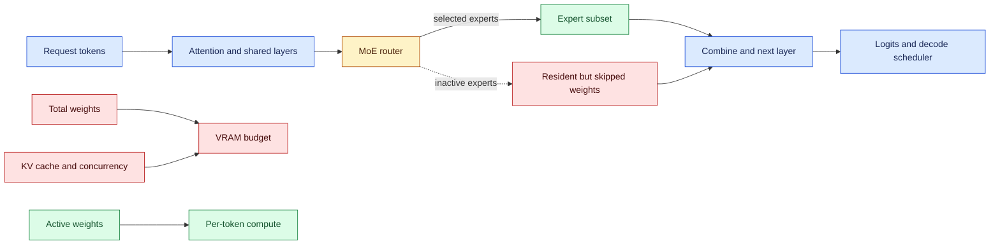
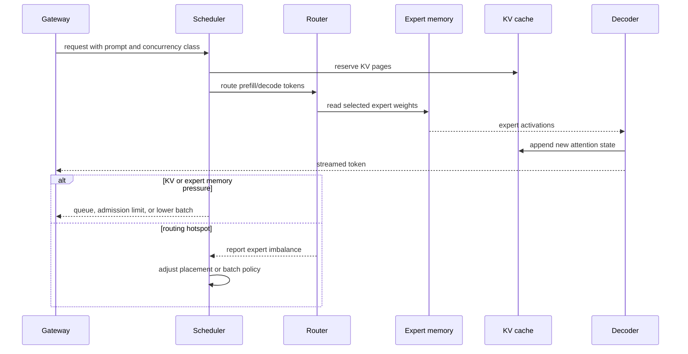

# Dense-versus-MoE deployment sizing
Status: durable
Sources: [NVIDIA — Dense vs. MoE Models: Active Parameters, Throughput, and When to Choose Each — 2026-09-15](https://developer.nvidia.com/blog/dense-vs-moe-models-active-parameters-throughput-and-when-to-choose-each/)

## In one sentence

Dense and mixture-of-experts models trade predictable deployment for sparse per-token compute, so capacity planning must size total parameters for memory and active parameters for compute while accounting for KV cache, concurrency, routing, and quantization.

## Background: what existed before

Model selection is often reduced to parameter count. A 30B model is assumed to require roughly the same memory and compute as every other 30B model. That assumption works better for dense models, where every token passes through all feed-forward weights, than for mixture-of-experts models, where a router activates only a subset of expert blocks for each token.

A **dense** model applies the same parameter path to every token. Memory is approximately the weight size plus activations, KV cache, runtime buffers, and overhead; compute per token grows with the full network. An **MoE** model stores multiple experts but activates only selected experts per token. It can offer high total capacity with lower active computation, but all or most experts usually need to be resident or quickly available. Memory and compute become separate constraints.

Before MoE serving became common, a team could choose a model by fitting weights and KV cache into one or more GPUs, then benchmark throughput. With MoE, “active parameters” describes arithmetic work, while “total parameters” describes the weight inventory and memory pressure. An MoE model may produce more tokens per second at low batch size because it reads fewer feed-forward bytes per token, yet leave less memory for KV cache because all experts are loaded.

The baseline architecture is a replica pool with fixed model weights, continuous batching, and a scheduler. MoE adds routing, expert placement, communication, load imbalance, and potentially different quantization behavior. It may be faster for one request but less predictable under high concurrency if many tokens hit the same expert or if expert weights are distributed across a network.

## What changed and why now

NVIDIA’s September 15, 2026 post frames dense-versus-MoE selection as a deployment decision rather than a raw parameter-count comparison. It says Nemotron 3.5 Lightning uses a MoE architecture with 3B active parameters out of 30B total and explains that MoE decouples memory cost from compute cost. The post says dense models activate all parameters, while MoE models route each token through a selected subset.

The source emphasizes that model choice depends on memory budget, concurrency, fine-tuning plans, quantization, and serving complexity. It reports that MoE can have a throughput advantage, especially at low batch size, while latency margins compress as concurrency rises. It also notes that all experts occupy GPU memory and leave less room for KV cache than a dense model of comparable total size may require.

The article includes a comparison table and third-party speed/pricing references. Those observations are configuration-specific and the source itself notes that architecture, Mamba layers, speculative decoding, hardware, precision, and framework contribute. They should guide a benchmark plan, not substitute for one.

## Impact on current processing and architecture

Capacity planning needs two ledgers. The memory ledger includes total weight bytes, KV-cache bytes, activations, workspace, and runtime overhead. The compute ledger includes active feed-forward parameters, attention, embedding, routing, communication, and sampling. For dense models, total and active parameter counts are close. For MoE, they diverge.



For b-bit weights and N parameters, a lower-bound weight memory estimate is `M_weights ≈ N × b/8`. Real memory includes scales, metadata, alignment, buffers, and replication. An MoE with N_total parameters and N_active parameters still pays approximately N_total weight storage if all experts are loaded, while per-token feed-forward arithmetic is closer to N_active. At batch size one, decode is often memory-bandwidth bound: reading fewer active weight bytes can help. At high concurrency, routing, KV cache, and expert traffic change the balance.

The KV cache grows with sequence length, layers, heads, head dimension, precision, and active sequences. A simple estimate is `M_KV ≈ batch × tokens × layers × 2 × kv_heads × head_dim × bytes_per_value`, with implementation-specific sharing and compression. If an MoE consumes more weight memory, fewer concurrent sequences may fit even when active compute is low. A model that wins single-stream tokens per second can lose p95 latency under the target concurrency because the scheduler admits fewer sequences or spills cache.



Deployment selection should compare complete service metrics: time to first token, inter-token latency, end-to-end latency, throughput, goodput, memory headroom, power, cost, and quality. Keep workload slices for short prompts, long prompts, long outputs, batch-one, target concurrency, and burst traffic. Do not compare a dense model’s output speed from one provider with an MoE model’s speed from another and attribute all difference to sparsity.

Quantization interacts with the choice. Quantizing all experts reduces weight memory but may require group scales and can change routing or output quality. A model that barely fits in native precision may fit at 4-bit, freeing room for KV cache. Conversely, dequantization or routing overhead can reduce the arithmetic advantage. Measure memory allocation and actual bandwidth, not only nominal bits per parameter.

## Real-world applications and constraints

For interactive assistants at batch one, MoE can offer lower active compute and good token throughput if all expert weights fit on the target device. The service still needs enough memory for a user’s context and KV cache. If prompts are long, a smaller dense model with more cache headroom may provide better p95 latency.

For high-concurrency APIs, MoE can improve aggregate throughput but create routing hotspots and communication overhead. Continuous batching changes the expert mix every step. Track per-expert token counts and enforce admission when memory or queue budgets are exceeded. If requests have different priorities, ensure a hot expert cannot starve critical traffic.

For edge or private deployments, total memory and power dominate. A dense model may be easier to quantize, fine-tune, and package; an MoE may require a larger device or multiple devices even though each token activates fewer parameters. Count model download time, storage, update bandwidth, and cold-start time.

For fine-tuning, the architecture changes the optimizer state, expert balance, and communication pattern. A team must know whether it can update all experts, selected experts, or shared layers, and whether the fine-tuning data routes evenly. A deployment win can disappear if the chosen adaptation method requires loading or synchronizing more state than inference.

## Mental model

Think of a dense model as a factory where every order passes through every station. An MoE model is a factory with many specialist stations: every station must exist in the building, but each order visits only a few. The building size is total parameters; work per order is active parameters. If too many orders choose one station, the queue at that station dominates. If the building uses all its floor space for stations, less space remains for order buffers—the KV cache.

## What changed this month

September’s source makes active-versus-total parameters a first-class deployment decision. The engineering delta is a capacity model that decouples memory sizing from per-token compute, then reconnects them through KV cache, concurrency, routing, quantization, and communication.

## Engineering consequence

Create a sizing spreadsheet or script with total parameters, active parameters, weight precision, KV-cache precision, context length, concurrency, layers, routing top-k, memory overhead, and target SLO. Reject a model based on a single parameter count. Benchmark dense and MoE candidates on the same hardware, runtime, prompt/output distributions, and concurrency sweep.

Use a simple feasibility condition: `M_weights + M_KV(concurrency, context) + M_runtime ≤ M_device × safety_headroom`. Then test whether `throughput × quality_pass_rate` meets goodput. If a model fits only with zero headroom, it is not production-feasible; cache fragmentation, long requests, and updates need margin.

The comparison should include rollout and failure cost. A dense replica may restart with a predictable image and weight layout. An MoE deployment may need all experts, routing metadata, collective groups, and a topology-aware placement. If one shard or expert rank fails, the service may lose the whole replica or require degraded routing. Include cold-start time, image and weight download, health-check duration, replica replacement, and traffic drain in the capacity model. For a multi-region service, compare the network and egress cost of sharding experts with the cost of keeping complete replicas.

Quality and operational metrics should be sliced by prompt length, language, tool use, and concurrency. Sparse routing can specialize, but a distribution shift may send tokens to experts with less useful coverage or create hot spots. A model that passes a general benchmark can still regress on a customer workflow. Shadow traffic and canary replicas should preserve the same tokenizer, quantization, router, and batch policy so that the dense-versus-MoE comparison is not confounded by unrelated serving changes.

For a fair cost comparison, divide infrastructure cost by accepted work rather than by raw generated tokens. If a request consumes compute cost C, has quality-pass probability q, and triggers retry or escalation cost R with probability 1 − q, expected cost per accepted response is approximately `(C + (1 − q) × R) / q`. This makes a cheaper but less reliable model visible in the same accounting unit as a more expensive model.

Keep a decision record for the selected architecture. Record why the model met memory, latency, quality, cost, and operational requirements; which workloads were excluded; and what would trigger a re-evaluation. This prevents a one-time benchmark winner from becoming an undocumented default after traffic, context length, hardware, or model weights change.

## Limits and failure modes

Active parameters do not mean inactive weights are free. Total experts consume memory, loading time, and update bandwidth. Routing can cause imbalance, and high concurrency can narrow the latency advantage. Third-party speed and price tables are not universal benchmarks.

MoE behavior depends on attention architecture, speculative decoding, quantization, framework, hardware, and batch. A dense model may win on tail latency or operational simplicity even if its tokens-per-second headline is lower. A model that fits weights may fail once KV cache and workspace are included.

## Mini exercise (15–30 min)

Build a small sizing calculator comparing dense and MoE models. Compute weight memory, approximate KV memory across context/concurrency, active compute units, and a feasibility margin. Change precision and routing top-k to see which constraint moves.

## Build it locally

```python
def estimate(total_params_b, active_params_b, weight_bits, layers,
             batch, tokens, kv_heads, head_dim, kv_bits, device_gb):
    weights_gb = total_params_b * 1e9 * weight_bits / 8 / 1e9
    kv_gb = (batch * tokens * layers * 2 * kv_heads * head_dim * kv_bits / 8) / 1e9
    runtime_gb = 2.0
    used = weights_gb + kv_gb + runtime_gb
    return {
        "weights_gb": round(weights_gb, 2),
        "kv_gb": round(kv_gb, 2),
        "used_gb": round(used, 2),
        "fits": used <= device_gb * 0.9,
        "active_compute_units": active_params_b,
    }

for name, total, active in [("dense", 30, 30), ("moe", 30, 3)]:
    print(name, estimate(total, active, 16, 48, 4, 4096, 8, 128, 16, 80))
```

### Numbered local steps

1. Save the example as `model_sizing.py` and run it with Python 3.9 or newer.
2. Change batch and token length; observe that KV memory grows independently of active parameters.
3. Change weight bits from 16 to 4 and add a scale-overhead percentage.
4. Add a second device and model tensor-parallel replication or sharding explicitly.
5. Add routing top-k and use `active_params_b = shared_params_b + experts_per_token × expert_params_b`.
6. Add a 10% fragmentation margin and compare it with the current 90% admission headroom.
7. Record p50/p95 latency and throughput from a real or synthetic load test next to the estimates.

## Interview Q&A

### Why can an MoE model be fast but memory-heavy?

It activates fewer expert parameters per token, reducing compute and memory reads during a token step, but all experts may need to reside in memory. Total parameter storage and KV cache still determine capacity.

### What does active parameter count omit?

It may omit shared attention and embedding weights depending on the model’s definition. It also says nothing by itself about routing, communication, quantization, or runtime overhead.

### When might dense be preferable?

When memory, latency predictability, fine-tuning simplicity, or deployment footprint matters more than sparse throughput, especially at high concurrency or on constrained devices.

## Glossary

- **Active parameters:** Parameters applied to a token on its selected computation path.
- **Dense model:** A model that applies its parameter path to every token.
- **KV cache:** Stored attention keys and values reused during autoregressive decoding.
- **MoE:** Mixture-of-experts architecture with routed expert blocks.
- **Total parameters:** The full stored parameter inventory, including inactive experts.
- **Routing hotspot:** An expert or device receiving disproportionate token traffic.

## References

1. NVIDIA, “Dense vs. MoE Models: Active Parameters, Throughput, and When to Choose Each,” September 15, 2026. Primary source for active/total parameter trade-offs, memory, concurrency, quantization, and deployment selection: https://developer.nvidia.com/blog/dense-vs-moe-models-active-parameters-throughput-and-when-to-choose-each/
2. The sizing equations, calculator, and operational recommendations are engineering analysis and inference, not independent reproduction of the source’s comparison data.

## Claim ledger

| Claim | Source | Fact or inference |
|---|---|---|
| Dense models activate all parameters while MoE models activate selected experts. | NVIDIA engineering post | Source explanation |
| MoE decouples total memory cost from active per-token compute. | NVIDIA engineering post | Source explanation |
| Nemotron 3.5 Lightning is described as 3B active of 30B total parameters. | NVIDIA engineering post | Release-specific source fact |
| Throughput advantage can narrow at high concurrency and depends on hardware/runtime. | NVIDIA engineering post | Source-qualified claim |
| KV cache and routing must be included in deployment sizing. | Systems analysis | Engineering inference |
| The calculator is a lower-order estimate and not a serving benchmark. | This lesson’s example | Explicit limitation |
