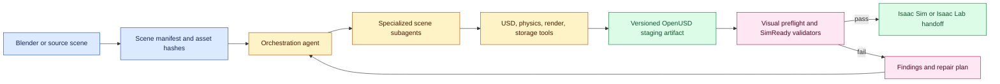
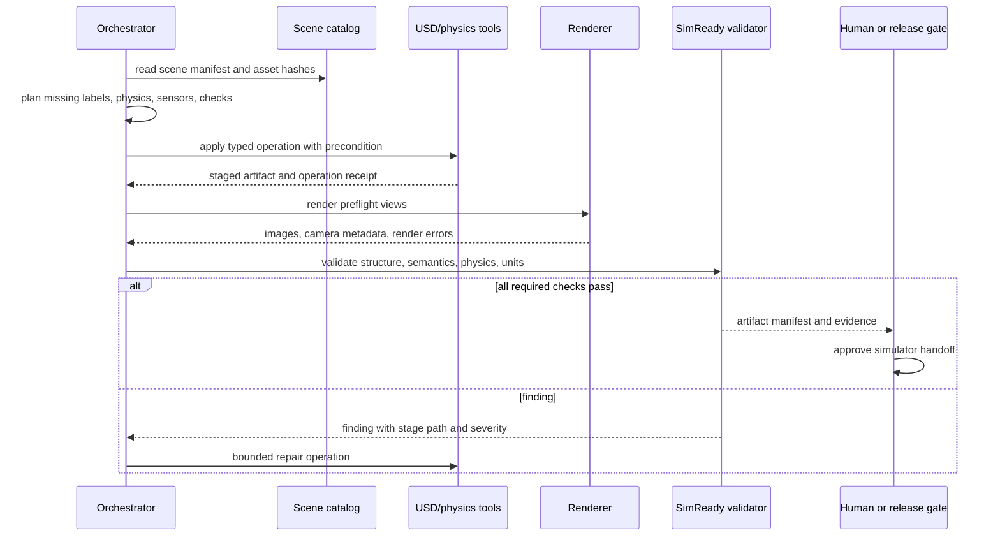

# Agent-built, simulation-ready digital twins
Status: emerging
Sources: [NVIDIA — How to Use AI Agents to Prepare 3D Scenes for Simulation — 2026-09-16](https://developer.nvidia.com/blog/how-to-use-ai-agents-to-prepare-3d-scenes-for-simulation/)

## In one sentence

An agent-built digital-twin pipeline turns a 3D scene into a validated simulation artifact by combining tool-using planning with explicit OpenUSD structure, labels, physics, sensors, rendering checks, and SimReady preflight rather than trusting a plausible scene alone.

## Background: what existed before

Simulation environments are often assembled by artists, robotics engineers, and technical designers. A scene may look correct in a renderer while missing collision geometry, physical materials, semantic labels, units, coordinate conventions, sensors, or articulation metadata required by a simulator. Manual conversion from Blender or another authoring tool to a robotics-ready world is repetitive and error-prone.

The baseline automation is a deterministic export script. It converts meshes, applies naming rules, adds a few materials, and writes a file. Scripts are predictable but brittle when scenes vary. A human must inspect the result, find missing objects, add sensors, correct transforms, and rerun validation. A general language model can describe what a scene should contain, but text alone cannot safely edit a USD stage or prove that physics and sensor configuration are valid.

The problem is an artifact pipeline, not only a generation problem. A digital twin is a structured representation of a physical or intended environment. A simulation-ready artifact needs semantics that a renderer and simulator interpret consistently. If a robot’s wheel looks attached but has no joint, a camera has the wrong frame, or a floor lacks collision, a visual review can pass while a policy-training run fails.

**OpenUSD** is a scene-description framework for composing structured 3D assets. **SimReady** is a set of requirements and conventions for simulation-ready content. A **preflight** is a validation pass before an artifact enters a downstream tool. The agent’s output is a candidate artifact; deterministic validators and human review remain responsible for acceptance.

## What changed and why now

NVIDIA’s September 16, 2026 engineering post describes a workflow that uses AI agents to inspect 3D scenes, author simulation-relevant data in OpenUSD, add physics properties, render preflight views, and validate the result against SimReady requirements. The source walks from a Blender scene to a simulation-ready OpenUSD handoff for Isaac Sim or Isaac Lab.

The workflow begins with an orchestration objective specifying input, desired output, destination, and validation criteria: a Blender scene, a robotics-simulation goal, a USD world, and visual plus SimReady validation. The post describes an orchestration agent, specialized NemoClaw subagents, and Omniverse Libraries that provide tools for USD, rendering, physics, storage, and validation.

The engineering change is a typed artifact loop: inspect, plan, modify, render, validate, and hand off. The agent supplies flexible decomposition and tool selection, but the artifact contract and validators decide whether the world is complete enough to use. This separates semantic reasoning from deterministic checks.

## Impact on current processing and architecture

The pipeline should preserve the original scene and create a new versioned artifact. The agent receives a scene manifest and a tool catalog. It proposes changes such as adding collision meshes, semantic labels, physics materials, sensors, or joints. Tools apply those changes to a branch or staging stage. Renderers produce visual evidence. SimReady validators inspect structural and semantic invariants. Only a passing artifact can enter the simulator.



The manifest is the trust anchor. Record source file hashes, scene units, coordinate system, asset dependencies, tool versions, target simulator, required labels, physics profile, sensor list, and validation profile. An agent should not discover critical requirements only from a prompt. Put them in a machine-readable contract that validators can inspect.

Represent modifications as typed operations: `add_semantic_label`, `set_collision_mesh`, `create_rigid_body`, `attach_sensor`, `set_material`, `add_joint`, `render_camera`, and `run_validator`. Each operation should include target path, precondition, proposed value, authoring tool, and result. Reject an operation whose target hash changed after planning. This prevents a late edit from applying to the wrong scene node.



A visual preflight and a structural validator catch different failures. Rendering can expose missing geometry, camera placement, scale, and visible material problems. Structural checks can expose missing collision, invalid relationships, duplicate identifiers, absent sensors, or unit mismatch. Physics smoke tests can reveal unstable bodies, penetrations, or joints that look plausible in a static image.

Measure artifact complexity and validation cost. If a scene has n assets, m relationships, s sensors, and p physics properties, a full validation pass is roughly proportional to `O(n + m + s + p)` for local checks, but rendering and simulation may be much more expensive. Incremental validation can recheck only the dependency closure of a changed node, while release gates should periodically run full validation. Cache results by artifact hash and validator version; never reuse a pass after changing either.

## Real-world applications and constraints

For warehouse robotics, an agent can convert a facility scene into a world with aisles, shelves, collision geometry, semantic labels, and camera or lidar sensors. The deployment constraint is calibration: a visually correct camera transform must match the robot’s real coordinate frame and sensor noise model. Use real measurements and compare simulated observations before training a policy.

For autonomous vehicles, an agent may prepare road, traffic, and sensor assets. A missing occlusion relationship or incorrect material can alter perception results. Keep a provenance link from every generated object to its source data and rule. Do not let the agent invent physical dimensions where safety or evaluation depends on measurement.

For construction or industrial planning, a digital twin can support layout and safety analysis. The system must handle asset licensing, proprietary geometry, versioned change orders, and multiple engineering disciplines. A model-generated layout suggestion should enter a review workflow, not become a construction instruction merely because the simulator accepted the file.

For reinforcement-learning research, repeatable scene generation enables variation in lighting, placement, materials, and sensor configuration. The risk is distribution mismatch: random variation that is not physically plausible can teach a policy shortcuts that fail in the real world. Record seeds, variation parameters, simulator version, and validation results for every training shard.

## Mental model

Treat the agent as a junior technical artist with excellent search and planning but no authority to certify its own work. It can inspect a scene, propose a repair, call a tool, and explain a finding. The artifact contract, deterministic validators, and release gate are the senior review process. A pretty render is a screenshot; a simulation-ready world is a versioned, validated dependency graph.

## What changed this month

September’s source makes the agent-to-OpenUSD-to-simulation handoff concrete. The new concept is not “ask an agent to make a 3D world.” It is an artifact pipeline in which agents perform structured edits and validators enforce simulation requirements before Isaac Sim or Isaac Lab receives the result.

## Engineering consequence

Make scene conversion transactional. Branch the stage, apply a bounded set of typed operations, render and validate, then publish a manifest. Preserve failed artifacts and findings for debugging. Require target hashes and idempotency keys so retries do not duplicate labels, sensors, or relationships.

Define acceptance at three levels. Artifact validity asks whether the file loads, references resolve, units are declared, and required properties exist. Simulation validity asks whether the simulator can step the world, sensors produce data, bodies remain stable, and collision or joint constraints behave within bounds. Task validity asks whether the world is useful for the intended robot or policy, including realistic observations and coverage of required scenarios. A scene can pass the first gate and fail the second or third; keep the results separate rather than publishing one green check.

Use a change impact graph for incremental work. If an agent changes a material, rerun visual and sensor checks that depend on appearance; if it changes a collision mesh, rerun physics and contact checks; if it changes a frame, rerun sensor and robot-kinematics checks. Let a validator declare its dependency types. This reduces iteration time while preserving a full validation gate before release. Record which checks were incremental and which were full so a later reviewer can interpret the evidence.

Track repair success rate, validator failure categories, render time, simulation smoke-test failures, artifact size, dependency count, and human overrides. A useful quality measure is not the number of agent actions; it is the percentage of artifacts that pass without unsafe or unaudited edits and remain valid after a downstream simulator load.

Store simulator and asset-library versions in the manifest. A validator result can become non-reproducible when a renderer, physics engine, or referenced mesh changes even if the top-level USD file hash is unchanged. Treat external dependencies as part of the artifact identity.

## Limits and failure modes

The NVIDIA post describes a workflow and tools; it is not an independent benchmark of agent correctness or simulation fidelity. An agent can select the wrong object, hallucinate a property, miss a hidden dependency, or produce a plausible but physically wrong scene. Validators must be deterministic and specific.

OpenUSD composition and asset references can create non-local effects. A change in a parent layer may alter a child scene. Asset hashes, path normalization, units, and coordinate frames need explicit checks. A successful import does not prove that a robot policy sees realistic sensors or that physics is stable.

Simulation-ready does not mean real-world-ready. Sim-to-real gaps remain in friction, contact, latency, noise, actuator dynamics, materials, lighting, and human behavior. Keep the handoff scoped to the validated simulator and task, and require domain review for safety-critical decisions.

## Mini exercise (15–30 min)

Build a miniature scene manifest and validator. Represent objects, labels, collision flags, sensors, and units as JSON-like Python data. Let an agent-like planner propose repairs, apply them to a staged copy, and produce findings when required fields are absent.

## Build it locally

```python
from copy import deepcopy

REQUIRED = {"units", "semantic_label", "collision", "sensor"}

scene = {
    "units": "meters",
    "objects": [
        {"name": "floor", "semantic_label": "floor", "collision": True},
        {"name": "robot", "semantic_label": "robot", "collision": True,
         "sensor": "front_camera"},
        {"name": "crate", "semantic_label": "crate", "collision": False},
    ],
}

def validate(scene):
    findings = []
    if scene.get("units") not in {"meters", "centimeters"}:
        findings.append(("scene", "unsupported-units"))
    for obj in scene.get("objects", []):
        missing = [field for field in REQUIRED - {"units"}
                   if field not in obj or not obj[field]]
        findings.extend((obj["name"], field) for field in missing)
    return findings

staged = deepcopy(scene)
print("before:", validate(staged))
for obj in staged["objects"]:
    if obj["name"] == "crate":
        obj["collision"] = True
        obj["sensor"] = "none"
print("after:", validate(staged))
print("publish:", not validate(staged))
```

### Numbered local steps

1. Save the example as `scene_preflight.py` and run it with Python 3.9 or newer.
2. Add `physics_material` and require it for objects with collision.
3. Add a `frame` field for sensors and reject an empty or duplicate frame.
4. Add a manifest hash and refuse to apply a repair when the source hash changes.
5. Add typed operations instead of directly mutating the scene dictionary.
6. Generate a preflight report with severity, object path, validator version, and artifact hash.
7. Add an incremental validator that checks only changed objects, then compare it with the full pass.
8. Add a smoke test that rejects a scene with no floor or with a sensor outside the robot hierarchy.

## Interview Q&A

### Why does an agent need validators for 3D scenes?

Because visual plausibility does not establish semantic, physical, unit, relationship, or sensor correctness. Validators turn requirements into repeatable release gates.

### Why use OpenUSD as an artifact boundary?

It provides a structured, composable representation that downstream tools can inspect and modify. The exact simulator contract still needs versioning and validation.

### Should the agent edit the production scene directly?

No. Use a versioned staging artifact, target preconditions, operation receipts, and a release gate. Preserve the original and failed variants.

### What is SimReady validation?

It is a validation profile for simulation-relevant content. Passing it means the artifact meets the checked requirements, not that simulation is physically faithful or safe for every task.

## Glossary

- **Digital twin:** A structured representation of a physical or intended environment for analysis or simulation.
- **OpenUSD:** A scene-description and composition framework for structured 3D assets.
- **Preflight:** Checks run before an artifact enters a downstream workflow.
- **SimReady:** Simulation-oriented content requirements and validation conventions.
- **Staging artifact:** A versioned candidate separated from the released scene.
- **Typed operation:** A structured edit with a known target, precondition, value, and receipt.

## References

1. NVIDIA, “How to Use AI Agents to Prepare 3D Scenes for Simulation,” September 16, 2026. Primary source for the Blender-to-OpenUSD workflow, agents, Omniverse Libraries, physics, rendering, preflight, SimReady, Isaac Sim, and Isaac Lab handoff: https://developer.nvidia.com/blog/how-to-use-ai-agents-to-prepare-3d-scenes-for-simulation/
2. The artifact contract, validation model, equations, and simulator are engineering analysis and inference, not independent validation of the NVIDIA workflow.

## Claim ledger

| Claim | Source | Fact or inference |
|---|---|---|
| NVIDIA describes agents inspecting scenes, authoring OpenUSD, adding physics, rendering preflight views, and validating SimReady requirements. | NVIDIA engineering post | Source description |
| The workflow starts from Blender and hands off to Isaac Sim or Isaac Lab. | NVIDIA engineering post | Source description |
| The post describes orchestration, specialized subagents, and Omniverse Libraries. | NVIDIA engineering post | Source description |
| A visual render does not prove semantic or physical correctness. | Simulation engineering analysis | Inference |
| Scene manifests, staged edits, hashes, and deterministic validators improve reproducibility. | Artifact pipeline analysis | Engineering inference |
| The Python example is not an OpenUSD or physics implementation. | This lesson’s example | Explicit limitation |
