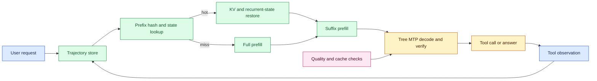
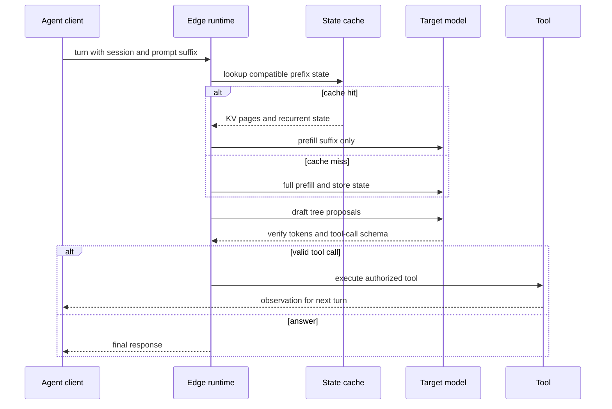

# Edge agent trajectories as a serving workload
Status: emerging
Sources: [NVIDIA — TensorRT Edge-LLM Completes the MLPerf Edge Agentic Benchmark 6.4x Faster on Jetson AGX Thor — 2026-09-16](https://developer.nvidia.com/blog/tensorrt-edge-llm-completes-the-mlperf-edge-agentic-benchmark-6-4x-faster-on-jetson-agx-thor/)

## In one sentence

Edge agent inference is a stateful trajectory workload, not a sequence of independent prompts: KV and recurrent-state reuse reduce repeated prefill while tree-based multi-token prediction reduces decode steps, but correctness, memory pressure, power, and tool-call behavior must be measured end to end.

## Background: what existed before

Most LLM serving benchmarks measure a prompt and one completion. The client sends input tokens, the server performs prefill, then autoregressive decode emits output tokens. Time to first token (TTFT), inter-token latency (ITL), and output throughput describe the response. For a one-shot chat request, those metrics are useful.

An agent is different. It emits a tool call, receives an observation, appends that result to the conversation, and asks the model to continue. The next request often repeats most of the previous history. If the runtime recomputes the whole prefix every turn, prefill cost grows with trajectory length. On an edge device, memory, bandwidth, power, and thermals make that repeated work expensive.

The baseline edge runtime may quantize weights and use a KV cache within one request. It may not persist reusable state across requests or understand that an agent trajectory shares a prefix. Standard speculative decoding can propose tokens with a draft model, but function calls and structured tool arguments need verification that preserves exact output semantics. A speedup that changes tool-call validity or accuracy is not a production improvement.

The prerequisite is to separate **prefill** from **decode**. Prefill processes the input context and builds attention state. Decode generates output one token or block at a time using cached state. **KV-cache reuse** restores attention keys and values for a repeated prefix. **Recurrent-state reuse** restores state for model components with recurrence or hybrid architectures. **Multi-token prediction (MTP)** proposes multiple future tokens and verifies them with the target model. An **agent trajectory** is the sequence of user request, model output, tool result, and subsequent turns.

## What changed and why now

NVIDIA reported on September 16, 2026 that TensorRT Edge-LLM completed the MLPerf Inference v6.1 Edge Agentic benchmark 6.4 times faster than a llama.cpp reference run on a Jetson AGX Thor Developer Kit. The reported configuration ran Qwen3.6-27B on one device, completed 1,007 turns in 24 minutes 36 seconds, and achieved 52.33 tokens per second. NVIDIA attributes the result to NVFP4 weight and activation quantization, FP8 KV cache, tree-based MTP, and KV/recurrent-state reuse.

The source says the benchmark replays recorded software-engineering agent trajectories: a user request, tool call, tool result, and continuation. It contains 20 conversations and 1,007 generated turns, with input length reaching about 23.5K tokens. NVIDIA reports approximately 96% of prompt tokens served from hot cache, prefilling about 0.5M of 13.6M total prompt tokens. It also reports an 8-step, top-2, 16-node verification tree and an additional roughly 40% decoding gain over linear MTP for function-calling workloads.

The post reports a median TTFT of 247.12 ms, median time per output token of 14.68 ms, 87.94% BFCL overall accuracy, and a single-stream MAXN power-mode run with 128 GB unified memory. These are vendor benchmark results under a stated device, model, quantization, workload, and reference. They are not a universal edge SLO or evidence that every agent trajectory benefits equally.

The engineering delta is workload awareness. An edge runtime can treat a trajectory as a stateful sequence and optimize repeated context while preserving tool-call correctness. The benchmark’s value is not only its headline speed; it exposes the relationship among trajectory length, cache reuse, decode speculation, accuracy, and memory.

## Impact on current processing and architecture

The serving stack needs a trajectory-aware session store. It maps a session and prefix hash to KV pages and recurrent state, checks model/engine/precision compatibility, restores state, processes only the new suffix, and records cache hits. Tool results must be canonicalized so semantically identical prefixes can reuse state without confusing user or tenant boundaries.



Prefix reuse needs a strong key. Include model and engine version, tokenizer, system/developer instructions, tool schema, tenant/session scope, and the exact prefix content hash. Do not share cache pages across tenants merely because text is identical. Invalidate on policy or tool-schema changes. A cache hit is a performance optimization, not an authorization result.

For an agent turn i with prefix length p_i and new suffix s_i, full prefill cost is approximately proportional to `p_i + s_i`; prefix reuse makes it closer to `s_i` plus state restoration overhead. Over n turns, saved prompt work is roughly `Σ_i p_i` minus cache misses. If 96% of prompt tokens are hot as NVIDIA reports for the benchmark, the workload’s prefill savings can be large, but the percentage depends on stable prefixes, tool-result formatting, cache capacity, and eviction.



Tree MTP changes decode control flow. A linear draft proposes one sequence and the target verifies it. A tree proposes branches of future tokens, then the target evaluates a verification structure; accepted tokens reduce target invocations, while rejected branches cost extra work. Let d be the average draft length and a the acceptance fraction. A rough effective gain depends on accepted tokens per verification step minus tree overhead; it is not simply d. Tool-call JSON or function arguments can have low tolerance for errors, so the runtime must validate complete structured calls and fall back to conservative decoding when acceptance is poor.

Edge capacity is a multi-resource problem. Weight memory, KV memory, recurrent state, temporary buffers, CPU tool processing, device power, and thermal headroom all compete. A trajectory with 23.5K context may fit in unified memory but cause eviction or throttling. Track cache bytes, hit rate, prefix length, suffix length, MTP acceptance, tool-call validity, TTFT, ITL, energy per completed trajectory, and temperature or power state.

## Real-world applications and constraints

In a vehicle or robot, an edge agent may interpret sensor context, call a navigation or manipulation tool, observe the result, and continue. Local inference reduces round-trip latency and can preserve operation during network loss. The model’s tool authority must remain narrow: cache reuse must not cross vehicle or task boundaries, and a fast response must still pass safety controllers.

In industrial inspection, the agent can iterate over images, sensor readings, and maintenance tools. Repeated context makes state reuse valuable, but measurements may be time-sensitive. Include sensor timestamp and freshness in the prefix key or suffix; do not reuse a state whose physical world has changed beyond the policy tolerance.

In field service, a technician’s device may run a multi-turn troubleshooting agent with manuals and diagnostic results. Quantization and state reuse improve battery and latency, but updates to manuals, permissions, or tool schemas must invalidate cached state. Keep an offline audit record that can be synchronized later without exposing secrets.

In edge robotics, memory pressure can trigger cache eviction exactly when the trajectory is longest. Design a bounded cache with priority, maximum session age, and a clear fallback to full prefill or a smaller model. A cache miss should increase latency, not change semantics.

## Mental model

Think of a trajectory as a long-running program whose immutable prefix is a compiled artifact. KV and recurrent-state reuse are incremental compilation: reuse what has not changed and compile the new suffix. Tree MTP is speculative execution: try several future steps, verify them, and commit only accepted output. The tool gateway remains the authority that decides whether a committed call may change the world.

## What changed this month

September’s benchmark makes multi-turn agent context a first-class edge-serving workload. It combines quantization, hot-state reuse, and tree verification on one Jetson device and reports a 6.4x faster benchmark completion than a reference run. The transferable lesson is to benchmark complete trajectories, not isolated prompts.

## Engineering consequence

Add trajectory metrics to the serving contract. Report per-turn and end-to-end results, cache hit/miss and eviction, prefix/suffix tokens, MTP acceptance, tool-call accuracy, memory, power, and thermal state. Compare against a correctness-preserving baseline with the same model, workload, and tool policy.

Use a cache admission rule such as `state_bytes + current_KV + reserve ≤ device_memory × headroom`. If false, evict the lowest-priority state or fall back to recomputation. For a tool call, require schema validation, argument allowlists, authorization, and an idempotency key after decoding; speculative acceptance is not permission.

Evaluate battery and thermal behavior over the whole trajectory. If device power is P watts and a completed trajectory takes t seconds, an approximate energy cost is `E_wh = P × t / 3600`; compare that with the same task using remote inference plus network energy and latency. Sample power and temperature during long runs because a short peak benchmark can hide throttling. A cache policy that improves tokens per second but increases memory pressure and thermal throttling may reduce completed-task goodput.

The state cache also needs lifecycle controls. Expire sessions, wipe sensitive pages when a task ends, encrypt or isolate memory where required, and record eviction reasons. A cache hit should be observable without exposing prompt content. When a model or tool schema is updated, invalidate incompatible state and record the reason so a post-incident investigator can explain why one turn recomputed while another reused a prefix.

## Limits and failure modes

The results are NVIDIA-reported measurements for Qwen3.6-27B, Jetson AGX Thor, a specific power mode, quantization, runtime, and MLPerf workload. The 6.4x figure should not be generalized to arbitrary devices, models, concurrency, or trajectories. MLPerf accuracy and benchmark validity depend on the stated protocol.

Cache reuse can be incorrect if prefixes differ in hidden metadata, tool schemas, tenant identity, or policy version. MTP can increase work when acceptance is low. Quantization can change quality, calibration, and tool-call validity. Thermal throttling can turn a short benchmark into a poor long-running service.

## Mini exercise (15–30 min)

Simulate an agent trajectory with repeated prefixes. Compare full-prefill token work with prefix reuse, estimate cache hit rate, and add a speculative decoder that accepts or rejects proposed tokens. Keep tool calls as inert records and measure end-to-end turns.

## Build it locally

```python
def trajectory_cost(turns, prefix_reuse=True):
    total = 0
    hits = 0
    previous = ""
    for prompt, output in turns:
        prefix = len(previous)
        suffix = len(prompt) - prefix if prompt.startswith(previous) else len(prompt)
        if prefix_reuse and prompt.startswith(previous):
            total += suffix
            hits += 1
        else:
            total += len(prompt)
        previous = prompt + output
    return {"prefill_tokens": total, "cache_hits": hits}

turns = [
    ("system tools user: inspect logs", "call:read_logs"),
    ("system tools user: inspect logs call:read_logs observation:ok", "call:check_config"),
    ("system tools user: inspect logs call:read_logs observation:ok call:check_config observation:ok", "answer"),
]
print("reuse:", trajectory_cost(turns, True))
print("full:", trajectory_cost(turns, False))
```

### Numbered local steps

1. Save the example as `trajectory_cache.py` and run it with Python 3.9 or newer.
2. Add a tenant and policy version to each turn; refuse reuse when either changes.
3. Add an LRU cache size in tokens and evict the oldest trajectory when it exceeds the budget.
4. Add a simulated MTP proposal list and count accepted versus rejected tokens.
5. Require a tool schema and allowlist before printing a tool-call record.
6. Add timestamps and reject cached state when the sensor observation is older than a freshness limit.
7. Calculate energy as `device_watts × elapsed_seconds / 3600` and compare full versus reused prefill.
8. Add a long trajectory and observe when the cache budget forces a miss.

## Interview Q&A

### Why is an agent trajectory different from a chat request?

It contains many turns, tool calls, observations, and a growing shared history. Recomputing the prefix on every turn wastes work and hides the workload from a one-shot benchmark.

### What does KV-cache reuse save?

It saves repeated prefill for a compatible prompt prefix. It does not eliminate new suffix processing, decoding, memory management, or tool execution.

### Does speculative decoding change correctness?

It should not if the target model verifies accepted tokens and structured tool calls are validated. Low acceptance can reduce performance, and implementation bugs can change semantics.

### What must be in a cache key?

The exact prefix plus model, tokenizer, engine, tool schema, policy, tenant/session scope, and other metadata that affects interpretation.

## Glossary

- **Agent trajectory:** A sequence of model turns, tool calls, observations, and continuations.
- **Inter-token latency:** Time between generated output tokens.
- **KV cache:** Attention state reused during decoding or compatible prefix continuation.
- **MTP:** Multi-token prediction that proposes several future tokens for target verification.
- **Prefix reuse:** Reusing state for unchanged conversation history.
- **TTFT:** Time to first generated token.

## References

1. NVIDIA, “TensorRT Edge-LLM Completes the MLPerf Edge Agentic Benchmark 6.4x Faster on Jetson AGX Thor,” September 16, 2026. Primary source for the MLPerf Edge Agentic workload, reported completion time, cache reuse, MTP, quantization, accuracy, and latency: https://developer.nvidia.com/blog/tensorrt-edge-llm-completes-the-mlperf-edge-agentic-benchmark-6-4x-faster-on-jetson-agx-thor/
2. The cache model, speculative-decoding explanation, and Python simulator are engineering analysis and inference, not an independent reproduction of the benchmark.

## Claim ledger

| Claim | Source | Fact or inference |
|---|---|---|
| NVIDIA reports 52.33 tokens/s and 24:36 completion for the stated MLPerf Edge Agentic run. | NVIDIA engineering post | Vendor benchmark result |
| The workload contains 20 conversations and 1,007 generated turns with context reaching about 23.5K tokens. | NVIDIA engineering post | Benchmark description |
| The reported system uses NVFP4, FP8 KV cache, tree MTP, and KV/recurrent-state reuse. | NVIDIA engineering post | Configuration fact |
| NVIDIA reports about 96% hot-cache prompt tokens and approximately 0.5M of 13.6M prompt tokens prefetched. | NVIDIA engineering post | Vendor workload measurement |
| Cache keys must include policy and tenant context to avoid semantic or security reuse. | Serving/security analysis | Engineering inference |
| The simulator does not implement a real KV cache or model decoder. | This lesson’s example | Explicit limitation |
