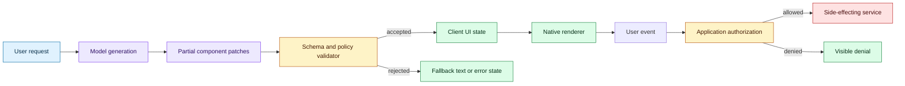

# Model-generated interfaces as streamable component trees
Status: emerging
Sources: [OpenAI — GPT-6 and Intelligent UI for everyone — 2026-10-07](https://openai.com/index/gpt-6-for-everyone/)

## In one sentence

The October change is a shift from treating a model response as text to treating it as a progressively delivered, typed interface proposal whose components, data, and actions need the same validation and authorization discipline as an ordinary application UI.

## Background: what existed before

Most AI applications began with a simple boundary: the model returned text, and application code decided what to do with that text. A chat client might render Markdown, highlight code, or attach a few hand-built buttons, but the interface vocabulary was owned by product engineers. If a product needed a chart, form, calculator, or workflow, a developer built the route, frontend component, state machine, and permission checks before the model could fill in the content. The model supplied language inside a fixed shell.

That baseline has useful properties. A fixed component has a known schema, an identified owner, a tested layout, and explicit event handlers. A button labeled “Approve” can be connected to a server endpoint that checks the current user, resource version, and authorization. A chart can be tested with empty data, extreme values, and missing labels. A form can reject malformed input before it reaches a side-effecting service. The cost of this safety is slower product iteration and a narrower response vocabulary.

The older alternative was to ask a model for HTML, JavaScript, or a JSON object and then render it. Returning HTML is flexible but hard to constrain: style, accessibility, scripts, and links can be mixed with content. Returning JSON is safer only if the schema is narrow and the renderer rejects anything outside it. A model-generated JSON object still does not become a trusted command simply because it is syntactically valid. The application must distinguish a display value from an action request, and it must recheck permissions at the time of the action.

Streaming added another complication. Token streaming allowed a text answer to appear before generation finished, improving perceived latency. However, partial text is not usually a valid application state. A half-written sentence can be displayed, but a half-written JSON object cannot safely be interpreted as a complete form or transaction. Teams therefore tended to buffer structured output until it parsed, or they built custom incremental parsers with complicated recovery behavior.

The system vocabulary before this change was consequently split. The model produced content; the frontend owned presentation; the backend owned state transitions; and an orchestration layer translated natural language into explicit tool calls. That split remains the right security baseline for high-impact actions. What changes in October is the opportunity to make the interface itself a first-class generated artifact while retaining an application-owned component and policy boundary.

## What changed and why now

OpenAI’s October 7 announcement describes GPT-6 in ChatGPT introducing “Intelligent UI.” OpenAI says the system can combine text, visuals, and interactive elements, including graphics, tappable buttons, forms, charts, and interactive experiences. It says the format is selected based on the question and that a response can remain simple text when that is more useful. These are release-specific claims from the announcement, not an independent evaluation.

The important engineering detail is the implementation boundary described by the source. OpenAI says it built a library of native, streamable components and a compiler that processes the interface as the model generates it. The component library supplies a familiar design foundation while leaving the model room to decide how pieces fit together. The compiler allows the interface to appear progressively instead of waiting for the entire response.

This is different from asking a model to emit arbitrary frontend code. A native component library is a constrained vocabulary. A compiler is a mediation layer between the model’s proposal and the renderer. Streaming is no longer merely “show the next token”; it can mean “apply the next validated component or patch to a client-side state.” The source does not publish the complete internal protocol, so an engineer should treat the following architecture as an inference grounded in the described library-and-compiler boundary, not as a claim about OpenAI’s private implementation.

The shift matters because an interface has at least three kinds of state. First is content state: text, labels, images, and computed values. Second is view state: selected tabs, expanded sections, chart ranges, and loading indicators. Third is action state: what a user can submit, purchase, approve, send, or otherwise cause to happen. A safe system cannot let the model’s choice of a visual component silently grant a capability in the third category.

## Impact on current processing and architecture

The response pipeline becomes a typed document pipeline. The model proposes a component tree or a sequence of patches. A validator checks the envelope, component type, field types, maximum sizes, and allowed nesting. A policy layer checks whether each event is display-only, locally interactive, or connected to a server-side action. A renderer applies accepted patches to a client-owned state tree. Telemetry records both the proposal and the rendered result without treating the proposal as an authoritative command.



The component library is an API surface. Each component needs a versioned schema, accessibility behavior, size limits, and a policy classification. A `Chart` may accept a bounded series of numbers and a title, but not an arbitrary URL for a script. A `Form` may render fields, but its submission target should be an application-owned action identifier rather than a model-selected URL. A `Button` may be display-only, may open a harmless local panel, or may request a privileged operation. Those are different capabilities even if they look identical on screen.

The compiler or validator must also handle partial state. A patch can add a component, replace a property, remove a component, or mark a subtree complete. Each patch should carry a response ID, monotonically increasing sequence number, parent path, schema version, and perhaps a content hash. The client should ignore a duplicate patch, reject an out-of-order patch, and reset or fall back when the stream becomes inconsistent. This is an engineering inference from progressive rendering, because the source describes the behavior but not the wire protocol.

```mermaid
sequenceDiagram
    participant C as Client
    participant G as Generation service
    participant V as Validator/compiler
    participant P as Policy service
    participant B as Backend action API
    C->>G: request with UI capability profile
    G-->>V: patch 1: loading card
    V->>P: classify component and events
    P-->>V: display-only allowed
    V-->>C: accepted patch 1
    G-->>V: patch 2: form plus submit event
    V->>P: check action class and scope
    P-->>V: submit requires authenticated user
    V-->>C: form rendered; action disabled or scoped
    C->>B: submit signed action intent
    B->>P: recheck identity, resource, freshness
    P-->>B: allow or deny
    B-->>C: result state
    Note over V,C: malformed or stale patches produce a safe fallback
```

The client should not rely on the model to preserve an invariant across patches. Suppose the first patch displays an account balance and the second patch adds a “transfer” button. The button’s presence does not prove that the account is eligible for transfers. The backend must check the current account, user, transaction limit, approval requirement, and version of the data. A generated UI is a proposal for interaction, not an authorization token.

The processing impact extends to observability. A normal text trace records prompt, model output, latency, and final answer. A generated-interface trace should also record component proposal counts, rejected patch counts, schema version, time to first accepted component, time to usable interaction, renderer errors, action-intent IDs, and fallback rate. The distinction between time to first token and time to first usable control becomes important. A beautiful skeleton that takes 20 seconds before its button works may feel worse than a plain text answer that is complete in 3 seconds.

Cost and latency also move. Progressive rendering can improve perceived latency while increasing client complexity, validation work, and event traffic. A chart or interactive calculator may require more model output than a paragraph. If the system regenerates the entire tree after every user event, it may duplicate context and create flicker. A better design can separate stable component identity from changing data, use patches instead of full trees, and keep deterministic calculations outside the model. These are engineering recommendations, not source-reported GPT-6 implementation facts.

## Real-world applications and constraints

An educational tutor is a low-risk application for generated interfaces. A student asking about probability might receive an interactive diagram, a slider, and a small calculator. The calculations should run in deterministic application code, while the model selects an explanation and initial parameters. The UI should expose assumptions and allow a student to reset the state. A test suite can verify that an invalid parameter never produces a misleading graph and that the model cannot inject an external link into a trusted-looking lesson card.

A support assistant could generate a comparison panel for two products or a checklist for troubleshooting. The panel can save a human agent time, but the data source, freshness, and permissions must remain visible. If one user can see an internal warranty field and another cannot, the renderer must receive already-authorized data or a policy-aware data reference. Hiding a field with CSS is not access control. A generated layout must never become a new path around row-level permissions.

A finance workflow is more constrained. The model could propose a budget chart and prefill a draft invoice, but sending payment, changing a beneficiary, or approving a transaction should require a server-side action with explicit identity and approval. Bind approval to the exact action payload and relevant evidence version. If the user approves a draft and the underlying invoice changes, invalidate the approval rather than silently applying it to the new state.

A developer tool may generate a query builder or a deployment dashboard. Read-only queries can often be sandboxed with timeouts, row limits, and a read-only database role. Deployment actions need stronger controls: environment allowlists, change review, two-person approval where appropriate, and an audit record of the generated plan. The interface can make the plan easier to inspect, but the model should not be able to promote a release simply by rendering a button.

Accessibility is a first-class constraint. A component library can centralize keyboard navigation, focus management, screen-reader labels, contrast, and reduced-motion behavior. A model can still assemble an unusable tree: ambiguous headings, duplicate labels, an inaccessible modal, or a chart with no textual alternative. Validate semantic structure and run automated accessibility tests on representative generated trees. Human review remains valuable for interaction quality, especially when the component combinations are novel.

There are also privacy constraints. A generated UI can reveal more than a text answer by placing sensitive fields side by side, displaying a chart with small cohorts, or leaving data in client state after the user changes context. Define retention and redaction rules for component traces. Avoid logging raw form values or private chart data by default. Treat screenshots and serialized UI trees as potentially sensitive artifacts.

## Mental model

Think of a model-generated interface as a compiler pipeline with an untrusted front end. The model is good at proposing a useful arrangement of concepts, but its output is not automatically a valid program. The component schema is the language; the validator is the type checker; the policy layer is the capability system; the renderer is the runtime; and backend authorization is the final authority for side effects.

This mental model explains why “the model chose a safe-looking button” is not a safety argument. A type checker can prove that a value has the right shape, not that a user is allowed to perform an action. Likewise, a renderer can display a confirmation dialog, not prove that the confirmed operation is still current. Safety requires layered checks at generation, rendering, and execution time.

It also clarifies the value of progressive streaming. The system does not need to wait for a complete page before showing every useful element. It can render a skeleton, then a title, then an explanation, then a read-only visualization, and finally an action affordance after the relevant policy decision. Streaming should expose progressively more state without progressively bypassing controls.

## What changed this month

The release-specific change is OpenAI’s public description of Intelligent UI: GPT-6 can choose among text, visuals, and interactive elements; OpenAI describes a native streamable component library and a compiler that processes interfaces as they are generated; and the rollout is described for ChatGPT tiers beginning October 7, with enterprise availability depending on workspace administration. The announcement also says that Work and Codex models are not changing as part of that ChatGPT update.

The engineering interpretation is broader but narrower in its claim. The reusable concept is not “all models now build safe applications.” It is “a model response can be treated as a typed, incrementally compiled interface artifact.” That makes component schemas, patch ordering, capability classification, client state, fallback, and server-side authorization central design concerns. The release makes this architecture more visible; it does not remove the need to build it carefully.

## Engineering consequence

Teams adopting generated interfaces should create a UI protocol review alongside a prompt review. Define the allowed component set, maximum tree depth, payload limits, event classes, data provenance rules, and fallback behavior. Decide which components are display-only and which can produce action intents. Make every action intent explicit, signed or bound to a session, scoped to a resource, and reauthorized at execution.

Version the component schemas independently from the model. A model update can change the frequency or order of components even when the prompt is unchanged. Store golden component trees and event traces for regression tests. Test malformed patches, duplicate sequence numbers, missing parents, stale data, unknown components, inaccessible labels, and a user who loses permission between render and click.

Measure both model and product outcomes. Useful metrics include accepted-patch rate, first accepted component latency, first usable read-only view, first actionable control, renderer error rate, fallback rate, event authorization denial rate, and task completion after a fallback. A higher interactive-component rate is not automatically better. If users abandon complex generated interfaces or if accessibility failures rise, the system needs better routing toward simple text.

## Limits and failure modes

The source describes a product direction and selected internal evaluations, not a universal guarantee of interface quality. Its reported latency and quality comparisons are source claims tied to OpenAI’s evaluation setup. An engineer should reproduce relevant workloads with the target model, component library, device mix, network conditions, and accessibility requirements.

Common failure modes include schema drift, partial-stream corruption, duplicated patches after retry, and a client applying a late response to the wrong conversation. Add a stream or conversation epoch and reject patches from an old epoch. Use idempotent patch IDs. If the tree cannot be repaired safely, discard it and show a readable fallback.

A model may produce a plausible but misleading visualization. Validate units, ranges, missing values, and aggregation semantics. Prefer deterministic code for arithmetic and use the model to explain results. A chart that is visually polished can still encode a wrong denominator or hide a filtered population.

Generated actions create confused-deputy risk. A user may ask for a report, while content inside a document tells the model to add an external recipient or upload secrets. Keep untrusted content separate from system policy and require explicit action intents. The renderer must not infer authority from text in a retrieved document, image, or generated label.

Progressive rendering can leak information before a final policy decision. Do not stream restricted fields into a placeholder and then remove them. Authorize data before it enters the component patch. Be careful with client caches, browser history, screenshots, analytics events, and accessibility trees, all of which may retain content after a component disappears.

Finally, generated UI can reduce transparency if the layout hides provenance. Show source identity, timestamp, uncertainty, and the boundary between model-generated explanation and application-computed value. An interface that feels native can make a weak claim look official; visual polish increases the need for evidence labeling.

## Mini exercise (15–30 min)

Build a tiny component-tree protocol simulator. It should accept a sequence of patches, allow a small set of components such as `text`, `metric`, `chart`, and `button`, and reject unknown types, oversized values, and buttons whose action class is not in the current capability profile. Add one stale-patch test and one server-side reauthorization test. The goal is to experience the distinction between rendering a proposal and authorizing an effect.

## Runnable low-cost example

```python
from dataclasses import dataclass, field

ALLOWED = {"text", "metric", "chart", "button"}
MAX_TEXT = 120


@dataclass
class UiState:
    version: int = 0
    nodes: dict[str, dict] = field(default_factory=dict)
    allowed_actions: set[str] = field(default_factory=set)

    def apply(self, patch: dict) -> str:
        if patch["version"] != self.version + 1:
            return "rejected: out-of-order patch"
        node = patch["node"]
        if node["type"] not in ALLOWED:
            return "rejected: unknown component"
        if node["type"] == "text" and len(node.get("text", "")) > MAX_TEXT:
            return "rejected: text limit"
        action = node.get("action")
        if action and action not in self.allowed_actions:
            return "rejected: action not authorized"
        self.nodes[node["id"]] = node
        self.version = patch["version"]
        return f"accepted: {node['id']}"


ui = UiState(allowed_actions={"open_help"})
patches = [
    {"version": 1, "node": {"id": "intro", "type": "text", "text": "Ready"}},
    {"version": 2, "node": {"id": "help", "type": "button", "action": "open_help"}},
    {"version": 3, "node": {"id": "send", "type": "button", "action": "send_money"}},
]

for patch in patches:
    print(ui.apply(patch))

assert set(ui.nodes) == {"intro", "help"}
assert ui.version == 2
print("renderable nodes:", sorted(ui.nodes))
```

## Build it locally

1. Save the example as `ui_protocol.py` and run `python3 ui_protocol.py`.
2. Add a `parent` field and reject a patch whose parent is not already present.
3. Add a `replace` operation with an idempotency key and ignore a duplicate key.
4. Add a `data_class` field and reject a restricted value unless the capability profile includes it.
5. Add a fake `execute_action` function that checks the current user and resource version again after rendering.
6. Record accepted and rejected patches as structured events, then compare the count of generated patches with the count of rendered nodes.

## Interview Q&A

**Why is a component schema better than letting a model emit arbitrary HTML?** A schema limits the vocabulary, centralizes accessibility and rendering behavior, and makes validation possible. It does not by itself authorize side effects; backend policy is still required.

**What does streaming change for structured UI?** It changes the client from parsing one final document to applying ordered partial state transitions. The client needs sequence checks, idempotency, recovery, and a safe fallback for incomplete or invalid state.

**Should a generated button be considered a permission grant?** No. It is an affordance or action proposal. The server must recheck identity, resource scope, freshness, and approval requirements when the action is submitted.

**How would you measure whether generated UI helps?** Measure task completion and time to a usable view, not just time to first token or number of interactive components. Include fallback rate, renderer errors, accessibility defects, authorization denials, and user abandonment.

**What belongs in the model trace?** At minimum, schema version, patch IDs, accepted and rejected component types, validation reasons, latency milestones, action-intent IDs, and a privacy-safe reference to data sources. Avoid logging sensitive field values by default.

## Glossary

- **Component tree:** A structured hierarchy of interface elements and their properties.
- **Patch:** An incremental update that adds, replaces, or removes part of a component tree.
- **Compiler:** A translation and validation layer that turns a generated representation into something a renderer can apply.
- **Capability profile:** The explicit set of display or action classes allowed in a context.
- **Action intent:** A structured request to perform an operation; it is not authorization by itself.
- **Progressive rendering:** Showing validated parts of an interface before the complete response has arrived.
- **Idempotency:** The property that retrying the same operation does not repeat its effect.
- **Confused deputy:** A trusted component induced to use its authority for an untrusted party or request.
- **Fallback:** A safer alternative, such as text or an error state, when generated UI cannot be validated.

## References

- [GPT-6 and Intelligent UI for everyone — OpenAI — 2026-10-07](https://openai.com/index/gpt-6-for-everyone/)
- [ARIA Authoring Practices Guide — WAI-ARIA Working Group](https://www.w3.org/WAI/ARIA/apg/)
- [OWASP Authorization Cheat Sheet](https://cheatsheetseries.owasp.org/cheatsheets/Authorization_Cheat_Sheet.html)

## Claim ledger

| Claim | Source | Fact or inference |
|---|---|---|
| OpenAI announced GPT-6 with Intelligent UI on October 7, 2026. | OpenAI release page | Fact |
| OpenAI describes graphics, tappable buttons, forms, charts, and interactive experiences as possible response elements. | OpenAI release page | Fact |
| OpenAI says it uses a native, streamable component library and a compiler that processes the interface as it is generated. | OpenAI release page | Fact |
| Progressive component delivery requires ordering, duplicate handling, and fallback behavior. | Distributed-systems reasoning applied to progressive rendering | Engineering inference |
| A generated button is not an authorization grant. | Authorization design principle; OWASP reference | Engineering inference |
| Component schemas can centralize rendering and accessibility behavior. | Component-system design reasoning; WAI-ARIA reference | Engineering inference |
| OpenAI’s reported latency and quality comparisons are not independent verification. | OpenAI release page and its described internal-evaluation context | Fact/inference boundary |
