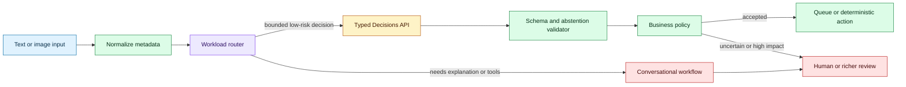

# Typed fast-path decisions for text and image inputs
Status: emerging
Sources: [OpenAI API Changelog — 2026-10-06](https://developers.openai.com/api/docs/changelog), [Decisions — OpenAI API documentation](https://developers.openai.com/api/docs/guides/decisions)

## In one sentence

The October Decisions API release makes a useful architectural boundary explicit: many production requests need a fast, typed decision from text or images rather than a full conversational response, so applications should route classification, extraction, and gating through a schema-first path with measured fallbacks.

## Background: what existed before

An application that receives text or an image has traditionally sent it to a general completion or responses endpoint and then interpreted the result. That endpoint may support conversation context, reasoning, tool calls, long output, and rich metadata. Those capabilities are valuable when the user needs an explanation or the system needs a multi-step plan. They are unnecessary overhead for a request such as “is this receipt eligible for reimbursement?”, “which queue owns this ticket?”, or “does this image contain a damaged package?”

Before a dedicated decision path, teams built several workarounds. One was prompt-only classification: ask for `yes` or `no`, then parse the text. This is easy to prototype but fragile. The model may answer “Yes — because…”; a refusal may look like a negative; and a formatting change can break a parser. A second workaround used structured outputs on a general endpoint. That improves shape validation, but the surrounding request may still pay for capabilities designed for longer generation. A third workaround used a small local classifier for speed, accepting lower coverage or weaker image understanding.

The problem is not just latency. A classification result often controls a queue, a permission, a fraud review, a retry policy, or a human escalation. If the output is an untyped string, every consumer invents its own interpretation. One service treats `unknown` as false; another retries it; a third accidentally lets it pass. The interface between model and application needs a total set of outcomes, versioned fields, confidence or evidence policy, and a known behavior for timeout and invalid output.

The historical baseline also tended to conflate two different jobs. A conversational answer is optimized for usefulness to a person. A decision is optimized for predictable integration. The former may be open-ended and verbose. The latter should be bounded, machine-readable, observable, and easy to reject. The same underlying model family can support both, but the application should not pretend they are the same workload.

## What changed and why now

OpenAI’s API changelog records the Decisions API as a beta feature released on October 6, 2026 with `gpt-6-luna`. The entry says it turns text and images into typed answers and claims it is 10x faster than the Responses API. The speed statement is a release-specific provider claim tied to an unstated comparison context in the short changelog entry; it is not a universal performance guarantee.

The accompanying documentation makes the conceptual boundary more useful than the headline multiplier. A decision endpoint can be treated as a contract between an input adapter, a model, a schema, and an application policy. The model does not need to produce a paragraph that another component must interpret. It produces one of the allowed typed outcomes. The application can then route the result to a queue, a deterministic calculation, a human reviewer, or a slower explanatory workflow.

This is not the same as saying the model is a trusted oracle. A typed answer can be confidently wrong, incomplete, stale, or based on an image artifact. The API shape reduces integration ambiguity; it does not eliminate semantic uncertainty. A good design therefore represents uncertainty and abstention explicitly rather than forcing every input into a business decision.

The distinct October lesson is operational: use a typed fast path for bounded decisions and preserve an escalation path for ambiguous or high-impact cases. September’s lesson on typed probabilistic decisions focused on calibration and expected loss at the model-policy boundary. This lesson focuses on the API and processing topology that lets a system keep that boundary visible at scale.

## Impact on current processing and architecture

The request path can now be designed as a router rather than a single model call. An input adapter normalizes text or image metadata without changing the evidence. A policy classifier determines whether the request is eligible for the fast decision path. The decision service invokes the typed endpoint with a versioned schema. A validator checks that the response is structurally complete. A business-policy layer combines the model result with deterministic rules, freshness checks, and user permissions. Only then does the system enqueue an action or escalate to a richer workflow.



The schema should describe more than a label. Consider a package-damage decision:

```json
{
  "schema_version": "damage-v2",
  "decision": "review",
  "reason_code": "occluded_corner",
  "evidence_scope": "image_only",
  "confidence_band": "medium",
  "needs_human": true
}
```

The exact fields depend on the domain, but the shape illustrates useful distinctions. `review` is not the same as `damaged`; `evidence_scope` prevents an image-only observation from being treated as a verified shipment fact; and `schema_version` lets consumers reject a response they do not understand. A numeric probability may be useful, but only if the team has measured calibration for the relevant slice. A confidence band can be safer than a precise-looking number when the model’s probabilities are not validated.

The decision service should be stateless from the business perspective. It can use request-local context and a model input, but the durable record belongs in the application. Persist the input reference, schema version, model identifier, decision, validation status, policy version, and timestamps. For images, store a content hash and a privacy-safe object reference rather than copying raw pixels into every downstream message. If the image is later replaced or expires, the original decision should remain auditable as a decision over a specific artifact.

The queue boundary matters. A decision can arrive out of order, be retried, or be duplicated. Give each request an idempotency key. Consumers should record whether the decision was applied, escalated, or rejected. A retry after a timeout must not send a duplicate customer notice or release a payment. If the decision controls a side effect, bind the decision to the resource version and recheck authorization when the effect executes.

The fast path also needs a clear timeout policy. A timeout is not a negative answer. It is a transport or service failure. An invalid JSON body is not necessarily a negative answer either. It means the system did not receive a contract-compliant decision. Use separate states such as `accepted`, `abstain`, `invalid`, `timeout`, and `policy_denied`. This preserves the difference between model semantics and infrastructure health.

```mermaid
sequenceDiagram
    participant A as Adapter
    participant R as Router
    participant D as Decision service
    participant V as Validator
    participant P as Policy engine
    participant Q as Queue
    participant H as Human review
    A->>R: normalized input + idempotency key
    R->>D: text/image + schema v2
    alt typed response arrives
        D-->>V: decision payload
        V->>V: check schema, enum, evidence fields
        alt valid and low impact
            V->>P: typed result
            P-->>Q: enqueue idempotent work
        else abstain or high impact
            V->>H: review packet with evidence reference
        end
    else timeout, overload, or invalid response
        D-->>R: operational failure
        R->>H: retry or escalate; never infer negative
    end
```

The router should be measurable. Track the fraction of inputs sent to the fast path, decision latency, schema-validation failures, abstentions, queue delay, escalation rate, and final task accuracy. Compare these by input type, image quality, language, customer segment, and policy version. A faster endpoint that increases human rework or false approvals may worsen the complete task cost.

The October changelog’s “10x faster” claim should therefore be decomposed into a local service-level objective. Measure time to a valid decision, not only time to the first token. Include image upload time, preprocessing, network transit, validation, queueing, retries, and the downstream action. If the fast path returns quickly but the review queue takes hours, the end-to-end user experience has not improved.

## Real-world applications and constraints

In customer support, a typed decision can route a ticket into billing, technical support, safety review, or a language-specific queue. The decision should be advisory when a routing mistake could delay urgent help. A ticket can include untrusted customer text that attempts to manipulate the classifier. Keep routing labels separate from instructions and never let the ticket body redefine the allowed enum values. Log a compact evidence reference so a reviewer can see why the route was selected.

In document processing, text and images can be classified before expensive extraction. A scanned form might be identified as an invoice, purchase order, or unsupported document. The decision service can return `unsupported` or `needs_better_scan` instead of forcing extraction. This saves compute and prevents garbage downstream records. However, image quality and document layout create distribution shifts. Test rotated pages, handwriting, low contrast, multilingual text, and pages containing adversarial instructions.

In safety triage, a decision path can select `allow`, `block`, or `review` for a request or uploaded artifact. The model result should not be the only control for high-impact policy. Combine it with deterministic rules, account history, rate limits, and human escalation. Keep the response schema conservative: a model should not be able to invent a new category that silently bypasses a blocklist.

In retail or logistics, image decisions can identify damaged goods or missing labels. The action may be a refund recommendation, not an automatic refund. A human may need the original image, shipment state, and prior claim history. Tie the decision to the image hash and shipment version so a later replacement image cannot change the audit trail without a new decision.

In healthcare administration, a typed decision might identify whether a document needs a specific workflow. That is different from making a clinical diagnosis. Keep the system’s scope explicit, restrict data access, and require appropriate review. A low latency claim does not remove obligations around privacy, retention, audit, or human oversight.

## Mental model

Treat the Decisions API as a fast, typed sensor—not as a judge. A sensor converts an observation into a signal with known fields and error modes. The application still interprets the signal, combines it with other evidence, and chooses an action under policy. A good sensor interface includes `unknown` and `fault`, not just true and false.

The router is the most important component in this mental model. It chooses which processing budget and evidence standard a request deserves. A small, bounded decision can use a fast path. A request that needs explanation, tool use, long context, or a high-impact judgment should use a richer workflow or a human. Routing is a product and safety decision, not merely a performance optimization.

The schema is also a control surface. It makes downstream states explicit and allows a consumer to fail closed when it sees an unknown version or enum. Schema validation is necessary but not sufficient: semantic validation checks that the value is plausible for the resource, time, and policy context.

## What changed this month

On October 6, OpenAI’s API changelog recorded the Decisions API in beta with `gpt-6-luna`, describing typed answers from text and images and a provider-reported 10x speed comparison with the Responses API. The official Decisions documentation is the more durable source for implementation details and should be checked as the beta changes.

The engineering consequence is a clearer separation between conversational generation and bounded decision processing. Applications can design a fast path around schema, abstention, validation, idempotency, and escalation. The release does not prove that every classification is accurate, calibrated, or appropriate for automation. It changes the interface available to engineers; reliability still depends on workload-specific evaluation and policy design.

## Engineering consequence

Start with a decision catalog, not a model call. For each proposed decision, document the enum, abstention condition, evidence source, maximum permissible impact, latency objective, human fallback, and owner. Mark which decisions are advisory and which can initiate a side effect. Do not use the same schema for a harmless UI filter and an irreversible financial action.

Version the schema and the policy independently. A model update may preserve the JSON shape while changing the distribution of labels. A policy update may change the action allowed for a label without changing the model. Store both versions with every outcome. Build replay tests from redacted, representative inputs and compare confusion matrices, abstention rates, slice metrics, and downstream task outcomes.

Use a shadow mode before automation. Send a sample of existing traffic through the decision path but do not act on it. Compare the result with human labels or deterministic outcomes. Measure disagreements and inspect false positives and false negatives by slice. Only after the error budget is understood should a low-risk decision be allowed to enqueue work automatically.

Design for failure explicitly. `timeout`, `invalid`, `unknown_schema`, `abstain`, and `policy_denied` should be distinct states. Retries need exponential backoff and idempotency keys. A queue consumer should verify that the resource is still current. A human review packet should include the input reference, model result, policy version, evidence scope, and reason for escalation.

## Limits and failure modes

The API is in beta according to the changelog, so names, limits, model availability, and operational behavior may change. Pin compatible client versions, monitor error codes, and keep a fallback adapter for a general endpoint or a local rules-based path where appropriate. Do not make a production dependency on an undocumented field.

The 10x speed claim is not a universal benchmark. It may depend on input size, output schema, network path, service tier, concurrency, warm state, and what is counted as latency. Reproduce the comparison with your workload. Report p50 and p95 valid-decision latency, not only an average or provider headline.

Typed output can create false confidence. A valid enum is still a potentially wrong semantic answer. Use abstention, calibration checks, confidence bands, and human review for uncertain or high-impact cases. Never convert missing evidence into a positive decision by default.

Images introduce additional failure modes: unreadable text, cropping, compression, adversarial visual content, and an image that is valid syntactically but irrelevant to the claimed resource. Preserve provenance and hash the artifact. If preprocessing changes the image, record the transformation and evaluate whether it changes the decision.

The fast path can also amplify systematic errors. A biased routing label may send an entire customer group to a worse queue. Monitor slice-level outcomes and allow manual correction. Do not use aggregate accuracy as proof that an action policy is safe.

Finally, do not expose internal policy details unnecessarily in error messages. A user may need to know that review is required, but not the exact threshold that an attacker could optimize against. Keep detailed reasons in protected audit logs and provide a clear, non-sensitive explanation at the user boundary.

## Mini exercise (15–30 min)

Build a dependency-free decision router with four outcomes: `accept`, `abstain`, `invalid`, and `operational_error`. Feed it synthetic text and image metadata, validate a versioned schema, and apply a deterministic policy that only queues `accept` when the evidence is fresh. Then add a replay test proving that a duplicate idempotency key does not create two queue entries.

## Runnable low-cost example

```python
from dataclasses import dataclass


@dataclass(frozen=True)
class Decision:
    key: str
    label: str
    confidence_band: str
    evidence_age_s: int
    schema_version: str = "triage-v1"


ALLOWED = {"accept", "review", "reject", "abstain"}


def validate(d: Decision) -> str:
    if d.schema_version != "triage-v1":
        return "invalid"
    if d.label not in ALLOWED:
        return "invalid"
    if d.confidence_band not in {"high", "medium", "low"}:
        return "invalid"
    if d.evidence_age_s < 0:
        return "invalid"
    if d.label == "accept" and d.confidence_band != "high":
        return "abstain"
    if d.label == "accept" and d.evidence_age_s > 300:
        return "abstain"
    return d.label


def enqueue_once(queue: list[str], seen: set[str], d: Decision) -> str:
    outcome = validate(d)
    if outcome != "accept":
        return outcome
    if d.key in seen:
        return "duplicate"
    seen.add(d.key)
    queue.append(d.key)
    return "queued"


queue, seen = [], set()
cases = [
    Decision("a", "accept", "high", 20),
    Decision("a", "accept", "high", 20),
    Decision("b", "accept", "medium", 20),
    Decision("c", "review", "high", 20),
    Decision("d", "accept", "high", 500),
]

for case in cases:
    print(case.key, enqueue_once(queue, seen, case))

assert queue == ["a"]
assert "b" not in queue and "d" not in queue
print("idempotent queue:", queue)
```

## Build it locally

1. Save the example as `decision_router.py` and run `python3 decision_router.py`.
2. Add an `input_kind` field with `text` and `image` values, then reject unknown kinds.
3. Add `policy_version` and store it with each queued key.
4. Add a `timeout` outcome that is distinct from `reject` and never enters the queue.
5. Add a slice field such as `language` and count outcomes by slice.
6. Replay the same cases twice and assert that the queue has no additional keys after the second run.

## Interview Q&A

**Why use a decision endpoint instead of asking a general model for a yes/no answer?** A decision endpoint makes the machine contract explicit and can be optimized for bounded output. The application still needs semantic validation, abstention, and policy checks.

**Is a typed response reliable because it validates against a schema?** No. Schema validation checks shape and allowed values, not truth. Workload-specific evaluation, calibration, evidence checks, and human fallback remain necessary.

**What should happen on timeout?** Represent timeout as an operational error, retry according to policy, or escalate. Never infer a negative business answer from a missing response.

**How do images change the design?** The system must track artifact identity, preprocessing, quality, provenance, and privacy. An image can be valid but unreadable, stale, manipulated, or unrelated to the resource.

**When can an accepted decision trigger automation?** Only when the decision is low impact, the input and evidence are fresh, policy permits automation, the action is idempotent, and the system rechecks authorization and resource version at execution.

## Glossary

- **Typed answer:** A response constrained to a declared machine-readable schema.
- **Decision endpoint:** An API path designed to return a bounded classification or extraction result rather than an open-ended conversation.
- **Abstention:** An explicit statement that the system should not choose a business label.
- **Fast path:** A specialized, low-latency processing route for a narrow workload.
- **Schema version:** An identifier for the structure and semantics expected by producers and consumers.
- **Semantic validation:** Checking whether a structurally valid value makes sense for the current resource, evidence, and policy.
- **Idempotency key:** A stable request identifier used to prevent duplicate effects during retries.
- **Shadow mode:** Running a new decision system without allowing it to control production actions.
- **Slice:** A subgroup such as language, document type, or image quality used for separate evaluation.

## References

- [OpenAI API Changelog — October 6, 2026 entry](https://developers.openai.com/api/docs/changelog)
- [Decisions — OpenAI API documentation](https://developers.openai.com/api/docs/guides/decisions)
- [Structured model outputs — OpenAI API documentation](https://developers.openai.com/api/docs/guides/structured-outputs)
- [OWASP Authorization Cheat Sheet](https://cheatsheetseries.owasp.org/cheatsheets/Authorization_Cheat_Sheet.html)

## Claim ledger

| Claim | Source | Fact or inference |
|---|---|---|
| OpenAI recorded the Decisions API as a beta feature on October 6, 2026. | OpenAI API Changelog | Fact |
| The changelog associates the beta with `gpt-6-luna`. | OpenAI API Changelog | Fact |
| The changelog says the API turns text and images into typed answers. | OpenAI API Changelog | Fact |
| The changelog reports “10x faster than the Responses API.” | OpenAI API Changelog | Fact about the provider claim; not independent verification |
| A typed response reduces parser ambiguity but does not prove semantic correctness. | API and reliability reasoning | Engineering inference |
| Timeouts and invalid responses should not be interpreted as negative business decisions. | Failure-state and distributed-systems reasoning | Engineering inference |
| A decision record should include artifact identity, schema version, policy version, and timestamps. | Auditability and data-lineage design reasoning | Engineering inference |
