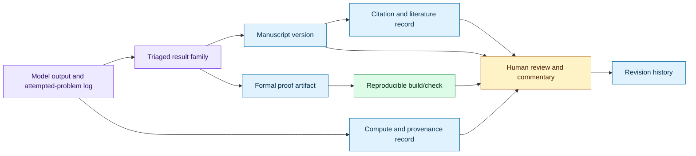

# Reproducible disclosure for AI-generated mathematics
Status: emerging
Sources: [OpenAI — Sharing AI progress in mathematics — 2026-10-06](https://openai.com/index/sharing-ai-progress-in-mathematics/), [OpenAI math repository](https://github.com/openai/math), [Responsible Release of AI-Generated Mathematics — AGMAI — 2026-09-29](https://agmai.org/general-sep29/)

## In one sentence

October’s mathematics release turns AI research output into an artifact-management problem: a plausible theorem needs a citable manuscript, version history, proof-checking status, provenance, compute record, and an honest boundary between formal verification and human understanding.

## Background: what existed before

Mathematical research already had a reproducibility pipeline before frontier models began proposing results. A researcher wrote a manuscript, cited earlier work, submitted a preprint, answered questions, and sent a revised version to a journal or conference. Readers could inspect definitions and proofs, reproduce calculations, and ask the authors to clarify gaps. The paper was not automatically correct, but the social and technical process made responsibility visible.

Computational mathematics added another layer. A numerical claim might ship with source code, input data, a random seed, a container, and a notebook. Formal methods added a stronger kind of artifact: a proof assistant such as Lean checks a machine-readable proof against a kernel and a library. This can establish that a formal statement follows from the formal definitions and imported lemmas. It does not necessarily establish that the formal statement captures the informal theorem a reader thought they were reading.

The pre-AI workflow usually had one authorial bottleneck: people who signed a paper were expected to understand its argument and take responsibility for it. A model can generate a proof-shaped text faster than a person can understand or verify it. That changes the failure mode. The issue is not only whether a line contains a hidden algebra error. It is also whether a release overstates novelty, omits related literature, hides failed attempts, gives no stable version, or presents an unformalized argument with the visual authority of a finished paper.

Large model evaluations also change the denominator. A human researcher may spend months on a small set of carefully chosen problems. An automated evaluation can try thousands of problems, retain a subset of promising outputs, group related results into families, and publish only the selected manuscripts. Without the number of attempts and the selection process, readers cannot distinguish broad capability from a high-yield search over many opportunities. A result may be important while the process that found it remains difficult to assess.

The baseline therefore had separate artifacts: paper, bibliography, code, and perhaps formalization. AI-generated mathematics needs those artifacts joined by provenance. A reader should be able to connect a published claim to a manuscript version, model and prompt context, proof-checking status, compute estimate, and revisions.

## What changed and why now

OpenAI’s October 6 release describes a broad collection of mathematical results produced by an internal frontier model. OpenAI says it is publishing the results in a GitHub repository with protocols for paper revisions and citations. It also says the repository includes formalizations of many proofs in Lean and that more formalizations will be added over time. The announcement describes additional details about how the results were obtained, including ten reasoning summaries, estimated compute in terms of Pro usage, and statistics about attempted problems.

The repository makes the artifact boundary concrete. Its README says that the collection contains manuscripts and supporting proof artifacts, that results are at different stages of verification, and that not all have Lean formalizations. It organizes manuscripts into families and points readers to preprints, a formalization catalogue, and history. The repository also states a top-line formalization percentage and describes the approximate number of problems attempted and average compute for the stated procedure. Those numbers are facts about the repository’s own description, not independent validation of the underlying mathematical results.

The change is not “Lean proves every AI theorem.” It is a release pattern in which a lab exposes enough surrounding evidence for readers to inspect what was claimed, what was formalized, what remains informal, and how the collection changed. That is closer to a software supply chain than to a single PDF. The manuscript is one artifact; the formal proof, build instructions, citation metadata, reasoning summary, attempt statistics, and revision history are related artifacts with different trust properties.

This lesson is distinct from mathematical reasoning itself. The question here is not how a model searches for a proof or how much inference-time compute it uses to discover one. The question is how an engineering team releases model-generated research so that experts can verify, reproduce, criticize, cite, and revise it without confusing a model-generated argument with an established result.

## Impact on current processing and architecture

An AI mathematics release can be modeled as a content-addressed evidence graph. A release manifest identifies a result family and points to a manuscript version, source files, bibliography, formalization status, build configuration, reasoning summary, and compute record. Each artifact gets a hash or immutable revision identifier. A human-facing catalogue renders the graph, but the underlying relationships remain machine-readable.



The graph should distinguish several states that are often collapsed into “published.” A result can be model-proposed, human-edited, informally checked, partially formalized, fully formalized for a stated theorem, independently reviewed, or revised after a discovered error. These states are not a single quality ladder. A short theorem may be fully formalized but conceptually unimportant; a major conjecture may have an insightful informal argument but no formalization yet. The release should expose the state instead of assigning one vague confidence label.

A useful manifest might include:

```json
{
  "family_id": "family-042",
  "manuscript": "preprints/family-042/v2/main.pdf",
  "commit": "immutable-revision-id",
  "formalization": {"status": "partial", "tool": "Lean", "build": "lake build"},
  "literature_review": "bibliography-v2.bib",
  "attempt_summary": "attempts-2026-10.json",
  "compute_estimate": {"unit": "provider-defined", "value": 3.0, "basis": "reported average"}
}
```

The fields are an engineering design, not OpenAI’s claimed schema. They make an important distinction: `formalization.status` describes a proof artifact, while `literature_review` and `attempt_summary` describe the research process. One cannot substitute for the other. A Lean file does not prove that the model searched a representative set of problems. An attempt log does not prove that a manuscript’s proof is correct.

Build reproducibility also needs environment capture. A formal proof depends on the Lean version, imported library revision, compiler, configuration, and sometimes external tools. A green build in one environment is not enough if readers cannot reconstruct it. Store a lockfile or commit reference, document commands, and run the build in a clean environment. Treat the formalization like a software artifact with a continuous integration job and a failing status that is visible rather than silently repaired by a maintainer.

```mermaid
sequenceDiagram
    participant G as Generator
    participant S as Selector
    participant R as Release pipeline
    participant P as Proof checker
    participant W as Reader or reviewer
    participant H as History store
    G->>S: candidate arguments and metadata
    S->>S: record attempted set and selection rule
    S->>R: manuscript, citations, status manifest
    R->>P: formal artifacts and pinned environment
    P-->>R: pass, fail, or not formalized
    R->>H: immutable release version
    R-->>W: catalogue and reproducibility instructions
    W->>P: independent build/check
    W->>R: issue, correction, or clarification
    R->>H: new version; retain prior version
    Note over R,H: a correction changes history; it does not erase the prior claim
```

The release pipeline should preserve failed checks and corrections. If a proof is later found to have a gap, editing the original file in place destroys evidence about what readers previously saw. Publish a new version, link the correction, and mark the old version as superseded. This is ordinary software release discipline applied to scholarly artifacts.

Provenance should also cover model use. The source announcement says OpenAI is sharing additional detail about how results were obtained, including summaries and estimates. A broader responsible-release recommendation from AGMAI asks labs to disclose the model, prompts, summarized reasoning, time, estimated compute, formalization status, and the number of comparable problems tried and failed. The recommendation is not an OpenAI implementation document, so an article must distinguish it from OpenAI’s release facts. Together, the two sources show why a model-generated result needs a process record, not only a polished manuscript.

The operational impact reaches storage and access control. Some artifacts may contain sensitive prompts, proprietary model traces, or unpublished results. A public release can expose one layer while retaining private logs. The manifest should state what is public, what is redacted, and what cannot be reproduced because a model or dataset is unavailable. Do not claim full reproducibility when readers can only inspect a summary and a final PDF.

## Real-world applications and constraints

Research organizations can use this pattern for AI-assisted theorem discovery, program synthesis, scientific simulation, or automated literature analysis. In each case, the output should be divided into claim, evidence, process, and verification status. A scientist deciding whether to build on a result needs to know whether a proof was checked, whether the relevant data and code are available, and whether the model’s proposed novelty was compared with prior work.

An engineering team can apply the same pattern to generated algorithms. Suppose a model proposes a faster scheduling algorithm. The release should include the algorithm specification, benchmark harness, workload generator, baselines, failed cases, and environment. A formal proof of a property such as termination does not establish that the implementation is faster on production traces. Conversely, a benchmark win does not prove correctness. Keep correctness, performance, and process evidence as separate fields.

For safety research, a versioned evidence graph supports responsible correction. A red-team report may begin as an observation, gain a reproducible test, receive a mitigation, and later be revised after deployment evidence. The artifact system can record each state without overstating certainty. This connects naturally to incident and evaluation workflows, but the mathematics case makes the scholarly versioning requirement especially visible.

Education is another application. Students can inspect a formal proof artifact and compare it with an explanatory manuscript. The system should not imply that copying a Lean file means understanding the idea. Provide definitions, examples, known limitations, and a path for human questions. The goal is to make verification and learning easier, not to replace mathematical judgment with a green build badge.

Constraints are substantial. Formalization can be expensive, incomplete, or delayed by library gaps. Human review of hundreds of manuscripts is scarce. A public repository can create maintenance work for the lab and confusion for readers if the catalogue is not curated. Compute estimates are often provider-specific and may not map cleanly to dollars, energy, or reproducible hardware time. Attempt statistics can reveal selection bias without fully correcting it.

## Mental model

Think of a model-generated mathematical result as a software release with a paper attached. The paper explains intent and significance. The formalization is a checker-oriented implementation. The bibliography is dependency metadata. The attempt log is experiment telemetry. The revision history is source control. Human reviewers are not just approvers; they are maintainers who interpret the artifact and identify gaps that automation cannot settle.

This mental model prevents three common category errors. First, a polished PDF is not the same as a verified theorem. Second, a formal proof is not the same as human understanding of the result’s meaning or importance. Third, a model’s reported reasoning summary is not a complete audit log or a guarantee that the summary is faithful to the internal process. Each artifact answers a different question.

## What changed this month

OpenAI’s October 6 announcement introduced a public mathematics release with a GitHub repository, revision and citation protocols, Lean formalizations, reasoning summaries, compute estimates, and attempted-problem statistics. The repository explains that its manuscripts have different verification stages, that formalizations are incomplete, and that release history is preserved. AGMAI’s September 29 responsible-release recommendations provide an independent community framework emphasizing scholarly deposits, model and prompt disclosure, formalization status, failed-attempt context, and support for human understanding.

The engineering delta is a richer release contract for AI-generated research. A result should move through an artifact pipeline in which every claim has a version, provenance, verification status, and correction path. That is useful even when the result is not mathematics: generated code, analysis, and scientific hypotheses also need evidence graphs when people may rely on them.

## Engineering consequence

Build the manifest before building the catalogue. Define stable identifiers for result families, manuscript versions, proof artifacts, environments, and revisions. Require every public claim to point to the artifact that supports it. Make “not formalized,” “formalization partial,” “build failed,” and “human review pending” first-class states.

Put the formal proof in continuous integration. A clean checkout should install the pinned toolchain, run the stated build, and publish the result. Store logs and checksums. If the build fails because a dependency moved, publish the failure and repair it in a new revision. Do not silently update the dependency and leave the old manuscript pointing at a different theorem environment.

Store attempts and selection decisions at the right level of aggregation. You may not be able to publish every prompt or private trace, but you can often publish the number of problems attempted, the selection rule, the categories represented, and the limitations. A reader should be able to estimate how much search preceded the selected result.

Separate release audiences. A mathematician needs readable exposition and citations. A formalizer needs source files and build instructions. A reviewer needs issue reporting and revision history. A systems engineer needs machine-readable metadata, hashes, and APIs. One PDF cannot serve all of these needs without supporting artifacts.

## Limits and failure modes

Formal verification has a boundary. A proof assistant checks the formal statement and proof in its environment; it does not decide whether the formal statement faithfully represents an informal claim, whether the definitions match domain practice, or whether the result is important. Report the exact theorem formalized and any assumptions or imported axioms.

An unformalized manuscript can still be correct, but it carries a different verification status. Do not use the presence of a repository or a large catalogue as a substitute for proof review. Readers need per-result status, not only a top-line percentage.

Compute and attempt statistics can mislead. “Three hours of compute” may be a provider-specific accounting unit rather than wall-clock hardware energy. “Four thousand problems” may include duplicates, easy items, or a selection process that is not fully documented. Attribute the figures and state what they do not establish.

Reasoning summaries are useful context but not a complete trace. A summary may be abridged, edited, or generated after the fact. Preserve the distinction between a report of the method and an independently replayable process. Avoid exposing private chain-of-thought or sensitive prompts merely to create an illusion of transparency; publish useful, safe metadata instead.

Public release creates maintenance risk. Links break, dependencies change, and a formalization can stop building. Assign ownership, add health checks, and publish a status page or history file. If a result is corrected, retain the prior version and make the correction prominent.

Finally, human understanding cannot be reduced to a CI check. A theorem may be formally verified but difficult to explain, connect to prior work, or use in future research. Fund and support exposition, seminars, workshops, and independent critique where the stakes justify it.

## Mini exercise (15–30 min)

Build a small release manifest and checker for a generated mathematical claim. The example uses local text files instead of a theorem prover: it verifies that a manuscript, proof status, citation record, attempt summary, and immutable revision identifier are present. Then make the checker distinguish `formalized`, `partial`, `not_formalized`, and `build_failed` rather than reducing them to a boolean.

## Runnable low-cost example

```python
import hashlib


REQUIRED = {"family_id", "manuscript", "proof_status", "revision", "attempts"}
ALLOWED_PROOF_STATUS = {"formalized", "partial", "not_formalized", "build_failed"}


def digest(text: str) -> str:
    return hashlib.sha256(text.encode()).hexdigest()[:12]


def validate_release(manifest: dict, files: dict[str, str]) -> list[str]:
    errors = sorted(REQUIRED - manifest.keys())
    if manifest.get("proof_status") not in ALLOWED_PROOF_STATUS:
        errors.append("invalid proof_status")
    if not isinstance(manifest.get("attempts"), int) or manifest["attempts"] < 1:
        errors.append("attempts must be a positive integer")
    revision = manifest.get("revision", "")
    if len(revision) < 8:
        errors.append("revision is not immutable-looking")
    manuscript = manifest.get("manuscript")
    if manuscript not in files:
        errors.append("missing manuscript artifact")
    if manuscript in files and manifest.get("manuscript_hash") != digest(files[manuscript]):
        errors.append("manuscript hash mismatch")
    return errors


files = {"family-042-v2.md": "Theorem T: every item in S has property P."}
manifest = {
    "family_id": "family-042",
    "manuscript": "family-042-v2.md",
    "proof_status": "partial",
    "revision": "a1b2c3d4e5f6",
    "attempts": 4000,
    "manuscript_hash": digest(files["family-042-v2.md"]),
}

errors = validate_release(manifest, files)
assert errors == []
print("release accepted with proof status:", manifest["proof_status"])

manifest["proof_status"] = "unknown"
assert "invalid proof_status" in validate_release(manifest, files)
print("unknown status rejected")
```

## Build it locally

1. Save the example as `release_manifest.py` and run `python3 release_manifest.py`.
2. Add a `citations` list and reject a manifest with no bibliography entry.
3. Add a `formalization` object containing toolchain and build-command fields.
4. Add a second artifact and verify that its hash is recorded separately.
5. Add a `supersedes` field and require it when a revision is marked corrected.
6. Write a small JSON Lines history file containing one original release and one correction, then show that both remain addressable.

## Interview Q&A

**Does a Lean formalization prove that an AI-generated paper is correct?** It proves the formal statement accepted by the checker in the stated environment. It does not automatically prove that the formal statement matches the informal claim or that the result is significant.

**Why publish attempted-problem statistics?** They give readers context about selection effects. A selected set of successes is easier to interpret when the number and class of attempted problems are documented.

**Why preserve old revisions after a correction?** Scientific and engineering users need to know what was previously released and what changed. Immutable history supports citation, audit, and reproducibility.

**What is the difference between a reasoning summary and a reproducible trace?** A summary explains a reported approach. A reproducible trace lets an independent party rerun or inspect the process. A summary may be useful without being complete or independently verifiable.

**How should a release describe a result that is not formalized?** State that status explicitly, identify what was checked, list open questions, and avoid using repository presence or polished exposition as a substitute for verification.

## Glossary

- **Formalization:** Encoding a mathematical statement and proof in a formal language checked by a proof assistant.
- **Proof assistant:** A system that checks formal proofs against definitions, rules, and imported libraries.
- **Artifact:** A file or recorded object needed to inspect, build, verify, or understand a result.
- **Result family:** A grouping of related manuscripts, arguments, consequences, or alternate proofs.
- **Provenance:** Metadata describing where an artifact came from, how it was produced, and which version it belongs to.
- **Immutable revision:** A version identified so later changes produce a new record rather than silently overwriting the old one.
- **Selection effect:** Distortion caused by publishing or analyzing only the outputs chosen from a larger set of attempts.
- **Build reproducibility:** The ability to recreate the same verification result from pinned inputs and documented commands.
- **Human understanding:** Conceptual knowledge sufficient to explain, assess, connect, and responsibly use a result.

## References

- [Sharing AI progress in mathematics — OpenAI — 2026-10-06](https://openai.com/index/sharing-ai-progress-in-mathematics/)
- [OpenAI math repository](https://github.com/openai/math)
- [Responsible Release of AI-Generated Mathematics — AGMAI — 2026-09-29](https://agmai.org/general-sep29/)
- [Theorem Proving in Lean 4](https://leanprover.github.io/theorem_proving_in_lean4/)

## Claim ledger

| Claim | Source | Fact or inference |
|---|---|---|
| OpenAI announced a public release of mathematical results on October 6, 2026. | OpenAI release page | Fact |
| OpenAI said the release includes a GitHub repository with revision and citation protocols. | OpenAI release page | Fact |
| OpenAI said many proofs have Lean formalizations and that more will be added. | OpenAI release page | Fact |
| The OpenAI repository says its collection has different verification stages and not all results have Lean formalizations. | OpenAI math repository README | Fact |
| The repository describes result families, a formalization catalogue, and preserved history. | OpenAI math repository README | Fact |
| AGMAI recommends disclosure of model, prompts, summaries, time, compute, formalization status, and attempted-problem context. | AGMAI responsible-release recommendations | Fact about the recommendation |
| A proof artifact, manuscript, attempt log, and compute record answer different verification questions. | Evidence-graph and software-release reasoning | Engineering inference |
| Immutable revisions and CI checks improve correction and reproducibility workflows. | Version-control and build-reproducibility reasoning | Engineering inference |
