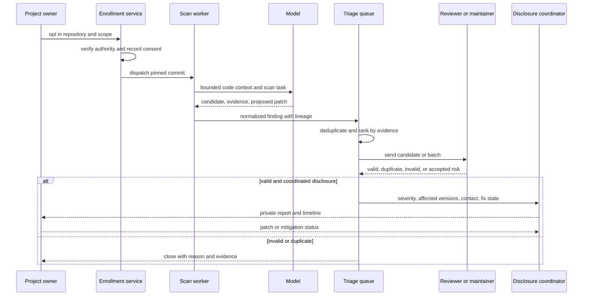

# Model-generated vulnerability reports need a triage control plane
Status: emerging
Sources: [Anthropic — Launching an opt-in vulnerability-finding service for open-source software — 2026-10-08](https://www.anthropic.com/research/launching-opt-in-vuln-finding-service-for-open-source)

## In one sentence

Anthropic’s October OSS Scanner announcement makes the useful engineering lesson clear: model-generated vulnerability discovery can scale candidate production faster than humans can validate it, so opt-in authorization, deduplication, evidence packaging, severity calibration, and coordinated disclosure are the real system to build.

## Background: what existed before

Open-source security programs already combine static analysis, dependency scanning, fuzzing, manual review, penetration testing, and maintainer judgment. Each tool produces findings with different evidence. A static analyzer may point to a suspicious data flow. A fuzzer may provide an input that crashes a process. A dependency scanner may identify a known vulnerable version. A human researcher may explain exploitability, affected configurations, and a patch.

The bottleneck has rarely been the ability to emit a possible issue. It has been deciding which findings are real, novel, reachable, severe, and worth interrupting a maintainer to fix. Duplicate reports waste time. Inflated severity creates alert fatigue. A proposed patch can introduce a regression. A proof-of-concept can expose a sensitive detail before a project has a fix. Security engineering therefore treats discovery and disclosure as separate stages.

Model-assisted scanning changes the economics of discovery. A model can inspect unfamiliar code, follow data flows across files, propose a reproducer, search for related patterns, and draft a report. This may improve coverage for projects that lack security staff. It can also produce a large number of plausible but unverified reports. The quality distribution matters more than the best example.

Before an opt-in service, a maintainer might run a local scanner or receive a researcher’s individually reviewed report. The researcher usually established authorization and chose what to disclose. A centralized model service introduces a new control-plane problem: which project authorized the scan, what commit and dependencies were in scope, where model outputs are stored, who sees unverified findings, how duplicates are merged, and when a report becomes a coordinated disclosure.

## What changed and why now

Anthropic announced OSS Scanner on October 8, 2026 as an opt-in vulnerability scanner for eligible open-source projects. Anthropic says enrolled projects receive periodic scans by its strongest models at no cost. It describes the service as informed by Project Glasswing and distinguishes it from an enterprise-oriented code scanning and patching product.

The announcement reports a large candidate-to-review gap from Anthropic’s preceding work: over 29,000 candidate vulnerabilities discovered and approximately 6,000 manually reviewed. Anthropic also says some maintainers requested bulk delivery of unverified reports. These figures are provider-reported operational facts about the described program, not an independent measurement of all model-generated vulnerability discovery.

The key design choice is explicit: OSS Scanner outputs are fully model-generated without human review or triage. Anthropic says this enables faster and more frequent scanning but means reports may be incorrect or invalid. It says each report contains a self-contained reproducer, an explanation, a possible bisection for when the bug was introduced, and a candidate patch when available. The service is therefore not promising that every report is a verified vulnerability. It is exposing a faster candidate stream to projects that choose to receive it.

Anthropic also reports a validation sample in which penetration testers reviewed 97 critical and high-severity findings across 48 projects; the announcement says 85 met its coordinated-vulnerability-disclosure bar, while the remaining findings were mostly duplicates or related findings and one was invalid. The source attributes the result to its validation exercise and notes that maintainers sometimes found severity inflated or the threat model misunderstood. Vendor-reported validation results must remain bounded by that configuration.

The October engineering lesson is not “AI has solved vulnerability discovery.” It is “candidate generation is now cheap enough that the human and project-side triage queue becomes the architecture.” A safe service must optimize time-to-validated-fix, not raw finding count.

## Impact on current processing and architecture

The scanner should be modeled as a pipeline with explicit authorization and evidence states. Enrollment establishes scope: repository, branches, commit policy, license or eligibility, contact, disclosure preference, and permitted scan cadence. A scan worker operates on a pinned snapshot. The model produces a candidate, but a normalizer extracts structured fields. A deduplication stage groups related candidates. A maintainer or authorized reviewer decides whether the issue is valid, duplicate, accepted risk, or out of scope. Only then does a disclosure workflow assign severity, coordinate a fix, and publish an advisory.

```mermaid
flowchart LR
    E[Opt-in enrollment] --> S[Scope and authorization record]
    S --> C[Pinned repository snapshot]
    C --> M[Model scan]
    M --> N[Candidate normalizer]
    N --> D[Duplicate and lineage grouping]
    D --> T[Maintainer or reviewer triage]
    T -->|invalid or duplicate| X[Close with reason]
    T -->|valid| V[Severity and threat-model review]
    V --> P[Patch and reproducer validation]
    P --> Q[Coordinated disclosure workflow]
    Q --> A[Advisory, fix, and audit record]
    classDef scope fill:#e0f2fe,stroke:#0369a1,color:#082f49;
    classDef model fill:#ede9fe,stroke:#7c3aed,color:#2e1065;
    classDef control fill:#fef3c7,stroke:#b45309,color:#451a03;
    classDef close fill:#fee2e2,stroke:#b91c1c,color:#450a0a;
    classDef fix fill:#dcfce7,stroke:#15803d,color:#052e16;
    class E,S,C scope;
    class M model;
    class N,D,T,V,Q control;
    class X close;
    class P,A fix;
```



Enrollment is a security boundary, not a marketing form. Verify that the person submitting a project is authorized to do so. Record the exact repository and allowed refs. Decide whether private forks, submodules, issue trackers, build secrets, and generated artifacts are in scope. The scanner should never infer permission from repository visibility alone. Public code can still contain unpublished vulnerability research, credentials in history, or a maintainer’s expectation that automated scanning will not contact external systems.

Pinning the snapshot makes a report reproducible. Store commit hash, language toolchain, dependency lockfile, build command, scan timestamp, and relevant configuration. If a finding depends on a generated file or platform-specific build option, include that context. A report that says “line 143 is unsafe” without the commit and build assumptions is difficult to reproduce and easy to misapply.

The candidate record should separate observation from interpretation. A useful schema might include `location`, `data_flow`, `reproducer_status`, `affected_configuration`, `introduced_by`, `duplicate_group`, `model_confidence`, `review_status`, `severity`, and `disclosure_state`. The model can propose a severity, but severity is a policy and threat-model decision. Do not let a model-created “critical” label page the on-call maintainer without a human or trusted downstream rule reviewing impact.

Evidence packaging is the main quality multiplier. A self-contained reproducer reduces maintainer effort, but it must be safe and bounded. Use synthetic inputs, a disposable environment, no live targets, and resource limits. A proof of concept should demonstrate the issue without turning the report into an operational exploit guide. Candidate patches need tests, a clear explanation of the invariant restored, and a check for compatibility and regression.

Deduplication needs more than matching file and line numbers. The same root cause can appear in multiple call paths. A code move can change line numbers while preserving the vulnerability. Two model reports can use different descriptions for the same missing authorization check. Store stable fingerprints based on normalized data flow, affected symbol, behavior, and snapshot lineage. Keep related findings linked even when they are not exact duplicates.



The queue should support different delivery modes. A human-verified coordinated report is one product. A maintainer-requested bulk feed of unverified candidates is another. The recipient must know which mode they are receiving. Do not send a raw model stream in a format that looks like a verified advisory. Label confidence, review state, duplicate status, and limitations prominently.

Capacity planning follows queueing logic. Let `λ` be candidate arrival rate and `μ` the validated-review rate per reviewer. If `λ` approaches or exceeds total `μ`, backlog grows even if scan generation is efficient. Adding more models can worsen maintainer load. A service should control scan cadence, cap candidate volume, prioritize high-evidence findings, and invest in deduplication and automated evidence checks before maximizing scan throughput.

Metrics should measure the full path: candidate count, unique-root-cause count, duplicate rate, invalid rate, time to first maintainer response, validation rate by severity band, time to patch, disclosure completion, regression rate, and maintainer effort per accepted issue. Provider-reported “reports sent” or “vulnerabilities found” is not enough to evaluate the service.

## Real-world applications and constraints

Critical infrastructure libraries are strong candidates for opt-in scanning because a single defect can affect many downstream users. Eligibility should still be explicit. A maintainer needs a clear scope, contact channel, and patch process before enrolling. A scanner should avoid opening issues publicly or publishing details until the project’s disclosure policy is followed.

Small projects may benefit most because they lack dedicated security staff, but they also have the least capacity to triage a flood. Offer a low-volume, high-evidence mode with human support, not only an unfiltered bulk export. Provide a machine-readable format that can enter an existing issue or security advisory workflow without losing provenance.

Large projects need integration with existing security operations. Findings should carry repository commit, component owner, severity rationale, duplicate links, and a suggested test. A project may already have a vulnerability database, static-analysis findings, and fuzzing corpus. The scanner should import and compare those sources instead of generating duplicate tickets.

Supply-chain maintainers must consider transitive impact. A vulnerability in a library may affect downstream products that cannot patch immediately. The disclosure process needs embargo handling, affected-version ranges, release coordination, and a way to notify downstream consumers. A model-generated report can accelerate discovery, but it cannot decide the ecosystem’s communication obligations by itself.

There are privacy and confidentiality constraints. Source code can be public while build metadata, issue comments, or private branches are not. Store only the authorized snapshot and restrict report access. Reproducers must not include real credentials, customer data, or irreversible commands. If the model sees secrets accidentally committed to a repository, route that finding through a secret-revocation process rather than embedding the secret in a report.

Legal and ethical boundaries matter. An opt-in project authorization is not permission to scan arbitrary dependencies, hosted services, or neighboring repositories. Keep the scanner’s activity inside the declared source snapshot and sandbox. Do not use reports to create public exploit material before a fix or coordinated timeline exists. The service should have a clear abuse-response process if a project submits a malicious or unauthorized target.

## Mental model

Think of model-generated vulnerability discovery as a high-throughput sensor attached to a low-throughput expert queue. The sensor improves coverage and proposes evidence. It does not own truth, severity, authorization, or disclosure. The system succeeds when valid issues reach fixes with less maintainer effort and less time exposed—not when the candidate counter is large.

The report is a product, not a model transcript. It should be self-contained enough to reproduce, narrow enough to avoid unnecessary exposure, and honest about its status. A candidate, verified vulnerability, accepted risk, and published advisory are different objects with different permissions and lifecycles.

## What changed this month

Anthropic announced an opt-in OSS Scanner on October 8, 2026. It says enrolled projects receive periodic scans at no cost, the outputs are fully model-generated without human triage, and reports can include reproducers, explanations, bisection information, and candidate patches. Anthropic also reported a large candidate-review gap and a validation sample of high- and critical-severity findings, while noting possible invalid findings, duplicates, and inflated severity.

The engineering change is to make triage and disclosure a first-class control plane. Model capability creates supply; review, deduplication, authorization, and coordinated disclosure determine whether that supply improves security or overwhelms maintainers.

## Engineering consequence

Design enrollment and disclosure states before scanning. At minimum, represent `proposed`, `authorized`, `scanning`, `candidate`, `duplicate`, `invalid`, `verified`, `patch_in_progress`, `disclosed`, and `withdrawn`. Every transition needs an actor, timestamp, evidence reference, and policy reason. Do not let a model move a finding directly from candidate to public advisory.

Require bounded evidence. A reproducer should run against a pinned snapshot in an isolated environment, terminate within a resource budget, and avoid external network access. A candidate patch should include a regression test where possible. If evidence cannot be reproduced, downgrade the finding rather than guessing.

Use human capacity as the rate limit. Tune scan cadence to the project’s stated triage capacity. Let maintainers request batch delivery, but label unverified material and provide deduplication metadata. Prioritize candidates with a concrete data flow, deterministic reproducer, affected version, and clear impact.

Build feedback loops. Maintainer decisions should train deduplication and ranking systems, but do not silently treat a maintainer’s “not reproducible” as proof that the model was always wrong. Record whether the code changed, the environment differed, or the threat model was misunderstood. Measure precision, recall where a reference set exists, and effort per valid report.

## Limits and failure modes

Model-generated reports can be invalid, duplicated, or overstate severity; Anthropic explicitly warns about this. A fluent explanation is not evidence. Require a reproducible test and independent review before treating a finding as verified.

A proposed patch can be dangerous. It may mask a symptom, break compatibility, or create a new authorization bypass. Run the project’s tests, add a focused regression test, and have a maintainer review the semantic change. Never auto-merge a security patch because the model supplied one.

Scanning public code can still expose sensitive context. Repository history may include secrets, private issue references, or unreleased fixes. Use retention limits, access controls, redaction, and a clear deletion process. Keep report artifacts separate from training data unless the project and applicable policies permit reuse.

Severity labels are context-dependent. A memory bug in a command-line utility, a parser in a network daemon, and an authorization issue in a multi-tenant service cannot share one default score. Let the affected deployment, reachability, privileges, and exploit preconditions drive severity.

Fast-track disclosure can overload maintainers or publish noise. Offer a default coordinated path, a clearly labeled unverified feed for projects that request it, and a way to pause scanning. The service must respect embargoes and withdrawal requests while preserving an audit trail.

Finally, provider benchmark results are not universal. Anthropic’s validation sample and maintainer quotations describe its selected projects, findings, and process. Teams should evaluate their own languages, frameworks, repositories, and review capacity before making operational promises.

## Mini exercise (15–30 min)

Build a local candidate-triage queue without scanning real code. Represent synthetic findings with a repository, commit, symbol, evidence strength, severity proposal, and root-cause fingerprint. Deduplicate related findings, reject missing authorization or evidence, and promote only reviewed candidates to a disclosure-ready state.

## Runnable low-cost example

```python
from dataclasses import dataclass


@dataclass(frozen=True)
class Finding:
    finding_id: str
    repo: str
    commit: str
    fingerprint: str
    evidence: str
    proposed_severity: str
    authorized: bool = True


def triage(findings: list[Finding]) -> dict[str, list[str]]:
    result = {"review": [], "duplicate": [], "rejected": [], "disclosure": []}
    seen: dict[tuple[str, str], str] = {}
    for finding in findings:
        if not finding.authorized or not finding.commit:
            result["rejected"].append(finding.finding_id)
            continue
        key = (finding.repo, finding.fingerprint)
        if key in seen:
            result["duplicate"].append(finding.finding_id)
            continue
        seen[key] = finding.finding_id
        if finding.evidence not in {"reproducer", "static_trace"}:
            result["rejected"].append(finding.finding_id)
            continue
        result["review"].append(finding.finding_id)
        if finding.evidence == "reproducer" and finding.proposed_severity in {"high", "critical"}:
            result["disclosure"].append(finding.finding_id)
    return result


findings = [
    Finding("f1", "demo", "abc123", "auth-1", "reproducer", "high"),
    Finding("f2", "demo", "abc123", "auth-1", "reproducer", "critical"),
    Finding("f3", "demo", "abc123", "parse-2", "guess", "high"),
    Finding("f4", "demo", "", "path-3", "reproducer", "high"),
]

out = triage(findings)
assert out["duplicate"] == ["f2"]
assert out["rejected"] == ["f3", "f4"]
assert out["disclosure"] == ["f1"]
print(out)
```

## Build it locally

1. Save the example as `finding_triage.py` and run `python3 finding_triage.py`.
2. Add an enrollment ID and reject findings from repositories without an active opt-in record.
3. Add a `snapshot_hash` and require it before a finding can enter review.
4. Add a `review_state` transition so only `verified` findings can enter disclosure.
5. Add a maintainer decision that can mark a finding `duplicate`, `accepted_risk`, or `invalid` with a reason.
6. Count candidates per repository and simulate a pause when the review backlog exceeds a configured limit.

## Interview Q&A

**Why is candidate generation not the same as vulnerability discovery?** A candidate is a hypothesis. It must be reproduced, scoped, checked against the threat model, deduplicated, and reviewed before it becomes a verified vulnerability.

**Why does opt-in matter?** It establishes authorization, scope, contact, and disclosure expectations. Public visibility of source code does not grant permission to perform arbitrary scanning or disclose findings.

**What should a high-quality model report contain?** A pinned snapshot, location, affected configuration, bounded reproducer, explanation, evidence status, possible patch, and clear limitations. It should not include unnecessary secrets or unsafe operational instructions.

**Why can more scanner throughput make security worse?** If candidate arrival exceeds human validation capacity, maintainers face backlog and alert fatigue. The service must optimize validated fixes and control scan cadence.

**Can a model assign CVSS or severity automatically?** It can propose a label, but severity depends on reachability, privileges, affected deployments, impact, and the project threat model. Human or policy review should finalize it.

## Glossary

- **Candidate finding:** A model-generated hypothesis that may represent a vulnerability.
- **Triage:** The process of validating, deduplicating, prioritizing, and assigning a finding.
- **Coordinated vulnerability disclosure:** A process for privately sharing a verified issue, preparing a fix, and communicating it responsibly.
- **Reproducer:** A bounded test that demonstrates the reported behavior against a pinned target.
- **Root-cause fingerprint:** A stable identity used to group findings that arise from the same underlying defect.
- **Threat model:** Assumptions about attackers, assets, trust boundaries, and impacts.
- **Embargo:** A period during which disclosure details remain private while maintainers prepare a fix.
- **Accepted risk:** A maintainer’s documented decision not to fix or immediately disclose a finding.
- **False positive:** A report that does not represent the claimed vulnerability under the stated conditions.

## References

- [Launching an opt-in vulnerability-finding service for open-source software — Anthropic — 2026-10-08](https://www.anthropic.com/research/launching-opt-in-vuln-finding-service-for-open-source)
- [OSS-Fuzz — Google](https://google.github.io/oss-fuzz/)
- [Coordinated Vulnerability Disclosure — CISA](https://www.cisa.gov/coordinated-vulnerability-disclosure-process)
- [OWASP Vulnerability Disclosure Cheat Sheet](https://cheatsheetseries.owasp.org/cheatsheets/Vulnerability_Disclosure_Cheat_Sheet.html)

## Claim ledger

| Claim | Source | Fact or inference |
|---|---|---|
| Anthropic announced OSS Scanner on October 8, 2026 as an opt-in service for eligible open-source projects. | Anthropic announcement | Fact |
| Anthropic says the scanner’s outputs are fully model-generated without human review or triage. | Anthropic announcement | Fact |
| Anthropic says reports can include a reproducer, explanation, bisection, and candidate patch. | Anthropic announcement | Fact |
| Anthropic reports over 29,000 candidate vulnerabilities and approximately 6,000 manually reviewed in preceding work. | Anthropic announcement | Fact about the provider’s reported process |
| Anthropic reports that 85 of 97 sampled critical/high findings met its CVD bar. | Anthropic announcement | Fact about the provider’s validation sample, not independent verification |
| Candidate arrival can exceed human review capacity and create backlog. | Queueing and operations reasoning | Engineering inference |
| Authorization, snapshot pinning, deduplication, and disclosure state should be separate controls. | Security workflow design reasoning | Engineering inference |
