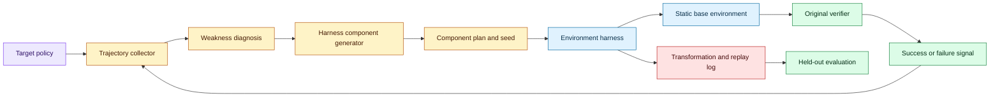
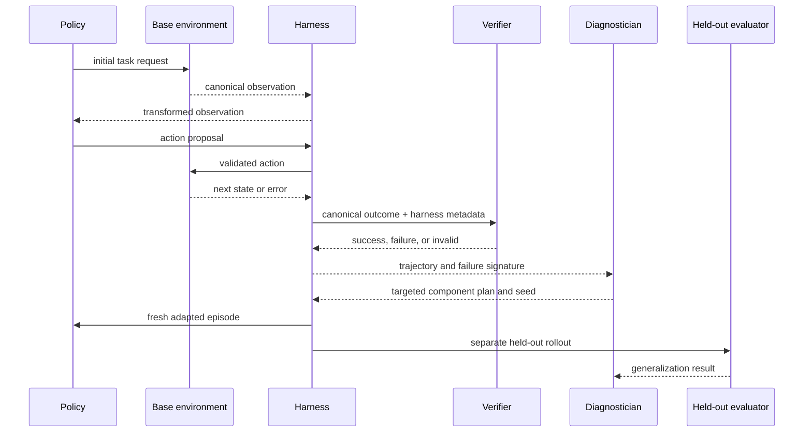

# Programmable environment harnesses for agent learning
Status: emerging
Sources: [EnvHarness: Awakening Static Worlds for Agent Learning — Huang et al. — arXiv:2608.19880](https://arxiv.org/abs/2608.19880)

## In one sentence

EnvHarness proposes a reusable layer of plug-in components that reshapes a static environment around an agent’s weaknesses while preserving the original verifier, turning environment engineering into a programmable control loop rather than a one-time simulator build.

## Background: what existed before

An agent learns by observing a state, choosing an action, receiving a new state or reward, and repeating the loop. In reinforcement learning, the environment defines what states and actions mean, how transitions occur, and how success is verified. In language-agent training, the environment may be a browser, code repository, game, API, tool collection, or simulated world. The environment is not just a dataset: it is the source of feedback that tells the policy what behavior works.

Historically, teams built these environments by hand for a task family. They wrote a simulator, defined task instances, implemented a verifier, and created a fixed distribution of difficulties. This has an important advantage: the environment’s rules are explicit and the score is relatively stable. It also creates a maintenance problem. As the policy improves, easy tasks saturate. If the policy has a particular weakness—long-horizon planning, state tracking, tool selection, or recovery from failure—the static environment may not expose enough examples to train against it.

The common response was to generate new tasks or rebuild the environment. Domain-specific environment generation can produce useful variety, but it may require a custom generator and a reliable verifier. A generated task that looks difficult but has an ambiguous answer is poor training data. A generated world that changes its rules may also make scores incomparable. The cost is not only implementation time; it is the risk of changing the learning target while trying to improve it.

A static environment has another limitation: it is usually blind to the policy’s trajectory. It knows whether the final answer is correct, but not necessarily which repeated mistake caused failure. An agent may repeatedly lose track of an object, call the wrong tool after a partial observation, or choose an action that works on the training layout but fails under a small perturbation. If the environment does not respond to that weakness, training can plateau without producing the examples needed for correction.

This is different from an ordinary evaluation harness. An evaluation harness should keep the task fixed while measuring behavior. A learning environment can adapt its challenges, but it must preserve the meaning of success and avoid creating a moving target that the policy can exploit. The design problem is how to add targeted variation without rewriting the original world.

## What changed and why now

The EnvHarness paper, submitted to arXiv on August 20 and highlighted at Google’s October 2026 COLM activities, proposes a programmable layer of plug-in components that wraps a static environment and reshapes its behavior without modifying the underlying logic. The abstract says the approach operates through standard interfaces and retains the original verifier. It introduces EnvRigger, which treats the target policy as a black box, observes execution trajectories, synthesizes components targeting diagnosed flaws, and validates them with fresh rollouts.

The authors report experiments across five benchmarks in four domains. They report up to a 9.0-point improvement on held-out instances and 9.8% fewer execution steps. Those are paper-reported results tied to the authors’ benchmark configurations; they are not universal guarantees. The paper also claims that EnvHarness can provide an optimization signal for reinforcement learning and enable continuous, targeted co-evolution of the policy and environment.

The reusable concept is a wrapper, not a new simulator. A wrapper can transform observations, perturb state, constrain actions, inject recoverable events, or change task context while delegating the underlying transition and verification semantics to the original environment. The wrapper should be composable and inspectable. Each component needs a defined input and output contract, a scope, a seed, and a way to prove that the original verifier still applies.

This is a meaningful engineering delta because environment code is expensive and domain-specific. If the wrapper interface is stable, one environment can support multiple curriculum policies, adversarial perturbations, or remediation challenges. But the abstraction only helps if the transformed state remains valid and the held-out evaluation does not accidentally use the same generated patterns. A programmable layer creates leverage and creates new leakage modes.

## Impact on current processing and architecture

The architecture separates a base environment from a harness layer and a policy diagnostician. The base environment owns canonical state transitions and verification. The harness receives a seed and a component plan, applies transformations at explicit lifecycle points, and records the resulting trajectory. EnvRigger or another controller observes trajectories and proposes the next component. A fresh rollout tests whether the intervention addresses the diagnosed weakness without changing the task’s success semantics.



The boundary between base environment and harness is critical. A component might alter an observation, add a distractor, change an object’s location, introduce a temporary tool failure, or adjust the order in which information becomes available. It must not silently change the reward definition, allow an impossible action, or modify the verifier’s interpretation of success. If a component needs a new rule, it should declare a new environment version rather than pretending the old verifier remains authoritative.

Every transformation should be deterministic under a recorded seed. Store base task ID, harness version, component IDs, parameters, random seed, model version, trajectory, and verifier output. This allows a training failure to be replayed. Without these fields, a policy may fail once under a hidden perturbation that cannot be reproduced, and a team may mistakenly blame the model or the environment.

Standard interfaces make composition possible. A useful interface might expose hooks such as `before_reset`, `after_observation`, `before_action`, `after_transition`, and `before_verify`. Each hook should receive an immutable event and return a typed transformation or a no-op. Components should declare whether they affect observations, action availability, transition timing, or task metadata. Avoid allowing arbitrary code to mutate base state directly; use a controlled overlay or copy-on-write representation.

The black-box diagnosis loop changes data processing. Instead of inspecting hidden model activations, EnvRigger can use execution trajectories: action sequences, retries, time-to-completion, tool errors, and verifier outcomes. A diagnosis might say that the policy fails when an object is occluded after a long delay, or that it chooses a tool correctly but cannot recover from a stale result. The generated component targets that condition. This is an inference from the paper’s black-box trajectory description; the exact diagnosis algorithms and component language must be read from the full paper implementation.

The system needs two evaluation distributions. The adapted environment measures whether the intervention changes the targeted behavior. A held-out distribution measures whether the policy improved beyond memorizing the harness pattern. The paper reports held-out improvements, which is important because training on the same perturbation can produce brittle overfitting. Keep held-out tasks, component seeds, and challenge families separate from the generation loop.



State overlays affect caching and parallelism. A base task may be reusable across many components, but transformed observations cannot share a cache unless the component plan and seed are part of the key. A copied state may consume more memory. A component that delays or perturbs transitions can increase episode length and training cost. Measure component overhead separately from policy steps so an apparent improvement in agent efficiency does not hide a more expensive environment.

The verifier is an especially valuable asset. Keeping it unchanged allows results from the original and transformed environment to remain comparable. It also creates a responsibility: verify that transformations do not leak the answer, invalidate the task, or create a shortcut. Run metamorphic tests such as “changing the random seed preserves the task’s success definition” and “a permitted transformation never marks a known-correct trajectory as invalid solely because of representation.”

## Real-world applications and constraints

In browser agents, a harness can vary page layout, introduce delayed responses, reorder visible content, or simulate recoverable network errors while preserving the task’s success condition. This teaches robustness without rebuilding an entire website simulator. The harness must prevent unintended access to real sites and keep credentials out of the loop. A browser perturbation should not accidentally become a security test against an external service.

In code agents, a wrapper can vary repository layout, rename non-semantic files, inject deterministic test failures, or delay a tool result. The base verifier can remain the test suite or a hidden checker. The challenge is distinguishing a meaningful software-engineering weakness from an arbitrary obstacle. A harness that changes APIs without versioning can teach the policy to guess rather than reason.

In robotics simulation, a wrapper can alter lighting, object pose, sensor noise, actuator delay, or task order. This can improve robustness to deployment variation, but physical plausibility matters. A visually different scene may not represent a real sensor distribution. Keep a domain review process and evaluate transfer to real or higher-fidelity environments separately.

In scientific workflows, the harness can vary data availability, instrument failures, unit conventions, or tool latency. The verifier should check the scientific result independently of the wrapper. Do not let a generated challenge alter the ground truth or reward a plausible but unsupported conclusion.

For customer-service or enterprise agents, a wrapper can simulate stale records, permission denials, or approval delays. This is useful for training recovery and escalation. It must preserve authorization semantics: a simulated denial should not be bypassable through a different tool, and a synthetic identity must never connect to production data.

The main constraint is validity. Environment adaptation can improve the measured score by making the policy better at the wrapper’s diagnostic pattern rather than better at the domain. Use unseen component compositions, held-out base tasks, and human-designed challenge sets. Report both adapted and original-environment results.

## Mental model

Think of an environment harness as middleware for experience, similar to a reverse proxy or test adapter. It can transform requests and observations at named boundaries while preserving a canonical backend contract. The base environment is the source of truth for task semantics; the harness is a controlled experiment layer; the policy is the system being trained; and the verifier is the judge whose meaning should remain stable.

The co-evolution loop has two feedback systems. The policy changes because it trains on the environment. The environment changes because it diagnoses policy weaknesses. Without held-out evaluation, these feedback systems can collude: the harness generates a challenge, the policy memorizes it, and the score rises without general capability. Reproducible seeds and independent challenge families are the guardrails.

## What changed this month

The EnvHarness paper was highlighted in Google’s October COLM 2026 program and proposes a programmable wrapper for static environments. The paper describes EnvRigger as a black-box trajectory-based system that synthesizes targeted components and validates them with fresh rollouts. It reports results across five benchmarks in four domains, including a maximum 9.0-point held-out improvement and 9.8% fewer execution steps in the authors’ experiments.

The engineering consequence is a reusable environment control plane. Teams can target weaknesses without rebuilding each world, while preserving the original verifier. The result is only trustworthy when component provenance, seeds, state isolation, verifier invariants, and held-out generalization are explicit.

## Engineering consequence

Define the wrapper interface before writing adaptive components. Specify lifecycle hooks, allowed state transformations, seed handling, resource limits, and verifier invariants. Make components declarative where possible so a reviewer can inspect what changed. Run the base environment and harnessed environment side by side on the same task IDs.

Store every generated component as a versioned artifact. Include the diagnosed failure signature, component parameters, target policy version, source trajectory hash, and validation results. This lets a team determine whether a policy improved because of a targeted challenge or because a component leaked task information.

Use a two-loop test plan. The inner loop checks that the component addresses the intended weakness on fresh rollouts. The outer loop checks transfer to held-out tasks, unseen seeds, original environments, and human-designed variants. Reject a component that improves only its own generated pattern or changes the verifier’s semantics.

Budget environment work like serving work. Track reset latency, transformation latency, memory overhead, episode length, verifier cost, and replay storage. If the harness is ten times more expensive than the base environment, a small reduction in policy steps may not improve total training cost.

## Limits and failure modes

The paper is a preprint and its reported improvements are author-reported experiments. Reproduce the results before treating the numbers as general. Check benchmark versions, held-out split construction, component generation budget, policy training procedure, and whether the environments are available.

Verifier preservation can fail subtly. A wrapper may alter the observation so the original verifier receives an invalid state, or it may change the action semantics while retaining the same function name. Add invariant checks and compare base versus wrapped outcomes on known trajectories.

Black-box diagnosis can confuse correlation with cause. A trajectory may fail after a delay, but the relevant weakness could be memory, tool selection, or an unrelated random event. Use controlled ablations and multiple fresh rollouts before generating a targeted component.

Adaptive environments can overfit. If generated components are reused in training, the policy may learn their signature. Hold out both base tasks and component families. Report performance on the original environment so a rise in challenge performance does not hide regression.

Components can create reward hacking. A wrapper that makes the target behavior easier to verify may accidentally reveal the answer or reward a shortcut. Keep reward and verifier logic outside the component’s authority. Review observation diffs and action availability.

Finally, environment co-evolution can become unstable. A policy improves, the diagnostician generates harder challenges, the policy regresses on earlier tasks, and the cycle continues. Maintain a curriculum archive, sample older tasks, and use regression gates before promoting a new environment version.

## Mini exercise (15–30 min)

Build a tiny grid-world with a stable goal verifier and a wrapper that adds deterministic observation noise or a temporary blocked cell. Record the base task, wrapper seed, transformed observation, action sequence, and verifier result. Compare a policy that memorizes one wrapper seed with one that handles unseen seeds.

## Runnable low-cost example

```python
from dataclasses import dataclass


@dataclass(frozen=True)
class World:
    width: int = 4
    height: int = 4
    goal: tuple[int, int] = (3, 3)


def step(world: World, position: tuple[int, int], action: str) -> tuple[int, int]:
    x, y = position
    dx, dy = {"right": (1, 0), "left": (-1, 0), "down": (0, 1), "up": (0, -1)}[action]
    return max(0, min(world.width - 1, x + dx)), max(0, min(world.height - 1, y + dy))


def harness_observation(position: tuple[int, int], seed: int) -> tuple[int, int]:
    # A deterministic wrapper changes the observation, not the goal verifier.
    if seed % 2 == 1 and position == (1, 0):
        return (1, 1)
    return position


def run(seed: int) -> dict:
    world = World()
    position = (0, 0)
    actions = ["right", "right", "down", "down", "right", "down"]
    observations = []
    for action in actions:
        observations.append(harness_observation(position, seed))
        position = step(world, position, action)
    return {"seed": seed, "observations": observations, "position": position, "success": position == world.goal}


def main() -> None:
    episodes = [run(seed) for seed in range(4)]
    assert all(episode["success"] for episode in episodes)
    assert episodes[1]["observations"] != episodes[0]["observations"]
    print("held-out wrapper seeds preserve success:", [e["success"] for e in episodes])


if __name__ == "__main__":
    main()
```

## Build it locally

1. Save the example as `world_harness.py` and run `python3 world_harness.py`.
2. Add a `blocked` cell chosen from the seed and reject actions that enter it.
3. Record the base position and transformed observation separately for every step.
4. Add a verifier invariant that the goal remains `(3, 3)` for every seed.
5. Run a fixed action policy over 20 seeds and count success, invalid actions, and episode length.
6. Add a second policy that uses the observed position and compare performance on seeds never used during tuning.

## Interview Q&A

**Why wrap a static environment instead of rebuilding it?** A wrapper can reuse the base transition and verifier logic while injecting targeted variation. This reduces domain-specific implementation work, but only if the wrapper preserves semantics.

**What does verifier preservation mean?** The original success checker remains authoritative for the transformed episode, subject to documented validity conditions. It does not mean every possible transformation is automatically valid.

**Why are held-out environments necessary?** Adaptive components can create patterns that a policy memorizes. Held-out tasks, seeds, and component families test whether the improvement generalizes.

**What should be recorded for reproducibility?** Base task ID, harness version, component IDs and parameters, random seed, policy version, observations, actions, verifier output, and resource usage.

**How can environment generation cause reward hacking?** A component may leak the answer, alter action semantics, or make the verifier easier to satisfy without improving the intended skill. Keep reward and verification outside the component’s authority and test invariants.

## Glossary

- **Environment:** The stateful system in which an agent observes, acts, and receives outcomes.
- **Harness:** A programmable wrapper that modifies an environment at controlled interfaces.
- **Verifier:** The function or process that decides whether a task succeeded.
- **Trajectory:** The ordered sequence of observations, actions, transitions, and outcomes in an episode.
- **Black-box policy:** A policy observed through inputs and outputs without access to internal parameters or activations.
- **Curriculum:** A schedule that controls which challenges an agent sees during learning.
- **Held-out instance:** A task, seed, or challenge family excluded from generation or training and used to test generalization.
- **Co-evolution:** Joint adaptation of a policy and the environment or challenge distribution.
- **State overlay:** A controlled transformation layered over base state without directly mutating the canonical environment.

## References

- [EnvHarness: Awakening Static Worlds for Agent Learning — arXiv:2608.19880](https://arxiv.org/abs/2608.19880)
- [Google at COLM 2026](https://research.google/conferences-and-events/google-at-colm-2026/)
- [Gymnasium documentation](https://gymnasium.farama.org/)

## Claim ledger

| Claim | Source | Fact or inference |
|---|---|---|
| EnvHarness is described as a programmable layer of plug-in components around a static environment. | EnvHarness abstract | Fact |
| The paper says EnvHarness operates through standard interfaces and retains the original verifier. | EnvHarness abstract | Fact |
| EnvRigger treats the target policy as a black box, observes trajectories, synthesizes components, and validates them with fresh rollouts. | EnvHarness abstract | Fact |
| The paper reports experiments across five benchmarks in four domains. | EnvHarness abstract | Fact |
| The paper reports up to a 9.0-point held-out improvement and 9.8% fewer execution steps. | EnvHarness abstract | Fact about the preprint’s reported results, not independent verification |
| Wrappers need recorded seeds, component versions, and state overlays for reproducibility. | Environment and experiment-systems reasoning | Engineering inference |
| Held-out component families are needed to distinguish generalization from memorization. | Evaluation methodology reasoning | Engineering inference |
