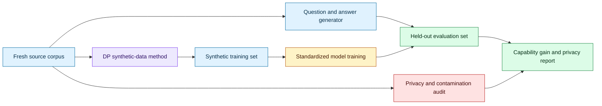
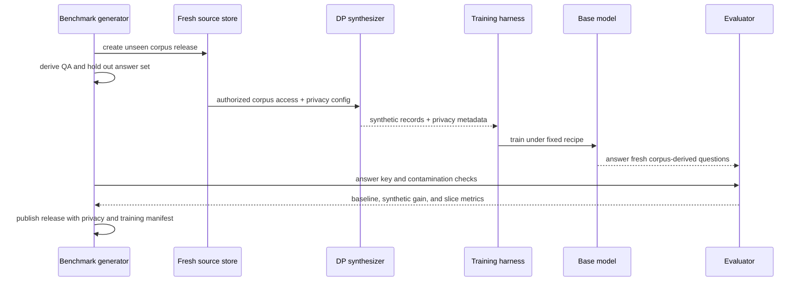

# Testing information retention in differentially private synthetic data
Status: emerging
Sources: [ContinuousBench: Can Differentially Private Synthetic Text Improve Capabilities? — Liu et al. — arXiv:2606.01849](https://arxiv.org/abs/2606.01849), [Google at COLM 2026](https://research.google/conferences-and-events/google-at-colm-2026/)

## In one sentence

ContinuousBench reframes private synthetic-data evaluation as a capability-transfer experiment: a synthetic corpus should be tested on knowledge that cannot be solved without the source corpus but can be learned from repeated independent records, rather than judged only by how realistic its surface statistics look.

## Background: what existed before

Synthetic data is generated data designed to resemble a source dataset without directly releasing every original record. Differential privacy (DP) adds a formal privacy mechanism that limits how much an individual record can influence an output. The promise is attractive: organizations may train or evaluate models using synthetic text while reducing the risk that a private person’s record is memorized or reconstructed.

The first generation of synthetic-data evaluation often measured distribution similarity. Teams compared token frequencies, length distributions, n-grams, classifier performance, or embedding distances between real and synthetic corpora. These tests answer whether the synthetic data looks statistically similar. They do not necessarily answer whether it transfers useful knowledge. A dataset can imitate style, vocabulary, and topic proportions while omitting the rare facts or relationships needed for a downstream task.

Another common evaluation trained a model on synthetic data and tested it on a standard benchmark. This is useful when the benchmark measures a capability that cannot be achieved without learning the relevant source information. But many popular benchmarks are already close to solvable from a pretrained model or web-scale training. A high score may show that the model already knew the answers; it does not show that synthetic data transmitted new information from the protected corpus.

Privacy introduces a deliberate tension. A DP mechanism adds noise or limits influence so that one record does not change the output too much. If the target knowledge is supported by many independent records, a good synthesis method might preserve it while protecting individuals. If the knowledge appears only once, preserving it may conflict with privacy. An evaluation should expose that trade-off rather than report one aggregate quality number.

The historical baseline also treated the dataset as a static artifact. A synthetic release was evaluated once, often with a fixed benchmark and fixed train/test split. This makes it hard to detect progress or regression as privacy mechanisms, generators, and source corpora change. A recurring benchmark with fresh source material can test whether a method transfers information in a setting where the model cannot have memorized the answers from a prior release.

## What changed and why now

ContinuousBench is a benchmark proposed in a paper by Liu and colleagues. The paper’s abstract says existing evaluations can be nearly solvable without training and therefore do not establish whether DP synthesis substitutes for access to the original data. It introduces a continuously and automatically regenerated benchmark whose releases pair a previously unseen training corpus with a derived question-answer set.

The benchmark is designed around two conditions. The questions should be unsolvable without the corpus, so a pretrained model cannot answer them from its prior knowledge alone. The target knowledge should also be learnable under DP, supported by hundreds of independent records rather than a single person’s unique fact. The evaluation then asks researchers to create DP synthetic data from the training corpus and run a standardized training and evaluation harness to measure capability gain.

The paper describes two tracks: Geminon, a procedurally generated dataset about fictional creatures, and News, a stream of newly crawled public news articles. Its abstract reports that non-private synthesis transfers substantial knowledge on ContinuousBench while state-of-the-art DP synthesis methods generally fail to do so, even at ε=100. That is a preprint-author result, not a universal statement about every privacy mechanism, corpus, model, or privacy accounting choice.

The October connection is the presentation of ContinuousBench in Google’s COLM 2026 program, where the organizers describe it as an evaluation of whether differentially private synthetic data retains the information content of the original data rather than merely matching style. The paper itself is dated June, so the month’s source ledger should label the October event as a conference presentation or visibility update, not pretend the research was first published in October.

The engineering change is a stronger test target. Instead of asking “does the synthetic corpus resemble the private corpus?”, ask “does training on the synthetic corpus produce new capability on fresh, corpus-derived questions, under a privacy mechanism?” That requires dataset generation, training, evaluation, privacy accounting, and leakage controls to be designed together.

## Impact on current processing and architecture

The benchmark pipeline has separate source, synthesis, training, and evaluation boundaries. A source corpus is held out from the model and benchmark creator’s prior public releases. A derived QA generator creates questions and answers from the source. A synthesis method receives the source under a specified DP configuration and emits synthetic records. A standardized trainer learns from those records. The evaluator tests on held-out questions with access to the answer key but not the source corpus.



The source corpus and question set need a one-way dependency. Questions can be derived from source facts, but the answer set must not leak the entire source to the training side. If the synthetic-data generator receives questions or answers, the experiment no longer tests whether it transmitted corpus information through synthesis. Keep roles and access paths explicit.

The baseline matters. Run a no-training condition using the base model on the evaluation questions. Run a non-private synthesis condition to estimate the information-transfer ceiling. Run the DP method at stated privacy parameters. Optionally run a real-data upper bound, subject to the experiment’s privacy and access rules. The important comparison is capability gain over the no-training baseline, not only the final score.

The unit of analysis is a capability gain curve. Let `A0` be accuracy without training on the fresh corpus and `A_syn(ε)` be accuracy after training on synthetic data produced at privacy parameter ε. The gain is `A_syn(ε) - A0`. A privacy-quality curve can show how gain changes as ε varies. Because ε is not a universal privacy quality score across mechanisms and compositions, report the mechanism, sampling, clipping, accounting method, and training configuration alongside it.

The benchmark’s independent-record condition changes corpus processing. If a fact is repeated across hundreds of independent records, a synthesis method can potentially learn a population-level pattern without memorizing one record. But independence must be defined carefully. Near-duplicates, syndicated news, copied documents, or records sharing one source can make the effective support much smaller than the row count. Deduplicate and report clusters, not just record totals.



The training harness is part of the benchmark. If every participant uses a different model, optimizer, number of steps, tokenizer, and filtering recipe, results conflate synthesis quality with training choices. A standard harness should pin the base model, data format, training budget, evaluation procedure, and random-seed policy. It should still allow a clearly labeled research track for alternative settings.

Contamination control is central. The base model may have seen the public News track before the benchmark release, even if the latest articles were newly crawled. A procedural fictional track can reduce prior knowledge but may not represent real privacy-sensitive text. Use time-based freshness, canary facts, private holdouts, and model-access restrictions. If the model already knows the answer, the benchmark loses its unsolvability condition.

Privacy auditing should be separate from capability scoring. A synthetic corpus can score well by memorizing rare records, or it can score poorly while still offering acceptable privacy. Test membership inference, nearest-neighbor similarity, canary exposure, and record-level influence where appropriate. Report failure cases rather than compressing privacy and utility into one number.

Operationally, recurring releases require a versioned data pipeline. Store corpus release ID, source timestamp, deduplication method, question generator version, answer-key hash, synthesis configuration, privacy accountant, trainer image, model checkpoint, and evaluator version. Retain the minimum sensitive material needed to reproduce the release. A public benchmark can publish synthetic data and questions while keeping sensitive source data under controlled access.

## Real-world applications and constraints

Healthcare researchers may want to share synthetic clinical text while preserving useful cohort patterns. A capability benchmark could test whether a model trained on synthetic notes learns a newly held-out clinical terminology or relationship. It must not expose patient-specific facts, and the evaluation must distinguish population-level knowledge from memorization. Clinical correctness and privacy require domain experts; a benchmark score alone is not evidence for deployment.

Financial institutions may use synthetic transaction narratives or support records for model development. A fresh, derived evaluation can test whether fraud patterns or policy distinctions transfer. Sensitive records may have strong correlations and duplicates, so independence assumptions require careful analysis. A model that learns a rare account pattern could create privacy risk even when aggregate similarity looks good.

Enterprises can use synthetic support or incident data to share training tasks across teams. The benchmark should test new capability on a holdout generated after the synthetic release, not only a familiar ticket classifier. Record deletion and retention policies must cover source data, synthetic outputs, checkpoints, logs, and evaluation answers.

Public-news synthesis is useful for studying freshness. A newly crawled stream can create questions whose answers were not present in older model training. Time boundaries still matter: articles may be syndicated, summaries may be copied, and models may have access to search during evaluation. Disable retrieval in the capability test or treat retrieval as a separate track.

The main constraint is cost. Each recurring release requires a fresh corpus, question generation, privacy synthesis, model training, evaluation, contamination review, and publication. Automation reduces labor but can propagate an invalid question or a broken answer key. Use canary checks and human review of a sample of questions. A continuously regenerated benchmark must be continuously tested.

## Mental model

Think of synthetic data as a communication channel. The original corpus is the message, the DP synthesis mechanism is a privacy-constrained encoder, model training is the decoder, and the benchmark is the receiver test. Surface resemblance is a weak channel metric. Capability gain on questions that require the message is stronger evidence that useful information crossed the channel.

The channel is lossy by design. DP limits the influence of any one record. The goal is not to preserve everything. It is to preserve supported, useful population-level information while limiting individual leakage. ContinuousBench’s independent-record condition operationalizes that distinction: information supported by many records is a better target for privacy-preserving transfer than a one-off personal fact.

## What changed this month

ContinuousBench was presented in Google’s October 2026 COLM program, while the underlying arXiv paper is from June. The benchmark’s central contribution is a continuously regenerated evaluation whose questions are intended to be unsolvable without a fresh corpus and learnable from repeated independent records. The paper reports a gap between non-private synthesis and current DP synthesis on its two tracks.

The engineering consequence is a move from similarity metrics toward information-retention experiments. Dataset synthesis, privacy accounting, training, contamination control, and evaluation must share a release manifest. A synthetic dataset is not useful merely because it looks realistic; it should demonstrate the intended capability transfer without violating the privacy boundary.

## Engineering consequence

Define the capability target before generating synthetic data. Write down what the model should learn, why a no-training model should fail, how many independent records support the knowledge, and what leakage would be unacceptable. If those conditions cannot be stated, the benchmark may measure style or prior knowledge rather than transfer.

Build a baseline matrix. Include no training, real-data training where permitted, non-private synthesis, and DP synthesis across privacy configurations. Keep the trainer and evaluator fixed. Report absolute scores, capability gain over no training, privacy metrics, confidence intervals, and per-slice results.

Make freshness a production feature. Automate corpus versioning, question generation, answer-key checks, and contamination screening. Publish a release manifest and immutable evaluation code. If an answer-key bug is found, issue a new benchmark version rather than silently changing labels.

Track record support. Compute cluster sizes, near-duplicate rates, and source diversity. Report whether “hundreds of independent records” means independent documents, authors, events, or merely rows. A privacy claim that depends on record independence is only as strong as that analysis.

## Limits and failure modes

Differential privacy is not a single utility guarantee. ε values are meaningful with the mechanism, neighboring-dataset definition, composition, sampling, and accountant. Comparing ε=100 across methods without those details can mislead. The paper’s reported result should be interpreted within its configuration.

Fresh questions can still leak. A question generator may include the answer in wording, the base model may have seen a syndicated fact, or the evaluation prompt may provide enough context to solve the item. Audit questions with a no-training baseline and human review.

Independent-record support may be overstated. Duplicated records, shared templates, and common source documents reduce effective support. Treat the data-generation process as part of the privacy analysis, not only a preprocessing detail.

Synthetic data may preserve correlations that are undesirable or legally sensitive. A benchmark that rewards a model for learning a protected attribute relationship can create pressure to preserve the wrong information. Define acceptable capability targets and privacy exclusions with domain experts.

Training and evaluation can be unstable. Small datasets, optimizer choices, and random seeds may produce large score changes. Use multiple seeds and report uncertainty. A single successful run is not strong evidence of transfer.

Finally, benchmark success does not prove deployment utility. A model can learn a narrow fictional or news-derived capability and still fail on real users, long-tail language, or safety constraints. Treat ContinuousBench-style results as evidence about information transfer, not a complete synthetic-data approval.

## Mini exercise (15–30 min)

Build a tiny information-retention benchmark without private data. Generate synthetic records about fictional devices, derive questions that require learning a repeated fact, compare a no-training lookup with a simple record-frequency synthesizer, and report capability gain. Then add a one-off fact and show why its preservation should be treated differently from a fact repeated across many records.

## Runnable low-cost example

```python
from collections import Counter


records = [
    {"device": "A", "material": "ceramic"},
    {"device": "A", "material": "ceramic"},
    {"device": "A", "material": "ceramic"},
    {"device": "B", "material": "wood"},
    {"device": "B", "material": "wood"},
    {"device": "C", "material": "rare-alloy"},
]


def learn_supported_facts(rows: list[dict], min_support: int) -> dict[str, str]:
    counts = Counter((row["device"], row["material"]) for row in rows)
    return {
        device: material
        for (device, material), count in counts.items()
        if count >= min_support
    }


def score(knowledge: dict[str, str], questions: list[dict]) -> float:
    correct = sum(knowledge.get(q["device"]) == q["answer"] for q in questions)
    return correct / len(questions)


questions = [
    {"device": "A", "answer": "ceramic"},
    {"device": "B", "answer": "wood"},
    {"device": "C", "answer": "rare-alloy"},
]

no_training = {}
synthetic_knowledge = learn_supported_facts(records, min_support=2)
print("no-training gain:", score(no_training, questions))
print("supported-fact gain:", score(synthetic_knowledge, questions))
assert score(no_training, questions) == 0.0
assert score(synthetic_knowledge, questions) == 2 / 3
assert "C" not in synthetic_knowledge  # one-off fact is not retained
```

## Build it locally

1. Save the example as `information_retention.py` and run `python3 information_retention.py`.
2. Add a second synthetic release with a different set of device names and questions.
3. Add a `release_id` and include it in every record and question.
4. Add a no-training answer prior and compare it with learned capability gain.
5. Vary `min_support` from 1 to 3 and plot or print which facts transfer.
6. Add duplicate records from one source and document how they change the effective support count.

## Interview Q&A

**Why is distribution similarity insufficient?** A synthetic corpus can match style and frequencies while failing to transmit facts or relationships needed by a downstream model. Capability gain tests whether training on the synthetic data adds useful information.

**Why require questions to be unsolvable without the source corpus?** Otherwise a high score may reflect pretrained knowledge or prompt clues rather than information transferred through synthesis.

**Why require repeated independent support?** It targets population-level information that can plausibly be preserved while limiting the influence of any one individual record.

**Does ε=100 automatically mean weak privacy or strong utility?** Neither conclusion is safe without the mechanism, neighboring-dataset definition, sampling, composition, and accountant. ε is a parameter in a configuration, not a standalone quality score.

**What is the most important baseline?** A no-training baseline on the fresh questions. Without it, a final score cannot show that synthetic data added capability.

## Glossary

- **Differential privacy:** A formal framework limiting how much one record can affect a released computation or model output.
- **Synthetic data:** Generated records intended to support analysis or training without directly releasing the original records.
- **Capability gain:** Improvement over a no-training or baseline system on a task requiring information from the source corpus.
- **Privacy parameter ε:** A parameter in a DP guarantee whose meaning depends on the mechanism and accounting configuration.
- **Independent record:** A record treated as separate evidence rather than a duplicate or derivative of another record.
- **Contamination:** Prior exposure to benchmark questions or answers that makes an evaluation solvable without the intended training data.
- **No-training baseline:** A model or method evaluated on fresh questions without training on the source corpus.
- **Release manifest:** Versioned metadata describing corpus, questions, synthesis, privacy, training, and evaluation settings.
- **Effective support:** The amount of genuinely independent evidence behind a fact or pattern.

## References

- [ContinuousBench: Can Differentially Private Synthetic Text Improve Capabilities? — arXiv:2606.01849](https://arxiv.org/abs/2606.01849)
- [Google at COLM 2026](https://research.google/conferences-and-events/google-at-colm-2026/)
- [Differential Privacy — NIST](https://www.nist.gov/itl/applied-cybersecurity/privacy-engineering/collaborative-research-cycles)
- [The Algorithmic Foundations of Differential Privacy — Dwork and Roth](https://www.cis.upenn.edu/~aaroth/Papers/privacybook.pdf)

## Claim ledger

| Claim | Source | Fact or inference |
|---|---|---|
| ContinuousBench is described as a continuously and automatically regenerated benchmark. | ContinuousBench abstract | Fact |
| Its releases pair a previously unseen training corpus with a derived QA set. | ContinuousBench abstract | Fact |
| The benchmark targets questions unsolvable without the corpus and learnable from hundreds of independent records. | ContinuousBench abstract | Fact about the benchmark design |
| ContinuousBench has Geminon and News tracks in the paper’s description. | ContinuousBench abstract | Fact |
| The authors report substantial transfer for non-private synthesis and failure for state-of-the-art DP synthesis in their experiments, even at ε=100. | ContinuousBench abstract | Fact about preprint-reported results, not independent verification |
| Capability gain over a no-training baseline is stronger evidence of information transfer than surface similarity alone. | Evaluation-design reasoning | Engineering inference |
| Effective record support must account for duplicates and shared sources. | Privacy and data-lineage reasoning | Engineering inference |
