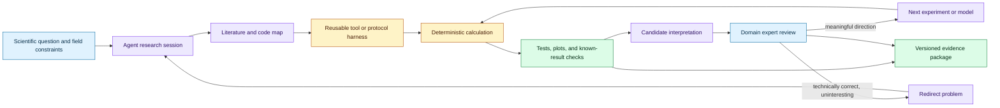
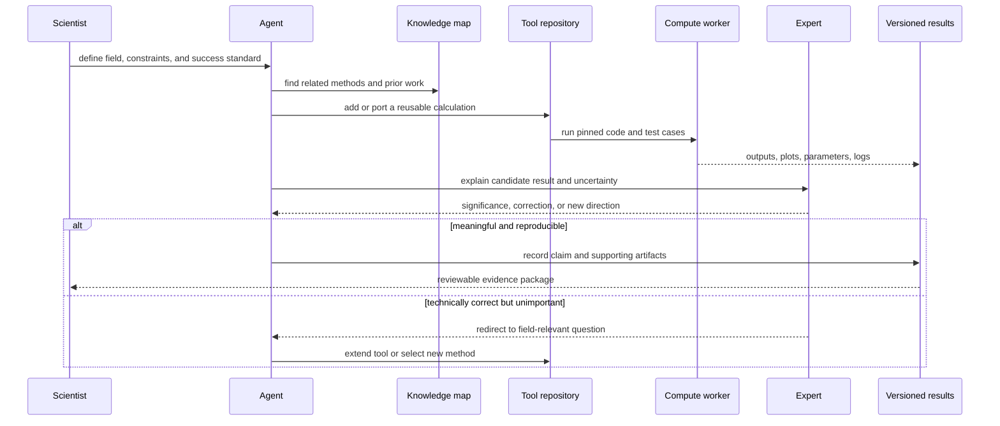

# Claude-shaped scientific workflows
Status: emerging
Sources: [Claude-shaped science — Matthew Schwartz / Anthropic — 2026-10-01](https://www.anthropic.com/research/claude-shaped-science)

## In one sentence

“Claude-shaped science” is an engineering strategy for directing current models toward problems that match their strengths in coding, literature breadth, exact calculation, and tool orchestration, while domain experts retain responsibility for choosing meaningful questions and validating conclusions.

## Background: what existed before

Scientific software has always mediated between a question and an answer. Researchers translate a domain problem into equations, algorithms, code, data pipelines, plots, and an interpretation. The work is distributed across people with different expertise: a physicist may understand the model, a statistician the inference, a software engineer the implementation, and a domain expert the meaning of the result. Reusable tools reduce the cost of repeating calculations across projects.

The conventional AI-assistant workflow inserted a language model into that process as a general collaborator. A researcher asked for ideas, code, literature summaries, or a draft. The model could accelerate routine work, but it often needed close steering. It might pursue an irrelevant line, produce a plausible but incorrect conclusion, or declare a result complete when a crucial assumption remained unproven. The human had to keep translating between the model’s broad suggestions and the field’s standards of significance.

Science has an additional difficulty that differs from mathematics. In a formal problem, the statement and answer may be checkable exactly. In empirical science, the question may be underspecified, data may be noisy or biased, measurement may be expensive, and “interesting” may depend on field context. A technically correct computation can be scientifically unimportant. A model can discover a pattern but not know whether the field already understands it, whether the dataset supports the interpretation, or what experiment would distinguish competing explanations.

Before agentic coding harnesses, a researcher typically built a one-off script or package for each project. Porting a method across languages and disciplines was expensive. Reproducing an old result might require recovering undocumented code, unavailable commercial tools, or details hidden in appendices. This created a large gap between methods that existed in papers and methods that another scientist could actually run.

The baseline therefore had two bottlenecks: implementation and judgment. Models can reduce implementation cost, but judgment remains a human and community responsibility. A useful workflow should exploit the first without pretending the second has disappeared.

## What changed and why now

Anthropic’s October 1 guest post by physicist Matthew Schwartz describes an approach called “Claude-shaped science.” The author defines Claude-shaped problems as problems suited to the capabilities of current large language model tools. The post says those strengths include broad cross-domain knowledge, coding, mathematics and statistics, and rapidly parsing papers, appendices, and data. It contrasts these strengths with deeper conceptual judgment and scientific taste.

The post describes BootLoops, an open-source toolkit and set of protocols created while using Claude for exact calculations in quantitative science. The author says the toolkit began with mathematical physics and then connected to problems in ecology, population genetics, economics, linguistics, and other fields. The post emphasizes that cross-domain connections were often technically correct but initially unremarkable, and that domain experts helped steer the work toward questions their fields cared about.

The source gives examples of a workflow rather than a controlled benchmark. It describes porting methods into a common framework, reproducing known results, extending methods to new classes of calculations, and using exact or highly checkable computations. It also describes running many projects in parallel with separate terminal sessions, repositories, background agents, validation sessions, and a master coordination session. These are the author’s reported experiences and recommendations, not an independent measurement of scientific productivity.

The engineering delta is a shift from asking a general model to “do science” toward building a harness that narrows the model’s job. Give the agent reusable tools, precise success criteria, versioned files, tests, plots, and a protocol for asking experts whether a result matters. The scientist’s role changes from typing every calculation to selecting questions, setting standards, reviewing evidence, and translating technical outputs into meaningful claims.

This lesson is distinct from October’s mathematics proof-artifact lesson. That lesson focuses on release provenance and formal verification of generated mathematics. This lesson focuses on scientific workflow design: tool-building, cross-domain transfer, human steering, parallel state, and the gap between technical correctness and scientific significance.

## Impact on current processing and architecture

The workflow is a multi-stage research system. A scientist defines a target area and constraints. The agent searches literature and existing code, proposes a tractable problem, or ports a method into a common toolkit. Deterministic tools perform calculations. Tests and reference results check implementation. The agent proposes interpretations and follow-up questions. A domain expert assesses significance and redirects the next iteration. The final claim is assembled from artifacts rather than from the model’s prose alone.



The harness should make the model’s strengths legible as interfaces. A literature tool returns citations, excerpts, and source identifiers. A calculation tool accepts typed parameters and returns numbers plus units and error bounds. A plotting tool writes an image and a machine-readable data file. A repository tool records the commit and test result. The model can compose these tools, but it should not be trusted to replace their deterministic checks with a narrative.

Exact calculations are a useful example. If a model ports an algorithm from one language to another, the workflow can compare known outputs, dimensional relationships, limiting cases, and high-precision numerical results. An exact or independently checkable result makes it easier to separate implementation correctness from scientific interpretation. The same pattern applies to empirical work, but the checks become more complex: held-out data, alternative specifications, negative controls, uncertainty intervals, and independent replication.

The project should have multiple state stores. Working notes contain hypotheses and tentative ideas. Tool code is versioned and tested. Results store raw outputs, parameters, and provenance. Expert comments record significance judgments and requested changes. A final manuscript references immutable artifact IDs. Mixing all of these in one conversation makes context loss and accidental overwrites likely.

Long-running agent sessions create operational problems. The source describes separate sessions for projects, a master session for coordination, background computations, and periodic organization of files to protect against context compaction. This is an engineering pattern: treat context as a cache, not as the source of truth. Keep the plan, assumptions, current result, failed attempts, and next action in durable files. A new session should be able to resume from those files without trusting a model-generated summary.



The expert review is not a final approval checkbox. It is an active routing signal. In the post’s examples, experts helped transform a technically correct but unremarkable result into a question the field cared about. That suggests storing review comments as structured project state: domain, proposed significance, missing comparison, recommended dataset, and decision. A model can then use the feedback without treating every positive remark as publication approval.

Cross-domain transfer is a graph problem. A mathematical form—an integral, differential equation, or statistical model—may appear in different fields under different names. A knowledge map can connect method, assumptions, implementation, and application. But analogy can be misleading. Two equations may share a form while their data-generating processes, boundary conditions, units, and interpretation differ. The harness should surface the mapping and its assumptions for an expert to inspect.

Resource scheduling matters when many projects run in parallel. Each project needs a compute budget, token budget, storage quota, and deadline or stopping rule. The source notes that the author found model time estimates unreliable and that agents could grind through long calculations rather than build a better tool. Add explicit budgets and progress checks. Stop a project when tests fail to improve, an assumption is unsupported, or the expert redirects the question.

## Real-world applications and constraints

In computational physics, an agent can port algorithms from papers, reproduce known cases, and explore a family of exact or high-precision calculations. The main constraint is that numerical agreement can hide an implementation error shared by two code paths. Use independent formulations, limiting cases, symbolic checks, or external data where possible.

In ecology and population genetics, a reusable quantitative toolkit can connect methods across fields. The constraint is interpretation: a model may compute a parameter or fit a curve while missing confounding variables, sampling bias, or the field’s established baseline. Domain experts must define what outcome would actually change a scientific conclusion.

In economics, an AI data editor can help port replication packages and compare reported tables with re-executed code. A result that matches a table does not prove the original causal claim. Preserve the dataset version, transformations, estimation choices, and software environment. Treat a mismatch as a research artifact that needs explanation, not automatic evidence of misconduct.

In linguistics, a large catalog built from public sources can broaden coverage and attach citations to entries. Coverage does not guarantee representativeness. The source selection process may exclude communities, languages, or unpublished knowledge. Each entry should keep its source passage, confidence, and human review status.

In any field, the safest early targets are problems with clear inputs, deterministic or highly checkable computations, reusable tools, and a domain expert who can judge significance. Open-ended causal claims, clinical decisions, and policy recommendations need stronger evidence and slower review. A model’s ability to connect literature quickly does not eliminate the need for measurement design.

## Mental model

Treat the model as a high-bandwidth research engineer inside a scientific control loop, not as an autonomous principal investigator. The harness supplies memory, tools, tests, and budgets. The deterministic code supplies repeatability. The domain expert supplies taste, context, and responsibility. Progress is a transition from a question to a validated evidence package, not a fluent paragraph or a surprising plot.

The phrase “Claude-shaped” is a routing heuristic. It asks: which work is currently well matched to model capabilities? Coding, porting, literature synthesis, exact calculation, and broad analogy may be good fits. Deep conceptual framing, significance, ethical interpretation, and experimental design may require more human ownership. The boundary will move, but it should be measured rather than assumed.

## What changed this month

Anthropic published Schwartz’s October 1 account of Claude-shaped science and BootLoops. The post describes an open-source harness for exact calculations, cross-field connections, expert steering, parallel agent sessions, and practical failure modes such as premature victory claims, untrusted qualitative conclusions, poor time estimates, context loss, and endless grinding.

The engineering consequence is a workflow architecture for AI-assisted science. Build reusable tools and protocols, keep evidence in versioned artifacts, measure deterministic checks, schedule agent projects, and bring domain experts into the loop before technical output becomes a scientific claim.

## Engineering consequence

Start with a problem-fit review. Record what the model is expected to do, what can be checked automatically, what requires a domain expert, and what evidence would count as progress. Prefer a narrow calculation with a known result and a meaningful extension over a vague request to “find something novel.”

Build a reusable harness before scaling projects. Define tool schemas, units, input validation, output artifacts, test fixtures, and provenance. A new project should reuse the harness and add a small domain adapter rather than copy a fragile notebook.

Make expert feedback executable. Convert comments such as “interesting but not useful” into a new target, comparison, dataset, or constraint. Keep the original result and the redirection in project history so later readers can understand how the scientific question evolved.

Use progress gates. A project may proceed from porting to known-result reproduction, to independent validation, to new calculation, to domain significance review. Stop or redirect when a gate fails. This prevents an agent from compensating for a weak foundation with more prose or more compute.

## Limits and failure modes

Technical correctness does not imply scientific importance. The source explicitly describes cases where cross-domain findings were correct but unremarkable until experts redirected them. Require field-specific comparisons and significance criteria.

Model-generated code can reproduce a paper’s error or introduce a correlated bug. Use independent implementations, known results, property tests, and adversarial review. Do not accept “the plot looks right” as a validation method.

Cross-domain analogy can violate assumptions. A shared equation may use different units, boundary conditions, sampling processes, or causal interpretations. Require an explicit mapping of assumptions and an expert sign-off before transferring a method.

Long-running agents can lose context, misreport progress, or declare a partial result complete. Keep durable project files, tests, checkpoints, and stopping rules. Ask the agent to report evidence paths and test outputs, not only a narrative status.

Parallel projects increase coordination cost. A master session can misroute compute, merge incompatible assumptions, or create duplicate work. Use project IDs, resource budgets, ownership, and a shared artifact registry. Do not let one project silently consume another’s credentials or private data.

Scientific claims may be sensitive or high impact. Protect unpublished data, restrict external communication, and require human review before sharing results. The harness should not automatically submit papers, contact subjects, or modify production scientific systems.

Finally, the source is a guest account of selected projects, not a controlled comparison of model-assisted and human-only science. Its examples demonstrate a workflow and potential, not a general productivity multiplier or evidence that current models can replace scientists.

## Mini exercise (15–30 min)

Build a tiny scientific workflow harness for a deterministic calculation. The harness should run a known-result test, store parameters and output hashes, generate a plot-ready summary, and require a human-style significance decision represented as `continue`, `redirect`, or `stop`. The point is to separate computation from interpretation.

## Runnable low-cost example

```python
import hashlib
import json


def calculate(xs: list[int], offset: int) -> list[int]:
    return [x * x + offset for x in xs]


def artifact_hash(value: object) -> str:
    payload = json.dumps(value, sort_keys=True).encode()
    return hashlib.sha256(payload).hexdigest()[:12]


def run_project(xs: list[int], offset: int, expert_decision: str) -> dict:
    output = calculate(xs, offset)
    known_case = calculate([0, 1, 2], offset)
    checks = {"known_case": known_case == [offset, 1 + offset, 4 + offset]}
    assert all(checks.values())
    if expert_decision not in {"continue", "redirect", "stop"}:
        raise ValueError("invalid expert decision")
    return {
        "parameters": {"xs": xs, "offset": offset},
        "output": output,
        "checks": checks,
        "artifact_hash": artifact_hash(output),
        "expert_decision": expert_decision,
    }


result = run_project([0, 1, 2, 3], 2, "redirect")
print(json.dumps(result, indent=2))
assert result["checks"]["known_case"]
assert result["expert_decision"] == "redirect"
```

## Build it locally

1. Save the example as `science_harness.py` and run `python3 science_harness.py`.
2. Add units to the parameters and reject incompatible units before calculation.
3. Add a second independent implementation and compare its output hash.
4. Add a `literature_refs` field and require at least one reference before `continue`.
5. Add a `reviewer` and `review_note` field for `redirect` decisions.
6. Run the project with three parameter sets and preserve each result as a JSON artifact.

## Interview Q&A

**What is a Claude-shaped problem?** In the source’s framing, it is a problem whose structure matches current model strengths such as coding, broad literature access, exact calculations, and tool use. It is not a claim that the model can solve arbitrary scientific questions.

**Why is a harness important?** It provides reusable tools, durable state, tests, budgets, and protocols so the model’s work is reproducible and bounded rather than trapped in a fragile conversation.

**Why do domain experts remain necessary?** A model can produce a technically correct result that is already known, scientifically unimportant, or misinterpreted under domain assumptions. Experts choose meaningful questions and evaluate significance.

**How do you validate model-generated scientific code?** Reproduce known results, use independent implementations, test limiting cases and invariants, preserve inputs and environments, and inspect outputs. A plausible plot is not sufficient.

**How should a long-running research agent report progress?** It should point to versioned artifacts, test results, assumptions, failures, compute usage, and the next bounded step. A narrative “done” claim is not evidence.

## Glossary

- **Scientific harness:** Tools, protocols, state, tests, and policies surrounding an agent’s research work.
- **Claude-shaped problem:** A problem selected because its workflow matches current model strengths.
- **Impedance mismatch:** A poor fit between what a user needs and what a tool does well.
- **BootLoops:** The open-source toolkit and protocols described in the source post for exact quantitative science workflows.
- **Reproducibility:** The ability to regenerate a result from recorded code, inputs, parameters, and environment.
- **Scientific significance:** The field-specific value or consequence of a result beyond technical correctness.
- **Independent implementation:** A separate code path or method used to check a calculation.
- **Artifact hash:** A compact identifier derived from an output or file to detect changes.
- **Progress gate:** A required evidence checkpoint before a project advances to the next stage.

## References

- [Claude-shaped science — Matthew Schwartz / Anthropic — 2026-10-01](https://www.anthropic.com/research/claude-shaped-science)
- [BootLoops](https://bootloops.ai/)
- [FAIR Principles for scientific data management](https://www.go-fair.org/fair-principles/)
- [Reproducibility and Replicability in Science — National Academies](https://nap.nationalacademies.org/catalog/25303/reproducibility-and-replicability-in-science)

## Claim ledger

| Claim | Source | Fact or inference |
|---|---|---|
| The source post was published on October 1, 2026. | Anthropic post | Fact |
| Schwartz describes “Claude-shaped” problems as problems suited to current LLM tool capabilities. | Anthropic post | Fact about the author’s framing |
| The post describes BootLoops as a toolkit and protocol harness for exact calculations in quantitative science. | Anthropic post | Fact about the described project |
| The post says cross-domain findings were often technically correct but needed expert steering to become scientifically meaningful. | Anthropic post | Fact about the author’s account |
| The post describes parallel sessions, background computations, validation work, and durable file organization. | Anthropic post | Fact about the reported workflow |
| A reusable harness should separate deterministic computation from human significance judgment. | Workflow and reproducibility reasoning | Engineering inference |
| Progress gates and artifact hashes reduce the risk of premature completion claims. | Software engineering reasoning | Engineering inference |
