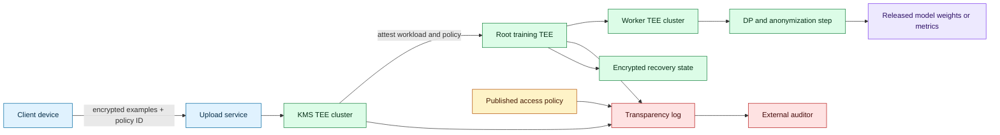
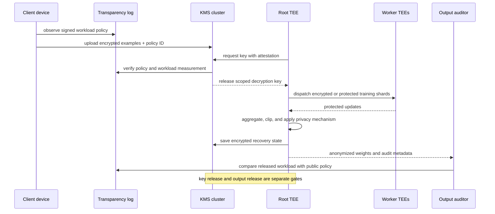

# Verifiable private federated learning with TEE workloads
Status: emerging
Sources: [Toward provably private learning from federated data — Google Research — 2026-10-02](https://www.research.google/blog/toward-provably-private-learning-from-federated-data/), [Toward provably private learning from federated data — arXiv:2609.31494](https://arxiv.org/abs/2609.31494)

## In one sentence

Google’s October federated-learning system moves beyond “trust the server to aggregate correctly” by combining encrypted uploads, policy-gated trusted execution environments, public workload transparency, reproducible builds, and differentially private outputs so external parties can inspect what computation is authorized to touch private data.

## Background: what existed before

Federated learning (FL) trains a shared model from data held across many devices or organizations. Instead of copying every example to a central data lake, a coordinator sends a training workload to clients, clients compute updates locally, and the system aggregates those updates. This can reduce direct data collection and is useful when data is private, distributed, or expensive to move.

Federated learning is not automatically private. A client update can leak information, a coordinator can log raw messages, an operator can change the training code, and a malicious participant can try to infer another participant’s data. Production systems therefore combine data minimization, secure aggregation, differential privacy, access control, retention limits, and auditing.

The original FL mental model placed much of the computation on the device. Device availability varied by time of day, battery, connectivity, hardware, and user settings. Training could take a long time because the server had to wait for enough devices and because each device had limited compute. The coordinator also had to be trusted to run the intended aggregation and privacy logic.

Secure aggregation reduces what the server can see by cryptographically combining client updates, but it does not by itself prove that the server ran the right workload or applied the right noise. Differential privacy gives a mathematical bound on an individual record’s influence, but the guarantee depends on the algorithm, accounting, implementation, and access to the data. Users and auditors still need a way to know which code can process their encrypted examples.

Trusted execution environments (TEEs) provide hardware-backed isolation for code and data on a machine. Remote attestation can let another party verify that an approved binary or measurement is running. TEEs are not magic: they depend on hardware, firmware, attestation roots, key management, side-channel assumptions, and correct application code. But they create a useful control point between “the server operator promises” and “the computation is cryptographically constrained and externally inspectable.”

## What changed and why now

Google Research’s October 2 post announces a new FL system that uses TEEs to provide externally verifiable privacy guarantees while shifting computation to the server. Google says the system is intended to improve training speed, accuracy, and device coverage. It describes a data path in which client devices encrypt training examples and pre-authorize an access policy identifying the TEE computations allowed to process them. Those policies are published to a public transparency log.

The post describes four operational concepts. First, devices upload encrypted data and authorize permitted workloads. Second, a key-management system made from TEE clusters using Raft gives decryption keys only to server workloads matching the access policy. Third, a root data-processing TEE runs a Python training program and delegates parallel subtasks to worker TEEs, with distributed logic expressed using Federated Language. The training loop periodically releases anonymized model weights. Fourth, the program saves KMS-encrypted recovery state at the end of a training round so failures can be recovered without additional privacy leakage.

Google says the KMS and processing binaries can be reproducibly built from open-source code, and that access policies are published to Rekor for external observation. It also says Gboard adopted the system for English and Japanese next-word prediction models. These are source-specific release facts and deployment claims, not independent verification of every privacy or performance property.

The architecture changes the trust boundary. Earlier FL systems could require trust that server-side logic did not log data and correctly added noise. In the described design, the client authorizes a class of workloads, the KMS gates decryption, TEEs constrain execution, and public logs expose the authorized workload set. The goal is not merely to encrypt transport; it is to make the data-to-code relationship auditable.

This lesson is distinct from September’s federated identity propagation. That lesson followed user identity across gateways and clusters. October’s topic is data confidentiality and verifiable execution for distributed learning: which workload can decrypt data, how that authorization is published, what outputs are released, and how the system recovers from failure.

## Impact on current processing and architecture

The system introduces a policy-aware data plane. A device does not simply upload encrypted bytes. It associates the upload with an access policy that names the permitted processing logic. The KMS verifies that a requesting TEE workload matches the policy before releasing a key. The processing TEE decrypts data only inside the protected environment, executes the training program, and emits an anonymized result. A transparency log provides an external record of policies and builds.



The policy must be more precise than “train a model.” It should identify the code or measurement that is allowed to access the data, permitted output classes, retention period, model or task scope, and perhaps resource limits. A policy should be immutable or versioned. If the server changes the training program, it should produce a new measurement and require a new authorization rather than silently reusing old device consent.

The KMS is a policy enforcement point. It must verify the TEE identity, code measurement, policy version, attestation freshness, and authorization before releasing a decryption key. Put this check outside the Python program being authorized. Otherwise, the workload could claim that it followed its own policy. Key release events should be auditable without exposing plaintext data.

The root and worker TEE split changes the processing topology. The root runs the training loop and distributes parallel work. Workers process partitions or subtasks. The system needs a protocol for inputs, intermediate state, aggregation, failure, and output release. A worker failure should not cause the root to release a partial or insufficiently private result. A malicious or compromised worker must not receive keys or intermediate data outside its role.

The post describes dynamic sideloading: proprietary model architecture and preprocessing information can be loaded into a Python program at runtime while privacy-relevant logic remains represented in the access policy. This is a useful separation, but it introduces a review question. Which logic is privacy-relevant? If a sideloaded component can change clipping, noise, sampling, logging, or output release, the public policy no longer fully describes the privacy behavior. Keep privacy-critical code fixed, measured, and auditable.



The output boundary is as important as the input boundary. The training loop may release model weights, metrics, or checkpoints. A model can memorize or reveal information even when the input was encrypted. Apply the stated privacy mechanism inside the TEE, account for composition across rounds, restrict output frequency, and log release decisions. “Only weights are visible” is not a complete privacy claim without the DP and release configuration.

Fault-tolerant recovery needs special care. Google says the system saves KMS-encrypted recovery state at the end of a round. The recovery state should include the minimum needed to resume, be bound to the same workload and policy, and expire when the authorization expires. Replaying a round must not cause duplicate privacy loss without accounting. A crash should not force operators to copy plaintext state out of the TEE.

Moving computation to servers changes cost and availability. It can reduce dependence on device compute and diurnal availability, but it shifts cost to a TEE cluster and introduces attestation, scheduling, memory, and network bottlenecks. TEE capacity can become the limiting resource. Model training may be faster while key management and worker coordination become more complex.

Externally verifiable privacy requires more than a public log. Auditors need to obtain the policy, identify the code measurement, reproduce builds, verify attestation chains, inspect release metadata, and understand the DP accountant. A log proves what was recorded, not that the underlying hardware or code is free from every flaw. Publish enough information for independent verification while protecting proprietary model details.

## Real-world applications and constraints

On-device typing and next-word prediction are natural FL workloads: data is generated on personal devices, training signals are distributed, and the model can improve from aggregate patterns. The source says Gboard adopted the described TEE-based system for English and Japanese models. A production deployment still needs consent controls, deletion semantics, update rollback, and protection against malicious clients.

Healthcare institutions could collaborate on a model without pooling raw records. A policy could restrict processing to a measured training program and release only DP weights. The system would still need institutional governance, clinical validation, data minimization, and careful handling of rare conditions. TEE attestation does not make an unsafe model clinically appropriate.

Companies with sensitive telemetry could use verifiable FL for keyboard, IoT, or application signals. The access-policy log helps organizations show what workloads their data participated in. Retention and policy revocation matter: a device may authorize future workloads for a limited period, and a previously uploaded encrypted example may remain in a training queue.

Cross-organization learning benefits from explicit workload governance. Each participant may have different rules about retention, model purpose, and output. A common policy language and public audit trail can make those differences machine-checkable. The price is coordination: policy versions, key management, attestation roots, and build reproducibility become shared infrastructure.

The constraints are substantial. TEEs have side channels, availability risks, hardware trust assumptions, and limited accelerator integration. Reproducible builds can be difficult for large ML stacks. Attestation does not prove that the model update is useful or fair. Distributed differential privacy accounting remains subtle. A public log may reveal workload metadata even when data remains private.

## Mental model

Think of the system as a capability-based data vault. The encrypted data is locked; the access policy describes which computation may use it; the KMS releases keys only to an attested workload; the TEE provides a protected execution room; the DP mechanism limits what can leave; and the transparency log lets observers inspect the authorized program set.

No single layer is the privacy guarantee. Encryption protects data at rest and in transit. TEEs protect memory and execution under stated hardware assumptions. Attestation connects a workload identity to measured code. Differential privacy limits individual influence. Logs provide auditability. Recovery preserves availability without exporting plaintext. The design is defense in depth with a strong emphasis on verifiable code-to-data authorization.

## What changed this month

Google Research announced the TEE-based FL system on October 2, 2026. The post describes encrypted device uploads, pre-authorized access policies, a TEE KMS using Raft, root and worker TEEs, Federated Language orchestration, encrypted recovery state, public Rekor logging, reproducible builds, and DP model-weight release. Google says the system has been adopted by Gboard for English and Japanese next-word prediction and reports faster training than its prior system.

The engineering consequence is a federated-learning architecture in which privacy policy becomes an externally visible workload artifact. The system shifts computation server-side while attempting to make the processing code and output controls verifiable, trading simpler device execution for TEE capacity, attestation, key-management, and side-channel responsibilities.

## Engineering consequence

Define the access policy as executable governance. It should name the measured workload, data purpose, allowed transformations, output class, retention, and expiry. Publish policy versions to a transparency log and reject key requests that do not match the authorized measurement.

Separate privacy-critical code from model-specific code. Keep clipping, noise, sampling, aggregation, key use, and output release in a reviewed and measured layer. If proprietary model logic is sideloaded, prove that it cannot change privacy-relevant behavior or access unapproved plaintext.

Treat attestation as a runtime dependency. Monitor quote freshness, key-release failures, TEE health, worker membership, and policy mismatches. Have a fail-closed path for unknown measurements and a recovery protocol that does not copy secrets outside the TEE.

Account for outputs and retries. Each training round and model release consumes privacy budget according to the configured mechanism. Recovery must not double count or accidentally release a second result. Store release IDs and DP accounting metadata with the model artifact.

## Limits and failure modes

TEE confidentiality depends on hardware, firmware, attestation infrastructure, and side-channel assumptions. A measured workload can still contain a bug. Public code and reproducible builds improve inspection but do not prove the absence of vulnerabilities.

The access policy may be incomplete. If dynamic sideloading or configuration can change clipping, noise, logging, or output behavior, the policy may not describe the true privacy computation. Keep the trusted computing base small and audit all inputs that affect privacy.

Differential privacy does not make every output harmless. Poor accounting, too many releases, weak parameters, or a model that memorizes population outliers can create risk. Report the mechanism and composition, not only “DP enabled.”

Server-side execution can improve speed while increasing central failure concentration. A KMS outage may block all training. A bad policy rollout can affect every client. Use staged policy versions, rollback, multi-region availability, and explicit expiry.

Federated clients can be malicious or unreliable. They may submit poisoned updates, lie about data, disconnect, or attempt protocol abuse. Secure execution protects server-side data handling but does not replace robustness, anomaly detection, or model-quality evaluation.

Finally, Google’s post reports system properties and deployment claims from the system’s authors. Independent auditors still need to verify build, attestation, policy, and DP behavior in the deployed configuration.

## Mini exercise (15–30 min)

Build a local policy-gated training simulator. Devices encrypt their contribution conceptually by withholding raw rows from the coordinator. A KMS-like function releases data only when the workload measurement matches the device’s policy. The simulator records policy versions, output releases, and recovery attempts, then rejects a changed workload.

## Runnable low-cost example

```python
import hashlib
from dataclasses import dataclass


def measure(workload: str) -> str:
    return hashlib.sha256(workload.encode()).hexdigest()[:12]


@dataclass(frozen=True)
class Policy:
    policy_id: str
    workload_measurement: str
    output_class: str
    expires_round: int


def release_key(policy: Policy, workload: str, round_id: int) -> str:
    if round_id > policy.expires_round:
        raise PermissionError("policy expired")
    if measure(workload) != policy.workload_measurement:
        raise PermissionError("workload does not match policy")
    if policy.output_class != "dp_weights":
        raise PermissionError("unapproved output class")
    return "scoped-key:" + policy.policy_id


approved_workload = "train_v1:clip=1:noise=2"
policy = Policy("p1", measure(approved_workload), "dp_weights", expires_round=3)
assert release_key(policy, approved_workload, 1) == "scoped-key:p1"

try:
    release_key(policy, "train_v2:clip=0:noise=0", 1)
except PermissionError as error:
    print("changed workload rejected:", error)
else:
    raise AssertionError("changed workload must be rejected")

try:
    release_key(policy, approved_workload, 4)
except PermissionError as error:
    print("expired policy rejected:", error)
else:
    raise AssertionError("expired policy must be rejected")
```

## Build it locally

1. Save the example as `policy_gated_fl.py` and run `python3 policy_gated_fl.py`.
2. Add a transparency-log list and append every policy before allowing a key release.
3. Add a `client_id` and ensure a key is scoped to one policy and round.
4. Add a `release_id` so a retry cannot publish the same model update twice.
5. Add a recovery state with a hash and reject recovery under a different workload measurement.
6. Add a privacy-budget field and reject a release that exceeds the configured budget.

## Interview Q&A

**What does a TEE add to federated learning?** It can protect data and code during server-side execution and support remote attestation, allowing a client or auditor to verify the workload identity before key release.

**Does a TEE replace differential privacy?** No. TEEs protect execution under hardware assumptions; DP limits individual influence in released outputs. They address different parts of the threat model.

**Why publish access policies in a transparency log?** It gives clients and auditors an observable record of which workloads may process uploaded data and supports detection of unauthorized policy changes.

**What is the risk of dynamic sideloading?** Proprietary logic can be loaded without revealing it publicly, but if it can change privacy-relevant behavior, the measured policy may not describe the actual guarantee.

**Why does recovery need privacy accounting?** Replaying a training round or releasing a second output can consume additional privacy budget or duplicate effects. Recovery must be bound to a round, policy, and release state.

## Glossary

- **Federated learning:** Collaborative model training across decentralized data holders.
- **Trusted execution environment:** Hardware-backed protected execution region for code and data.
- **Remote attestation:** Evidence that lets a remote party verify a measured workload or platform state.
- **Access policy:** A machine-readable authorization describing which workload may process data and what it may release.
- **KMS:** Key management service controlling decryption-key release.
- **Secure aggregation:** Cryptographic protocol that hides individual client updates while producing an aggregate.
- **Differential privacy:** A formal guarantee limiting the influence of one record on an output.
- **Transparency log:** Append-oriented public record used to observe policy or artifact changes.
- **Sideloading:** Loading runtime data or proprietary logic into an already measured program.

## References

- [Toward provably private learning from federated data — Google Research — 2026-10-02](https://www.research.google/blog/toward-provably-private-learning-from-federated-data/)
- [Toward provably private learning from federated data — arXiv:2609.31494](https://arxiv.org/abs/2609.31494)
- [Confidential Federated Compute — GitHub](https://github.com/google-parfait/confidential-federated-compute)
- [Rekor transparency log documentation](https://docs.sigstore.dev/logging/overview/)

## Claim ledger

| Claim | Source | Fact or inference |
|---|---|---|
| Google Research announced the system on October 2, 2026. | Google Research post | Fact |
| The system uses TEEs and shifts computation to the server. | Google Research post | Fact |
| Devices upload encrypted examples and pre-authorize access policies. | Google Research post | Fact |
| The KMS uses a TEE cluster implementing Raft and releases keys to matching workloads. | Google Research post | Fact about the described architecture |
| The system uses root and worker TEEs, Federated Language, and encrypted recovery state. | Google Research post | Fact about the described architecture |
| Policies are published to Rekor and binaries can be reproducibly built from open source. | Google Research post | Fact about the described system |
| Gboard adopted the system for English and Japanese next-word prediction models. | Google Research post | Fact about Google’s deployment claim |
| TEEs do not eliminate hardware, firmware, side-channel, or application-code risk. | TEE security reasoning and source caveat | Engineering inference |
| A policy log is useful only when it is connected to key release and output-release enforcement. | Access-control systems reasoning | Engineering inference |
