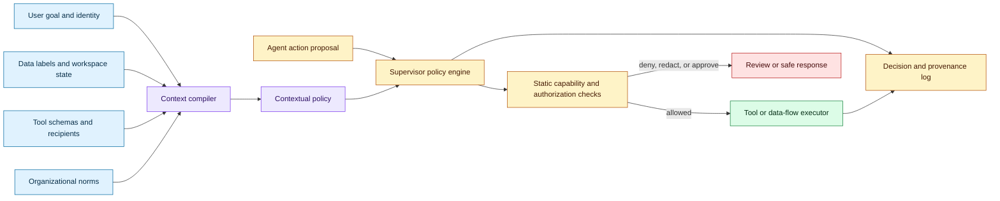
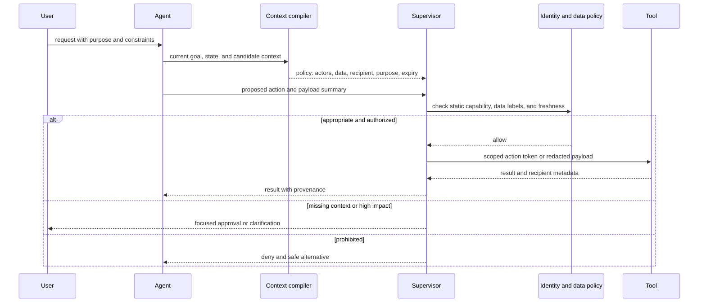

# Contextual policy engines for agentic privacy and security
Status: emerging
Sources: [Open and Emergent Problems in Agentic Privacy and Security: A Contextual Angle — Google Research — 2026-10-05](https://www.research.google/blog/open-and-emergent-problems-in-agentic-privacy-and-security-a-contextual-angle/)

## In one sentence

Google’s October CAPS workshop report argues that agent authorization must evaluate whether a proposed data flow or action is appropriate for the current context—not merely whether a static permission exists—and sketches a supervisor policy engine that generates and enforces context-specific rules before execution.

## Background: what existed before

Traditional software authorization usually starts with a stable subject, resource, action, and policy. A user has a role, a service has a token, and an API checks whether the subject may perform an operation on a resource. Privacy controls often add consent, purpose, retention, and data classification. These controls work best when the application knows the workflow in advance and the number of actions is bounded.

Agentic systems make the boundary more fluid. An agent receives a natural-language request, reads documents, calls tools, delegates subtasks, and chooses a sequence of actions. The same data may be appropriate in one context and inappropriate in another. A user may authorize a travel assistant to share passport information with an airline, but not with a hotel mailing list. A support agent may read a private ticket to draft a response, but not copy the ticket into a public issue. A calendar assistant may see event details to find a conflict, but not disclose the event title to another attendee.

Role-based access control can answer “can this principal call this endpoint?” It may not answer “should this information flow to this recipient for this purpose at this moment?” Attribute-based policies add context such as time, resource tags, and location, but hand-written rules become difficult to maintain as tools and workflows expand. Consent screens ask users to make fine-grained choices, but people cannot predict every action an autonomous agent may take over a long task.

The privacy theory of contextual integrity provides a useful framing. Privacy is not only secrecy or individual control; it is appropriate information flow according to norms for a context. A norm describes who sends information about whom, what type of information it is, who receives it, and under what transmission principle. A system can therefore treat an action as a candidate data-flow event and ask whether it is appropriate, rather than reducing privacy to a static list of allowed resources.

The older security architecture also assumed mostly deterministic control flow. An application developer could enumerate routes, test them, and review privileged calls. A model can generate a plan whose path is probabilistic, change strategy after a tool error, or delegate a subtask to another agent. Testing every complete path is infeasible. Policy checks need to sit at action boundaries and reason over the current context.

## What changed and why now

Google Research published “Open and Emergent Problems in Agentic Privacy and Security: A Contextual Angle” on October 5, 2026. The report came from the Contextual Agent Privacy and Security workshop and involved more than 50 academic and industry leaders, according to the post. It identifies three agentic dimensions that create security and privacy challenges: unstructured interfaces and ambiguous inputs, probabilistic control flows, and autonomy and delegation.

The report applies contextual integrity to agent actions. It describes actors, information types, and transmission principles as a way to specify context-specific norms. It gives the example that a user may share a gift-shopping list with a shopping assistant but not with family and friends. The report extends the idea from information sharing to contextual security: whether an agent action is appropriate in its context.

The proposed operational mechanism is a contextual policy engine in a supervisor layer. Google describes a dynamic policy-generation loop that tailors policy to the user request and changing context, including tools and capabilities discovered at runtime. The engine evaluates whether a data flow is appropriate before information leaves the user’s workspace. The report also calls for system-level sandboxing, model-level reasoning, user-centric controls, multi-agent guardrails, ecosystem governance, and dynamic multi-agent evaluation environments.

This is a research direction, not a finished product specification. The report identifies open problems and proposed layers; it does not prove that a model-generated policy is correct or that contextual norms can be inferred reliably from a prompt. The engineering lesson is to add an explicit context-policy object and supervisor decision to an agent architecture, while keeping static permissions and server-side authorization as non-negotiable backstops.

The topic is distinct from September’s permission-preserving data agents and June’s policy enforcement points. Those lessons focus on governed data access and enforcement locations. This lesson focuses on the missing semantic layer: representing purpose, actors, recipients, information types, and transmission norms as a policy that changes with the task context.

## Impact on current processing and architecture

The architecture adds a context compiler before tool execution. The compiler receives the user goal, authenticated identity, active workspace, data classifications, tool metadata, current state, and organization norms. It emits a contextual policy with allowed flows, prohibited recipients, required approvals, expiration, and an explanation record. The agent proposes an action. The supervisor evaluates the action against the contextual policy and static capability policy. Only an allowed action reaches the tool.



The contextual policy should be structured, not only prose. A possible record contains:

```json
{
  "purpose": "book a conference flight",
  "actors": {"sender": "user", "subject": "user", "recipient": "airline"},
  "information_types": ["name", "passport_number", "travel_dates"],
  "principles": ["purpose_limited", "minimum_necessary", "user_approval"],
  "allowed_tools": ["airline_booking_api"],
  "expires_at": "2026-10-10T18:00:00Z"
}
```

This is an illustrative engineering schema, not a schema published by Google. It makes the policy testable. The supervisor can ask whether a proposed payload contains only the allowed information types, whether the recipient matches, whether the purpose is still active, and whether the action requires approval. A prose explanation can accompany the record but should not be the only enforcement input.

Static capabilities remain necessary. The contextual policy might say that sending a passport number to an airline is appropriate, but the service account still needs an explicit permission for that airline endpoint. Conversely, a static token may permit a CRM write while the current purpose policy forbids it. The effective permission is the intersection of identity authorization, capability scope, contextual norm, data classification, and freshness.

The system must represent uncertainty. Context inference can be wrong because the user’s request is ambiguous, a document is untrusted, a tool’s recipient is misdescribed, or a model fails to identify sensitive data. The engine should return `allow`, `deny`, `redact`, `approval_required`, or `insufficient_context`, not force a binary choice. A safe fallback can ask a focused question: “May I send your passport number to this airline for this booking?”

Dynamic policy generation creates a new trust boundary. If the model proposes the policy and the action, it may rationalize its own overreach. Use a separate policy compiler or constrained model, retrieve organization rules from a trusted store, and apply deterministic checks for recipient, data class, purpose, and expiry. The policy engine should not be able to grant a capability that the identity and tool layers do not already permit.



The action token should be narrow and short-lived. Bind it to policy version, user, tool, recipient, resource, payload hash, and expiry. A token issued for reading a calendar should not authorize sending an email. A retry should not reuse a token if the purpose or resource version changed. The tool should revalidate the token server-side rather than trusting the supervisor’s client message.

Multi-agent delegation makes context propagation harder. A parent agent may delegate a subtask to a specialist. The child must receive the purpose, data scope, recipient restrictions, expiry, and prohibition on further delegation unless explicitly allowed. Do not pass a broad identity token and expect the child to infer the parent’s norms. Record the delegation chain and require the child’s action to fit within the parent’s policy.

Logs need to capture context without creating a new privacy leak. Store policy version, decision, data classes, recipient class, tool, action hash, reason code, and approval reference. Avoid raw sensitive values. A reviewer should be able to reconstruct why an action was allowed without seeing the passport number or entire private document.

## Real-world applications and constraints

A travel assistant illustrates contextual policy well. The agent may use a traveler’s name, dates, and passport details to book a flight, but the appropriate recipient is the airline booking service, not an analytics vendor. The purpose expires after booking. A hotel or visa workflow may require a different recipient and a new approval. Static roles alone cannot encode this relationship cleanly.

An enterprise data agent can summarize a confidential project for an internal team. It may share aggregated status with a manager but not raw customer records with a broad channel. The contextual policy can enforce purpose limitation, minimum necessary fields, and recipient scope. Row and column permissions remain the data-layer enforcement; context determines whether the current use is appropriate.

A coding agent may read a repository and open a pull request. It may be allowed to write to a branch but not production, reveal secrets, or upload private code to an external debugging service. A context policy can bind the task purpose and destination while a sandbox restricts filesystem and network capabilities. Generated patches should include provenance and require review before merge.

A multi-agent research workflow may delegate literature retrieval, data cleaning, and analysis. Each child agent should receive a bounded purpose and data scope. The parent should not be able to delegate a secret to a child whose tool policy permits external upload. Context propagation and revocation become central.

The constraints are social as much as technical. Norms differ between organizations, cultures, domains, and individuals. A policy engine may encode a company rule that a user considers surprising. Users need understandable controls and a way to correct policy assumptions. An automatic “privacy score” can create false reassurance if the underlying norm is wrong.

There is also a latency and complexity cost. Compiling context, classifying data, checking recipients, and obtaining approval adds work to every action. Cache only stable policy fragments; re-evaluate dynamic context and high-impact actions. Explain denials without exposing sensitive policy details that would help bypass them.

## Mental model

Think of contextual policy as a type system for information flows and actions. A value is not just a string; it has a data class, subject, purpose, and allowed recipients. An action is not just an API call; it has an actor, resource, side effect, and context. The supervisor checks whether the proposed flow type-checks under current norms and static permissions.

This is a complement to authorization, not a replacement. Role checks answer whether a principal may access a capability. Context checks answer whether using that capability for this purpose and recipient is appropriate now. Sandboxing limits impact if both checks fail. Human approval handles cases where context cannot be inferred safely.

## What changed this month

Google Research published the CAPS workshop report on October 5, 2026. It frames agentic privacy and security around ambiguous inputs, probabilistic control flows, and autonomy or delegation. It applies contextual integrity to data flows and actions, proposes dynamic contextual policy engines in a supervisor layer, and calls for layered system, model, user, multi-agent, ecosystem, and evaluation research.

The engineering consequence is a richer policy object between an agent plan and a tool call. The object carries actors, information types, recipient, purpose, transmission principles, scope, expiry, and approval state. It must be enforced alongside static authorization and sandboxing.

## Engineering consequence

Represent context explicitly in the action protocol. Require each proposal to declare purpose, actor, recipient, data classes, resource, and expected side effect. Reject proposals that omit material fields for high-impact operations. Do not infer authority from a natural-language justification alone.

Compile dynamic policy from trusted inputs. User intent, organization norms, data labels, tool metadata, and identity should come from separate channels with provenance. A model may summarize or propose a policy, but deterministic checks must enforce recipient, data, expiry, and capability constraints.

Use narrow action tokens. Bind them to a policy version, payload hash, resource version, and expiration. Revalidate at the tool boundary. Propagate a reduced scope to child agents and record the delegation chain.

Measure context-policy performance. Track allow, deny, redact, approval, and insufficient-context rates; false allows and false denies; clarification turns; policy compilation latency; and user corrections. Evaluate with scenario matrices where the same tool call is appropriate in one purpose and inappropriate in another.

## Limits and failure modes

Context is difficult to infer from ambiguous language, images, retrieved content, or changing user goals. Treat insufficient context as a state that triggers clarification or review. Do not silently choose a permissive interpretation.

A model-generated policy can rationalize an action it already wants to take. Separate policy generation from action planning, retrieve norms from trusted sources, and enforce a static intersection. Never let a contextual policy grant broader authority than the identity or tool layer.

Data classification can fail. Sensitive values may be hidden in free text, images, code, or metadata. Use layered classifiers and deterministic labels where possible, but include residual-risk handling and human review for uncertain high-impact flows.

Contextual norms can conflict. A user preference may conflict with an organization policy, a legal requirement, or a recipient’s contract. Define precedence and surface the conflict. Do not resolve it by silently choosing the most permissive rule.

Multi-agent delegation can leak scope. Propagate purpose, recipient restrictions, expiry, and non-delegation rules. Revoke child tokens when the parent task ends or the user changes direction.

Finally, contextual policy engines can produce confirmation fatigue. If every low-risk action asks the user, people approve blindly. Use risk tiers, grouped previews, and clear explanations while reserving blocking approvals for meaningful side effects.

## Mini exercise (15–30 min)

Build a policy checker for synthetic travel and support tasks. Represent each proposed flow with actor, subject, information type, recipient, purpose, and action. Allow only flows that match the context policy and static capability set; return `approval_required` for high-impact operations and `insufficient_context` when purpose or recipient is missing.

## Runnable low-cost example

```python
from dataclasses import dataclass


@dataclass(frozen=True)
class Flow:
    actor: str
    subject: str
    info_type: str
    recipient: str
    purpose: str
    action: str


ALLOWED = {
    ("user", "user", "passport", "airline", "book_flight", "submit")
}


def decide(flow: Flow, high_impact: bool = False) -> str:
    key = (flow.actor, flow.subject, flow.info_type, flow.recipient, flow.purpose, flow.action)
    if not flow.purpose or not flow.recipient:
        return "insufficient_context"
    if key not in ALLOWED:
        return "deny"
    if high_impact:
        return "approval_required"
    return "allow"


cases = [
    Flow("user", "user", "passport", "airline", "book_flight", "submit"),
    Flow("user", "user", "passport", "marketing_vendor", "book_flight", "submit"),
    Flow("user", "user", "passport", "airline", "", "submit"),
]

assert decide(cases[0]) == "allow"
assert decide(cases[0], high_impact=True) == "approval_required"
assert decide(cases[1]) == "deny"
assert decide(cases[2]) == "insufficient_context"
for case in cases:
    print(case.recipient, case.purpose or "missing-purpose", decide(case))
```

## Build it locally

1. Save the example as `context_policy.py` and run `python3 context_policy.py`.
2. Add a `data_minimization` field and reject a flow that includes unnecessary information.
3. Add `expires_at` and reject an expired policy.
4. Add a static capability set and require both contextual allow and static permission.
5. Add a child-agent flow and require its purpose to be a subset of the parent purpose.
6. Log policy version, decision, and a payload hash without logging the sensitive value itself.

## Interview Q&A

**How does contextual policy differ from RBAC?** RBAC asks whether a principal has a role permission. Contextual policy also considers purpose, actors, information type, recipient, transmission rule, freshness, and current situation.

**Should the model generate the policy?** It may help translate intent into a candidate policy, but trusted rules and deterministic enforcement must constrain it. A model should not grant itself new capabilities.

**Why is a supervisor needed?** It creates an enforcement point between an agent proposal and an external effect. The supervisor can apply contextual and static policies, redact data, require approval, and record provenance.

**What should happen when context is ambiguous?** Return `insufficient_context`, ask a focused clarification, or escalate. Do not choose the most permissive interpretation by default.

**How do multi-agent systems preserve privacy norms?** Propagate purpose, data scope, recipient restrictions, expiry, and delegation limits in a narrow child policy, then recheck every child action at the tool boundary.

## Glossary

- **Contextual integrity:** A privacy theory focused on appropriate information flows according to context-specific norms.
- **Contextual policy:** A structured rule describing whether a data flow or action is appropriate for the current actors, purpose, data, and recipient.
- **Supervisor layer:** An enforcement component between agent proposals and tool or data execution.
- **Transmission principle:** A rule governing an information flow, such as confidentiality, consent, or purpose limitation.
- **Purpose limitation:** Restricting use of information to the purpose for which it was authorized.
- **Context compiler:** A component that turns intent, state, data labels, tools, and norms into a machine-readable policy.
- **Action token:** A narrow, short-lived authorization bound to a specific action and context.
- **Confirmation fatigue:** Reduced attention or blind approval caused by too many confirmation requests.
- **Delegation chain:** The recorded sequence of parent and child agents involved in a task.

## References

- [Open and Emergent Problems in Agentic Privacy and Security: A Contextual Angle — Google Research — 2026-10-05](https://www.research.google/blog/open-and-emergent-problems-in-agentic-privacy-and-security-a-contextual-angle/)
- [Contextual Integrity — Helen Nissenbaum](https://nissenbaum.tech.cornell.edu/)
- [OWASP Agentic AI Threats and Mitigations](https://genai.owasp.org/)
- [OAuth 2.0 Security Best Current Practice](https://datatracker.ietf.org/doc/html/rfc9700)

## Claim ledger

| Claim | Source | Fact or inference |
|---|---|---|
| Google Research published the report on October 5, 2026. | Google Research post | Fact |
| The report identifies ambiguous inputs, probabilistic control flows, and autonomy/delegation as agentic challenges. | Google Research post | Fact |
| The report applies contextual integrity to agent information flows and actions. | Google Research post | Fact about the report’s framing |
| The report proposes a dynamic contextual policy engine in a supervisor layer. | Google Research post | Fact about the proposed direction |
| The report calls for layered system, model, user, multi-agent, ecosystem, and evaluation research. | Google Research post | Fact about the report’s recommendations |
| Contextual policy should intersect with static capability authorization rather than replace it. | Authorization architecture reasoning | Engineering inference |
| Action tokens should bind recipient, purpose, payload, resource version, and expiry. | Least-privilege and replay-prevention reasoning | Engineering inference |
