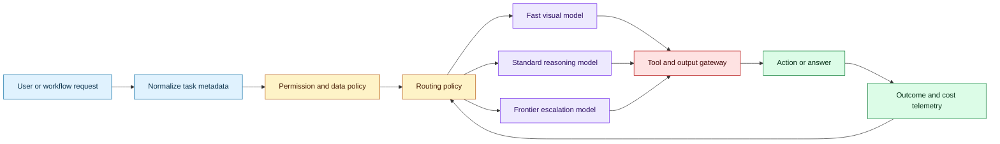
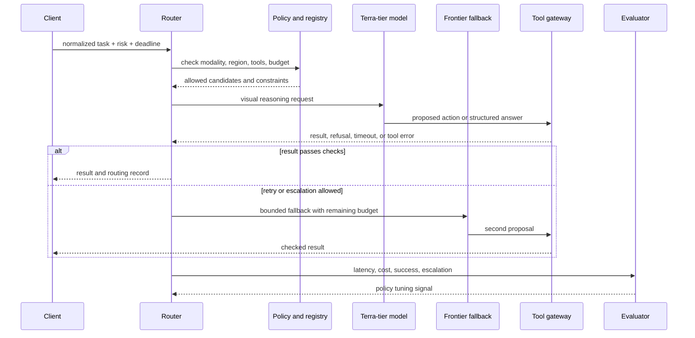

# Model routing for visual reasoning and computer use
Status: emerging
Sources: [Introducing GPT-6.1 Terra — OpenAI — 2026-10-26](https://openai.com/index/introducing-gpt-6-1-terra/)

## In one sentence

Model routing turns a heterogeneous model family into an operational decision system that sends each visual or computer-use task to a model whose capability, latency, and cost fit the task’s risk.

## Background: what existed before

Many early AI applications treated model choice as configuration: an engineer selected one model, placed its identifier in an environment variable, and sent every request through the same path. That approach is simple to deploy and easy to reason about, but it assumes that the workload has one stable requirement. Real applications do not. A support assistant may answer a short text question, read a scanned invoice, operate a browser, and inspect a technical drawing within the same hour. Those jobs differ in input modality, tool permissions, latency tolerance, error cost, and required reasoning depth.

Computer-use agents make the mismatch more visible. A text completion can be judged after the response arrives. A desktop agent must perceive a screen, identify controls, choose an action, execute it, observe the new state, and recover from errors. A model that is excellent at summarization may be poor at coordinate grounding or state tracking. A powerful frontier model may solve the task but cost too much for thousands of low-risk requests. A small fast model may be cheap but create more retries, which can make the whole workflow slower and more expensive.

Before model routing, teams commonly built separate applications for separate model tiers. That duplicates prompts, tool adapters, telemetry, and policy logic. It also makes migration difficult: changing the model changes behavior in many places, while the team may not know which workload actually benefits from the upgrade. A router creates a stable control-plane boundary between the task and the model implementation.

Routing is not merely load balancing. Load balancing distributes similar work across equivalent workers. Model routing selects among workers with different capabilities and failure modes. The router therefore needs a task description, a policy, a model registry, and feedback from completed work.

## What changed and why now

OpenAI’s October 26 release describes GPT-6.1 Terra as a fast model combining detailed visual reasoning and precise computer use with lower standard API prices than the previous Terra and Sol models. The release reports vendor measurements on professional-task, visual-reasoning, desktop-agent, and coding benchmarks, and exposes the model as `gpt-6.1-terra`. Those measurements are release-specific claims, not independent verification.

The engineering change is the widening of the useful middle tier. If a model can perform visual and computer-use work at materially lower latency and price than a frontier model, an application can route routine visual tasks to it and reserve the expensive model for ambiguous, high-impact, or failed cases. That changes the architecture from “one model per product” to “policy-controlled model portfolio.”

The important consequence is not that every task should use Terra. It is that model identity becomes a decision variable. A router can consider modality, task class, confidence, deadline, user tier, data residency, tool scope, and recent failure history. The output is a model choice plus an explanation of why that choice was permitted.

## Impact on current processing and architecture

The router should sit before the model gateway but after request normalization and policy checks. Normalization extracts features without sending sensitive content to an unapproved classifier. For example, it can record whether the request contains an image, whether a browser tool is requested, the maximum allowed latency, and whether the action can change an external system. A registry describes each model’s supported modalities, context limit, price, latency envelope, geographic availability, and safety restrictions.



The router’s contract should be explicit. Given a normalized task and current policy version, it returns a selected model, allowed tools, a fallback chain, a budget, and a decision record. The model gateway must reject a response that violates the selected contract. For computer use, the model should not receive a browser or shell tool merely because it was selected for visual reasoning. Capability selection and authority selection are related but separate decisions.

The most useful routing features are operational rather than semantic. `has_image` and `requires_screen_action` are easy to audit. `risk_class` should come from the application’s policy rather than the model’s own claim. `deadline_ms`, `max_cost_cents`, and `data_region` convert product requirements into enforceable constraints. A router may also use a calibrated difficulty estimate, but it should treat that estimate as uncertain and retain a safe fallback.



Fallback is a state machine, not a recursive retry loop. A visual task may go from fast model to standard model after one schema failure, then to a human after an external side effect is requested. Each transition consumes a budget and records a reason. If a browser action fails because the page changed, retrying with a stronger model may help. If it fails because authorization is missing, a stronger model must not be allowed to bypass the denial.

Caching becomes more nuanced under routing. Cache keys must include the model contract, prompt version, image fingerprint, tool schema, and policy version. A result produced by a cheap model should not silently satisfy a request whose required quality tier has changed. For screen actions, caching the answer may be unsafe because the screen is stateful; cache perception features or intermediate summaries only when their freshness is known.

Observability should compare routes, not only models. Record request class, selected model, fallback count, time to first token, time to action, total latency, input and output tokens, tool failures, human escalation, and final task outcome. A router that lowers average price while increasing failed transactions is not an optimization. Segment results by task family because aggregate success can hide a severe regression in one workflow.

## Real-world applications and constraints

Invoice processing is a good low-risk starting point. A fast visual model can read routine invoices and emit a typed record. Low confidence, unusual layouts, or mismatched totals can route to a stronger model or human review. The accounting system should receive only schema-validated fields, and the router should record the image hash and policy version used for extraction.

Technical-drawing workflows require a different boundary. A model may interpret a drawing and propose a 3D operation, but the CAD tool should validate units, coordinate systems, and allowable geometry. Routing can select a cheaper model for classification and a stronger model for ambiguous geometry. The tool gateway remains responsible for preventing an invalid or destructive operation.

Browser automation benefits from fast perception for repetitive navigation and escalation for unusual page states. The application should use DOM or accessibility-tree evidence when available rather than relying only on pixels. A router must understand that a login, payment, deletion, or message-sending action has a higher risk class than opening a read-only page.

Customer support can route text-only questions to a low-latency model and image-bearing troubleshooting cases to a visual model. But the response policy should not infer that a visual model is authorized to issue a refund. The business system remains the source of truth for account state and approval limits.

The largest constraint is measurement quality. Vendor benchmark scores may not predict a product’s task distribution, and model names do not define a stable capability boundary. Build a small representative evaluation set with real input shapes, tool errors, ambiguous states, and policy-sensitive actions. Use shadow routing before changing production traffic: run the candidate model without allowing it to act, compare outputs, and estimate cost and latency.

## Mental model

Think of a model router as a database query planner with safety gates. The request is a query, the model registry is a catalog, the routing policy is an optimizer, and the tool gateway is an authorization boundary. The optimizer may choose a cheap plan for a simple query, but it cannot choose a plan that violates transaction semantics. Likewise, the router may choose a fast model, but it cannot select one that lacks required modality, region, or safety properties.

## What changed this month

The October release makes visual reasoning and computer use available in a lower-cost, faster model tier, according to the publisher’s description and measurements. The practical shift is portfolio design: applications can separate routine perception and action from hard reasoning and use escalation as a controlled exception path.

## Engineering consequence

Create a model registry before adding routing rules. Store capability declarations, pricing snapshots, latency observations, availability, supported tools, and policy restrictions as versioned data. Define route classes such as `read_only_visual`, `screen_navigation`, `external_side_effect`, and `high_consequence_review`.

Start with deterministic rules. Route by modality and risk, then add calibrated difficulty only after collecting outcome data. Keep the first version explainable: the decision record should state which rule matched, which candidates were rejected, and why a fallback was or was not allowed.

Set separate budgets for model cost, wall-clock time, and action attempts. A fallback should not turn one request into an unbounded cascade. For side effects, require a confirmation or approval state independent of the model’s confidence.

Evaluate the routing policy on a fixed task set and replay set. Compare success, unsafe-action rate, latency, cost, and human review rate. A route change is a production code change because it changes behavior, spend, and authority distribution.

## Limits and failure modes

Vendor benchmark claims may not transfer to your task distribution. Reproduce representative tasks and treat release scores as directional evidence.

Routing can amplify classifier mistakes. If a difficulty estimator labels a dangerous task as easy, the cheapest model receives the most authority. Use conservative defaults and make risk a hard constraint.

Fallback loops can multiply cost and latency. Bound attempts, preserve the original error, and terminate in a clear state rather than retrying indefinitely.

Model availability and pricing change. Keep registry data time-stamped and test behavior when a model is unavailable, region-restricted, or rate-limited.

Different models may produce incompatible tool arguments or refusal styles. Validate structured outputs at the gateway and maintain model-specific adapters behind a common contract.

Finally, lower cost can increase volume enough to raise total spend. Measure demand elasticity and downstream transaction cost, not only per-token price.

## Mini exercise (15–30 min)

Implement a deterministic router for four task classes: text answer, image extraction, read-only browser action, and payment action. Give each class a different allowed model tier and fallback budget. Run a synthetic workload and compare total cost, latency, and escalation count when the router is conservative versus when it routes every task to the cheapest tier.

## Runnable low-cost example

```python
from dataclasses import dataclass


@dataclass(frozen=True)
class Task:
    kind: str
    risk: str
    deadline_ms: int
    has_image: bool = False


@dataclass(frozen=True)
class Route:
    model: str
    tools: tuple[str, ...]
    max_attempts: int


def route(task: Task) -> Route:
    if task.risk == "external_side_effect":
        return Route("frontier-review", ("approval",), 1)
    if task.has_image or task.kind == "computer_use":
        if task.deadline_ms < 1500:
            return Route("fast-visual", ("read_screen",), 2)
        return Route("standard-visual", ("read_screen",), 2)
    return Route("text-fast", (), 1)


def main() -> None:
    tasks = [
        Task("invoice", "read_only", 1200, has_image=True),
        Task("computer_use", "read_only", 2200),
        Task("payment", "external_side_effect", 5000),
        Task("question", "read_only", 800),
    ]
    routes = [route(task) for task in tasks]
    assert routes[0].model == "fast-visual"
    assert routes[2].tools == ("approval",)
    print(routes)


if __name__ == "__main__":
    main()
```

## Build it locally

1. Save the example as `router.py` and run `python3 router.py`.
2. Add a model registry containing price, region, modality, and observed latency.
3. Add a policy rule that rejects any route lacking the requested data region.
4. Add a bounded fallback from `fast-visual` to `standard-visual` after a schema error.
5. Generate 100 synthetic tasks and record route, attempts, and estimated cost.
6. Change the workload mix and check whether lower unit cost actually lowers total cost.
7. Add a side-effect task and verify that no model route can bypass the approval tool.

## Interview Q&A

**How is model routing different from load balancing?** Load balancing spreads equivalent work across equivalent workers. Model routing selects among models with different capabilities, costs, and authority constraints.

**What should be a hard routing constraint?** Required modality, data region, tool permission, risk class, and maximum budget should be hard constraints. Difficulty estimates are softer signals.

**Why is fallback a state machine?** Each retry changes cost, latency, and possibly authority. Explicit states prevent recursive retries and make escalation auditable.

**How do you evaluate a router?** Use representative tasks and measure final success, unsafe actions, latency, total cost, tool errors, and human escalation by task class.

**Can a stronger model replace policy checks?** No. Model capability is not authorization. The gateway and business system must enforce permissions independently.

## Glossary

- **Model routing:** Selecting a model for a request using task and operational policy.
- **Model registry:** Versioned metadata describing model capabilities, cost, latency, and restrictions.
- **Fallback:** A bounded transition to another model or human path after a defined condition.
- **Tool gateway:** The service that validates and authorizes model-proposed tool calls.
- **Risk class:** An application-owned category describing potential consequence of an action.
- **Shadow routing:** Running a candidate route for observation without allowing it to affect production state.
- **Calibration:** Measuring whether a confidence or difficulty estimate matches observed outcomes.
- **Side effect:** A change to an external system, such as sending, deleting, purchasing, or updating data.

## References

- [Introducing GPT-6.1 Terra — OpenAI — 2026-10-26](https://openai.com/index/introducing-gpt-6-1-terra/)
- [Agents’ Last Exam — benchmark context](https://openai.com/index/introducing-gpt-6-1-terra/)
- [OpenAI model documentation](https://developers.openai.com/api/docs/models)

## Claim ledger

| Claim | Source | Fact or inference |
|---|---|---|
| GPT-6.1 Terra is described as combining visual reasoning, computer use, and writing. | OpenAI release | Fact |
| OpenAI reports lower standard API prices than GPT-5.6 Terra and GPT-6.1 Sol. | OpenAI release | Fact about the publisher’s pricing claim |
| OpenAI reports benchmark results on Agents’ Last Exam, MMMU-Pro, OSWorld 2.1, and coding evaluations. | OpenAI release | Fact about the publisher’s measurements |
| `gpt-6.1-terra` is listed as an API model. | OpenAI release | Fact |
| A lower-cost capable tier makes portfolio routing more useful. | Model-portfolio reasoning | Engineering inference |
| Tool authority must remain separate from model selection. | Systems and security design | Engineering inference |
| Route decisions should be versioned and evaluated like production code. | Operations design | Engineering inference |
