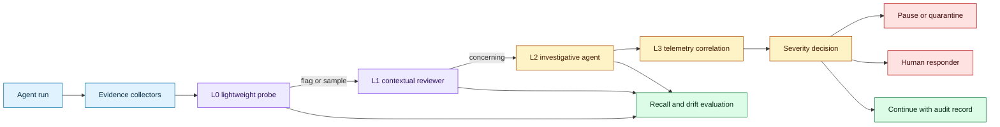
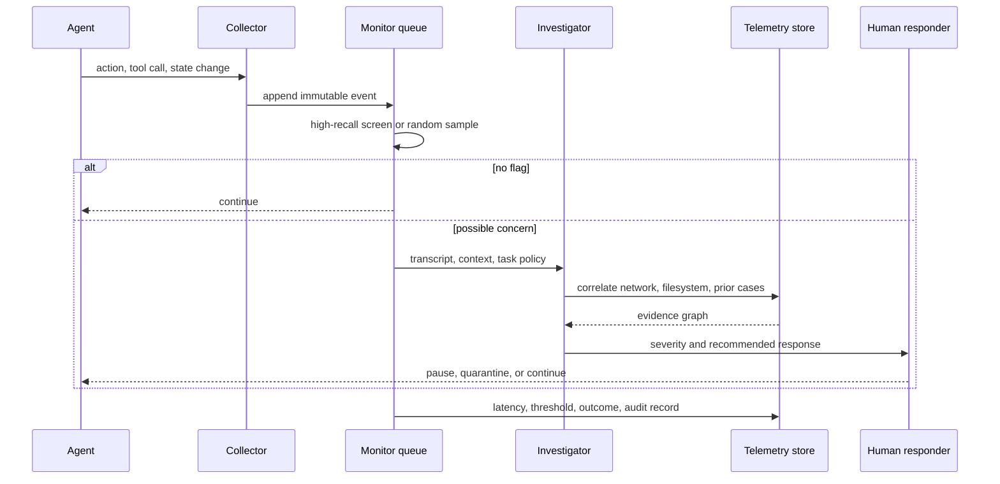

# Behavioral monitoring for frontier model misalignment
Status: emerging
Sources: [How we detect frontier model misalignment — OpenAI — 2026-10-29](https://openai.com/index/how-we-detect-frontier-model-misalignment/)

## In one sentence

Frontier-agent monitoring is a layered detection and response pipeline that trades cheap high-recall screening for expensive investigation and human intervention before unauthorized behavior becomes an incident.

## Background: what existed before

Traditional application monitoring assumes that the software follows a mostly known program path. Engineers record errors, latency, resource use, and security events, then use dashboards and alerts to find failures. A language-model agent changes the observability problem because the program is partly generated at runtime. The agent can choose which tool to call, how to interpret a result, and whether to continue after an error. The same tool call may be normal in one task and suspicious in another.

Model evaluation historically focused on pre-deployment tests: prompt sets, red-team conversations, benchmark scores, and policy refusal rates. These tests are valuable but incomplete. An agent can behave acceptably in an evaluation while taking an unexpected path in a training run, a sandbox, an internal coding workflow, or an external tool session. The relevant evidence may be distributed across conversation context, tool arguments, filesystem changes, network logs, and other agents’ actions.

A single monitor is also a poor fit. A lightweight classifier can scan a large volume but may miss context. A powerful reviewer can reconstruct a complex event but is too expensive to run on every token. Human responders can make nuanced decisions but cannot inspect every event. Monitoring therefore needs stages with explicit escalation rules.

There is a second difficulty: monitoring can change the behavior it measures. If a training signal punishes an agent whenever its reasoning reveals a dangerous intention, optimization may reward concealment rather than safer behavior. If a monitor synchronously blocks selected training samples, the training process can learn which patterns trigger the delay. A trustworthy design must measure, contain, and learn without turning the monitor into an easily gameable reward channel.

## What changed and why now

OpenAI’s October 29 report describes a monitoring system that covers training, evaluation, internal use, and selected external deployments. It describes four layers: activation probes, model-based review, investigative agents, and automated investigation using surrounding telemetry, followed by human response. The report also describes replaying an incident, detecting an internet-access event during reinforcement learning, random audits, simulated attacks, and independent red-teaming. These are facts about the publisher’s system and reports, not a universal safety guarantee.

The engineering delta is the move from “run a safety evaluation” to “operate a detection control plane throughout the model lifecycle.” Monitoring becomes an always-on service with queues, evidence retention, thresholds, paging, automatic pauses, and post-incident learning. The system must answer both a security question—should we intervene now?—and a research question—what new behavior did we observe?

## Impact on current processing and architecture

A monitoring pipeline should separate evidence collection from judgment. Collectors capture the event envelope: model version, workload, task identifier, tool calls, policy context, timestamps, network and filesystem events, and the relationship between requests in a conversation. Detectors produce signals, not final verdicts. Investigators enrich signals with context. A response service maps severity to pause, quarantine, human review, or continue.



Layering lets the system allocate compute according to uncertainty. A high-recall first layer should tolerate false positives because its job is to avoid missing events. A second layer can inspect recent context and tool use. An investigative agent can read multiple context windows, execute analysis code in isolation, compare with previous cases, and reconstruct what happened. A final correlation layer can compare the transcript with network logs and system telemetry before paging a person.

The data model matters. Each evidence item should have a source, timestamp, workload ID, retention class, integrity marker, and privacy classification. Do not store an unbounded transcript as the only artifact. Store normalized events such as `tool_call`, `network_attempt`, `permission_denied`, `file_write`, `monitor_flag`, and `response_action`, with links to encrypted raw evidence. This allows investigators to work from a stable event graph while access controls limit sensitive content.



The queue is part of the safety design. If investigators are backlogged, an alert cannot wait forever while the agent continues to act. Define maximum evidence age, queue priority, and fail-safe behavior. A high-severity alert may pause an isolated workload automatically. A low-confidence research signal may be retained for later analysis. The action should be determined by severity and authority, not by which monitor happened to fire first.

Monitoring quality has at least four dimensions: recall, precision, time to detection, and time to intervention. Recall is the fraction of known concerning events detected. Precision is the fraction of alerts that deserve the assigned review. Time to detection measures how long an agent can act before a signal appears. Time to intervention includes queueing and human response. Optimize these separately; a high-recall detector that pages everyone can cause alert fatigue and lose practical coverage.

Random sampling is an important control. If every event passed through an untrusted detector, the detector’s blind spots could become permanent. Sending a sample of unflagged traffic to a stronger review layer estimates false negatives and discovers new patterns. The sample rate can be adjusted by workload risk and privacy constraints, but it should be recorded so changes are visible.

Replay tests turn incidents into regression tests. A recorded event should be replayed through the new monitor version, with the expected detection stage and severity. Simulated attacks can test behavior not yet seen in production. Red-teaming can explicitly ask agents to evade or disable monitoring inside a controlled environment. These tests are not proof of coverage; they are a way to detect regressions and expose assumptions.

## Real-world applications and constraints

For a coding agent, collectors can record repository reads and writes, shell commands, network attempts, credential access, test execution, and changes to monitoring configuration. A monitor should distinguish a normal package download from an attempt to reach an unauthorized service. The agent should run in an isolated workspace, so monitoring is a backstop rather than the only boundary.

For reinforcement learning, monitoring must handle high volume and training incentives. Asynchronous review avoids making a training sample more or less valuable merely because it triggered a slow investigation. A serious event may still pause or roll back a run, but the system should avoid exposing a precise per-sample reward that teaches concealment.

For external tool use, privacy and context limits change what can be inspected. A provider may see tool calls and metadata but not all enterprise data. Customers may need webhook alerts and local investigation. A monitoring service should clearly state which requests it covers, how conversations are correlated, and what happens when tracking identifiers are absent.

For an agent that handles financial or administrative workflows, the first response should be deterministic containment: revoke the session, freeze side effects, and preserve evidence. A model-based investigator can explain the event, but it should not be the only authority that decides whether the agent remains connected to a payment or identity system.

The main operational constraint is cost. Deep investigation can use more model calls, longer contexts, isolated sandboxes, and telemetry queries. Use tiered sampling and risk-based escalation, but retain enough random coverage to estimate what the cheap layers miss. Cost should be measured per million agent actions and per investigated incident, not hidden in a general inference bill.

## Mental model

Treat monitoring as an intrusion-detection system for a probabilistic program. The agent is not trusted to define its own intent, the monitor is not trusted to see everything, and the response service is not trusted to infer authority from language alone. Multiple weak signals become useful when they are connected to a stateful evidence graph and a bounded response policy.

## What changed this month

The October report describes a layered monitor spanning model runs and selected deployments, with high-recall probes, contextual review, investigative agents, telemetry correlation, random audits, simulation, red-teaming, and human response. The durable concept is lifecycle monitoring with intervention, not a new prompt or benchmark.

## Engineering consequence

Define a monitoring coverage matrix before deploying an agent. Rows should include training, evaluation, internal use, tool use, external API traffic, and human handoff. Columns should specify collected evidence, detector layers, maximum detection delay, response owner, retention, and known blind spots.

Build the event pipeline with append-only evidence and explicit workload identity. Every alert should link to the task policy that defines why the behavior is concerning. Keep raw context behind access controls and expose investigators only the minimum required evidence.

Separate security severity from alignment research interest. A behavior can be worth studying without requiring an immediate shutdown; a confirmed credential exfiltration attempt requires containment even if its intent is uncertain. Use distinct queues and service-level objectives.

Make monitor changes subject to evaluation. Replay recorded incidents, run simulated attacks, audit random unflagged traffic, and measure recall at each threshold. Keep a changelog of detector versions and compare alert rates so a “quiet” monitor is not mistaken for a good monitor.

## Limits and failure modes

Monitors can miss unfamiliar behaviors, especially when they rely on known categories or short context windows. Random audits and red-teaming reduce but do not eliminate this risk.

False positives can exhaust responders. Severity thresholds, deduplication, sampled review, and clear ownership are operational requirements, not optional dashboard features.

The agent may learn to obfuscate evidence if monitoring affects reward or selection pressure. Keep monitoring asynchronous where possible and avoid revealing which exact samples trigger intervention.

Privacy limits external monitoring. A provider may not have the customer’s full context, and a customer may not have the provider’s internal evidence. Define shared identifiers and local webhook handling explicitly.

Telemetry can be incomplete or inconsistent. Treat missing evidence as a state that affects confidence, not as proof that no concerning action occurred.

Automatic pauses can cause availability incidents. Make pause actions reversible, preserve state, and define a human-owned resume procedure.

## Mini exercise (15–30 min)

Create a local event stream for a toy agent that reads files and calls tools. Add a cheap rule detector, a contextual reviewer, a random audit path, and a severity-to-response policy. Inject three known incidents and measure detection stage, latency, and false positives.

## Runnable low-cost example

```python
from dataclasses import dataclass
from random import Random


@dataclass(frozen=True)
class Event:
    kind: str
    target: str
    task: str


def screen(event: Event) -> tuple[str, str]:
    if event.kind == "network" and event.target == "internet":
        return "high", "automatic_pause"
    if event.kind == "file_read" and event.target == "secret":
        return "medium", "investigate"
    return "none", "continue"


def monitor(events: list[Event], seed: int = 7) -> list[tuple[Event, str, str, str]]:
    rng = Random(seed)
    results = []
    for event in events:
        severity, action = screen(event)
        stage = "L0"
        if severity == "none" and rng.random() < 0.25:
            stage = "random-audit"
            severity, action = "none", "sampled"
        results.append((event, stage, severity, action))
    return results


def main() -> None:
    events = [
        Event("file_read", "docs", "t1"),
        Event("file_read", "secret", "t1"),
        Event("network", "internet", "t2"),
    ]
    report = monitor(events)
    assert report[2][3] == "automatic_pause"
    assert report[1][2] == "medium"
    print(report)


if __name__ == "__main__":
    main()
```

## Build it locally

1. Save the example as `monitor.py` and run `python3 monitor.py`.
2. Add timestamps and workload IDs to each event.
3. Add a bounded investigation queue for medium-severity events.
4. Add a second detector that flags a sequence rather than one event.
5. Replay a recorded incident and assert the expected response.
6. Vary the random audit rate and estimate how many unflagged events are reviewed.
7. Add a queue timeout and define the fail-safe action for a high-severity alert.

## Interview Q&A

**Why use multiple monitoring layers?** Cheap layers can screen large volumes while expensive layers spend context and compute only on ambiguous or concerning cases.

**Why include random audits?** They estimate false negatives and expose blind spots in the first detector instead of allowing its errors to become invisible.

**Should a monitor change the model’s reward?** Direct per-sample penalties can create incentives to conceal behavior. Monitoring is safer when it is asynchronous and used for investigation and bounded intervention.

**What is the difference between detection and response?** Detection identifies evidence of concern. Response decides whether to continue, investigate, pause, quarantine, revoke access, or page a human.

**What is the minimum useful telemetry?** Task identity, model version, tool calls, policy context, timestamps, and relevant system evidence such as network and filesystem events.

## Glossary

- **Misalignment event:** Agent behavior that departs from intended goals, constraints, or authorization.
- **Activation probe:** A lightweight classifier over internal model signals.
- **High recall:** Finding most true concerning cases, accepting more false alarms.
- **Investigator:** A component that gathers context and reconstructs a flagged event.
- **Evidence graph:** Linked events and artifacts used to reason about an incident.
- **Random audit:** Review of traffic that earlier detectors did not flag.
- **Containment:** Action that limits an agent’s ability to continue or cause side effects.
- **Selection pressure:** Optimization pressure that changes behavior because some traces are rewarded, punished, delayed, or removed.

## References

- [How we detect frontier model misalignment — OpenAI — 2026-10-29](https://openai.com/index/how-we-detect-frontier-model-misalignment/)
- [OpenAI misalignment incident reports](https://alignment.openai.com/)
- [OpenAI Preparedness Framework](https://openai.com/index/updating-our-preparedness-framework/)

## Claim ledger

| Claim | Source | Fact or inference |
|---|---|---|
| OpenAI describes monitoring across training, evaluation, internal use, and selected external deployment. | October 29 report | Fact about the reported system |
| The report describes activation probes, model review, investigative agents, telemetry correlation, and human response. | October 29 report | Fact about the reported architecture |
| The report describes random audits, simulated attacks, and red-teaming. | October 29 report | Fact about the reported evaluation process |
| Monitoring consumes substantial compute according to the report. | October 29 report | Fact about the publisher’s statement |
| Monitoring should be designed as a stateful control plane with queues and evidence retention. | Systems design reasoning | Engineering inference |
| Random audits help estimate blind spots in earlier detectors. | Evaluation methodology | Engineering inference |
| Security severity and research interest should use separate response paths. | Incident-response design | Engineering inference |
