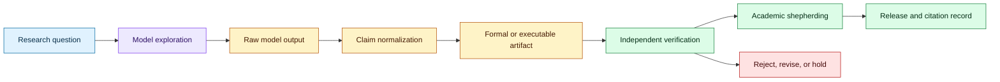
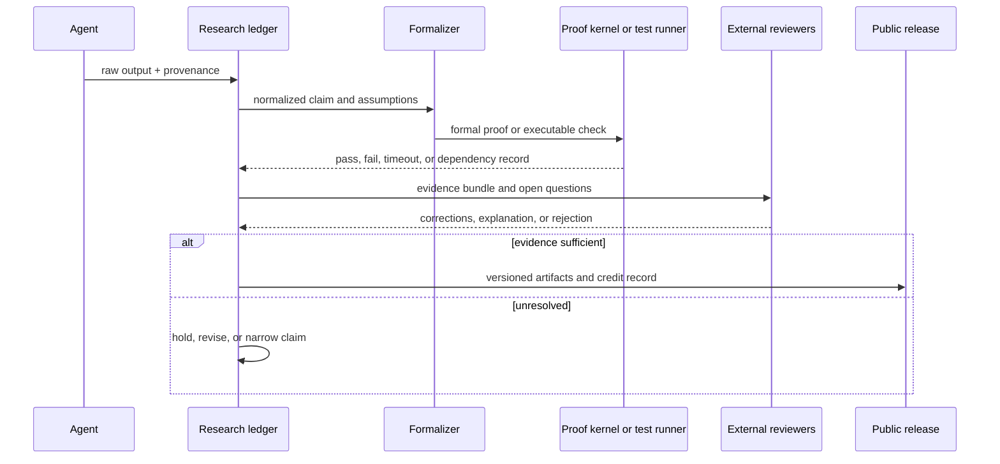

# Verifiable model-assisted scientific discovery
Status: emerging
Sources: [Working with academic communities to build scientific understanding — OpenAI — 2026-10-26](https://openai.com/index/building-scientific-understanding-with-academic-communities/)

## In one sentence

AI-assisted discovery becomes an engineering system rather than a model demo when raw model outputs, formal artifacts, independent review, credit, and release decisions are treated as separate stages.

## Background: what existed before

Scientific software has always separated suggestion from acceptance. A researcher may notice a pattern, propose a conjecture, write a derivation, run a simulation, and ask peers to inspect the result. The observation can be valuable before it is correct, but it is not yet a published fact. The same distinction appears in software engineering: a generated patch is an input to tests and review, not proof that the change is safe.

Language models make the suggestion stage faster and broader. They can search a large body of literature, combine familiar techniques, write symbolic derivations, produce code, or propose a proof strategy. They can also generate plausible errors with convincing notation. In mathematics and theoretical computer science, a fluent proof sketch can hide an invalid quantifier or an unjustified case. In physics, a formal expression can be dimensionally inconsistent while still looking authoritative. The operational question is therefore not “can the model discover?” but “what evidence moves a generated result from hypothesis to shared scientific understanding?”

Traditional publication pipelines assume that an author can explain the result, provide enough methods for reproduction, and accept peer review. AI-generated results add provenance questions: which model and prompt produced the result, what intermediate artifacts were discarded, who checked the formalization, and what credit belongs to human contributors? If these questions are left until publication, the organization may have no reliable record of how the claim was produced.

## What changed and why now

OpenAI’s October 26 report describes three model-generated results in mathematics, computer science, and physics and experiments with different release strategies. It calls the model outputs raw research data, uses external academic groups as shepherds, and emphasizes transparency, no academic credit for the internal models, recognition for human understanding, and independence of collaborators. The report says a natural-language proof and Lean formalization were released for the computer-science result, while other artifacts followed different strategies. These are the publisher’s descriptions, not independent validation of the scientific claims.

The engineering change is a staged evidence pipeline. The model output, formal proof, external explanation, publication artifact, and credit record are distinct objects with different owners. A result may be released for inspection before the organization knows whether it is useful, but the release should preserve enough provenance for others to verify or reject it.

## Impact on current processing and architecture

Represent a discovery as a bundle rather than a document. A bundle contains the prompt or task specification, model and tool versions, raw output, normalized claim, formal or executable artifact, test results, reviewer notes, and release decision. Hash immutable artifacts and link derived explanations back to their inputs. Do not overwrite the raw output when an expert edits the proof; preserve both versions.



The normalized claim is an important boundary. A raw output may contain multiple conjectures, informal reasoning, and proposed lemmas. A claim record states exactly what is asserted, its assumptions, the evidence required, and its status. This lets reviewers reject one claim without treating the whole bundle as valid or invalid.

Formalization changes the failure surface. A proof assistant checks a formal statement and proof term under its libraries and kernel; it does not automatically prove that the formal statement captures the interesting natural-language theorem. A successful Lean check is strong evidence about the encoded proposition, but the translation from the research question to the formal statement remains a human and systems responsibility. Record library versions, compiler versions, axioms, timeouts, and imported declarations.

The evidence bundle should also distinguish discovery time from verification time. A model may produce an idea in one environment, while a later formalizer discovers that a library theorem, notation convention, or hidden assumption supplied the crucial step. Record those dependencies instead of presenting the final proof as an isolated act of generation. For long-running projects, store intermediate failed formalizations and counterexamples because they explain how the claim narrowed.

Review queues need domain-aware routing. A mathematician can evaluate whether a definition is natural, a formal-methods engineer can inspect the trusted base, and a domain scientist can judge whether an experimental prediction is meaningful. One reviewer may be excellent at checking syntax but unable to assess novelty or physical interpretation. The workflow should require the right review role for the claim type and allow reviewers to mark “technically checked, scientifically unresolved.”

Release packages should include a compact reproducibility command. A reader should be able to fetch the declared commit, run the checker, and see which outputs are deterministic. If a proof uses expensive search, provide cached certificates or bounded logs. If a result depends on a proprietary model, publish the resulting artifacts and enough metadata for independent checking without claiming that the model itself is reproducible.



Verification should be layered. Cheap checks include syntax, type checking, dimensional analysis, unit tests, and small counterexample searches. More expensive checks include proof assistant formalization, symbolic computation, numerical experiments, and independent re-derivation. The result is not a single score; it is an evidence profile that tells a reader what has been checked and what remains conjectural.

Reproducibility requires more than a prompt. Store the model snapshot or deployment identifier, temperature and sampling settings, tool calls, retrieved documents, random seeds where applicable, and environment versions. If a tool uses private data, record a redacted schema and a reproducible substitute. The goal is not necessarily to make every response identical; it is to make the process auditable and the critical artifact inspectable.

Credit is also a data-model problem. Link contributors to the artifact they produced: discovery, formalization, exposition, counterexample, review, or release stewardship. Do not collapse all roles into “author” when that hides the work required to turn a model output into understanding. A release should state what the model generated and what humans changed, checked, or rejected.

## Real-world applications and constraints

In theorem proving, an agent can propose lemmas and a proof assistant can reject invalid terms. The main risk is statement drift: the formal theorem may be weaker, stronger under hidden assumptions, or unrelated to the intended problem. Pair formal checks with a natural-language statement review and test examples that exercise edge cases.

In algorithm design, an agent can propose a faster method or refute a complexity conjecture. Use executable reference implementations, adversarial instances, and independent complexity analysis. A proof of a restricted model does not automatically imply a result for the production algorithm.

In physics, simulation and symbolic algebra can test consequences of a generated theory. Unit consistency, boundary conditions, numerical stability, and agreement with established limits are operational gates. A simulation that reproduces its own assumptions is not independent evidence.

In biology and materials research, model outputs can prioritize experiments. The workflow should expose uncertainty and preserve negative results. A recommendation engine must not silently convert a predicted interaction into a biological claim, and laboratory execution needs domain-specific safety review.

The constraint shared by all domains is epistemic status. A result can be interesting, internally consistent, formally checked, experimentally supported, peer reviewed, or accepted by a community; these are different states. The ledger should make them visible rather than compressing them into “AI discovered.”

## Mental model

Treat AI-assisted science like a build pipeline for knowledge. The model produces a candidate source artifact. Formalization and tests are verification stages. External experts are maintainers and reviewers. The release package is a versioned build with provenance, dependencies, known failures, and a change log. A green build means the declared checks passed; it does not mean every interpretation is correct.

## What changed this month

The October report makes raw model artifacts, formal proofs, external shepherding, credit, and release strategy explicit parts of the research process. It describes different disclosure paths for different fields rather than assuming one publication workflow fits every result.

## Engineering consequence

Create a discovery ledger with immutable artifact IDs and explicit status transitions: `generated`, `normalized`, `formally_checked`, `independently_reviewed`, `released`, or `withdrawn`. Require a reason and evidence link for each transition.

Separate the claim from the proof. A proof checker should receive a declared proposition, dependencies, and environment. A reviewer should inspect whether that proposition represents the intended scientific question.

Build counterexample search into the default workflow. Before investing in a long formalization, generate small instances, boundary cases, dimensional checks, and alternative derivations. A cheap failure is valuable evidence.

Publish a machine-readable provenance manifest with human-facing explanations. Include model identifier, artifact hashes, tool versions, formal library commit, contributor roles, and unresolved limitations.

## Limits and failure modes

Formal verification can certify the wrong statement. Review the translation and assumptions separately from the proof check.

Model outputs may contain hidden dependence on retrieved or private material. Record inputs and licensing constraints before publication.

External shepherds can create selection bias. Make the process transparent, disclose who was invited, and provide a path for additional independent review.

Reproducibility can fail when models, libraries, or APIs change. Pin versions and preserve artifacts rather than relying on a live endpoint.

Attribution can be distorted when discovery, explanation, and verification are treated as one contribution. Maintain role-specific credit.

Finally, a release can outrun understanding. Mark claims as provisional and communicate which checks have not been completed.

## Mini exercise (15–30 min)

Build a tiny claim ledger for a generated algorithmic conjecture. Add a brute-force checker, a counterexample field, a formal-status field, and a contributor-role record. Deliberately enter a false claim and verify that it cannot transition to `released` without passing the checks.

## Runnable low-cost example

```python
from dataclasses import dataclass, field
from itertools import product


@dataclass
class Claim:
    statement: str
    status: str = "generated"
    evidence: list[str] = field(default_factory=list)
    counterexample: tuple[int, ...] | None = None


def candidate_property(values: tuple[int, ...]) -> bool:
    # Candidate claim: a sorted tuple has a nondecreasing prefix sum.
    sums = []
    total = 0
    for value in values:
        total += value
        sums.append(total)
    return all(left <= right for left, right in zip(sums, sums[1:]))


def check_claim(claim: Claim) -> Claim:
    for values in product(range(-2, 3), repeat=3):
        ordered = tuple(sorted(values))
        if not candidate_property(ordered):
            claim.counterexample = ordered
            claim.status = "rejected"
            claim.evidence.append("exhaustive-small-domain-check")
            return claim
    claim.status = "checked_on_small_domain"
    claim.evidence.append("exhaustive-small-domain-check")
    return claim


def main() -> None:
    claim = Claim("sorted tuples have nondecreasing prefix sums")
    result = check_claim(claim)
    assert result.status == "rejected"
    assert result.counterexample is not None
    print(result)


if __name__ == "__main__":
    main()
```

## Build it locally

1. Save the example as `claim_ledger.py` and run `python3 claim_ledger.py`.
2. Replace the candidate property with a claim from a small algorithm you understand.
3. Add a normalized statement and explicit assumptions to the record.
4. Store each checker result as an evidence item with a version and timestamp.
5. Add a status transition function that prevents `released` after a counterexample.
6. Add a second independent checker using a different implementation.
7. Record which parts are facts from execution and which are inferences from the evidence.

## Interview Q&A

**Does a Lean proof prove that an AI discovered a theorem?** It proves the encoded formal proposition in the specified environment. It does not by itself establish authorship, relevance, or that the encoding matches the natural-language claim.

**Why preserve raw model output?** It provides provenance, exposes discarded alternatives, and allows later reviewers to distinguish generated material from human explanation and correction.

**What is the role of an external shepherd?** A shepherd coordinates domain experts who interpret, challenge, explain, and contextualize a result; that is different from merely checking syntax.

**Why use small counterexample searches?** They cheaply reject broad claims before expensive formalization or experimentation.

**How should credit be recorded?** Assign roles to artifacts: discovery, formalization, implementation, exposition, review, and stewardship, with links to the versions each person contributed to.

## Glossary

- **Raw research artifact:** Unprocessed model output or generated data retained for inspection.
- **Claim normalization:** Converting a broad output into a precise statement with assumptions and evidence requirements.
- **Formalization:** Encoding a statement in a formal language checked by a proof assistant or verifier.
- **Proof kernel:** The small trusted component that checks a formal proof term.
- **Shepherding:** Expert-led organization of review and explanation around a result.
- **Provenance:** Record of where an artifact came from and how it was transformed.
- **Epistemic status:** What kind of evidence supports a claim and what remains uncertain.
- **Counterexample search:** Systematic testing for an input that violates a candidate claim.

## References

- [Working with academic communities to build scientific understanding — OpenAI — 2026-10-26](https://openai.com/index/building-scientific-understanding-with-academic-communities/)
- [Lean theorem prover](https://lean-lang.org/)
- [OpenAI AI mathematics release — 2026-10-06](https://openai.com/index/sharing-ai-progress-in-mathematics/)

## Claim ledger

| Claim | Source | Fact or inference |
|---|---|---|
| OpenAI describes three results across mathematics, computer science, and physics. | October 26 report | Fact about the publisher’s report |
| The report describes raw outputs, external shepherds, and different release strategies. | October 26 report | Fact |
| The report says a computer-science result included a public natural-language proof and Lean formalization. | October 26 report | Fact about the reported release |
| Formal verification checks an encoded proposition rather than automatically validating the natural-language interpretation. | Formal-methods reasoning | Engineering inference |
| A provenance manifest should include model, tool, library, and artifact versions. | Reproducible-systems design | Engineering inference |
| Claim status should be distinct from publication status. | Scientific workflow design | Engineering inference |
