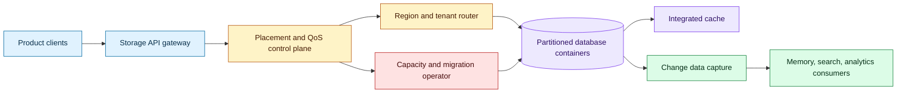
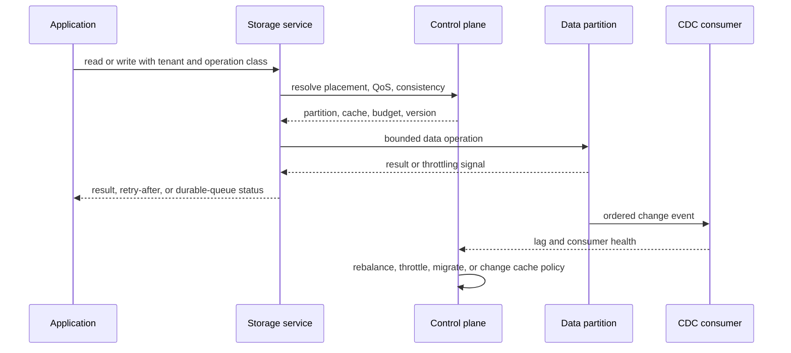

# Storage control planes for billion-user AI products
Status: durable
Sources: [Rapidly scaling online storage to serve over 1 billion ChatGPT users (Part II) — OpenAI Engineering — 2026-10-23](https://openai.com/index/scaling-storage-one-billion-users-part-two/)

## In one sentence

At extreme scale, application storage becomes a control plane: partition placement, tenant isolation, quality of service, caching, replication, and change streams must be managed as one operational system.

## Background: what existed before

An application can begin with a database client embedded in its service. The client writes records, reads them back, and relies on the database’s partitioning, replication, and throttling behavior. This is an excellent starting point because it keeps the system small. The application team owns business logic while the managed database owns storage mechanics.

That model becomes strained as traffic and data grow. A single tenant or key can become hot. Tenants with very different request rates can share a partition and create noisy-neighbor failures. A logical partition may hit a service limit even when the aggregate database has capacity. Cross-region reads add latency, while broad replication raises cost and consistency complexity. Change data capture can become a second workload that competes with online reads and writes.

AI products intensify these problems. Conversations, files, tool traces, memories, evaluations, billing state, and product metadata have different access patterns and retention periods. A user may be active in multiple regions. A model workflow may issue bursts of reads and writes, then go idle. A retrieval or memory feature may need low latency but not strong global consistency. An online storage platform must support product teams without making each team rebuild placement, caching, and backpressure logic.

The key architectural distinction is between a database and a storage platform. A database exposes primitives. A platform adds tenancy policy, routing, capacity management, reliability controls, observability, and developer interfaces around those primitives.

## What changed and why now

OpenAI’s October 23 engineering report describes Habitat, an online storage platform for its products, serving over 1 billion users across 40 regions and over 500 petabytes of data. The report describes an evolution from a client library to a service and then to a globally distributed platform, including several phases of multi-tenancy and data movement over Azure Cosmos DB. The scale and implementation details are source-specific engineering claims, not a universal prescription.

The durable lesson is the control-plane evolution. The team first used database primitives, then tried workload isolation and single tenancy, and later adopted multi-tenancy with data movement, hot-key throttling, quality-of-service controls, serverless capacity, selective replication, integrated caching, and a change-data-capture path. This is a sequence of explicit trade-offs rather than a single “choose the right database” decision.

## Impact on current processing and architecture

The storage data plane serves reads and writes. The control plane decides where a tenant lives, how much capacity it receives, what consistency it needs, when it moves, and which cache or replica can answer a request. Keep those concerns visible in the architecture.



A tenant should be a policy object, not merely a string in a partition key. Store tenant class, region affinity, consistency requirement, throughput envelope, cache policy, migration state, and data-retention class. The router reads a versioned placement record and includes its version in the request. This prevents a write from using stale placement during a move.

Partitioning needs both logical and physical reasoning. A logical partition groups records by a key. A physical partition is the unit that consumes capacity and may be split or moved by the service. A well-distributed key can still be problematic if one tenant’s traffic is bursty or one record is accessed disproportionately. Measure per-key rate, size, latency, throttles, and fan-out rather than assuming aggregate averages are representative.

Quality of service is a backpressure contract. When capacity is scarce, the system should preserve critical reads and writes while shedding or delaying lower-priority work. Define budgets by tenant and operation class. A background embedding update should not starve an interactive conversation write. The API should expose retry-after or a durable queue path so clients do not create a retry storm.



Data movement is a control-plane operation with application-visible risk. A migration must coordinate old and new locations, preserve ordering, avoid duplicate writes, and define what happens when the control plane is unavailable. Use a placement state machine such as `stable`, `copying`, `dual_write`, `cutover_pending`, `cutover`, and `retiring`. Every state should have a recovery action and an observable invariant.

Caching is not one switch. A local cache can reduce latency but create staleness. A globally replicated cache can reduce remote reads but introduce invalidation traffic. Integrated cache behavior may be useful when the database understands the access pattern, but the application still needs to classify which data can be stale. User-visible conversation state, billing state, permissions, and model memory should not share one freshness policy.

Selective replication is a cost and latency decision. Replicate the smallest latency-sensitive datasets broadly; keep large or less interactive data near its owner; use caching for data that is expensive to replicate. This can reduce cross-region traffic but requires a clear read-after-write contract. A user who writes a memory item in one region should not immediately receive an older value from another region unless the product explicitly permits it.

Change data capture turns storage into an event source. Downstream consumers may build search indexes, memories, analytics tables, or audit records. CDC needs offsets, deduplication, schema evolution, and backfill handling. Consumer lag is part of product freshness. If a consumer is slow, do not silently drop events that define security or billing state.

The platform also needs a request-admission layer. Before a write enters the database, admission can check tenant budget, payload size, idempotency, consistency class, and current migration state. This is more useful than allowing every client to retry the same rejected operation. Return a stable error category so the caller knows whether to retry, enqueue, reduce payload size, or ask for operator intervention. Admission decisions should be observable and included in cost accounting.

Schema evolution is especially important for AI traces. A model or tool may add fields to an event while old consumers are still running. Use versioned envelopes, backward-compatible readers, and explicit dead-letter handling. A malformed trace should not block the user’s primary write, but it should not disappear silently either. Store the primary record and route the derived event to repairable quarantine.

Recovery should be tested at the platform boundary. Restore a partition while a tenant is moving, replay CDC after a consumer outage, and serve a region failure with the declared consistency level. These tests expose whether placement metadata, cache invalidation, and derived indexes recover together. A database backup alone does not restore the control plane that tells clients where the data lives.

## Real-world applications and constraints

Conversation storage benefits from tenant-aware partitioning and regional routing. Recent messages may need low-latency reads, while old attachments can use colder storage. A memory extractor can consume CDC asynchronously, but it must preserve deletion and privacy events so a user’s request to remove data propagates to derived indexes.

Enterprise agent traces have bursty writes and varied retention. Store hot execution state separately from long-term audit evidence. A customer with strict residency needs should have placement and replication policy enforced by the control plane, not by a prompt or client convention.

Evaluation platforms often run many parallel jobs. Their storage workload may create hot keys around a shared benchmark or model version. QoS should prevent a large evaluation from starving interactive product traffic. CDC can feed dashboards, but results should be immutable and versioned.

The constraints are familiar distributed-systems constraints: consistency, availability, latency, cost, capacity, and operability. The platform should make trade-offs explicit in APIs and telemetry. “Global” is not a consistency model, and “serverless” does not remove capacity planning; it changes who manages it and how the bill responds to bursts.

## Mental model

Think of storage as a traffic system. Data records are vehicles, partitions are roads, the router is traffic control, QoS is emergency-lane policy, caches are local depots, and CDC is the rail network carrying changes to other services. Adding more roads does not solve a hot intersection unless routing and capacity are managed together.

## What changed this month

The October engineering report describes a path from a simple client and database to a global online storage platform, including multi-tenant containers, data movement, hot-key throttling, QoS, selective replication, caching, and CDC. The concept is directly relevant to AI products because persistent agent state and derived artifacts turn model calls into storage-heavy workflows.

## Engineering consequence

Define the storage platform API around tenant and operation policy. Require callers to declare consistency, priority, region, idempotency key, and retention class. Reject requests that omit a policy rather than silently applying an unsafe default.

Build a placement service with versioned records and a migration state machine. Test stale routers, duplicate writes, partial copies, and consumer lag. Make every data operation observable by tenant and partition.

Separate interactive state, derived data, and audit evidence. Give each class its own freshness, deletion, replication, and recovery contract. Propagate tombstones through CDC so derived stores do not resurrect deleted information.

Capacity dashboards should show p99 latency, throttling, hot keys, weak partitions, migration progress, cache hit rate, CDC lag, and cost by tenant class. Aggregate capacity can look healthy while one tenant or partition is failing.

## Limits and failure modes

Multi-tenancy can create noisy neighbors if placement and QoS are weak. Isolating every tenant can waste capacity and make growth unpredictable. Use movement and rate controls rather than assuming one permanent layout.

Hot-key throttling protects the database but can produce user-visible failure. Provide durable queues or graceful degradation for work that can be delayed.

Data movement can duplicate or lose writes if cutover ordering is unclear. Use idempotency keys, dual-write reconciliation, and explicit states.

Caching can serve stale permissions or resurrect deleted content. Attach freshness and invalidation policy to data classes.

CDC consumers can lag or fail independently. Track offsets and replayability, and distinguish recoverable lag from lost events.

Global replication raises cost and consistency complexity. Replicate only what the product contract requires.

## Mini exercise (15–30 min)

Simulate tenants writing to partitions with one hot key. Add a placement table, per-tenant QoS limits, a migration state machine, and a change-event queue. Compare p99 latency and rejected work before and after moving the hot tenant.

## Runnable low-cost example

```python
from collections import Counter, deque
from dataclasses import dataclass


@dataclass
class Tenant:
    name: str
    priority: int
    limit: int
    partition: str


def schedule(tenants: list[Tenant], requests: list[str]) -> tuple[list[str], list[str]]:
    used = Counter()
    accepted, delayed = [], []
    by_name = {tenant.name: tenant for tenant in tenants}
    queue = deque(requests)
    while queue:
        name = queue.popleft()
        tenant = by_name[name]
        if used[name] < tenant.limit:
            used[name] += 1
            accepted.append(name)
        else:
            delayed.append(name)
    accepted.sort(key=lambda name: by_name[name].priority, reverse=True)
    return accepted, delayed


def main() -> None:
    tenants = [Tenant("interactive", 10, 3, "p1"), Tenant("batch", 1, 1, "p1")]
    accepted, delayed = schedule(tenants, ["batch", "interactive", "interactive", "interactive", "interactive"])
    assert accepted.count("interactive") == 3
    assert delayed == ["interactive"]
    print("accepted:", accepted, "delayed:", delayed)


if __name__ == "__main__":
    main()
```

## Build it locally

1. Save the example as `qos.py` and run `python3 qos.py`.
2. Add a per-partition capacity limit and report hot partitions.
3. Add idempotency keys so a retry does not double-count a write.
4. Add a `copying` and `cutover` migration state for one tenant.
5. Emit a change event for every accepted request.
6. Add a consumer offset and simulate a consumer falling behind.
7. Write invariants for no lost accepted requests and no cross-tenant placement.

## Interview Q&A

**Why is storage a control plane at scale?** Placement, QoS, movement, replication, caching, and derived consumers determine whether database primitives meet product requirements.

**What is a noisy neighbor?** One tenant or workload consumes shared capacity and degrades other tenants.

**Why is CDC part of storage reliability?** It propagates changes to search, memory, analytics, and audit systems; lag or loss changes product behavior.

**How should migration be modeled?** As an explicit state machine with idempotent operations, reconciliation, cutover rules, and recovery actions.

**Why not replicate everything globally?** Replication increases cost, write coordination, storage, and consistency complexity; only some data requires global low-latency access.

## Glossary

- **Control plane:** Logic that configures, routes, and governs the data plane.
- **Data plane:** The path that serves application reads and writes.
- **Logical partition:** Records grouped by an application partition key.
- **Hot key:** A key receiving disproportionate traffic or size.
- **Noisy neighbor:** A tenant whose shared-resource use harms others.
- **QoS:** Quality-of-service policy that allocates capacity by priority.
- **CDC:** Change data capture, a stream of committed data changes.
- **Read-after-write:** A consistency guarantee that a later read observes a prior write.

## References

- [Rapidly scaling online storage to serve over 1 billion ChatGPT users (Part II) — OpenAI Engineering — 2026-10-23](https://openai.com/index/scaling-storage-one-billion-users-part-two/)
- [Rapidly scaling online storage to serve over 1 billion ChatGPT users — Part I](https://openai.com/index/scaling-storage-one-billion-users/)
- [Azure Cosmos DB documentation](https://learn.microsoft.com/azure/cosmos-db/)

## Claim ledger

| Claim | Source | Fact or inference |
|---|---|---|
| Habitat is described as an online storage platform for OpenAI products. | October 23 engineering report | Fact |
| The report describes service across 40 regions and over 500 petabytes. | October 23 engineering report | Fact about the publisher’s report |
| The report describes multi-tenancy, data movement, hot-key throttling, QoS, caching, selective replication, and CDC. | October 23 engineering report | Fact about the described design |
| Tenant placement and migration should be versioned control-plane state. | Distributed-systems design | Engineering inference |
| Interactive, derived, and audit data need different freshness and deletion contracts. | Storage architecture reasoning | Engineering inference |
| Aggregate capacity can hide hot partitions and noisy neighbors. | Capacity-planning reasoning | Engineering inference |
