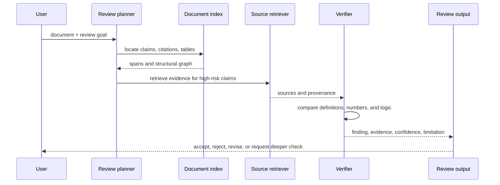

# Deep review for technical documents
Status: emerging
Sources: [Analyzing technical documents with Deep Review — Google Research — 2026-10-14](https://research.google/blog/analyzing-technical-documents-with-deep-review/)

## In one sentence

Deep review is an evidence-grounded, multi-step document-analysis workflow that turns review from a single model judgment into claim extraction, source checking, critique, and revision assistance.

## Background: what existed before

Document review has traditionally been a scarce expert activity. A reviewer reads a manuscript, contract, design document, or proposal, builds a mental model, checks important claims against references, and writes feedback. The process is valuable because the reviewer can connect local wording to a document’s larger argument and to domain expectations. It is also slow: long documents require sustained attention, specialist knowledge, and repeated passes.

Earlier AI review tools mostly performed local transformations. They summarized paragraphs, corrected grammar, or answered a question about the text supplied in the prompt. These capabilities are useful but insufficient for technical review. A summary can omit the one unsupported assumption that invalidates a conclusion. A fluent critique can invent a citation. A model can identify a missing section without checking whether the document’s central claim follows from its evidence.

The review problem is therefore a pipeline problem. The system must segment a document, identify claims and dependencies, retrieve relevant evidence, reason about contradictions, preserve citations, and present uncertainty. The user must be able to inspect why a concern was raised and decide whether to accept, reject, or investigate it.

## What changed and why now

Google Research’s October 14 announcement describes Deep Review as an agentic system for rigorous feedback and technical verification. It says the system evolved from the Paper Assistant Tool, was used in opt-in pilots across more than 16,000 submissions at four conferences, and expanded from scientific papers to documents such as legal and finance material. The announcement describes PDF and plain-text input, a public release, and API access. These are publisher-reported details, not independent evidence that every review is correct.

The engineering change is the review loop. A reviewer agent should not simply produce a verdict. It should build a review plan, extract claims, gather evidence, test consistency, and generate traceable findings. The output is a review artifact with links to document spans, evidence sources, confidence, and suggested follow-up.

## Impact on current processing and architecture

The ingestion layer converts a document into stable chunks with page, section, paragraph, and character coordinates. Preserve the original file hash and extraction method. A claim extractor identifies factual, quantitative, causal, and normative statements. A planner decides which claims deserve verification based on risk, centrality, novelty, and uncertainty.

```mermaid
flowchart LR
    D[PDF or text document] --> I[Ingest and preserve layout]
    I --> C[Claims and citations]
    C --> P[Review planner]
    P --> E[Evidence retrieval]
    E --> V[Verification and contradiction checks]
    V --> F[Findings with span links]
    F --> H[Human author or reviewer]
    H --> U[Revision and rerun]
    classDef input fill:#e0f2fe,stroke:#0369a1,color:#082f49;
    classDef parse fill:#ede9fe,stroke:#7c3aed,color:#2e1065;
    classDef plan fill:#fef3c7,stroke:#b45309,color:#451a03;
    classDef verify fill:#dcfce7,stroke:#15803d,color:#052e16;
    classDef human fill:#fee2e2,stroke:#b91c1c,color:#450a0a;
    class D input;
    class I,C parse;
    class P plan;
    class E,V,F verify;
    class H,U human;
```



The evidence retriever needs source boundaries. It should distinguish a cited paper, an internal attachment, a search result, and model background knowledge. Each finding should say whether the evidence supports, contradicts, or fails to establish the claim. Retrieval is not verification; a relevant passage may be misinterpreted or use a different definition.



Technical review benefits from claim graphs. Nodes represent claims, assumptions, evidence, and conclusions. Edges represent supports, contradicts, derives-from, or depends-on. A reviewer can then find a conclusion whose evidence node is missing, a cited result whose conditions differ, or a numerical table whose totals do not match the text.

The system needs controlled depth. A shallow pass can check citations and arithmetic. A deeper pass can inspect methodology, run supplied code, compare baselines, or search for counterexamples. Let users choose review goals and budgets. The planner should stop when the allocated budget is exhausted and label unresolved items rather than presenting partial work as complete.

Review plans should be risk-aware. A claim about a deployment limit, medical result, financial total, or security property deserves more scrutiny than a sentence describing motivation. Central claims deserve more scrutiny than peripheral background because an error in a premise can invalidate many downstream paragraphs. The planner can assign each claim a risk score from consequence, uncertainty, novelty, and dependency count, then spend its deepest checks on the highest-ranked set.

Tables and figures require their own processing path. Text extraction often loses column headers, units, footnotes, or axis scales. Convert a table into a typed representation before checking sums and comparisons. Preserve the image or page crop alongside the parsed cells so a reviewer can inspect whether extraction was correct. For a chart, record the plotted variables, units, range, and source; do not infer a trend from pixels without exposing that interpretation.

Source quality also needs a ledger. A primary paper, official dataset, preprint, search snippet, and model-generated explanation should not receive the same evidentiary weight. The reviewer can still use a weak source to generate a lead, but the finding should say that the lead needs stronger confirmation. If two sources disagree, report the conflict and identify which definitions or populations differ instead of choosing the newer-looking sentence.

Human interaction should be designed for correction. Present a finding beside the smallest relevant document span and evidence span, with controls for accept, reject, duplicate, and escalate. A long narrative report is hard to audit and encourages users to accept the model’s framing. Structured findings let an expert correct one claim while preserving the rest of the review.

Feedback is part of quality. A human author may mark a finding as valid, invalid, duplicate, or requiring domain review. Capture that outcome to improve prompts, retrieval, and triage, but do not silently train on sensitive documents. Review results should be versioned against document revisions so a corrected claim closes the old finding and creates a traceable new state.

Review quality should be measured against an expert-labeled set, not only user satisfaction. Track critical-issue recall, valid-finding precision, citation correctness, arithmetic accuracy, time saved, and the rate at which experts overturn a finding. A system that produces fewer findings may be better if it removes unsupported criticism while retaining important defects. Keep separate scores for extraction, retrieval, reasoning, and presentation so a failure in one stage does not disappear inside a single end-to-end number.

## Real-world applications and constraints

Scientific manuscripts need checks for claim-evidence alignment, statistical assumptions, missing baselines, and reproducibility. An agent can identify a claim that depends on a table and verify that the table is present, but a domain expert may still need to judge whether the experiment answers the research question.

Legal agreements require clause comparison, defined-term consistency, and conflict detection. The system should highlight relevant text and sources, not provide an unreviewed legal conclusion. Access control, retention, and tenant isolation are essential because uploaded agreements are confidential.

Finance documents need arithmetic, date, unit, and scenario checks. A reviewer can flag that a number appears inconsistent with a cited filing, but the source version and reporting period must be explicit. Do not let an agent silently substitute a newer source for the one the document cites.

Engineering design reviews can inspect requirements, interfaces, failure modes, and test coverage. A claim graph can connect a requirement to an implementation decision and test. The system should surface missing evidence while leaving acceptance authority with the responsible engineer.

The central constraint is review calibration. A verbose report is not a good report if its high-priority findings are buried in style comments. Rank findings by consequence, confidence, and evidence quality. Measure precision on expert-labeled review sets and track missed critical issues separately from harmless false positives.

## Mental model

Treat deep review as a compiler plus test runner for prose. Parsing creates an intermediate representation of sections, claims, citations, tables, and definitions. Analysis passes check consistency and evidence. The human sees diagnostics linked to source spans. Re-running after an edit should show which findings disappeared, changed, or remain.

## What changed this month

Deep Review’s public release describes an expansion from paper assistance to broader knowledge documents and a workflow for verification and iterative improvement. The concept is a traceable review pipeline, not “ask a model whether the document is good.”

## Engineering consequence

Store document and source hashes. Never rely on a citation URL alone; record retrieval time, title, version, and relevant span. Use stable coordinates so findings survive minor formatting changes.

Define review passes: structure, citation, arithmetic, methodological, and domain. Each pass should have a scope, tool budget, and output schema. A pass may return `verified`, `unsupported`, `contradicted`, `uncertain`, or `not_run`.

Give the reviewer an evidence contract. Every substantive finding must include document span, claim paraphrase, evidence span or reason for missing evidence, confidence, and recommended next action. This makes feedback inspectable and reduces persuasive but unsupported critique.

Measure the system with expert-labeled documents. Track critical-issue recall, finding precision, citation correctness, time saved, and reviewer acceptance. Do not optimize only for the number of findings.

## Limits and failure modes

Retrieval can find a related but incompatible source. Require source identity, version, and definition matching.

OCR and layout extraction can corrupt tables, equations, and footnotes. Preserve the original and expose extraction uncertainty.

The model may generate plausible criticism that is not grounded in the document. Enforce evidence links and allow `no evidence found` as an output.

Long documents can exhaust context or budget. Use hierarchical summaries, claim graphs, and bounded deep dives rather than pretending full coverage.

Sensitive documents can leak through logs, prompts, or feedback datasets. Apply tenant isolation, retention controls, redaction, and access auditing.

Review automation can create false confidence. Require human sign-off for high-consequence decisions and show unresolved items prominently.

## Mini exercise (15–30 min)

For SDE2 implementation, model the review as a durable job rather than one request. The API accepts a document hash, review profile, evidence scope, and budget, then returns a job ID. Workers can retry extraction and retrieval independently, while the result store keeps partial findings. This matters for long PDFs and legal or scientific workflows where a review may exceed a request timeout. Idempotency prevents a retry from creating duplicate findings. A review profile can require citation checking, arithmetic checking, or methodology review and can set which external sources are permitted.

The review output should be safe to merge into a document workflow. Findings need stable IDs, severity, confidence, source spans, and status. A revision can mark a finding as closed only when the new document version contains evidence that addresses it. Keep the old finding linked to the old hash so audit users can reconstruct what the reviewer saw. This is more useful than overwriting a report with the newest prose.

Build a document checker that extracts numbered claims from a short text, links each claim to a local evidence sentence, checks arithmetic, and reports unsupported claims with line numbers. Add a revision and rerun to see finding state changes.

## Runnable low-cost example

```python
from dataclasses import dataclass
import re


@dataclass(frozen=True)
class Finding:
    claim: str
    status: str
    evidence: str


def review(text: str) -> list[Finding]:
    evidence = [line.strip() for line in text.splitlines() if line.startswith("EVIDENCE:")]
    findings = []
    for line in text.splitlines():
        if not line.startswith("CLAIM:"):
            continue
        claim = line.removeprefix("CLAIM:").strip()
        number = re.search(r"\b\d+(?:\.\d+)?\b", claim)
        matched = next((item for item in evidence if number and re.search(rf"(?<!\d){re.escape(number.group())}(?!\d)", item)), None)
        findings.append(Finding(claim, "supported" if matched else "unsupported", matched or "no matching evidence"))
    return findings


def main() -> None:
    text = """CLAIM: latency fell to 120 ms
EVIDENCE: benchmark run recorded 120 ms p95 latency
CLAIM: cost fell to 2 dollars
"""
    findings = review(text)
    assert findings[0].status == "supported"
    assert findings[1].status == "unsupported"
    print(findings)


if __name__ == "__main__":
    main()
```

## Build it locally

1. Save the example as `review.py` and run `python3 review.py`.
2. Add line numbers and stable document IDs to every finding.
3. Add a citation record with URL, title, version, and retrieval date.
4. Add a check for contradictory evidence rather than only matching numbers.
5. Add finding states for `accepted`, `rejected`, and `needs_domain_review`.
6. Re-run the review after changing one claim and show the state transition.
7. Measure precision on ten documents labeled by a human reviewer.

## Interview Q&A

**Why is retrieval not verification?** A retrieved source may use different definitions or conditions. Verification must compare the document’s exact claim with evidence.

**What should every finding contain?** A document span, claim, evidence link or explicit missing-evidence reason, confidence, and next action.

**How do you control review cost?** Use risk-ranked claims, bounded passes, and explicit depth budgets.

**Why retain document revisions?** A finding belongs to a specific version; revisions should show which concerns closed, changed, or remain.

**Can an agent replace expert review?** It can expand coverage and surface evidence, but high-consequence acceptance still requires an accountable domain owner.

## Glossary

- **Deep review:** Multi-step technical analysis that checks claims against evidence.
- **Claim graph:** Structured links among claims, assumptions, evidence, and conclusions.
- **Evidence grounding:** Connecting a finding to an inspectable source span.
- **Review pass:** A bounded analysis stage with a defined scope and output.
- **Finding precision:** Fraction of reported findings judged valid.
- **Critical-issue recall:** Fraction of important problems that the system detects.
- **Stable coordinate:** Page, section, or line identifier used to locate document content.
- **Domain review:** Expert assessment requiring specialized knowledge.

## References

- [Analyzing technical documents with Deep Review — Google Research — 2026-10-14](https://research.google/blog/analyzing-technical-documents-with-deep-review/)
- [Towards Automating Scientific Review with Google’s Paper Assistant Tool](https://arxiv.org/abs/2606.28277)
- [Google Deep Review](https://deepmind.google/technologies/gemini/deep-research/)

## Claim ledger

| Claim | Source | Fact or inference |
|---|---|---|
| Deep Review is described as an agentic system for technical verification and feedback. | Google Research announcement | Fact |
| The announcement reports opt-in pilots across more than 16,000 submissions and four conferences. | Google Research announcement | Fact about the publisher’s report |
| The system is described as expanding from papers to documents in legal and finance contexts. | Google Research announcement | Fact about the publisher’s description |
| A claim graph makes evidence dependencies and unresolved findings inspectable. | Review-system design | Engineering inference |
| Review quality should be measured by critical-issue recall and finding precision, not report length. | Evaluation methodology | Engineering inference |
| A review artifact should be versioned with the document revision. | Document-processing design | Engineering inference |
