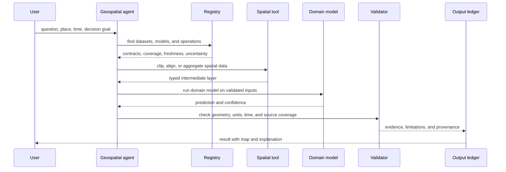

# Geospatial agents and foundation-model task routing
Status: emerging
Sources: [Putting Earth AI to work: Geospatial agents for our planet’s biggest challenges — Google Research — 2026-10-14](https://research.google/blog/putting-earth-ai-to-work-geospatial-agents-for-our-planets-biggest-challenges/)

## In one sentence

Geospatial agents make planetary analysis tractable by routing a question through domain-specific foundation models, spatial tools, planning, and evidence-aware execution instead of asking a general LLM to reason over raw maps.

## Background: what existed before

Geospatial work combines maps, satellite imagery, weather, terrain, population, time, and administrative boundaries. Each source has its own coordinate reference system, resolution, update cadence, file format, and uncertainty. A question such as “where should a health team prioritize outreach after flooding?” is not a single retrieval operation. It requires finding relevant imagery, aligning it with hydrology and population data, selecting a spatial operation, checking temporal freshness, and explaining the result.

Historically, analysts wrote scripts or used GIS software to perform these steps. A domain expert chose datasets, projections, filters, and models. This produces reliable workflows when the analyst is available, but it creates a high skill barrier and makes cross-domain questions slow. General-purpose language models improved natural-language interfaces but struggled with planet-scale data and specialized spatial formats. They could describe a map but were not automatically trustworthy at selecting a raster window, applying a buffer in the correct coordinate system, or combining a weather forecast with a population layer.

The system boundary is therefore important. A geospatial agent should not treat a map as a picture alone. It should treat spatial data as typed, indexed, versioned evidence and invoke tools that preserve geometry, units, time, and provenance.

## What changed and why now

Google Research’s October 14 announcement describes a Geospatial Reasoning agent that combines domain-specific foundation models, spatial tools, and upfront planning for multi-step analysis and planetary prediction. It describes four benchmarks, including GeoKTools and GeoExpertQueries, partner testing in workflows such as disease investigation and disaster preparedness, and experimental access through Google Earth and an agent-to-agent service. These are publisher-reported capabilities and evaluations.

The engineering change is a tool-using planner over a portfolio of specialized models. Instead of one general model producing an answer from a prompt, the agent decomposes the question, chooses a geospatial operation, invokes the correct model or dataset, validates the intermediate result, and assembles a provenance-backed response.

## Impact on current processing and architecture

Represent each geospatial asset with a contract: spatial reference system, resolution, time range, coverage, measurement units, missing-data policy, license, and uncertainty. A tool registry advertises operations such as clip, reproject, aggregate, detect, forecast, compare, and map. The planner should select tools whose input contracts match the question.

```mermaid
flowchart LR
    Q[Natural-language spatial question] --> P[Task planner]
    P --> C[Spatial contract checker]
    C --> D[Dataset and model registry]
    D --> T[GIS and geospatial tools]
    D --> F[Domain foundation models]
    T --> V[Geometry, time, and unit validation]
    F --> V
    V --> E[Evidence and uncertainty ledger]
    E --> A[Answer, map, or prediction]
    classDef input fill:#e0f2fe,stroke:#0369a1,color:#082f49;
    classDef plan fill:#fef3c7,stroke:#b45309,color:#451a03;
    classDef tool fill:#ede9fe,stroke:#7c3aed,color:#2e1065;
    classDef verify fill:#dcfce7,stroke:#15803d,color:#052e16;
    classDef output fill:#fee2e2,stroke:#b91c1c,color:#450a0a;
    class Q input;
    class P,C plan;
    class D,T,F tool;
    class V,E verify;
    class A output;
```



Upfront planning prevents the model from making an invalid sequence of calls. The planner first identifies the target geography, time window, outcome, and acceptable uncertainty. It then chooses a source and operation plan. If the question is about change over time, a single current image is insufficient. If it asks for area, the tool must use a suitable projection or geodesic calculation. If it asks for a prediction, the response needs a forecast model and a validation period.



Coordinate reference systems are a common failure mode. Latitude and longitude are angular coordinates, not a uniform distance grid. Buffering a point by “five units” can produce very different physical areas depending on the projection. The agent should expose the chosen reference system and use a geospatial library for transformations rather than asking the language model to calculate geometry from memory.

Resolution and aggregation create another failure surface. A population raster at one resolution can hide small communities when aggregated to a larger cell. A satellite model trained at one resolution may behave poorly on another. Record resampling method and avoid presenting a coarse estimate as precise.

Time is a first-class dimension. A flood map, weather forecast, population estimate, and road network may come from different dates. The planner should reject incompatible windows or mark the analysis as stale. An agent can also use a cached layer whose freshness policy is visible to the user.

The evidence ledger should include source IDs, acquisition times, spatial bounds, transformations, model versions, tool parameters, and validation results. A result without this ledger is difficult to reproduce and unsafe for high-consequence decisions.

## Real-world applications and constraints

Disease outbreak investigation can combine case locations, climate, travel, population, and environmental signals. The agent can propose candidate areas for public-health analysis, but sensitive location data requires access controls and aggregation. A correlation is not a causal conclusion, and a map should show uncertainty and missing coverage.

Disaster preparedness can compare hazard projections with infrastructure and vulnerable populations. Inputs may be incomplete during an event, so the system should distinguish “no risk” from “no data.” Cache and failover design matter when connectivity is limited.

Clean-energy screening can combine solar, wind, grid, land-use, and transmission layers. A planner must preserve units and constraints; an apparently favorable site may be unavailable because of ownership, permitting, biodiversity, or grid capacity.

Planetary prediction requires long-running data pipelines, model calibration, and distribution-shift monitoring. The agent’s language interface should not hide that predictions are conditional on the chosen model and time horizon.

The operational constraint is that a spatial answer can change a physical decision. Require human review for public-health, emergency, land-use, or infrastructure actions. Use the agent to reduce analysis time and broaden scenario exploration while keeping source data and approval authority explicit.

## Mental model

Think of a geospatial agent as a query planner for a typed multidimensional database. The language model chooses a plan, specialized models execute transformations, and validators check that the plan preserved space, time, units, and uncertainty. The final text is a view over an evidence graph, not the source of truth.

The planner should also distinguish descriptive, diagnostic, predictive, and prescriptive questions. A descriptive request summarizes what is observed. A diagnostic request asks which factors may explain a pattern and needs causal caution. A predictive request estimates a future or unobserved value and needs a model, validation period, and uncertainty. A prescriptive request recommends an action and requires a decision policy, constraints, and an accountable owner. Routing all four through the same answer template hides the change in risk.

Spatial joins deserve explicit observability. When a point, polygon, and raster are combined, record the boundary rule, inclusion rule, and aggregation function. “Inside” can mean centroid inside, any overlap, or full containment. A population total can change materially depending on that choice. The agent should produce a compact execution trace that a GIS analyst can reproduce without trusting the prose description.

Data freshness should be enforced at the tool boundary. A wildfire response may tolerate a map that is minutes old but not one from last week. A long-term land-use analysis may prefer a stable historical snapshot. Encode freshness as a requirement and return a stale-data error when no source satisfies it. Do not let the language model decide that an old layer is “probably good enough” without exposing the trade-off.

Evaluation should include adversarial spatial cases: points near a boundary, polygons crossing the antimeridian, missing tiles, different datums, seasonal changes, and queries with ambiguous place names. These cases test the system’s contracts rather than its ability to write a convincing paragraph. Keep a human-reviewed set of maps and intermediate outputs, not only final textual answers.

Cost and latency are also spatially shaped. Planet-scale imagery may be expensive to fetch and transform, while a small local crop can answer a narrow question quickly. The planner should estimate the area, number of tiles, model calls, and expected output size before execution. It can first use a coarse layer to locate candidate regions, then request high-resolution data only where it changes the decision. This coarse-to-fine strategy should be visible in the trace so users understand why a result is approximate.

Access policy belongs in the same plan. Some layers are public, some are licensed, and some contain protected locations. The agent should fail closed when a source is unavailable rather than substituting an unapproved mirror. A provenance record should include authorization context so a later analyst can tell whether a map was generated from permitted data.

## What changed this month

The October report describes a geospatial reasoning agent that connects specialized Earth AI models and spatial tools through upfront planning, evaluates it on new benchmarks, and tests it in partner workflows. The practical change is making complex spatial analysis agentically accessible while preserving domain-tool boundaries.

## Engineering consequence

Build a registry with explicit data contracts. Require every tool to declare coordinate system, resolution, time semantics, units, missing-data behavior, and output schema. The planner should reject a plan with incompatible contracts before execution.

Store intermediate artifacts, not only the final map. A reviewer should be able to inspect the clip, reprojection, aggregation, model input, and validation messages. Cache expensive layers by source version and transformation parameters.

Use benchmark tasks that test tool selection and spatial reasoning separately. Include coordinate-system traps, stale data, missing coverage, multi-region queries, and ambiguous boundaries. Measure factual correctness, geometry correctness, source attribution, latency, and cost.

Make uncertainty visible. Return ranges, confidence, coverage, and sensitivity to alternate datasets. Do not let a polished map imply precision the underlying data does not support.

## Limits and failure modes

A general LLM may choose a plausible but invalid spatial operation. Enforce typed tool contracts and validate before execution.

Data misalignment can create false conclusions. Check coordinate systems, temporal windows, resolution, and boundaries.

Partner workflows may not represent global use. Report coverage, access conditions, and evaluation splits.

Sensitive location data can expose people or communities. Apply aggregation, access control, retention, and audit policies.

Predictions may drift as climate, population, and sensor distributions change. Monitor calibration and retrain or revise models deliberately.

An agent can hide uncertainty in narrative. Require machine-readable evidence and limitations alongside prose.

## Mini exercise (15–30 min)

For production use, expose spatial planning as a typed intermediate representation. A plan might contain `source`, `bbox`, `time_window`, `crs`, `operation`, `resolution`, and `quality_gate` fields. Validate the representation before executing any tool. This creates a reviewable boundary between the language model and geospatial code, and it makes a failed plan reproducible without rerunning the model. A planner should be able to explain that it chose a coarse layer for discovery, a high-resolution layer for confirmation, and a particular aggregation rule for the final estimate.

The agent should also distinguish data discovery from data interpretation. Discovery finds candidate layers and checks licensing, coverage, and freshness. Interpretation runs the spatial operation or domain model. Keeping them separate allows a human analyst to approve a source before the agent uses it and makes it easier to replace a stale dataset without rewriting the reasoning policy.

Create a tiny spatial query planner that selects between a point lookup, rectangular aggregation, and time-series comparison. Add contracts for coordinate system, units, and date range, then reject an incompatible plan before running it.

## Runnable low-cost example

```python
from dataclasses import dataclass


@dataclass(frozen=True)
class Layer:
    name: str
    crs: str
    unit: str
    start: int
    end: int


def choose_plan(question: str, layer: Layer) -> str:
    if "area" in question and layer.unit != "meters":
        return "reproject_then_area"
    if "change" in question and layer.start == layer.end:
        return "reject_static_layer"
    if "forecast" in question:
        return "model_then_validate"
    return "lookup"


def main() -> None:
    latlon = Layer("roads", "EPSG:4326", "degrees", 2025, 2025)
    assert choose_plan("area of roads", latlon) == "reproject_then_area"
    assert choose_plan("change in roads", latlon) == "reject_static_layer"
    print(choose_plan("forecast rainfall", latlon))


if __name__ == "__main__":
    main()
```

## Build it locally

1. Save the example as `spatial_plan.py` and run `python3 spatial_plan.py`.
2. Add bounding boxes and validate that a query lies within source coverage.
3. Add a time-window check for forecast and historical layers.
4. Add unit conversion and explicit resampling methods.
5. Store every plan and intermediate layer as a JSON record.
6. Add a sensitivity run using two alternate layers.
7. Write a final report that separates observed data, model prediction, and inference.

## Interview Q&A

**Why can’t a general LLM answer spatial questions alone?** Planetary data is large, typed, multi-resolution, temporal, and specialized; the model needs spatial tools and domain models.

**What must a layer contract contain?** Coordinate system, resolution, time range, units, coverage, missing-data policy, license, and uncertainty.

**Why is upfront planning useful?** It chooses a valid sequence of data and model operations before expensive execution and exposes missing inputs early.

**What is a geospatial failure that text evaluation misses?** A response can name the right dataset but use the wrong projection, date, boundary, or resolution.

**When should a human approve the result?** Before high-consequence public-health, disaster, land-use, or infrastructure decisions.

## Glossary

- **Geospatial agent:** Agent that plans and executes spatial data and model operations.
- **CRS:** Coordinate reference system describing how spatial positions are represented.
- **Raster:** Grid of cells containing measurements such as elevation or population.
- **Vector:** Geometries such as points, lines, and polygons.
- **Resolution:** Spatial or temporal granularity of a dataset.
- **Resampling:** Converting data to a different grid or resolution.
- **Coverage:** Geographic and temporal extent for which data exists.
- **Evidence ledger:** Provenance record for sources, transformations, models, and outputs.

## References

- [Putting Earth AI to work: Geospatial agents for our planet’s biggest challenges — Google Research — 2026-10-14](https://research.google/blog/putting-earth-ai-to-work-geospatial-agents-for-our-planets-biggest-challenges/)
- [Google Earth AI](https://sites.research.google/earth-ai/)
- [Google Earth AI Geospatial Reasoning Agent: Capabilities and a Systematic Evaluation](https://arxiv.org/abs/2610.15750)

## Claim ledger

| Claim | Source | Fact or inference |
|---|---|---|
| Google describes a Geospatial Reasoning agent combining domain models, spatial tools, and upfront planning. | Google Research announcement | Fact |
| The announcement describes GeoKTools and GeoExpertQueries benchmarks. | Google Research announcement | Fact |
| Partner workflows included disease investigation, disaster preparedness, and clean-energy screening. | Google Research announcement | Fact about reported partner tests |
| Spatial data should be represented with typed contracts and provenance. | Geospatial systems design | Engineering inference |
| Coordinate, temporal, and resolution validation are necessary before model execution. | GIS engineering reasoning | Engineering inference |
| High-consequence geospatial decisions need human approval. | Operational-risk reasoning | Engineering inference |
