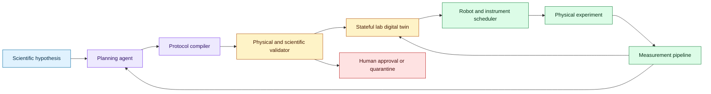
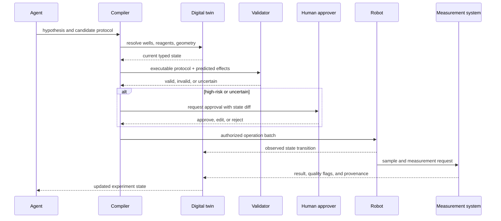

# Autonomous wet-lab control loops
Status: emerging
Sources: [Grounding AI agents in biological reality: Building blocks for autonomous wet labs — Google Research — 2026-10-16](https://research.google/blog/grounding-ai-agents-in-biological-reality-building-blocks-for-autonomous-wet-labs/)

## In one sentence

Autonomous wet-lab agents require a stateful digital twin and closed-loop experiment controller that validates physical feasibility before allowing a model-generated protocol to reach laboratory robots.

## Background: what existed before

Biological research has a gap between computational design and physical experiment. A model can propose a protein sequence, an aptamer, or a protocol, but the laboratory must handle liquid volumes, reagent identity, pipette geometry, well locations, contamination risk, timing, and instrument state. Traditional laboratory automation uses scripted protocols and human-designed checks. This provides repeatability for known procedures but is less flexible when an experiment changes based on a measurement.

AI systems have become useful for literature search, sequence design, image analysis, and hypothesis generation. Those capabilities operate mostly in silico. The next step is a loop in which an agent proposes candidates, a robot executes safe experiments, measurements return to the agent, and the next candidates are selected. The loop is attractive because biological search spaces are enormous, but it changes the safety boundary: a syntactically valid command can still be physically impossible or scientifically invalid.

The laboratory is a stateful environment. A well may be empty, contaminated, reserved, or at a different temperature. A pipette tip may be consumed. A robot arm may be positioned over another instrument. The agent’s plan must be checked against live state, not only against a static API schema.

## What changed and why now

Google Research’s October 16 report describes work on AI agents for wet labs and introduces VERID, a “Verified Infrastructure for Discovery Laboratories” framework. The report describes a semantic digital twin of a laboratory workcell that tracks robot geometry, well volumes, reagent identities, and pipette inventory. It also describes closed-loop agentic discovery prototypes for aptamer and protein design. These are research reports and demonstrations, not evidence that autonomous labs are generally safe or production-ready.

The engineering change is a physical-state control plane. The agent’s high-level plan is compiled into operations against a typed, live model of the workcell. A validator checks geometry, inventory, sequencing, and scientific constraints before execution. Measurement results then update the twin and the experiment policy.

## Impact on current processing and architecture

The digital twin should own canonical physical state. It is not merely a visualization. It tracks entities, relations, volumes, locations, reservations, instrument modes, and uncertainty. Every robot command is evaluated against the current state and produces a proposed transition before it is committed.



The protocol compiler converts a model plan into typed operations such as `aspirate`, `dispense`, `incubate`, `transfer`, `image`, and `measure`. Each operation declares preconditions, effects, required resources, and safety limits. The compiler should reject unknown operations and preserve the scientific intent separately from robot-specific coordinates.



State transitions need concurrency control. Two experiments must not reserve the same well or consume the same reagent volume. Use resource reservations, leases, and compare-and-swap updates. If an instrument reports an uncertain state, block dependent operations until reconciliation. A robot timeout should not be treated as a failed dispense without checking the physical system.

Physical validation includes geometry and inventory. The validator can check whether a pipette fits a vessel, whether the volume is available, whether tips are compatible, whether the destination has capacity, and whether the order avoids contamination. Scientific validation checks concentrations, controls, replicates, temperature, timing, and measurement quality. Keep these layers separate so a protocol can be physically valid but scientifically weak, or scientifically sensible but physically impossible.

Closed-loop learning requires measurement provenance. Store instrument calibration, sample identity, protocol version, raw output, quality checks, preprocessing, and derived features. An agent should receive a result with uncertainty and failure status, not only a scalar reward. A bad measurement can otherwise make the agent “learn” a false biological conclusion.

The experiment controller should use explicit transaction boundaries. Planning can be speculative, but reservation and execution must be committed against a current state version. A protocol may reserve a set of wells and tips, execute a subset, and then pause when an instrument reports an unexpected condition. The state record should show which operations definitely happened, which were attempted, and which were never sent. This prevents a recovery agent from repeating a transfer merely because the original command timed out.

Closed-loop selection also needs an objective contract. The agent may optimize binding strength, yield, selectivity, or a multi-objective combination, but the objective must include assay uncertainty and resource cost. A candidate with a slightly better predicted score is not necessarily worth an expensive experiment if the confidence interval overlaps the current best. Use an experiment budget, exploration quota, and stopping rule that a scientist can inspect.

Data quality gates should be able to reject a result before it reaches the learning loop. Examples include failed controls, impossible concentration changes, imaging saturation, temperature excursions, and missing sample lineage. The rejected result remains in the ledger for investigation, but it should not be treated as a positive or negative training signal without a repair decision.

Human review should be part of the protocol state rather than an informal chat message. An approval records the exact protocol hash, state snapshot, hazards, expected effects, and expiry time. If the physical state changes after approval, the approval should become invalid. This makes the boundary between scientific agency and automated execution visible and auditable.

## Real-world applications and constraints

Protein binder design can use the agent to propose sequences, schedule expression or binding assays, and select the next candidates. The search controller should balance exploitation of promising sequences with exploration of diverse candidates. Human scientists should define target, assay, and biosafety boundaries.

Aptamer design can use iterative selection and measurement. The system must track sample lineage and avoid confusing a derivative sample with an independent replicate. Contamination or batch effects can invalidate a result even when the robot followed its script.

Cell imaging workflows can close the loop between microscopy, phenotype detection, and treatment selection. The agent should not silently change imaging parameters in ways that make measurements incomparable. Instrument drift and segmentation errors need quality gates.

The constraints are physical risk, biological uncertainty, expensive experiments, and limited throughput. A digital twin reduces some operational errors but is only as accurate as its sensors and reconciliation logic. The system should default to simulation or dry-run for new protocols, require approval for hazardous or irreversible actions, and make emergency stop and recovery paths independent of the model.

Instrument integration should be treated as an unreliable distributed system. Drivers can disconnect, clocks can drift, sensors can report stale values, and a robot can stop between two protocol steps. Every adapter needs a heartbeat, command ID, acknowledgement, timeout, and recovery status. The controller should never infer completion from a network response alone; it should reconcile with the instrument or a physical sensor. Store clock and calibration metadata with measurements so later analysts can distinguish a biological effect from an integration defect.

The lab also has a throughput scheduler. Experiments compete for instruments, incubator slots, consumables, and human attention. A planner that optimizes only scientific promise may create an infeasible queue or starve controls. Schedule controls and replicates with the same priority as candidate experiments, and make resource conflicts visible before approval. A high-value experiment that cannot finish within reagent stability windows should be rejected or split into a safe plan.

## Mental model

Think of a wet-lab agent as a compiler targeting a physical machine. The language model writes an intent-level program. The compiler resolves resources. The digital twin is the type-and-state checker. The robot scheduler is the runtime. Measurements are test results that update state. A model-generated protocol is not executable until it passes the same kind of precondition and invariant checks expected in safety-critical automation.

## What changed this month

The October report describes a semantic 3D digital twin, physical validation, and closed-loop agentic experiments. It shifts the lesson from “AI designs molecules” to “AI systems must control and learn from physical experiments through state-aware infrastructure.”

## Engineering consequence

Define a laboratory state schema before connecting a model. Include locations, volumes, identity, reservations, instrument mode, calibration, temperature, contamination status, and confidence. Every command should declare its preconditions and predicted effects.

Make the protocol compiler deterministic and auditable. Store the original intent, compiled operations, state snapshot, validator results, approvals, robot logs, and measurements as one experiment record.

Use dry-run, simulation, and staged execution. Begin with harmless operations, then authorize low-risk experiments, and only later consider higher-consequence workflows. Provide an independent emergency stop and revoke the agent’s credentials on anomaly.

Evaluate both physical success and scientific value. A protocol that executes without error may still produce uninformative or irreproducible data. Measure execution failure, contamination, measurement quality, hypothesis update, and cost per useful result.

## Limits and failure modes

The digital twin can become stale if sensors miss a transition. Require reconciliation and fail closed on uncertain state.

A model can generate a scientifically plausible but unsafe protocol. Domain-specific policy and human approval remain necessary.

Robot success does not imply experiment validity. Controls, replicates, calibration, and measurement quality must be evaluated.

Closed-loop optimization can exploit assay artifacts. Use orthogonal assays and holdout experiments before trusting a promising result.

Resource conflicts can cause race conditions. Reserve consumables and use transactional state updates.

Biological search is expensive. Use explicit experiment budgets and stop criteria rather than allowing endless candidate generation.

## Mini exercise (15–30 min)

Build a toy lab twin with wells, volumes, and pipette operations. Let an agent propose a transfer, validate capacity and identity, execute it, and update state. Inject an insufficient-volume and stale-state failure.

## Runnable low-cost example

```python
from dataclasses import dataclass


@dataclass
class Well:
    name: str
    reagent: str
    volume: float


def transfer(source: Well, destination: Well, amount: float, reagent: str) -> None:
    if source.reagent != reagent:
        raise ValueError("source identity mismatch")
    if source.volume < amount:
        raise ValueError("insufficient source volume")
    if destination.reagent not in ("empty", reagent):
        raise ValueError("destination contamination risk")
    source.volume -= amount
    destination.reagent = reagent
    destination.volume += amount


def main() -> None:
    source = Well("A1", "buffer", 20.0)
    destination = Well("B1", "empty", 0.0)
    transfer(source, destination, 5.0, "buffer")
    assert source.volume == 15.0
    assert destination.volume == 5.0
    try:
        transfer(source, destination, 20.0, "buffer")
    except ValueError as error:
        print("blocked:", error)
    else:
        raise AssertionError("unsafe transfer was not blocked")


if __name__ == "__main__":
    main()
```

## Build it locally

1. Save the example as `lab_twin.py` and run `python3 lab_twin.py`.
2. Add well location, capacity, and reservation fields.
3. Add a protocol object containing preconditions and expected effects.
4. Add a dry-run mode that returns a state diff without changing state.
5. Add a measurement record with raw value, quality flag, and protocol ID.
6. Simulate two concurrent transfers and reject a stale state version.
7. Add an approval requirement for any operation marked irreversible.

## Interview Q&A

**Why is a digital twin more than a simulator?** It tracks live physical state and uses that state to validate commands and reconcile observed transitions.

**What should a protocol compiler check?** Geometry, inventory, identity, volume, ordering, contamination, instrument constraints, and scientific preconditions.

**Why separate physical and scientific validation?** A robot can execute a protocol that is physically valid but scientifically uninformative or unsafe.

**How should the system handle uncertain state?** Pause dependent operations, reconcile with sensors or a human, and do not guess that the intended transition happened.

**What is the main closed-loop risk?** The agent can optimize an assay artifact or noisy measurement rather than the intended biological objective.

## Glossary

- **Wet lab:** Laboratory that performs physical biological or chemical experiments.
- **Digital twin:** Live, stateful representation of a physical workcell and its resources.
- **Protocol compiler:** Component that converts intent into typed, executable lab operations.
- **Precondition:** State requirement that must hold before an operation runs.
- **Closed loop:** Process in which measurements update the next planning decision.
- **Lineage:** Record of how a sample or result derives from prior material.
- **Assay artifact:** Measurement effect unrelated to the intended biological signal.
- **Reconciliation:** Comparing reported system state with observed physical state.

## References

- [Grounding AI agents in biological reality — Google Research — 2026-10-16](https://research.google/blog/grounding-ai-agents-in-biological-reality-building-blocks-for-autonomous-wet-labs/)
- [VERID paper](https://arxiv.org/)
- [Google Research Science AI](https://research.google/teams/science-ai/)

## Claim ledger

| Claim | Source | Fact or inference |
|---|---|---|
| Google describes VERID as a semantic digital twin of a laboratory workcell. | Google Research announcement | Fact |
| The described state includes robot geometry, well volumes, reagent identity, and pipette inventory. | Google Research announcement | Fact |
| The report describes closed-loop aptamer and protein-design prototypes. | Google Research announcement | Fact about reported research |
| A model-generated lab command must be validated against live physical state. | Robotics and lab-automation reasoning | Engineering inference |
| Physical execution success is not equivalent to scientific validity. | Experimental-design reasoning | Engineering inference |
| Resource reservations and reconciliation are required for safe concurrent automation. | Stateful-systems design | Engineering inference |
