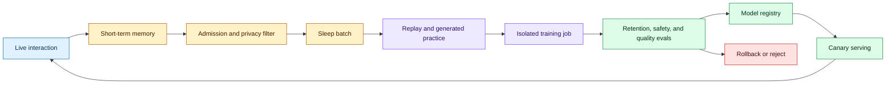
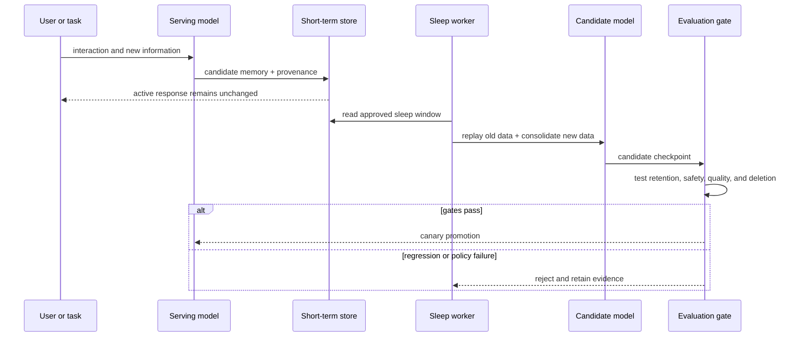

# Continual learning with sleep-style consolidation
Status: emerging
Sources: [The sleep framework: A new way for LLMs to retain knowledge in continual learning — Google Research — 2026-10-27](https://research.google/blog/the-sleep-framework-a-new-way-for-llms-to-retain-knowledge-in-continual-learning/)

## In one sentence

Sleep-style continual learning separates active interaction from offline consolidation so a model can absorb durable knowledge without updating parameters on every live request.

## Background: what existed before

Most deployed language models are static after training. New information can be placed in a prompt, retrieval index, or conversation memory, but the model’s parameters do not change. In-context learning is fast and reversible, yet the knowledge disappears when the context ends and is limited by context size. Retrieval augments answers but introduces freshness, ranking, access-control, and citation problems.

Direct continual fine-tuning seems like a natural solution: add new examples and update the model. It creates catastrophic forgetting, where learning new material degrades earlier capabilities. It also makes deployment governance difficult because every new fact can change behavior, and the update may compete with serving traffic for compute. A production system needs a safe boundary between collecting experience and changing long-lived state.

The word “sleep” is a metaphor for that boundary. The system has an active phase that gathers short-term information and an offline phase that consolidates selected material. The important engineering ideas are scheduling, memory selection, replay, isolation, evaluation, rollback, and promotion—not the neuroscience analogy itself.

## What changed and why now

Google Research’s October 27 report introduces a sleep framework for continual learning. It describes alternating active and offline phases, short-term memory, consolidation into parameters, self-generated practice examples, and pre-allocated Mixture-of-Experts memory blocks. The report claims retention of long-context knowledge and improved reasoning in its experiments. Those are source-reported research results, not independent production guarantees.

The architectural change is a model lifecycle with two states. Live traffic writes candidate memories and learning traces; it does not directly mutate the serving model. A sleep job selects and transforms those traces, trains an isolated candidate, evaluates regressions and retention, and promotes it only if policy gates pass.

## Impact on current processing and architecture

The active phase needs a short-term memory store with provenance and expiry. It records observations, user-approved facts, task outcomes, and candidate examples. A memory admission policy decides what can be consolidated. Sensitive or unverified information should remain external or require review.



The admission policy should distinguish facts, preferences, temporary context, and model-generated hypotheses. A user-approved preference may be stored with a scope and expiry. A model guess should not become a parameter update merely because it appeared in a successful conversation. Add source, consent, tenant, retention, and deletion metadata to each candidate.



Consolidation is a data-selection problem. Replay protects older capabilities. Generated practice can expand a short fact into varied contexts, but synthetic examples can amplify errors. Mix trusted historical data, recent approved examples, adversarial tests, and negative cases. Keep a holdout set that is never used in sleep training.

The scheduler should treat sleep as a workload with a service-level objective. A daily batch may be acceptable for documentation facts, while safety patches or urgent policy changes need a separate deterministic release path. Do not make emergency behavior wait for the next consolidation cycle. Conversely, do not let every new observation trigger a training job; that creates unstable behavior and makes evaluation impossible.

Memory compaction needs deduplication and conflict handling. Two conversations may state the same fact with different wording, or one may contain a correction. Keep source timestamps and authority levels. A later statement is not automatically more trustworthy. The system should produce a conflict queue when it cannot determine whether a fact changed, was scoped to a tenant, or was simply hallucinated.

Training and serving must have separate resource budgets. A sleep job can saturate accelerators, storage, or evaluation workers and harm interactive latency. Use reservations, quotas, and preemption rules. Candidate checkpoints should be written atomically and verified before the registry exposes them to serving. If a job is interrupted, resume from a known checkpoint or discard the partial artifact.

The evaluation set should contain temporal and adversarial cases. Test whether the model can use a newly admitted fact, whether it retains older facts, whether it refuses unsupported updates, and whether a prompt injection in a memory record changes behavior. Include cases where the correct answer is “unknown” because the memory has expired or was deleted.

A useful promotion report compares the candidate with the serving model on matched requests. Show new-fact accuracy, old-fact accuracy, refusal behavior, tool-call changes, latency, memory footprint, and evaluation cost. If the candidate improves one benchmark while changing unrelated behavior, the release owner needs that evidence before promotion. Keep a small traffic sample on the old model during canary so real workload drift can be detected, but do not use uncontrolled live feedback as the only acceptance gate.

There is also a distinction between learning a fact and learning a procedure. A fact may be represented compactly, while a new procedure can change tool selection, permissions, or action order. Procedure updates should use explicit tests and approval because they can create side effects. In many products, retrieval or a policy configuration is a safer place for operational changes than model parameters.

For multi-tenant systems, sleep batches need a merge policy. Shared general knowledge may be consolidated globally, while customer-specific preferences remain tenant-scoped. A batch builder should fail if an example lacks a tenant label or consent state. Evaluation must test that one tenant’s update cannot alter another tenant’s answers or tool behavior.

Operators should be able to inspect why a memory was admitted. Store the source event, approval actor, policy version, transformation, and target model component. When behavior changes, the incident investigator can then trace it to a sleep batch instead of searching an opaque history of checkpoints. This is the model equivalent of a database audit trail and a software deployment manifest.

The model registry needs lineage. A candidate checkpoint references the base model, sleep batch, data policy version, optimizer configuration, memory blocks, evaluation suite, and approval. Promotion is an artifact transition, not a mutable pointer change. Rollback should restore the previous serving model and prevent the failed batch from re-entering automatically.

Continual learning changes deletion semantics. If a user asks to delete a fact that was consolidated into parameters, deleting the source row may not remove its effect. A system must decide whether the model architecture supports targeted unlearning, whether the fact should never enter parameters, or whether retraining from a clean base is required. The admission policy should keep sensitive facts out of parameter updates unless the deletion story is credible.

## Real-world applications and constraints

Enterprise assistants can consolidate stable organizational terminology, approved workflows, and user preferences. Tenant isolation is essential: a sleep batch must not mix data across customers. Approval and retention policies should be encoded in the batch builder.

Technical support models can learn newly released product behavior. A release-specific dataset can be consolidated after tests check that old troubleshooting flows still work. Retrieval may remain preferable for rapidly changing facts because it is easier to update and delete.

Robotics or long-running agents can consolidate successful trajectories and failure cases during offline periods. The evaluation must include safety constraints and distribution shift, not only task reward.

The constraints are compute, staleness, forgetting, privacy, and deployment risk. Offline training consumes resources and creates a delayed feedback loop. Frequent sleep phases may be expensive; infrequent phases may leave the model stale. A serving system should remain useful while a candidate is evaluated and should not be coupled to a training job’s availability.

## Mental model

Think of sleep as a database compaction and software release process for model state. Live traffic writes a log. A compactor selects, deduplicates, and rewrites durable structures. Tests run against a candidate. Only a versioned artifact that passes gates becomes the active index—or in this case, the serving model.

## What changed this month

The October report describes a continual-learning lifecycle with active interaction, offline consolidation, memory replay, and model updates while keeping the core architecture fixed. It gives a concrete systems framing for persistent learning rather than treating every new fact as prompt context.

## Engineering consequence

Use a two-store design: short-term memory for recent information and a versioned training ledger for candidates. Do not write live traffic directly into serving weights. Define admission, consent, privacy, retention, and deletion before adding consolidation.

Build sleep jobs as reproducible pipelines. Pin data, model, code, and evaluation versions. Preserve the candidate checkpoint and its evidence even when promotion is rejected.

Evaluate forgetting explicitly. Maintain regression suites for old tasks, new-task holdouts, safety behaviors, privacy deletion, and tool-use contracts. Report new knowledge and retained capability together.

Prefer retrieval for facts whose update or deletion rate exceeds the model-release cadence. Parameter consolidation is useful when the knowledge is stable and repeated access justifies the operational cost.

## Limits and failure modes

Synthetic practice can reinforce incorrect model beliefs. Keep trusted data and human-approved examples in the replay mix.

Catastrophic forgetting can hide behind aggregate scores. Segment old capabilities and safety tests.

Parameter updates complicate deletion and tenant isolation. Keep sensitive facts external unless the design has a credible unlearning path.

Sleep jobs can race with product releases. Use model registry dependencies and canary promotion.

Memory admission can capture prompt injection or malicious content. Treat candidate memories as untrusted input and sanitize them.

Continual updates can create behavior drift that is hard to explain. Maintain versioned batches and compare serving traces before promotion.

## Mini exercise (15–30 min)

An implementation should make the sleep boundary visible to operators. Expose batch size, admitted-memory count, rejected-memory count, replay composition, evaluation version, candidate checkpoint, and promotion decision. A dashboard that shows only “model updated” cannot explain why an answer changed. Store a diff of behavior on a fixed probe set and attach it to the promotion record.

The learning ledger also needs a quarantine path. Prompt injection, unsupported user claims, copied secrets, and low-confidence model summaries should remain available for investigation but must not enter replay or parameter updates. Quarantine records can be reviewed later without making the serving model depend on the review speed. This separation is the continual-learning equivalent of putting untrusted events in a dead-letter queue.

Implement an active memory list and a sleep job that consolidates only approved facts into a dictionary used by a toy model. Add a regression set and reject a candidate that overwrites an old fact.

## Runnable low-cost example

```python
from dataclasses import dataclass


@dataclass(frozen=True)
class Memory:
    key: str
    value: str
    approved: bool
    source: str


def sleep(active: list[Memory], base: dict[str, str]) -> tuple[dict[str, str], list[str]]:
    candidate = dict(base)
    rejected = []
    for memory in active:
        if not memory.approved:
            rejected.append(memory.key)
            continue
        if memory.key in candidate and candidate[memory.key] != memory.value:
            rejected.append(memory.key)
            continue
        candidate[memory.key] = memory.value
    return candidate, rejected


def main() -> None:
    base = {"tone": "concise"}
    active = [
        Memory("timezone", "Phoenix", True, "user"),
        Memory("tone", "secret", False, "model_guess"),
        Memory("tone", "verbose", True, "user"),
    ]
    candidate, rejected = sleep(active, base)
    assert candidate["timezone"] == "Phoenix"
    assert "tone" in rejected
    print(candidate, rejected)


if __name__ == "__main__":
    main()
```

## Build it locally

1. Save the example as `sleep_cycle.py` and run `python3 sleep_cycle.py`.
2. Add timestamps, tenant IDs, expiry, and deletion state to memories.
3. Add a replay set that must remain unchanged after consolidation.
4. Add a candidate version and an evaluation result before promotion.
5. Simulate a conflicting update and record why it was rejected.
6. Add a canary model that handles a small request fraction.
7. Add rollback to the prior candidate when a regression appears.

## Interview Q&A

**Why separate wake and sleep phases?** Live serving stays predictable while offline jobs select, consolidate, evaluate, and promote model changes.

**When is retrieval better than parameter updates?** When facts change often, need precise deletion, or must be tenant-isolated.

**How do you test forgetting?** Run old capability, safety, and tool-contract suites alongside new knowledge tests.

**Can generated examples be trusted?** No. They need provenance, filtering, and mixing with trusted data because they can amplify errors.

**What is the hardest privacy issue?** A fact written into parameters may survive deletion of its source record; the architecture must address that before admission.

## Glossary

- **Continual learning:** Updating a model or memory as new information arrives over time.
- **Sleep phase:** Offline consolidation period separated from live interaction.
- **Catastrophic forgetting:** Loss of prior capability after learning new data.
- **Replay:** Reusing older examples to preserve previous behavior.
- **Memory admission:** Policy deciding which observations may become durable.
- **Canary promotion:** Serving a candidate to a small traffic fraction before full release.
- **Model registry:** Versioned store of model artifacts, lineage, and deployment state.
- **Unlearning:** Removing the effect of data from a model or derived state.

## References

- [The sleep framework — Google Research — 2026-10-27](https://research.google/blog/the-sleep-framework-a-new-way-for-llms-to-retain-knowledge-in-continual-learning/)
- [Language Models Need Sleep: Learning to Self-Modify and Consolidate Memories](https://arxiv.org/abs/2606.03979)
- [Continual learning overview](https://www.cs.toronto.edu/~hinton/absps/nature13.pdf)

## Claim ledger

| Claim | Source | Fact or inference |
|---|---|---|
| Google describes alternating active and sleep phases for continual learning. | Google Research announcement | Fact |
| The reported framework uses short-term context, offline consolidation, and self-generated practice examples. | Google Research announcement | Fact about the reported method |
| The report describes pre-allocated MoE memory blocks. | Google Research announcement | Fact about the reported implementation |
| Live traffic should not directly mutate the serving model in a production design. | Release and deployment engineering | Engineering inference |
| Replay and holdouts are necessary to detect forgetting. | Continual-learning methodology | Engineering inference |
| Sensitive data requires an explicit parameter-deletion policy. | Privacy and model lifecycle reasoning | Engineering inference |
