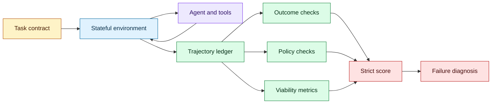
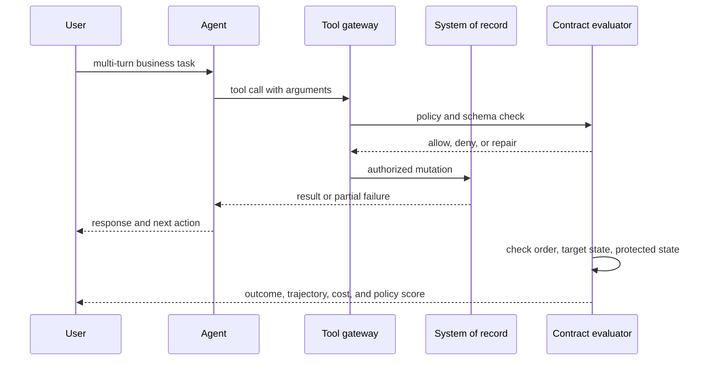

# Stateful enterprise-agent evaluation
Status: emerging
Sources: [CRM-Agent-Bench: Benchmarking Tool-Using Agents in Stateful Enterprise Environments — Banerjee et al. — 2026-10-23](https://arxiv.org/abs/2610.32004)

## In one sentence

Enterprise agents must be evaluated as state-changing transaction systems, where outcome, trajectory, operational viability, and policy compliance are jointly checked against an executable contract.

## Background: what existed before

Many language-agent evaluations score an answer against a reference string or ask whether a task was completed. That is useful for question answering and simple tool use, but it is insufficient when an agent updates a system of record. A CRM workflow may require finding the right customer, checking permissions, changing fields in a specific order, sending a message, and leaving protected fields untouched. The final record can look correct even if the agent took an unsafe route or violated a policy along the way.

Enterprise state is mutable and shared. A customer record changes between turns, tools can return partial failures, and a user may correct the agent midway through a conversation. An agent can also spend too much time or money while eventually reaching the desired state. Evaluation must therefore inspect the trajectory and the operational envelope, not only the final answer.

## What changed and why now

CRM-Agent-Bench is an October 23 arXiv benchmark for tool-using agents in stateful enterprise environments. The paper describes 555 multi-turn tasks across nine business domains and 36 capability tags. Each task includes an executable contract checking actions, arguments, order, response, target state, and protected state. The paper reports strict success, latency, cost, and per-domain reliability across sixteen systems. These are benchmark-reported results, not independent production measurements.

The engineering change is contract-grounded evaluation. A task is not “did the model say the right thing?” It is “did the complete agent system reach the required state, follow the declared policy, use viable resources, and avoid forbidden changes?” This creates a portable test interface between an agent and an enterprise simulator or sandbox.

## Impact on current processing and architecture

Represent a task contract as executable checks. It should declare initial state assumptions, allowed tools, required action sequence or partial order, argument constraints, expected response, target-state predicates, and protected-state invariants. The evaluator runs the agent against a versioned environment and records every event.



Strict conjunction is important. If the task requires both a target update and preservation of a protected field, passing one does not compensate for failing the other. Report component checks separately so a team can see whether failure came from tool selection, argument formation, ordering, response quality, or state integrity.



The environment must model realistic state transitions. A tool should be able to return stale data, permission denial, validation error, or timeout. Records should include hidden protected fields so the evaluator can detect accidental mutation. Multi-turn tasks should include user corrections and contradictory requests to test whether the agent maintains the right state.

Operational viability includes latency, tool calls, token use, cost, retries, and failure recovery. A system that reaches the correct state after hundreds of expensive calls may be unsuitable for production. Measure distribution, not only mean: p95 latency and tail cost often determine user experience.

Contract design should distinguish invariants from workflow preferences. An invariant is a condition that must always hold, such as never changing a protected field or never sending a message without approval. A preference is a desirable path, such as using a particular search tool before another. If a preference is scored as a hard requirement, the benchmark may penalize a safe alternative; if an invariant is scored as a preference, the benchmark may permit harm. Store the distinction in the contract schema.

Partial orders are often more realistic than one exact sequence. A customer lookup must precede an update, but logging and drafting a response may happen in either order. Represent dependencies as a directed acyclic graph and check that each action’s prerequisites were satisfied. This tests planning without rewarding an arbitrary trace. For irreversible actions, add a confirmation edge from a human or an approval service.

State snapshots need isolation. Two benchmark tasks should not share mutable records unless the benchmark deliberately tests concurrency. Reset the environment from a known seed, record the initial state hash, and verify that cleanup restored the expected state. Otherwise a successful run can depend on a previous task’s mutation and make results irreproducible.

Tool errors are part of the task, not noise to remove. A realistic evaluator should include malformed arguments, transient outages, permission denials, stale reads, and conflicting updates. Score whether the agent retries safely, asks for clarification, or escalates. A retry that repeats a non-idempotent write is a different failure from a retry of a read-only query.

Benchmark reports should include confidence intervals and per-domain breakdowns. A model may perform well on contact lookup and poorly on authorization-sensitive case closure. The engineering owner needs the breakdown to choose routing, guardrails, or human review. Aggregate success is a summary, not a diagnosis.

The benchmark harness itself requires security. Tool sandboxes should contain only synthetic data, credentials should be scoped, and evaluator logs should redact sensitive values. A benchmark that grants broad permissions to simplify scoring can teach an agent that those permissions are normal. The test environment should model the same least-privilege assumptions expected in deployment.

Policy compliance should be evaluated at the event level. A final state can conceal that the agent read an unauthorized record, attempted a forbidden tool, or changed a field and then restored it. Log denied calls and policy decisions. In real systems, a denied call may be good behavior, while a benchmark that scores only completion could mark it as failure.

The evaluator should expose a failure taxonomy that maps to engineering owners. `wrong_record` belongs to retrieval or entity resolution, `forbidden_action` to authorization, `bad_arguments` to tool schema or planning, `stale_state` to concurrency handling, `unsafe_retry` to idempotency, and `poor_response` to communication. This makes a benchmark run actionable. It also prevents teams from “improving the score” with a generic prompt change when the real fix belongs in the gateway or data model.

Human review can be modeled as a tool with a response contract. The agent may submit a clarification request, the reviewer may approve or reject a side effect, and the evaluator checks that the agent waits for the decision. This tests escalation behavior rather than treating a human as an invisible oracle. Include reviewer latency and queue capacity in viability metrics because a workflow that always waits for a person may be correct but not scalable.

Contracts should evolve with schema versions. When a CRM field changes meaning or a policy adds a new protected attribute, old benchmark tasks should retain their original contract while new tasks use the new one. Store the environment schema, tool schema, and contract revision together. A score change after a schema update is not comparable without that metadata.

Finally, evaluate abstention. An agent that recognizes missing authorization or ambiguous identity should be able to stop and request clarification. Score a safe abstention differently from an avoidable failure, but never reward the agent for guessing through an unresolved business constraint. This is especially important when the benchmark’s goal is trustworthy delegation rather than maximum task completion.

## Real-world applications and constraints

CRM workflows include account updates, ticket triage, customer communication, and case routing. Contracts can check that the right account changed, a protected field did not, and an external message was sent only after approval.

IT service agents can be evaluated on incident creation, access requests, and remediation. A task should check change-window constraints, rollback availability, and whether the agent escalated when evidence was incomplete.

Finance operations need exact fields, authorization, and audit records. The evaluator should score both transaction correctness and the presence of required evidence.

HR or healthcare workflows require stronger privacy controls. Benchmark data must be synthetic or governed, and contracts should include access boundaries and retention behavior.

The constraint is realism without unsafe external effects. Use a stateful simulator or isolated sandbox that mirrors schemas and failure modes, then validate a smaller set against human-reviewed scenarios. Avoid treating a public benchmark score as a deployment authorization.

## Mental model

Think of an enterprise-agent benchmark as integration testing for a distributed transaction. The model is one component, tools are APIs, the system of record is a database, and the contract is an executable business invariant. A green final-state assertion without trajectory checks is like testing a database only by inspecting one row after a transaction.

## What changed this month

CRM-Agent-Bench makes state, trajectory, operational viability, and policy compliance first-class evaluation dimensions. It provides a concrete pattern for moving agent evaluation from response quality to business-transaction integrity.

## Engineering consequence

Write task contracts before prompts. Define target and protected state, action constraints, policy, latency budget, cost budget, and escalation conditions. Make contracts executable and versioned.

Build a trajectory ledger with tool request, authorization decision, arguments, result, state diff, latency, and cost. Redact sensitive values while retaining identifiers needed for diagnosis.

Use strict scoring for release gates and component metrics for debugging. A single aggregate score is useful for comparison but not sufficient for deciding what to fix.

Test recovery. Include stale reads, timeouts, duplicate requests, user corrections, and permission denials. An agent should fail safely and explain the next step rather than inventing completion.

## Limits and failure modes

Benchmarks may not represent a company’s schemas, policies, or user behavior. Build a local contract suite from real failure patterns with safe data.

Simulators can have unrealistic tool failures or state transitions. Compare simulator traces with production incidents.

Strict conjunction can hide useful partial progress. Report each component and the failure reason alongside the strict result.

Agents may optimize for benchmark contracts and miss unmodeled policy. Rotate task templates and include human-authored scenarios.

Cost and latency measurements depend on infrastructure. Record model, tool, hardware, and concurrency configuration.

Privacy-sensitive state must be synthetic or access-controlled. Do not copy customer records into an evaluation set casually.

## Mini exercise (15–30 min)

For a useful local harness, represent the system of record as an event-sourced fixture. The evaluator can replay the initial events, execute the agent trace, and compare the resulting state hash with the contract. This makes failures reproducible and supports time-travel debugging: an engineer can inspect the exact record before the forbidden mutation. Add a separate policy log so a denied tool call is visible even when it did not change state.

A benchmark should include both happy-path and recovery tasks. Happy-path tasks test whether the agent can complete a normal business process. Recovery tasks test whether it notices stale information, handles a tool timeout, waits for approval, or asks the user to disambiguate an identity. The latter often reveal more about deployability because production systems are defined by partial failure rather than by the ideal path.

Implement a toy CRM with contacts, tickets, and protected fields. Write a contract requiring one ticket update, one unchanged field, and a maximum of three tool calls. Evaluate a correct agent trace and a trace that reaches the target state by violating policy.

## Runnable low-cost example

```python
from dataclasses import dataclass


@dataclass
class Record:
    status: str
    owner: str
    protected_email: str


def evaluate(before: Record, after: Record, calls: list[str]) -> dict[str, bool]:
    return {
        "target_state": after.status == "closed",
        "protected_state": after.protected_email == before.protected_email,
        "allowed_order": calls == ["read", "close"],
        "viable": len(calls) <= 3,
    }


def main() -> None:
    before = Record("open", "sam", "sam@example.test")
    after = Record("closed", "sam", "sam@example.test")
    checks = evaluate(before, after, ["read", "close"])
    assert all(checks.values())
    bad = Record("closed", "sam", "changed@example.test")
    assert not evaluate(before, bad, ["read", "close"])["protected_state"]
    print(checks)


if __name__ == "__main__":
    main()
```

## Build it locally

1. Save the example as `contract_eval.py` and run `python3 contract_eval.py`.
2. Add tool arguments and authorization results to the trace.
3. Add a timeout and duplicate-call failure case.
4. Add a user correction between tool calls.
5. Record a state diff after every mutation.
6. Add cost and latency to the viability result.
7. Create five contracts with different protected fields and compare failure categories.

## Interview Q&A

**Why is final-state accuracy insufficient?** The agent may violate policy, access unauthorized data, or take an expensive and unsafe path before reaching the final state.

**What is a protected-state assertion?** An invariant that must remain unchanged, such as a permission, balance, or identity field.

**What should a contract contain?** Initial assumptions, allowed tools, argument rules, order, target state, protected state, response, and operational limits.

**Why measure cost and latency?** A functionally correct agent can still be operationally unusable if it requires too many calls or excessive time.

**How should benchmarks influence deployment?** They identify strengths and failure modes; deployment also needs organization-specific tests, approvals, and monitoring.

## Glossary

- **Stateful environment:** Environment whose records change as actions execute.
- **Executable contract:** Machine-checkable task requirements and invariants.
- **Target state:** Required final condition in the system of record.
- **Protected state:** Data that must not change during the task.
- **Trajectory:** Ordered record of observations, actions, results, and state changes.
- **Strict success:** Result that passes every required contract check.
- **Operational viability:** Whether latency, cost, retries, and resource use meet constraints.
- **Policy compliance:** Adherence to authorization and business rules during execution.

## References

- [CRM-Agent-Bench — arXiv:2610.32004](https://arxiv.org/abs/2610.32004)
- [CRM-Agent-Bench repository](https://github.com/salesforce-misc/crm-agent-bench)
- [AgentBench](https://arxiv.org/abs/2308.03688)

## Claim ledger

| Claim | Source | Fact or inference |
|---|---|---|
| CRM-Agent-Bench contains 555 stateful, multi-turn tasks across nine domains and 36 capability tags. | Benchmark paper | Fact about the paper |
| Its contracts check actions, arguments, order, response, target state, and protected state. | Benchmark paper | Fact |
| The paper evaluates outcome, trajectory, operational viability, and policy compliance. | Benchmark paper | Fact |
| Enterprise agents should be tested as transaction systems rather than answer generators. | Benchmark interpretation | Engineering inference |
| Protected-state checks expose unsafe paths that final-state checks miss. | Evaluation design | Engineering inference |
| Local contract suites should complement public benchmark results. | Deployment engineering | Engineering inference |
