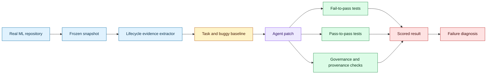
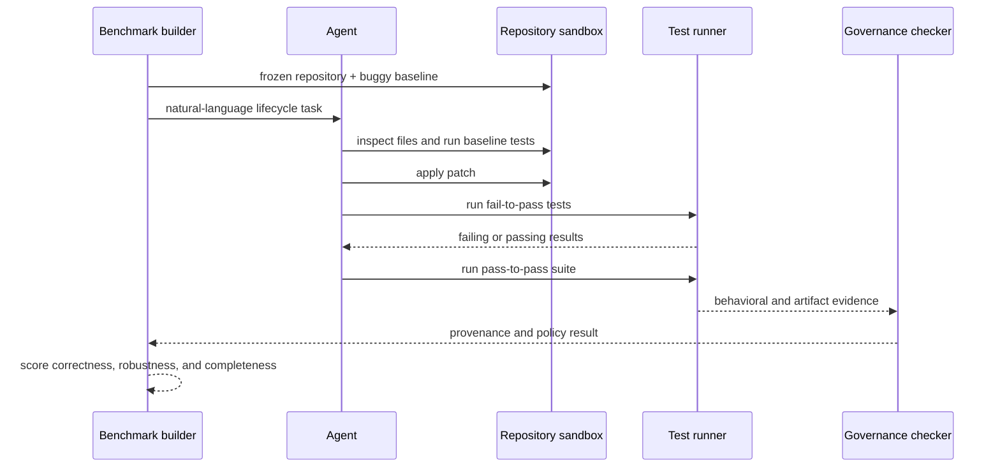

# Repository-native MLOps agent evaluation
Status: emerging
Sources: [MLOps-Bench: Benchmarking AI Agents on Production ML Engineering in Real Repositories — Tran et al. — 2026-10-16](https://arxiv.org/abs/2610.23506)

## In one sentence

Repository-native MLOps benchmarks test whether an agent can make executable lifecycle changes that preserve data, training, serving, monitoring, CI/CD, and governance behavior in real machine-learning repositories.

## Background: what existed before

Coding-agent benchmarks often evaluate issue resolution in ordinary repositories or ask agents to build models in isolated competition environments. Both are useful, but production ML engineering has a wider contract. A change to a feature transform can break train/serve consistency. A serving change can invalidate input validation. A new model artifact may lack lineage. A monitoring change can hide drift. A CI configuration can bypass a governance gate.

The repository is part of the specification. The task description may mention a symptom, but the correct solution depends on loaders, schemas, configuration, artifact layout, tests, deployment scripts, and monitoring conventions already present. An agent that writes locally plausible code can still break behavior elsewhere in the lifecycle.

MLOps also has pass-to-pass behavior. Existing tests should continue to pass, not only newly added tests. A patch that fixes one failing case by changing a schema or disabling a check may receive a narrow green signal while damaging production assumptions. Evaluation needs repository evidence and behavioral tests.

## What changed and why now

MLOps-Bench is an October 16 arXiv benchmark for production ML engineering in real repositories. The paper describes 212 validated tasks from 31 public ML repositories, with fail-to-pass and pass-to-pass tests, oracle patches, buggy baselines, and provenance metadata. It evaluates lifecycle areas including data pipelines, features, training, serving, monitoring, CI/CD, governance, and integration. The paper reports results for six agents and emphasizes partial progress versus production-relevant correctness. These are benchmark-reported results.

The engineering change is repository-grounded evaluation. A task is generated from lifecycle evidence in a frozen repository snapshot. The agent must modify that repository, run tests, and preserve behavior. This moves evaluation from code completion to change management across coupled ML components.

## Impact on current processing and architecture

The benchmark builder needs a reproducible repository snapshot, task contract, buggy baseline, oracle patch, behavioral tests, and provenance. The evaluator applies the agent patch to the frozen snapshot, runs fail-to-pass tests, then runs pass-to-pass tests and lifecycle checks.



Lifecycle evidence is the bridge between repository and task. It may include a data loader, feature schema, training configuration, model artifact, serving endpoint, monitoring output, workflow file, or governance metadata. The task should identify the relevant surfaces without giving away the implementation. The oracle patch is a reference for validation and analysis, not necessarily the only acceptable patch.



Fail-to-pass tests show whether the requested behavior was fixed. Pass-to-pass tests show whether existing behavior was preserved. Add contract tests for train/serve parity, artifact metadata, input validation, monitoring signals, and CI gates. A patch that changes one layer without updating its contract should fail visibly.

The evaluator should capture more than a final pass rate. Record files changed, commands run, test durations, retries, dependency changes, artifact hashes, and whether the agent modified tests to hide a failure. Use a clean patch application and review generated diffs for forbidden changes such as deleting governance checks or weakening assertions.

Task construction should begin with a lifecycle map. Identify where data enters, where schemas are validated, how features are computed, where training reads configuration, how artifacts are named and registered, how serving loads them, and where monitoring emits evidence. A task is strong when a requirement crosses at least two of these boundaries and the repository contains observable contracts for both. For example, “add a new feature” should test the loader, transformation, training fixture, serving path, and schema metadata rather than only one function.

The buggy baseline must be plausible. A random syntax error measures debugging, not MLOps reasoning. Useful baselines include a feature name present in training but absent in serving, a checkpoint loaded without version validation, a monitoring metric emitted under the wrong label, a workflow that skips a data validation job, or a model artifact without a lineage field. The bug should fail a meaningful behavior test and be repairable through repository-native evidence.

Agent trajectories deserve review. An agent that reads the right configuration, runs a focused test, inspects the failure, and makes a small patch demonstrates a different capability from one that rewrites half the repository until a test happens to pass. Log search paths, command outputs, test selection, and patch size, while treating internal reasoning as unnecessary for the benchmark contract. The useful artifact is the observable engineering process.

Cross-repository generalization is another dimension. An agent can memorize conventions in one repository and fail when the same lifecycle concept uses different filenames or frameworks. Partition tasks by repository and evaluate leave-one-repository-out performance. Include both familiar and unfamiliar toolchains, but preserve the same behavioral contract so the comparison remains meaningful.

MLOps correctness often includes time. A training job may finish today but produce a stale artifact tomorrow. A monitoring alert may fire eventually but miss the incident window. A data backfill may be logically correct but violate the serving freshness objective. Add temporal fixtures, freshness thresholds, and delayed-event tests where the concept requires them. Record wall-clock and simulated time separately so a fast test does not hide a slow operational path.

Security boundaries should be explicit. The agent’s repository token should not grant production deployment, and test credentials should be synthetic. A benchmark can check that a patch preserves secret scanning, approval requirements, and environment separation. If an agent needs to update a deployment manifest, the evaluator should inspect whether it also changed an unrelated permission or endpoint.

## Implementation detail: scoring a patch

Use a scorecard rather than a single pass bit. One useful shape is: requested behavior, regression behavior, data-contract integrity, artifact lineage, monitoring coverage, governance compliance, resource budget, and patch hygiene. Each dimension can be boolean for a release gate and numeric for diagnosis. Keep the strict gate as a conjunction for high-consequence changes, but show the vector so engineers know where the patch failed.

When tests disagree, preserve evidence. A fail-to-pass test may pass while a pass-to-pass test fails because the patch changed a shared helper. A governance check may fail even though application tests pass. The evaluator should report the first failure in dependency order and the complete set of failures after the run. This avoids encouraging agents to stop after the requested test passes.

Human reviewers can use the scorecard to approve a patch that is not fully automated, but the exception must be recorded. For example, a numerical model-quality change may require domain review even when lifecycle tests pass. The benchmark should not encode a false certainty that all production acceptance can be reduced to unit tests.

Repository state must be isolated. Run each task from a clean snapshot with controlled network and credentials. A build cache can improve cost but must not leak artifacts between tasks. If the task requires a dataset, use a stable fixture and record its version. If the agent cannot reproduce a service, provide a local fake with the same contract rather than allowing arbitrary external access.

## Real-world applications and constraints

Data-pipeline tasks can test schema validation, null handling, partitioning, and backfills. The evaluator should check that a fix does not alter historical semantics accidentally.

Feature-engineering tasks can test train/serve consistency and feature freshness. A model may pass offline tests while production serving computes a different transform; include both paths.

Training tasks can test configuration, checkpoint naming, reproducibility, and resource limits. A correct change should not make a job silently consume ten times the intended compute.

Serving tasks can test input validation, model loading, batching, and error handling. The agent should preserve observability and safe defaults.

Monitoring tasks can test drift metrics, alerts, dashboards, and incident metadata. A change that removes an alert is not a fix merely because tests stop failing.

Governance tasks can test approvals, lineage, model cards, and release gates. Repository-native evaluation makes these artifacts part of correctness rather than optional documentation.

The constraint is benchmark maintenance. Real repositories evolve, dependencies disappear, and tests become flaky. Freeze snapshots, pin environments, and periodically revalidate tasks. Preserve a task when it teaches a durable lifecycle concept, not merely a version-specific line edit.

## Mental model

Think of MLOps-Bench as a release rehearsal. The agent is a maintainer, the repository is a living system, fail-to-pass tests define the requested change, pass-to-pass tests define the compatibility contract, and governance checks define the conditions for shipping. The benchmark asks whether the patch is safe to merge, not whether the generated code looks reasonable.

## What changed this month

The October benchmark grounds agent tasks in real ML repositories and evaluates lifecycle behavior across data, features, training, serving, monitoring, CI/CD, and governance. It exposes the gap between partial code progress and production-ready change management.

## Engineering consequence

Create repository evidence maps for internal agent evaluations. Link task requirements to files, schemas, tests, artifacts, and operational checks. This improves both benchmark validity and agent debugging.

Require pass-to-pass tests and governance checks. New tests alone can be gamed or can miss regressions in existing behavior.

Version task snapshots, dependencies, fixtures, and oracle patches. Record environment provenance and test flakiness so score changes are explainable.

Measure patch quality by lifecycle dimension. A single success number should be accompanied by data-contract, serving, monitoring, governance, and integration breakdowns.

## Limits and failure modes

Public repositories may not represent private production conventions. Supplement them with safe internal tasks.

Oracle patches can bias evaluation toward one implementation. Prefer behavioral contracts and multiple valid solutions where possible.

Tests can miss operational failures. Add resource, latency, artifact, and governance checks.

Agents may modify tests or configuration to hide failures. Protect test infrastructure and inspect diffs.

Dependencies and external services can make tasks flaky. Pin versions and use deterministic fixtures.

Partial success can be useful but misleading. Report component failures instead of treating a near miss as production readiness.

## Mini exercise (15–30 min)

Create a tiny repository with a data loader, feature transform, model file, and serving function. Introduce a train/serve mismatch, write a fail-to-pass test, add pass-to-pass tests, and ask a local script to score a patch.

## Runnable low-cost example

```python
from dataclasses import dataclass


@dataclass
class PatchResult:
    fail_to_pass: bool
    pass_to_pass: bool
    governance: bool


def score(result: PatchResult) -> dict[str, bool]:
    return {
        "task_complete": result.fail_to_pass and result.pass_to_pass and result.governance,
        "requested_fix": result.fail_to_pass,
        "regression_free": result.pass_to_pass,
        "shippable": result.governance,
    }


def main() -> None:
    good = score(PatchResult(True, True, True))
    risky = score(PatchResult(True, False, True))
    assert good["task_complete"]
    assert not risky["task_complete"]
    assert not risky["regression_free"]
    print(good, risky)


if __name__ == "__main__":
    main()
```

## Build it locally

1. Save the example as `mlops_score.py` and run `python3 mlops_score.py`.
2. Create a temporary repository with a loader and serving function.
3. Add a failing test for train/serve feature parity.
4. Add a pass-to-pass test for existing prediction behavior.
5. Add a metadata check for model version and input schema.
6. Record files changed and commands run for each patch.
7. Reject a patch that edits tests or disables a governance check.

## Interview Q&A

**Why are ML repositories different from ordinary code repositories?** Correctness spans data contracts, features, training, artifacts, serving, monitoring, and governance.

**What is a pass-to-pass test?** An existing behavior test that must remain passing after the requested change.

**Why freeze the repository?** So agent results are comparable and not affected by upstream dependency or code changes.

**How can an agent game the benchmark?** It can weaken tests, remove gates, hard-code fixtures, or make a narrow patch that ignores lifecycle behavior.

**What should a production score include?** Requested behavior, regression freedom, operational viability, artifact lineage, monitoring, and governance compliance.

## Glossary

- **MLOps:** Practices and systems for operating ML through data, training, serving, and monitoring lifecycles.
- **Repository-native task:** Task grounded in files, contracts, tests, and artifacts from a real repository.
- **Fail-to-pass test:** Test expected to fail on the buggy baseline and pass after the fix.
- **Pass-to-pass test:** Existing regression test that must remain passing.
- **Train/serve skew:** Difference between feature processing during training and serving.
- **Governance gate:** Required approval, metadata, or policy check before release.
- **Oracle patch:** Reference patch used to construct or validate a benchmark task.
- **Provenance:** Record of code, data, environment, and artifact origins.

## References

- [MLOps-Bench — arXiv:2610.23506](https://arxiv.org/abs/2610.23506)
- [MLOps-Bench repository](https://github.com/)
- [Hidden Technical Debt in Machine Learning Systems](https://papers.neurips.cc/paper/5656-hidden-technical-debt-in-machine-learning-systems)

## Claim ledger

| Claim | Source | Fact or inference |
|---|---|---|
| MLOps-Bench contains 212 validated tasks from 31 public ML repositories. | Benchmark paper | Fact about the paper |
| Tasks span data, features, training, serving, monitoring, CI/CD, governance, and integration. | Benchmark paper | Fact |
| The benchmark includes fail-to-pass and pass-to-pass tests plus provenance metadata. | Benchmark paper | Fact |
| Repository evidence is necessary for production-ML agent evaluation. | Benchmark interpretation | Engineering inference |
| Governance and artifact lineage should be scored as behavior, not documentation polish. | MLOps design | Engineering inference |
| Test-infrastructure protection is required to prevent benchmark gaming. | Evaluation security | Engineering inference |
