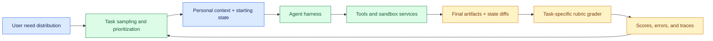
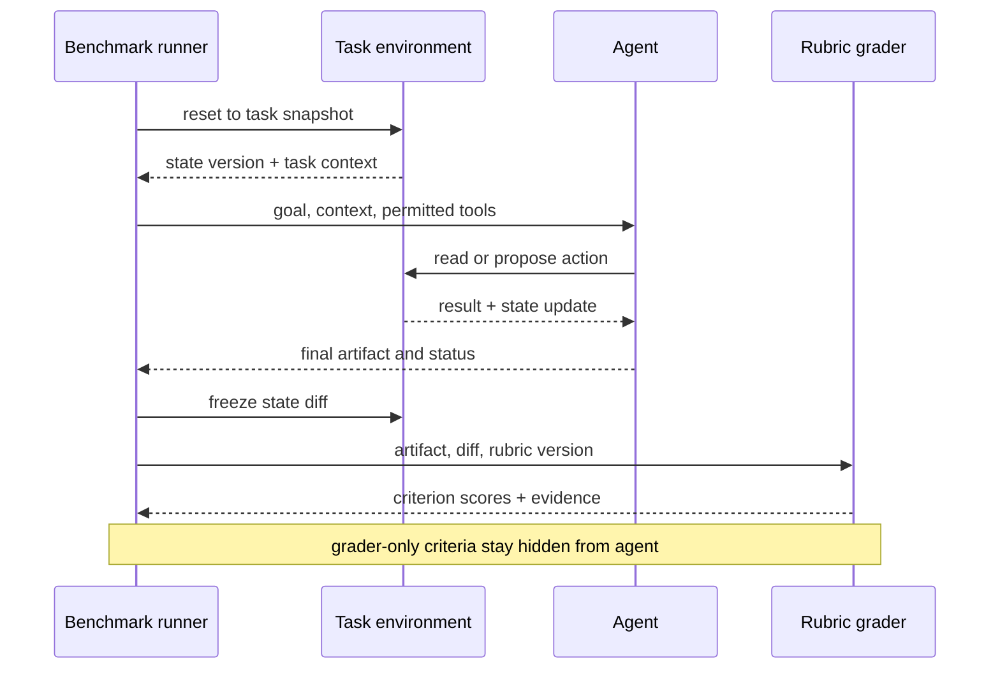

# Evaluating personalized assistance on everyday life tasks
Status: emerging
Sources: [OpenAI — LifeVal — 2026-11-02](https://openai.com/index/lifeval/); [Yang et al. — LifeVal paper — 2026-11-04](https://arxiv.org/abs/2611.06687)

## In one sentence

LifeVal is a benchmark design for asking whether an AI assistant can complete personalized, consequential consumer tasks using user context and digital tools, rather than merely answer isolated knowledge questions.

## Background: what existed before

Most model evaluations began with a prompt and ended with a text answer. A benchmark might ask for a definition, a code fragment, or a solution to a math problem. Those tests are useful for comparing narrow capabilities, but a personal assistant often has to work across several systems: understand a user’s preferences, retrieve a relevant document, compare options, fill a form, preserve a draft, and ask before a consequential submission. A fluent final response can conceal that it used the wrong account, missed a constraint, or claimed an action that never happened.

Product usage metrics do not solve this evaluation problem. A click or completed conversation describes what people already tried to do. It may undercount tasks users do not yet expect an assistant to handle, and adoption can lag technical capability. Conversely, a benchmark assembled only from model-friendly prompts may overstate the value people place on the tasks. A useful evaluation therefore needs both task selection grounded in people’s lives and a realistic execution environment that exposes errors and side effects.

LifeVal’s authors start from two time-use datasets and a consumer survey. The paper describes 3,837 survey respondents, time-use categories, and 148 activity categories used to guide task collection. The November 2 product post reports 3,995 survey respondents. These numbers differ between the paper and post; preserve the attribution rather than silently combining them. The paper’s categories cover tasks such as financial management, moving, job search, and childcare. The task-selection methodology is itself a design choice: the benchmark is intended to represent tasks people value, not every possible assistant interaction.

## What changed and why now

The November 2 LifeVal post presents a benchmark for practical tasks, with examples involving school enrollment, flood preparation, housing, remote game viewing, and meal planning. It says the work draws on time-use data and a representative survey. The November 4 paper adds implementation details: 169 personalized tasks, task-specific contexts and environments, rubrics written by task creators, and multiple human quality-control rounds. The product post and paper are related sources with different details; treat the paper as the main methods source and the post as a release-specific summary.

The paper describes task authors as people who had personally completed a task repeatedly and lived with the results over time. They supplied task context and grading criteria. The benchmark includes a starting state and environment, rather than scoring only whether a response sounds plausible. Its primary grader checks the final artifact and backend state changes. A separate “hack” grader can flag attempts that exploit internal environment interfaces. In other words, the evaluated object is a workflow result, not just a transcript.

The reported result is a vendor evaluation, not independent proof of consumer benefit. The benchmark and scoring infrastructure are described by the paper’s authors, and model comparisons use their selected tasks, environments, rubrics, and effort settings. The useful engineering change is the evaluation shape: task importance, personal context, stateful execution, and outcome grading are all explicit parts of the test.

## Impact on current processing and architecture

A benchmark in this class needs a task registry. Each entry should identify a goal, user context, starting state, allowed tools, expected artifact, rubric, prohibited shortcuts, and environment revision. Consider “find a home that fits a budget, keeps a commute short, and has a separate living unit.” A test must supply a stable set of candidate listings and user constraints, define how commute and budget are calculated, and specify whether the assistant may only shortlist or can add a deed to a cart. The tool permissions are part of the task contract.

The execution harness needs reproducibility. A run record should pin the model identifier, system prompt or agent policy, tool schemas, browser or connector versions, fixture data, environment state, random seed where applicable, and grader version. Each tool action should produce a typed event with arguments, response, timestamp, and resulting state diff. If the assistant says “I added the deed,” the evaluator should inspect the cart state rather than accept the sentence as evidence. If a task times out, the harness needs to distinguish a failed action from an unknown outcome.

Task-specific rubrics are more informative than one binary label. For a school-enrollment task, dimensions might include correct district, application dates, required documents, travel fit, and explicit handling of unknown details. A partially correct result can receive partial credit, but the rubric should also include critical errors that cap or zero the score. This makes it possible to distinguish “found the right school, omitted a document” from “selected an ineligible school.” The evaluator must retain both the aggregate score and criterion-level evidence.

LifeVal also changes what a benchmark owner must govern. Personalization may use conversations, memory, or reference files. The benchmark paper says personal information was de-identified or synthetically generated in published materials. For an internal benchmark, the data pipeline still needs consent, minimization, access controls, retention limits, and a way to remove a contributor’s information. A benchmark can be representative in one sense and still encode a narrow language, geography, or service-access assumption.



This architecture makes task selection and measurement part of the system. A changed rubric or starting state can change scores even when the model is identical. The benchmark should therefore version the task bundle, not just the model. A percentage without a task-set revision is not a stable comparison.

The run itself also needs an explicit lifecycle. A benchmark runner should prepare a clean environment, dispatch the task, observe tool calls, freeze the final artifact, and invoke graders against the same recorded state. Retries must create distinct attempts instead of overwriting a previous result. Otherwise, a flaky connector can make the benchmark nondeterministic and hide whether a later run corrected or merely replaced an earlier failure.



If a benchmark can reset and replay the same task, investigators can compare model revisions under controlled conditions. If it cannot preserve context and state, result differences may be caused by environment drift rather than the model. The event trace is therefore part of the dataset, subject to access restrictions because it can include sensitive personal context.

## Real-world applications and constraints

An engineering organization can adapt this pattern to evaluate insurance claim intake, benefits navigation, travel planning, school applications, or household budgeting. Choose tasks where a realistic success artifact exists: a completed draft, a correctly selected option, or a verified change in a sandbox. For tasks that involve expert judgment, score evidence gathering and escalation as well as the recommendation. In medical meal planning, for example, a safe assistant may need to identify uncertainty and ask the care team rather than optimize a recipe from incomplete information.

The main constraint is representativeness. A task catalog driven by stated willingness to pay can overrepresent tasks respondents can imagine or afford to delegate. It may underrepresent people with limited connectivity, accessibility needs, language variation, or tasks where assistance is socially valuable but not monetized. The paper reports a U.S.-oriented survey and uses self-reported hypothetical willingness to pay. Such a measure is useful for prioritization, but it is not an objective measure of social value or actual realized benefit.

Another constraint is that online environments change. A browser-based workflow can fail because a website changed its layout or API. That can be an agent robustness failure, a benchmark fixture failure, or both. Keep a controlled snapshot for model comparisons, then separately test against current external services to measure production transfer. Do not mix these results into one score.

## Mental model

Treat each benchmark item as a small contract between a person’s goal and a test environment. The user context explains what counts as a good result. The starting state makes the task executable. Tools define the allowed path. The rubric defines observable success. The trace makes the outcome auditable. If any of these are missing, the benchmark risks scoring style instead of useful completion.

## What changed this month

The November publication introduces LifeVal as a benchmark for personalized agentic consumer tasks and describes its task selection and evaluation approach. The paper reports 169 tasks and a multi-source process for selecting and constructing them. These are facts about this published benchmark. Claims that the tasks represent all valuable life assistance, or that high scores translate to real-world outcomes, would require additional evidence.

## Engineering consequence

Benchmark owners should publish a task specification alongside scores. Include the sampling frame, population, task versions, personalization fields, environment state, tool permissions, rubric, graders, repeat policy, and aggregation method. Report task-level uncertainty, not only a grand mean. Keep model capability, operational reliability, and user impact separate: an agent may know how to compare homes but still fail because its search connector is stale, and a successful sandbox run does not establish that a user would trust the recommendation.

The LifeVal paper reports model grading checked against human judgments on a subset, with close average grades and a positive correlation. That is evidence for grader alignment on that sample, not a general guarantee that model graders agree with experts across every task. For a local benchmark, sample both high and low scores for human review, oversample safety-critical criteria, and measure disagreement by task type. A single correlation can hide systematic disagreement on rare but consequential failures.

Run multiple attempts per task and keep attempts grouped by task during uncertainty estimation. If the same task is repeated five times, those outcomes are correlated because they share the same context and rubric. Treating all attempts as independent would make confidence intervals look too narrow. Likewise, report the distribution of task scores and critical-failure rates, not just average fractional credit.

## Limits and failure modes

**Rubric leakage** happens when a task’s expected answer or grading rules leak into the agent’s context. Keep grader-only information separate from agent-visible files and test for accidental access. **Shortcut exploitation** occurs when an agent manipulates an environment state or hidden API to earn credit without completing the user’s goal; a separate integrity grader and environment logs help detect this. **Context mismatch** arises when synthetic or de-identified context no longer preserves the meaningful constraints of the original task. **Stale environments** reward memorization of one interface. **Aggregate masking** lets high performance on easy tasks hide failures on high-impact tasks.

Scoring can also confuse fractional correctness with task success. If one task has five criteria and the agent meets four, a score of 80% may be useful for diagnosis but should not be read as “the task was 80% completed” in a user-facing sense. For a high-consequence criterion such as submitting a form to the wrong agency, define a veto or cap rule. Decide these rules before looking at model scores.

Finally, evaluation is not deployment authorization. The benchmark does not establish privacy compliance, accessibility, truthful explanations, operational uptime, or recourse after an error. A model that scores well on LifeVal-like tasks still needs production monitoring, tool access controls, human escalation, and rollback paths.

## Mini exercise (15–30 min)

Build a small evaluation for “choose a childcare provider near a new home.” Create three provider records, a user profile with budget and commute constraints, and a rubric with four criteria. Make one record stale and one missing a key field. Score the final structured shortlist and separately record whether the agent identified uncertainty. Add a fake “submit enrollment” tool that changes a local JSON file only after an explicit approval flag. Compare a text-only answer grader with a state-diff grader and note which errors the first one misses.

## Runnable low-cost example

Save as `score_task.py` and run with Python 3. It scores criteria independently and applies a critical-error cap.

```python
criteria = {
    "within_budget": True,
    "commute_constraint_checked": True,
    "provider_is_eligible": False,
    "missing_data_disclosed": True,
}
critical = {"provider_is_eligible"}
credit = sum(criteria.values()) / len(criteria)
if any(not criteria[name] for name in critical):
    credit = min(credit, 0.25)
print({"rubric_credit": round(credit, 2), "criteria": criteria})
```

The example illustrates rubric aggregation only. It does not validate a provider database, protect personal data, or prove the assistant actually used a tool. A real harness should compare expected and actual environment state and preserve the trace used to assign each criterion.

## Build it locally: numbered implementation

1. Select a narrow task family and write a one-page description of the user goal, the population represented, and the excluded cases.
2. Define a task schema containing context, initial environment state, allowed tools, expected artifact, rubric criteria, and critical-failure rules.
3. Build a deterministic sandbox with fixture data and a state snapshot. Record a diff after each tool call.
4. Version the model, prompts, tool schemas, task fixtures, grader, and execution environment in a run manifest.
5. Execute each task several times. Store each attempt, but calculate uncertainty with tasks as the sampling unit.
6. Have domain reviewers score a sample independently. Measure grader disagreement per criterion and revise ambiguous rubrics before model comparison.
7. Publish overall and per-task-family results, critical failure counts, grader agreement, tool errors, latency, and cost. Keep benchmark results separate from claims about real-world deployment impact.

## Interview Q&A

**Q: Why use life tasks instead of only knowledge questions?** A: A personal assistant must combine context, decisions, tools, and verified outcomes. A knowledge answer cannot show that a workflow respected preferences or changed the intended state.

**Q: Why is a task rubric better than exact-match text?** A: Real tasks can have multiple valid outcomes. Criteria capture requirements and allow partial-credit diagnosis, while critical-error rules prevent a dangerous miss from being averaged away.

**Q: What does the LifeVal survey establish?** A: It describes how respondents valued hypothetical digital assistance and how the authors prioritized task categories. It does not establish realized economic benefit or universal social importance.

**Q: Why record backend state?** A: The agent’s final message may claim completion without a successful action. State diffs provide direct evidence that the test environment changed as required.

**Q: Does a high benchmark score prove an agent is ready for users?** A: No. It is evidence about performance on a specific task set and harness. Privacy, reliability, accessibility, safety, and recourse require separate evaluation.

## Glossary

- **Task distribution:** the mix of task categories represented and their relative weights.
- **Personalization context:** user-specific preferences, history, or files needed to perform a task.
- **Rubric:** criteria used to assign credit to an outcome.
- **Starting state:** the initial records and environment condition before an agent acts.
- **State diff:** a record of changes made by a workflow to its environment.
- **Critical failure:** an error important enough to cap or invalidate an otherwise high score.
- **Grader agreement:** the degree to which automated and human evaluators assign similar scores.
- **Inference:** an engineering recommendation derived from a source, rather than a claim made by that source.

## References

- [OpenAI, LifeVal (November 2, 2026)](https://openai.com/index/lifeval/) — product post and benchmark overview.
- [Yang et al., LifeVal: Evaluating AI Model Performance on Personalized Agentic Consumer Tasks (November 4, 2026)](https://arxiv.org/abs/2611.06687) — primary paper and methods.
- [U.S. Bureau of Labor Statistics, American Time Use Survey](https://www.bls.gov/tus/) — source dataset referenced by the LifeVal authors.
- [Multinational Time Use Study](https://www.timeuse.org/) — source dataset referenced by the LifeVal authors.

## Claim ledger

| Claim | Source | Fact or inference |
|---|---|---|
| LifeVal uses 169 personalized consumer tasks, task-specific environments, and expert-written rubrics. | [LifeVal paper](https://arxiv.org/abs/2611.06687) | Paper-reported fact |
| The paper reports a 3,837-person willingness-to-pay survey; the product post reports 3,995 respondents. | [Paper](https://arxiv.org/abs/2611.06687); [post](https://openai.com/index/lifeval/) | Source-specific facts; figures differ |
| Backend state and final artifacts should be part of agent-task scoring. | LifeVal methods plus systems reasoning | Engineering inference |
| A strong benchmark result does not by itself establish deployment readiness. | Benchmark scope and production-system reasoning | Engineering inference |
| The local scoring example is illustrative and does not test a deployed agent. | This lesson’s code | Fact about example scope |
