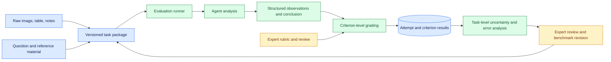
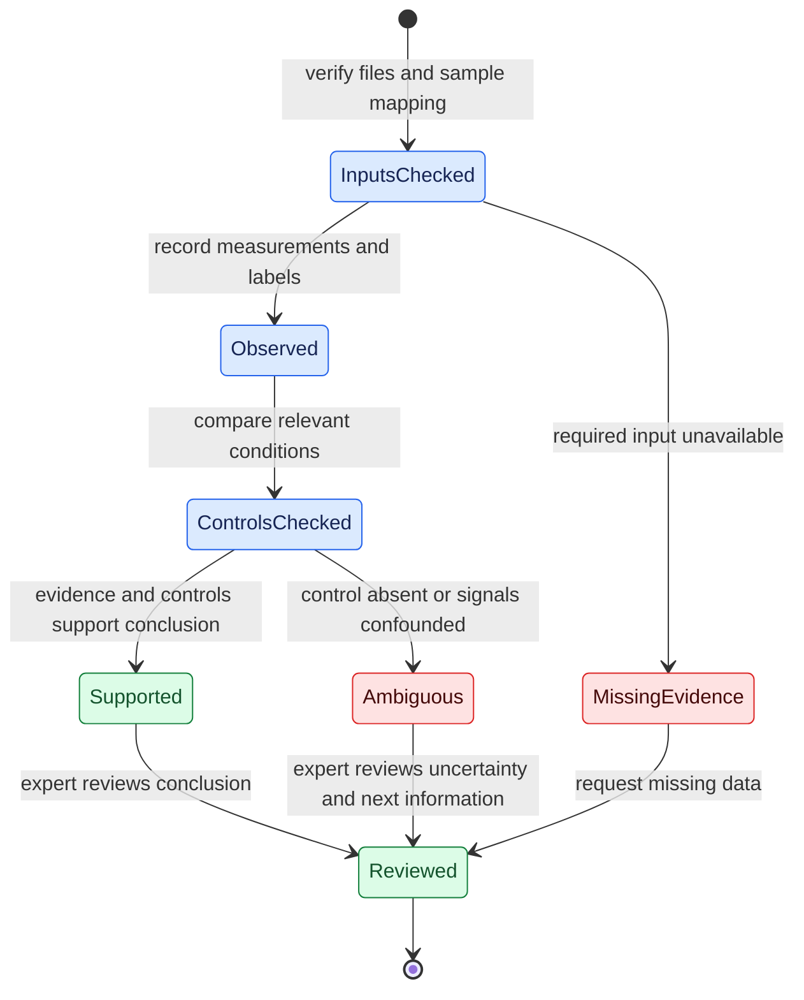

# Evaluating agents on raw laboratory evidence
Status: emerging
Sources: [OpenAI — 2026-11-06](https://openai.com/index/measuring-how-ai-agents-handle-wet-lab-science/) (vendor benchmark report)

## In one sentence

An evaluation of scientific assistants should test whether they connect raw experimental observations, controls, and context to a justified conclusion, including the decision that the evidence is insufficient.

## Background: what existed before

Many scientific question-answering tests ask a model to explain a concept or interpret a clean chart prepared for a paper. Those tasks can measure useful knowledge, but everyday laboratory work often begins earlier: a researcher receives instrument files, handwritten notes, a photograph, and an imperfect control, then decides what the evidence supports. The system must identify what was actually measured, associate files with the right samples, recognize conflicting observations, and distinguish a tentative interpretation from a reliable conclusion.

A **wet lab** is a setting where researchers work with physical samples and experimental materials. An **assay** is a procedure for measuring a property of a sample. A **control** is a comparison condition intended to reveal whether an observation can be interpreted as expected. A control is useful only if it is appropriate for the question and was actually run under the required conditions. A graph or image can be visually clear and still fail to support a conclusion if the wrong control was used.

The engineering problem is not limited to biology. Any assistant that interprets sensor readings, financial documents, or production logs faces a similar chain: ingest evidence, link it to context, apply a rule, state uncertainty, and pass the result to a person or downstream workflow. In a laboratory, an incorrect conclusion can waste expensive follow-up work. A benchmark needs to examine the chain rather than grade fluent prose alone.

For the reader, familiarity with files, structured records, APIs, and basic statistics is enough. A **rubric** is a list of criteria used to grade an answer. A **bootstrap confidence interval** is an uncertainty estimate computed by repeatedly resampling observations and recalculating a statistic. We will use these ideas to reason about evaluation data and reporting; the local example analyzes fictional rubric results and does not perform laboratory work.

## What changed and why now

On November 6, 2026, OpenAI introduced BioBasicsBench with Ligo, a biotechnology company, to measure agents' interpretation of routine raw wet-lab evidence. The [vendor report](https://openai.com/index/measuring-how-ai-agents-handle-wet-lab-science/) describes 100 tasks across protein methods, imaging and cytometry, quantification and assays, nucleic acid methods, and molecular cloning. Task authors used evidence from their own experiments and supplied expert grading criteria. Each task received internal review by a different Ligo scientist, external review by a PhD-level wet-lab scientist, and final internal review.

OpenAI reports evaluating seven models at 37 model-and-reasoning-effort settings, with five attempts on each of 100 tasks per setting: 18,500 results. The score is **mean reward**, the average percentage of available rubric credit, not the percentage of tasks fully solved. OpenAI reports 66.7% mean reward for GPT-6 Astra at its reported xhigh setting, compared with 43.8% for GPT-5.6 Sol at xhigh. These are publisher-reported benchmark results under the stated setup, not independent evidence that either model is ready to make unsupervised laboratory decisions.

The report is valuable because it supplies both improvements and mistakes. One example concerns fluorescence channels whose detection ranges overlap: an observation in one channel cannot, without suitable controls, uniquely establish which signal produced it. Another concerns a negative control plate labeled with a different antibiotic than the experiment. These source examples show why a grading rubric should examine whether an answer noticed relevant context, not only whether it produced a confident final label.

## Impact on current processing and architecture

A laboratory-evidence evaluation needs a data contract connecting each task to its evidence and grading rules. A task can contain an image, instrument export, protocol note, question, reference sheet, and rubric. Each item should have an identifier, role, version, format, and relationship to the other items. For example, an image labeled `sample-A` should not silently be paired with metadata for `sample-B`. The benchmark runner must preserve the input package used in each attempt so a reviewer can reproduce what the model actually saw.

The answer contract should distinguish observations from interpretation. An observation might say that two regions appear brighter than the background in a supplied image. An interpretation might say that the evidence is consistent with a particular outcome, conditional on a control. A recommendation might say to seek expert review because the control is missing. These are different claims and can receive different rubric credit. A model that identifies an ambiguous control but then ignores that finding in its final answer should not receive full credit for an accurate final decision.



The diagram is a proposed evaluation architecture, not a claim about BioBasicsBench's internal implementation. Its separation between runner, answer, rubric, and reviewer helps locate an error. A missing image is an input problem; a misread label is a perception problem; a correct observation followed by an unsupported recommendation is a reasoning or decision problem. A single aggregate score does not reveal which of these failed.

## Real-world applications and constraints

Consider a fictional research support assistant asked to summarize a plate reader export. The input package contains a small table, a sample map, and a note stating that the expected control is missing. A useful answer might report the visible values, identify the missing control, and decline to label a sample as conclusively positive. The assistant can still help the researcher by naming what evidence is missing and linking to the relevant records. A human expert remains responsible for interpreting the result in the experimental context.

In production, the input may be a large microscopy stack or a proprietary instrument file. Conversion to an image or table can discard channels, alter contrast, remove scale information, or separate labels from the data they describe. The evaluation should test the same conversion path used by the deployed assistant. Record original file identifiers and transformations; if a file cannot be decoded, report that explicitly rather than asking the model to infer its contents from a filename.

Laboratory data can include confidential project information or sensitive sample metadata. Access control, retention, and consent requirements affect whether raw evidence can be copied into a benchmark. Synthetic examples are useful for teaching and regression checks, but they may not capture artifacts in actual instruments. A realistic benchmark needs a governed route for representative evidence and qualified review. None of these safeguards makes a benchmark score a substitute for prospective evaluation in the target laboratory.

## Mental model

Treat an experimental conclusion as a chain of evidence with checkpoints: **input identity**, **measurement**, **control validity**, **interpretation**, and **decision**. A failure at an earlier checkpoint limits what later checkpoints can establish. The model can be correct about an image's visual pattern yet wrong about what the pattern means. It can recognize an invalid control yet still issue a definitive conclusion. The benchmark should grade these checkpoints independently and also check their consistency in the final answer.



`Ambiguous` is an informative outcome, not an automatic failure. If the supplied evidence cannot distinguish two explanations, a system that states this limitation can be more useful than one that guesses. The rubric must still check whether uncertainty is justified: an agent should not earn full credit by refusing every difficult task.

## What changed this month

BioBasicsBench's source report describes raw evidence including gel and blot images, plate photographs, microscopy, sequencing files, instrument exports, videos, notes, and reference sheets. Some tasks include multiple modalities. The table of data types and skill tags has overlapping categories; adding those counts would double-count tasks. The benchmark has 100 unique tasks, not the sum of every modality row.

The report also gives a concrete failure in which a model recognized a visual grouping but mapped those groups to the wrong experimental identities relative to the reference. Another example describes a colony-count error in which visible items were missed and empty areas marked. These are publisher-provided examples, not prevalence estimates for all laboratories or image types. Their engineering value is that they suggest distinct fixtures: one for the link between observation and interpretation, another for spatial counting and downstream calculation.

## Engineering consequence

### Build a task as a reproducible package

Assign a task ID to the question, evidence files, expected output schema, rubric version, and any reference material. The runner should record the model version, configuration, attempt number, input transformations, and response. Store the rubric separately from agent-visible material where the evaluation design requires it. If the rubric changes, preserve the old version and regrade intentionally rather than mixing scores from different definitions.

The **unit of analysis** matters. BioBasicsBench reports five attempts per task per setting. Those attempts share the same experimental evidence and rubric, so they are not 500 independent experimental situations. The report estimates confidence intervals by resampling whole tasks while keeping each task's attempts together. A local evaluation should preserve the same grouping when estimating uncertainty for a mean over tasks. Resampling attempts independently can make uncertainty appear smaller because it treats repeated answers to the same underlying task as entirely independent evidence.

### Grade observations, reasoning, and conclusion

Create criterion IDs with clear evidence requirements. A fictional task might assign one point for reporting the relevant measurement, one for noticing the missing control, and one for withholding a definitive label. These criteria are not a laboratory protocol; they illustrate how a rubric can recognize both useful partial work and a harmful final claim. Keep the grading result for each criterion so reviewers can see whether a model failed to read, failed to relate evidence to context, or failed to state the right uncertainty.

Partial credit needs care. An answer that correctly notes a missing control and then confidently recommends an unsupported action may satisfy one criterion while failing the overall decision. A simple average can hide that contradiction. Add a decision-level rule or report a separate critical-error metric. Make its definition explicit: which claims or actions count as a critical error, who adjudicates borderline cases, and how changes are versioned. Do not assume that every criterion is equally important merely because each is easy to count.

Expert rubrics can also be imperfect. Two reviewers may disagree about an image region, a control's adequacy, or whether a cautious answer is sufficiently specific. Store disagreements and adjudication outcomes. A rubric revision should explain which evidence changed and whether previous results were recomputed. Blind review of model identity can reduce expectations about a particular system influencing a human grade, though it cannot eliminate all bias.

### Examine multimodal transformations

Images have resolution, color channels, scale, and compression. Tables have units, missing values, row order, and sample identifiers. Notes can contain dates, handwritten labels, or qualifications. The runner may resize an image, extract frames from video, or convert a spreadsheet to text before the model sees it. Those transformations are part of the evaluated system. If a label becomes unreadable after resizing, the resulting error may belong to ingestion rather than the underlying model.

Use controlled perturbations in a local test suite. For example, change a fictional sample label, remove a reference sheet, or provide a note that contradicts a filename. The expected behavior should be defined by an expert before observing the model's answer. Keep a version of the unmodified task, change one factor at a time, and track whether the conclusion changes appropriately. This is an engineering test design, not a reported BioBasicsBench result.

### Report performance with its denominator

Report the number of unique tasks, attempts per task, rubric points, model configuration, and aggregation procedure. Mean reward answers how much available credit was earned on average under that rubric; it does not by itself answer how often an agent was fully correct. A task with three of four points and a task with four of four contribute differently depending on whether the metric is fractional credit or all-or-nothing completion. Show both if the intended decision needs both, and include a separate count of unsupported definitive conclusions.

Slice results by evidence type, task domain, and error class where the sample supports it. Because tasks can belong to multiple categories, slices overlap. A small slice can have wide uncertainty; report its denominator instead of comparing percentages without context. Do not claim that a model's apparent improvement on one example establishes improved visual perception as a general fact. Differences can arise from task selection, prompt setup, grading, and chance.

### Design the human handoff

A deployed assistant should show the evidence it used, the relevant control status, the conclusion, and the uncertainty. Provide a route to inspect the original artifact rather than only a generated summary. When a required input is missing, route the case to a person who can locate the data or decide how to proceed. Keep the original and corrected conclusions linked so an audit can identify what changed. A reviewer needs enough context to check the answer, but access should remain limited to authorized project members.

## Limits and failure modes

**Control confusion.** A model may treat a mislabeled or inappropriate control as valid. The report's antibiotic-label example shows a case in which this detail changed interpretation. Check the control's identity and relationship to the experiment, not merely whether a control image exists.

**Confounded signals.** Two causes can produce overlapping observations. A bright region in one channel may not uniquely identify a biological state when another signal can contribute. State which measurements and controls would distinguish the alternatives rather than inventing certainty.

**Correct observation, wrong decision.** An intermediate statement can be accurate while the final recommendation ignores it. Grade consistency across the answer and make consequential decision criteria visible in reports.

**Counting and measurement errors.** Closely spaced objects, empty regions, and image quality can cause missed or extra counts. An accurate explanation of the counting method does not validate the count. Compare against an expert reference and retain the marked evidence where practical.

**Rubric leakage or gaming.** If an agent sees hidden grading criteria, it can optimize the wording rather than the task. Keep evaluation-only material separated and audit whether the stated evidence supports each awarded point. Automated graders can make mistakes too, so sample their decisions for expert review.

**Distribution shift.** One hundred tasks cannot represent every laboratory, instrument, sample, and workflow. A score on the reported tasks does not establish reliability under new imaging conditions or unusual experimental designs. Prospective local evaluation and expert oversight remain necessary.

## Mini exercise (15–30 min)

Create three fictional evaluation records. In one, an agent reports a measurement and correctly identifies a missing control. In another, it notices the missing control but gives a definitive conclusion. In the third, it refuses despite a complete evidence package. Design a three-criterion rubric and a separate critical-error flag. Compare mean fractional credit with the number of cases that have no critical error. Explain which metric you would use for a dashboard and why the other still matters.

### Runnable low-cost example

Save as `lab_rubric.py` and run `python3 lab_rubric.py`. It uses fictional labels and no laboratory data or external packages.

```python
from statistics import mean


tasks = {
    "missing-control": [
        {"measurement": 1, "control": 1, "decision": 1, "critical": False},
        {"measurement": 1, "control": 1, "decision": 0, "critical": True},
    ],
    "complete-evidence": [
        {"measurement": 1, "control": 1, "decision": 1, "critical": False},
        {"measurement": 1, "control": 0, "decision": 1, "critical": False},
    ],
}


def credit(attempt):
    return sum(attempt[key] for key in ("measurement", "control", "decision")) / 3


task_means = [mean(credit(a) for a in attempts) for attempts in tasks.values()]
attempts = [a for group in tasks.values() for a in group]
print(f"mean task credit: {mean(task_means):.3f}")
print(f"critical errors: {sum(a['critical'] for a in attempts)}/{len(attempts)}")
```

This example computes fractional credit and a separate error count. Its scores are preassigned fictional values; it neither grades real experimental evidence nor calculates a confidence interval. A real benchmark requires an expert-authored rubric, quality control, protected inputs, and an appropriate aggregation and uncertainty method.

## Build it locally: numbered implementation steps

1. Create a fictional JSON task with an ID, a small numeric table, a sample map, a control-status field, and a question. Use synthetic values that have no scientific interpretation.
2. Define a rubric with separate criteria for data transcription, control recognition, and the final decision. Write the expected answer before generating attempts.
3. Add three fixed mock answers: correct caution, contradictory conclusion, and unnecessary refusal. Store each answer and the rubric version with its attempt ID.
4. Write a deterministic grader for these fixtures. Mark a contradiction as a separate critical error even if some criteria earn partial credit.
5. Aggregate attempts within each task before averaging tasks. Print both mean credit and the number of critical errors with their denominators.
6. Remove a required input and confirm the expected outcome is an explicit missing-evidence status. Restore it and change only the sample mapping; the expected result should change.
7. Ask a domain expert to review the task and rubric before applying the pattern to real data. Record disagreements and the resolution as versioned review notes.

## Interview Q&A

**Q: Why isn't a mean reward of 66.7% the same as 66.7% of tasks solved?**

**A:** The reported measure averages fractional rubric credit. An attempt may receive some points for correct observations while missing a conclusion. A fully solved task rate requires a separate all-criteria definition.

**Q: Why resample whole tasks when estimating uncertainty?**

**A:** Multiple attempts on one task share the same underlying evidence and rubric. Task-level resampling keeps those repeats together and better reflects variation across the sampled tasks.

**Q: What should an assistant do when a control is missing?**

**A:** State the missing evidence and limit its conclusion accordingly. A useful answer can still summarize observations and direct the case to a qualified reviewer; it should not fabricate a definitive result.

**Q: How can a model be right about an image and wrong overall?**

**A:** It can correctly identify a visual pattern but assign the pattern to the wrong sample or experimental condition. Evaluation should check the link from observed evidence through context to the final conclusion.

**Q: What does a benchmark improvement prove about deployment?**

**A:** It shows a difference on the reported tasks and grading setup, subject to uncertainty and source limitations. It does not establish safe performance in a different laboratory or justify unsupervised decisions.

## Glossary

- **Assay:** a procedure used to measure a property of a sample.
- **Control:** a comparison condition used to help interpret an experiment.
- **Rubric:** a set of explicit criteria for evaluating an answer.
- **Mean reward:** the average fraction of available rubric credit earned under a specified aggregation.
- **Task:** one evaluation problem with its evidence, question, and grading criteria.
- **Attempt:** one model response to a task under a stated configuration.
- **Bootstrap:** repeated resampling used to estimate variation in a statistic.
- **Confounding:** a situation in which an observation can have multiple explanations that the available evidence does not distinguish.
- **Critical error:** an explicitly defined mistake whose consequences warrant separate reporting from ordinary partial-credit scoring.
- **Distribution shift:** a difference between evaluation conditions and the conditions in which a system is later used.

## References

- [OpenAI, Measuring how AI agents handle everyday wet-lab science, November 6, 2026](https://openai.com/index/measuring-how-ai-agents-handle-wet-lab-science/) — vendor benchmark report developed with Ligo.

## Claim ledger

| Claim | Source | Fact or inference |
|---|---|---|
| BioBasicsBench contains 100 tasks across five areas of routine wet-lab work and uses expert-written grading criteria. | [OpenAI report](https://openai.com/index/measuring-how-ai-agents-handle-wet-lab-science/) | Vendor description of benchmark construction |
| The report evaluates 37 model/effort settings with five attempts on each task, totaling 18,500 results. | [OpenAI report](https://openai.com/index/measuring-how-ai-agents-handle-wet-lab-science/) | Vendor-reported evaluation setup |
| Mean reward is fractional rubric credit; confidence intervals resample whole tasks while preserving attempts within each task. | [OpenAI report](https://openai.com/index/measuring-how-ai-agents-handle-wet-lab-science/) | Vendor-described metric and uncertainty method |
| A local evaluation should track unsupported definitive conclusions separately from average partial credit. | Design reasoning based on the reported failure examples | Engineering inference |
| The Python example uses synthetic pregraded records and does not establish laboratory competence. | Runnable example above | Fact about example scope |
