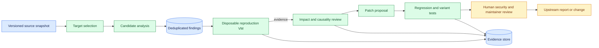
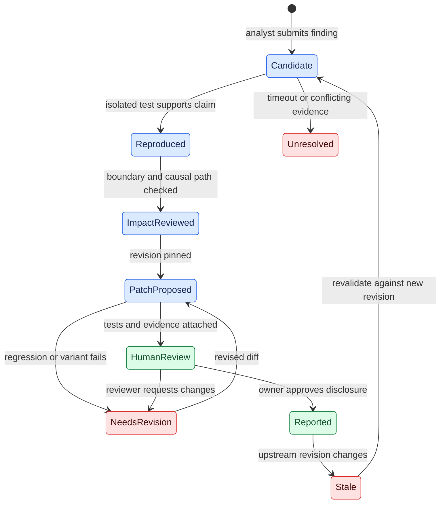

# From vulnerability candidate to reviewed patch
Status: emerging
Sources: [OpenAI — 2026-11-04](https://openai.com/index/a-thousand-fewer-paths-to-root/) (vendor research report)

## In one sentence

An AI-assisted security pipeline turns a suspected defect into a maintainer-ready patch by preserving evidence and applying a different test at each transition from discovery through reproduction, impact assessment, repair, and review.

## Background: what existed before

Security teams already used static analysis, fuzzing, sanitizers, proof-of-concept programs, regression tests, and human review before modern coding agents. **Static analysis** inspects code without running the target; **fuzzing** executes it with many inputs to discover unexpected behavior. A **sanitizer** instruments a program to report certain invalid operations, such as access to memory after it has been freed. A proof of concept (PoC) demonstrates a specific behavior in a controlled setting. None alone establishes that a patch is correct for all inputs or that an observed failure crosses a useful security boundary.

Traditional workflows are often constrained by the gap between finding a suspicious code path and producing evidence a maintainer can act on. A scanner can produce thousands of alerts, including duplicates or conditions that cannot occur. A human then reads source, creates a small reproducer, checks which configurations are affected, evaluates severity, proposes a fix, and reviews side effects. Each handoff costs attention. A result may become stale while it waits because the upstream branch changes. A correct description sent against yesterday's revision can become a duplicate of a fix merged today.

The November 2026 report describes a research prototype that combines these established stages with model-based agents. It is useful to a software engineer because it makes the pipeline's intermediate artifacts and queues visible. The engineering challenge is to avoid collapsing different meanings of “success”: a plausible report, a reproducible crash, a demonstrated privilege boundary crossing, a candidate patch, and an accepted upstream change are five different outcomes.

### Prerequisites

You should know how a Git commit identifies a code revision, how a test process returns pass or fail, and why a queue separates work producers from workers. A **kernel** mediates access to hardware and privileged operating-system resources. **Local privilege escalation** (LPE) means an actor who already has lower-privilege access gains higher privilege on that same system. A **virtual machine** (VM) isolates a guest operating system from its host through a virtualization layer; its isolation still depends on the security and configuration of that layer. This lesson discusses defensive triage and patch verification. Its local example works on synthetic records and runs no exploit.

## What changed and why now

In [OpenAI's November 4 report](https://openai.com/index/a-thousand-fewer-paths-to-root/), the company describes a controlled research pipeline for the Linux kernel. Scout agents selected security-relevant audit targets, analyst agents generated candidate findings, isolated VMs were used for dynamic reproduction, another stage assessed exploitability, and candidate patches went to human security researchers for review. The report is the vendor's account of its experiment; its counts and costs have not been independently verified here.

OpenAI reports 2,308 deduplicated candidate findings and 1,724 reproduced vulnerabilities. It reports 1,169 working LPE exploits that were grouped into 948 distinct patches, and uses the latter count for unique LPEs. This distinction matters: neither candidate count nor exploit count is automatically a count of independent root causes. The reported $1,213,430 in API credits covers the run under its particular model, scope, and configuration; it is not a budget for an unrelated organization's assessment, and it does not include every possible engineering or maintenance expense.

The report also describes an instructive early failure: 20 of 200 reported successful LPE attempts used a different vulnerability from the one assigned. The team added an independent check tying the outcome to the assigned finding. A privileged result is therefore insufficient evidence of *which defect* produced it. This is a general lesson for evaluation pipelines: verify the causal path as well as the terminal result.

## Impact on current processing and architecture

Treat each stage as an independently retryable service that accepts a versioned input and emits an evidence package. A finding record needs a repository revision, target path, candidate identifier, threat assumptions, evidence references, owner, and state. A sandbox job needs a specific image and configuration; a patch job needs the exact source revision and a reproduction that can be rerun. The reporting queue needs duplicate detection and a check against the current upstream revision.

A practical architecture has at least four trust boundaries. First, the discovery worker can read source but should not be able to modify the upstream repository. Second, code generated for reproduction runs only in disposable test infrastructure, with controlled network and credentials. Third, patch generation produces a proposal, while the test runner records independently whether the proposed change passed. Fourth, a maintainer or authorized reviewer decides whether a report or patch leaves the organization. A model's explanation is useful input to review, but it cannot authorize publication or merge.



The figure is a proposed engineering design, not a representation of OpenAI's internal implementation. The arrows into the evidence store show why “the agent says it passed” is inadequate. Store the command category, test image revision, outcome, log reference, affected commit, and timestamp. Restrict access to sensitive reproducer material and retain only what is needed under the team's security process. A hash can identify an artifact, but it cannot establish that the artifact is safe or that its claimed interpretation is correct.

## Real-world applications and constraints

A maintainer of an internal storage service could use the same pattern without testing an operating-system kernel. The candidate stage might find a missing bounds check in a parser. An isolated test job runs a small input that triggers the failure. A patch proposal adds a validation check, while a separate suite checks valid inputs, invalid inputs, compatibility, and performance. The queue holds the proposal until a reviewer confirms ownership and disclosure rules. This example illustrates a workflow; it is not a reported finding from the November study.

Large projects complicate the economics. A failure may depend on a particular compiler, build flag, architecture, workload, or permission configuration. A fix that blocks the reproducer can still break legitimate callers or miss related variants. A VM may differ from the production fleet. Reproduction also costs CPU time and attention: if a test job runs for hours on an unreachable path, it can delay more urgent work. Assign explicit resource budgets and leave a `not_reproduced_within_budget` state instead of translating a timeout into “safe.”

Coordinated disclosure imposes another boundary. A public issue containing a detailed reproducer before a fix is available can create risk for downstream users. Route evidence to the project’s established private reporting process where appropriate, track who received it, and follow the project’s rules on embargo and publication. Human review and maintainer acceptance are separate from successful automation.

## Mental model

Imagine an evidence funnel with five bins: **candidate**, **reproduced**, **impact evidenced**, **patch tested**, and **maintainer reviewed**. Each bin answers a different question. A record advances only when the required evidence for that transition is present. A record can also move backward when the source revision changes, or sideways into `needs_investigation` when evidence conflicts. The funnel measures the work remaining; it does not measure the number of defects that definitely exist in the whole codebase.



`Unresolved` is deliberately different from a rejected false positive. It can represent a timeout, an unsupported configuration, missing permissions, or an ambiguous log. Rechecking the record after a dependency change must retain its history so reviewers can see why the earlier outcome differed.

## What changed this month

The new report makes a large research run and its stage costs visible. OpenAI says its scout stage selected 5,034 targets covering roughly seven percent of the kernel codebase, and that the analyst stage produced 2,308 deduplicated candidates. It describes prioritizing reachable paths available to a low-privileged user and using instrumented kernels to reproduce memory corruption in isolated VMs. It also reports that maintainers were fixing related issues during the run, making revalidation against the latest code necessary. These are release-specific claims about the reported experiment, not evidence that the same selection strategy finds every relevant vulnerability.

The source's later stage illustrates the cost of proof. OpenAI reports that exploitation processing accounted for the largest portion of the run's API credit cost, and that some unsuccessful attempts were expensive because difficult cases consumed the allotted time. The practical design implication is to measure cost per stage and set budgets, but avoid rejecting a serious finding merely because a bounded attempt failed. A budget tells a queue when to stop spending; it is not a statement about the underlying security property.

## Engineering consequence

### Design the finding record

Give each candidate a stable ID distinct from a specific execution attempt. A candidate can have multiple attempts against different builds; an attempt can produce several artifacts. The record should include the source commit, affected path, candidate category, assumptions, test image, resource budget, result, and references to logs. Store `reported`, `reproduced`, and `reviewed` as explicit transitions with the actor or service responsible for each. If a reviewer determines two candidates share a root cause, link them to a common root-cause record rather than silently deleting one. That preserves the reasons counts changed.

The evidence package should also capture negative information. For a reproduction, record the build and test configurations actually tried, duration, and whether the relevant code path was reached. “No crash” under one image does not mean the condition is impossible elsewhere. Similarly, a report that a generated patch passed one reproducer says little about adjacent paths, concurrency, or downstream compatibility. A reviewer needs to know what was tested and what remains unknown.

### Verify the route to an outcome

The wrong-vulnerability example shows why outcome-only evaluation is fragile. For a parser issue, a test might succeed because the input fails earlier than the target code. For an authorization bug, access might be denied because the test account was misconfigured. For a concurrency issue, a changed delay might hide the race without removing the unsafe operation. Add independent observations: did the intended path execute, did the expected invariant fail before the patch, and does that same invariant hold afterwards? Record the observations separately from the agent’s narrative.

For patch verification, compare at least four cases: the original failure on the original revision; the same test on the patched revision; a legitimate neighboring case on both revisions; and a related variant that should also be safe. Build and test on supported configurations when feasible. Track patch provenance so an apparently successful test cannot accidentally run against an older build. Require a clean environment or a reproducible build identifier for each attempt.

### Bound work and schedule human attention

Order the queue using reproducibility, reachability, severity evidence, affected deployments, patch availability, and maintainer capacity. Severity is a decision under uncertainty, not a label the model can settle by itself. Use a deadline for each worker, preserve intermediate results, and send ambiguous cases to a human when their potential impact warrants it. Limit concurrent VM jobs so a burst of candidates cannot exhaust the host or block routine regression tests.

Monitor the funnel with stage-specific counts: candidates per target, duplicate rate after review, reproductions per attempted finding, median and tail queue age, time and cost per attempt, patches failing a regression, and reports returned by maintainers. Keep denominators explicit. A rising reproduction rate might reflect better analysis, but it might also mean the system stopped testing hard cases. A lower report count might mean improvements upstream, a changed target set, or an overloaded reviewer queue. Pair metrics with samples of rejected and timed-out records.

### Handle stale findings

A source commit can change between analysis and disclosure. Before reporting, check whether the code and relevant configuration remain present, whether another patch already addresses the issue, and whether the test still demonstrates the stated behavior. If the upstream revision differs, mark the earlier evidence as historical and run a new attempt with its own revision. Do not overwrite old logs: a reviewer may need them to understand why the original candidate was credible and why its status changed.

## Limits and failure modes

**Candidate inflation.** Multiple reports can describe one missing check, and a single report can include several defects. Deduplicate by root-cause evidence and patch relationship, not by title alone. In the source, exploit count and distinct patch count differ; presenting them interchangeably would overstate uniqueness.

**False causal confidence.** A test reaches an apparently important result via an unrelated path. The November report's early wrong-vulnerability cases show that this can happen even when the outcome is dramatic. Add a separate causal check and retain the test trace for review. The check itself may be wrong, so sample it and include negative controls.

**Patch overfitting.** A patch can stop one reproducer while leaving a neighboring call site unsafe. Require tests for the invariant and related variants, plus review of error handling, locking, compatibility, and performance. A model-generated change that compiles is still a proposal.

**Isolation failure.** Test infrastructure is itself software. OpenAI reports observing an issue in its testing infrastructure during its campaign. That observation does not prove that any particular VM escapes or host is vulnerable; it does motivate independent maintenance, limited credentials, and isolation appropriate to the risk of the work. A disposable guest does not automatically make the host disposable.

**Research-to-production transfer.** The reported pipeline used selected targets, models, compute budgets, and configurations. Its counts are not a guarantee for other codebases or deployment settings. Human review, upstream acceptance, and deployed fixes may occur later and are different milestones from a generated patch.

## Mini exercise (15–30 min)

Design a triage queue for a fictional file parser. One candidate has a reproduction on revision `a1`; one times out; one has a patch but no independent test result; and one has a passing regression on the wrong revision. Decide which can be sent for review. Then add a new source revision and explain which evidence must be rerun. The following example encodes a deliberately small release gate using synthetic records only.

### Runnable low-cost example

Save the code as `triage.py` and run `python3 triage.py`. It uses only the Python standard library and does not inspect or modify any real repository.

```python
from dataclasses import dataclass


@dataclass(frozen=True)
class Finding:
    name: str
    source_revision: str
    tested_revision: str
    reproduction: str
    causal_check: bool
    regression_passed: bool
    reviewer: str


def disposition(finding: Finding) -> str:
    if finding.source_revision != finding.tested_revision:
        return "retest: evidence revision differs"
    if finding.reproduction == "timeout":
        return "unresolved: reproduction timed out"
    if finding.reproduction != "reproduced":
        return "hold: no reproduction"
    if not finding.causal_check:
        return "hold: cause not independently checked"
    if not finding.regression_passed:
        return "hold: regression missing or failed"
    if not finding.reviewer:
        return "hold: reviewer not assigned"
    return "ready for human review"


cases = [
    Finding("bounded", "a1", "a1", "reproduced", True, True, "lee"),
    Finding("timeout", "a1", "a1", "timeout", False, False, "lee"),
    Finding("wrong revision", "a2", "a1", "reproduced", True, True, "lee"),
    Finding("no causal check", "a1", "a1", "reproduced", False, True, "lee"),
]
for item in cases:
    print(f"{item.name}: {disposition(item)}")
```

The example distinguishes an unresolved timeout from a verified false positive and requires matching revisions. Its booleans are assertions supplied by the caller, so production software would have to authenticate evidence, run tests independently, verify reviewer identity, protect records from alteration, and perform the actual security analysis. Passing this gate does not imply that a vulnerability or patch has been independently proven.

## Build it locally: numbered implementation steps

1. Create a local JSON fixture containing candidate IDs, source revisions, affected paths, and declared assumptions. Use fictional paths and avoid sensitive code or exploit material.
2. Add a transition function that rejects a request to mark a candidate reproduced unless a test attempt exists with the matching revision and an evidence reference.
3. Implement a queue with a per-attempt deadline. Simulate a completed attempt, a timeout, and a worker crash. Preserve the difference between an unknown result and a negative test.
4. Add a separate causal-check result and a regression result. Require both before a candidate patch is eligible for a named reviewer.
5. Simulate a new source revision. Mark earlier evidence historical and require a new attempt; do not overwrite the old record.
6. Record stage duration, reviewer queue age, and the number of candidates in each state. Reconcile the totals against the fixture IDs so retries do not inflate finding counts.
7. Add a human review decision with an explicit reason and demonstrate that no record becomes `reported` merely because automated checks pass.

## Interview Q&A

**Q: Why isn't a candidate finding equivalent to a vulnerability?**

**A:** A candidate is a hypothesis based on analysis. It may depend on an unreachable path, a configuration that does not apply, or an incorrect assumption. Reproduction under a recorded configuration strengthens the evidence, while still leaving questions about impact and other deployments.

**Q: Why record both source and test revisions?**

**A:** A test result only applies to the artifact it actually ran. Without pinned revisions, a passing test could be attributed to a patch it never exercised, or a valid finding could be reported after upstream code has changed.

**Q: What does a timeout mean?**

**A:** The bounded attempt did not establish the requested result. It can justify rescheduling or review, but it does not prove that the suspected defect is absent.

**Q: Why check the causal path after observing an outcome?**

**A:** The outcome may have resulted from a different defect or an unrelated configuration. The November report describes early cases in which a successful privilege escalation did not use the assigned vulnerability.

**Q: What makes a patch suitable for a maintainer?**

**A:** A clear root-cause explanation, a reproducible test, a focused change, regression and variant coverage, compatibility and performance consideration, and a current source revision all help. Maintainer review and project-specific requirements still decide acceptance.

## Glossary

- **Candidate finding:** a hypothesis that a code path may violate a security property.
- **Dynamic validation:** executing an instrumented target under controlled conditions to observe whether a claimed behavior occurs.
- **Local privilege escalation:** an increase in privilege by an actor who already has access to the local system.
- **Proof of concept:** a small demonstration of a specific behavior under stated conditions.
- **Root cause:** the underlying defect that explains one or more observations.
- **Regression test:** a repeatable check intended to detect the return of a known failure.
- **Variant analysis:** examining related code paths or inputs for other instances of the same underlying problem.
- **Causal check:** independent evidence that the assigned defect, rather than an unrelated path, produced the observed outcome.
- **Coordinated disclosure:** reporting a security issue through an agreed process that gives maintainers a chance to prepare a fix.
- **Unresolved:** a state in which available evidence cannot establish the outcome, such as after a timeout.

## References

- [OpenAI, A thousand fewer paths to root, November 4, 2026](https://openai.com/index/a-thousand-fewer-paths-to-root/) — vendor research report describing the experiment, stages, counts, cost, and limitations.

## Claim ledger

| Claim | Source | Fact or inference |
|---|---|---|
| The reported pipeline used discovery, dynamic validation, exploitability assessment, patch generation, and human review. | [OpenAI report](https://openai.com/index/a-thousand-fewer-paths-to-root/) | Vendor-reported experiment |
| OpenAI reports 2,308 candidate findings, 1,724 reproduced vulnerabilities, and 948 distinct patches used to count unique LPEs in its run. | [OpenAI report](https://openai.com/index/a-thousand-fewer-paths-to-root/) | Vendor-reported result; not independently verified here |
| In an early run, 20 of 200 apparent successful LPE attempts used a different vulnerability than assigned; the team added a check. | [OpenAI report](https://openai.com/index/a-thousand-fewer-paths-to-root/) | Vendor-reported observation |
| A pipeline should preserve source revisions and independently link an observed effect to the candidate's claimed cause. | Design derived from the report's wrong-vulnerability example | Engineering inference |
| A generated patch should pass regression and variant tests and receive human review before disclosure or merge. | Engineering design in this lesson | Recommendation; not a guarantee of security |
| The Python example exercises a synthetic decision gate and does not validate a real vulnerability. | Runnable example above | Fact about example scope |
