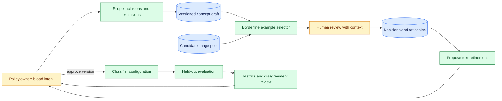
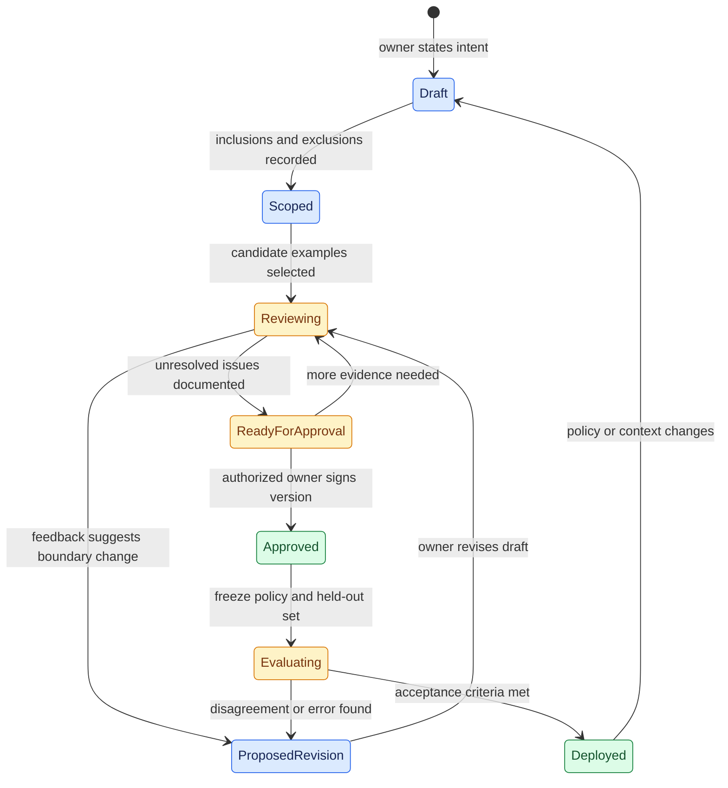

# Deliberating subjective classifier boundaries
Status: emerging
Sources: [Google Research — 2026-11-04](https://research.google/blog/agile-deliberation-how-ai-helps-humans-define-the-gray-areas/) (research explanation); [Wang et al. — CVPR 2026](https://arxiv.org/abs/2512.10821) (research paper)

## In one sentence

When a classification category has an unclear boundary, an iterative review workflow can help people define that boundary through concrete examples before a classifier is evaluated against the resulting versioned criteria.

## Background: what existed before

Supervised classification usually starts with examples and labels: a person marks each item as belonging to a category or not, and a model learns to predict those labels. This approach works best when the intended category and its edge cases are already specified. In practice, a team asked to identify “misleading reward promotions,” “inspiring artwork,” or another subjective concept may not agree on every case at the start. People can change their minds as they encounter examples or learn which distinctions matter operationally.

**Subjective** does not mean arbitrary. It means the answer depends on a stated perspective, policy, purpose, or community rather than a universally agreed visual property alone. A content moderation team can define a policy with explicit inclusions and exclusions; another team can reasonably use a different policy. The engineering task is to capture the relevant policy, its owner, the cases that shaped it, and the date on which it applied. A classifier cannot infer organizational authority from a user's casual description.

Active learning is a related technique that selects examples likely to be informative for improving a model, often by asking a human to label cases where the model is uncertain. The research discussed here also selects difficult examples, but uses them to help a person refine the definition itself. This difference changes the workflow. A disagreement may reveal an unclear policy rather than a simple labeling mistake. The correct response may be to revise the criteria and revisit earlier labels rather than immediately train on the latest answer.

### Prerequisites

You should know that a classifier maps an input to a label, that a dataset can be split into training and evaluation portions, and that an API can store a versioned record. A **vision-language model** (VLM) processes visual and textual information together. A **false positive** is an item classified as matching when the reference decision says it does not; a **false negative** is a missed match. **F1** combines precision and recall into one score, but the score depends on the labels and population used for evaluation. These measures describe agreement with a particular reference; they do not independently establish that the reference policy is fair or appropriate.

## What changed and why now

On November 4, 2026, Google Research published an explanation of **Agile Deliberation**, a workflow for developing subjective visual classifiers through human interaction. The underlying [research paper](https://arxiv.org/abs/2512.10821) was submitted in December 2025, revised in April 2026, and listed at CVPR 2026. The November event is the research explanation, not the invention date of the method. This date distinction prevents a retrospective write-up from being presented as a new November experiment.

The report describes two stages. In **concept scoping**, a user decomposes a broad concept into inclusions and explicit exclusions. In **concept iteration**, the system surfaces semantically borderline images, the user supplies feedback, and an optimization loop updates the text used by the classifier. The research team reports 18 live sessions of 1.5 hours each across two subjective domains, with comparison methods presented in randomized order. Participants reported lower effort and clearer understanding, and the authors report improved classifier performance in their study. These findings describe that research setting; they do not establish outcomes for every team, domain, or population.

This lesson uses a fictional marketplace moderation example: a team wants to flag images that promise a reward in a misleading way. The team must decide whether an image that says “possible reward” but omits the conditions is in scope. An engineer can implement a workflow for reviewing that case, but the policy owner must decide the relevant boundary and authorize any change.

## Impact on current processing and architecture

An ordinary labeling service might store `(item_id, label)` and treat each label as a stable fact. A deliberation service needs a richer record: concept ID, policy version, item reference, displayed context, proposed interpretation, reviewer decision, rationale, timestamp, and reviewer role. It also needs to distinguish a provisional decision from an approved policy change. When a definition evolves, the system can identify which earlier examples may require reconsideration and which classifier version was evaluated against which labels.

The model's role is to suggest subcategories, retrieve borderline examples, or propose revised text. The human's role is to review those suggestions and choose the policy. A policy service should own the approved version; a classifier service should consume an immutable reference to that version. A reviewer interface should show the example and enough context to make a decision, plus the current inclusion and exclusion rules. If an image is shown without the surrounding claim or audience context, a decision about whether it is misleading may be unreliable even if the pixels were read correctly.



This diagram is a proposed system design inspired by the source, not a diagram of Google's production infrastructure. The held-out evaluation path is particularly important: examples repeatedly shown during deliberation can shape both the policy and prompt, so their apparent performance can overstate performance on new material. The held-out set must represent the intended deployment population, including groups and contexts that matter to the policy.

## Real-world applications and constraints

For marketplace moderation, a policy owner could start with a list of images that clearly promise a reward and a list that clearly do not. The selector then presents borderline examples: an image with a reward icon but no text, one with a disclaimer in small print, or one where a claim is made outside the image. Reviewers can record whether each case is within the policy and explain which evidence mattered. The service then proposes a versioned policy clarification for approval. The final deployment still needs escalation, appeal, and monitoring for changed campaigns or policy drift.

For an art collection, the goal may be a personal preference rather than a shared organizational standard. A curator can use borderline images to discover that they value a style, subject, or mood they had not initially articulated. A classifier tuned to one curator's choices should be labeled with that scope; calling it a universal measure of artistic merit would misrepresent both the task and the result.

The workflow also has limits. Reviewers need time and domain context. Selection can repeatedly surface similar examples and miss whole subpopulations. A model can suggest language that anchors a reviewer to its framing. A policy may affect people who are not represented among the reviewers. For consequential classification, involve appropriate stakeholders, evaluate impacts across relevant groups, and give affected users a way to contest decisions. These are engineering and governance recommendations, not results established by the 18-session study.

## Mental model

Think of the policy as a map being drawn while the reviewer walks its border. Clear examples mark the interior and exterior; borderline examples reveal where the line needs explanation. Each approved revision is a dated map. A classifier is a tool that attempts to follow one map, and evaluation asks how well it does so on cases the team did not use to draw that map. The map may later change, but old decisions should still be traceable to the version in force at the time.



The state machine is a design proposal. It makes an important distinction between a user's feedback on one example and an approved policy revision. A single label can be evidence for a change without granting authority to change a production rule. The system should keep the original record even when the approved definition changes.

## What changed this month

Google's November explanation describes the two-stage workflow and reports a live user study comparing the approach with zero-shot, automated decomposition, and manual deliberation baselines. It describes domains involving healthy food and pay-to-play content. The associated paper reports the same study and provides a research description of the approach. The study's size and domains limit generalization; the source does not prove that the method resolves disagreement fairly for every stakeholder or prevents harmful classification decisions.

The useful engineering development is the explicit treatment of evolving intent as state. Instead of assuming the first prompt is complete, a system can preserve a sequence of reviewed decisions and revisions. That is an inference for service design, not a claim that the research prototype implemented every control described in this lesson.

## Engineering consequence

### Model the concept as versioned state

Define a concept record with a stable ID, a short purpose, inclusions, exclusions, owner, effective date, and references to reviewed examples. A revision should include its parent version and a reason for change. For the fictional marketplace policy, a revision might clarify whether a missing qualification counts as misleading. Do not overwrite the previous version: a moderation decision made under version 2 should remain explainable even after version 3 is approved.

A label needs its own context. Store the item ID and a hash or immutable reference to the displayed material, the policy version shown to the reviewer, the label, rationale, reviewer role, and whether the label is provisional or adjudicated. If the item changes, an old label may no longer apply. If a policy changes, a previously correct label can become inconsistent with the new rule without being an error at the time. This distinction matters for audits, appeals, and re-evaluation.

Separate the lifecycle of a definition from the lifecycle of a model prompt. A model can propose a prompt that seems to capture the policy, but a prompt edit is a configuration change and may change behavior on many cases. A policy owner should approve the underlying rule; an evaluation owner should compare the proposed classifier against a frozen set of cases. Record both versions in each decision so a future investigation can determine whether a problem arose from the policy, its implementation, or the input context.

### Select useful examples without hiding coverage gaps

The Google report describes using a VLM to find semantically borderline images. A local implementation might rank examples by disagreement between two candidate descriptions, by proximity to a boundary in an embedding space, or by model uncertainty. An **embedding** is a numerical representation intended to capture features of an input. None of these strategies guarantees that the selected examples are the most important for affected people. A visually common case may be easy for the model but important because mistakes are costly; a rare community may be underrepresented in the candidate pool entirely.

Combine targeted boundary selection with a random sample of ordinary traffic and deliberately collected coverage cases. Track which source, category, and sampling rule produced each reviewed item. Reserve a separate set for evaluation before repeatedly tuning the prompt. If the selector sees only past model errors, it may miss cases where the model is confidently wrong. If it sees only low-confidence cases, it may overrepresent ambiguous items relative to deployment traffic. Report both selection criteria and deployment prevalence when interpreting metrics.

### Treat disagreement as data

Two reviewers can disagree because the policy is vague, the image is ambiguous, the available context differs, or their perspectives differ. A majority vote may be useful for a narrow operational decision, but it can erase the reason for disagreement. Capture independent judgments before showing reviewers each other's answers when feasible, then route material disagreements to an adjudicator with a documented role. A reviewer can mark `insufficient_context` rather than guessing from an incomplete image.

Measure agreement on both individual examples and policy revisions. If an inclusion is repeatedly interpreted differently, the wording may need a concrete example or an explicit exception. Avoid treating reviewer consistency as proof that the policy is legitimate: a group can agree on a harmful or poorly scoped rule. Affected groups, appeal outcomes, and domain review provide additional evidence beyond classifier agreement.

### Evaluate the changing target honestly

An evaluation set is meaningful only relative to the policy version used to label it. If the team changes the policy after seeing model outcomes, prior labels may no longer match the new definition. Freeze a version, relabel the relevant held-out examples where necessary, and record which labels were revised and why. Compare models under the same version before claiming an improvement. A score increase after a policy change can reflect a different target rather than a better classifier.

For binary classification, precision is the fraction of predicted matches that are correct under the reference labels; recall is the fraction of reference matches that the system finds. F1 summarizes both but can hide the operational cost of false positives and false negatives. In a moderation workflow, false positives may remove legitimate content while false negatives leave misleading content visible. Report the confusion matrix and relevant slices alongside F1, and set thresholds according to the policy's actual consequences.

The source's live study is useful because it observes how definitions evolve during interaction. Its 18 sessions are still a limited sample, and participant-reported usability does not prove long-term deployment outcomes. A local team should run its own review with representative users, actual operational constraints, and a predeclared success measure. Preserve qualitative feedback as well as scores: a high accuracy number cannot reveal that reviewers felt unable to reject a model-suggested category.

### Control the update loop

Prompt optimization can make changes quickly, so the system needs a promotion boundary. Save a proposed text revision, show the examples that motivated it, run regression cases, and require an authorized owner to approve promotion. Test both newly disputed examples and previously settled cases. If the new rule improves one border while damaging an established exclusion, the review should see both effects before deployment.

Record the evaluator version, model version, prompt, policy version, and held-out data version in the release manifest. A rollback should restore a known classifier configuration and retain the decisions made under the newer version. If an automated job cannot retrieve the approved version or the review service is unavailable, choose a documented fallback such as routing the item to human review. The model should not silently invent a replacement rule.

## Limits and failure modes

**Anchoring.** A model's first suggested categories can influence what reviewers consider, narrowing the discussion. Show source examples, permit edits and rejection, and ask reviewers to propose missing categories independently when appropriate.

**Selection bias.** Borderline examples from one candidate pool may omit a language, culture, visual style, or affected community. Track coverage and add representative or independently sampled cases. A selector's confidence does not establish coverage.

**Policy drift.** A definition changes while labels, prompts, or dashboards still refer to an older version. Bind every artifact to the version it used, and make the transition explicit in reporting.

**Evaluation contamination.** Reusing the same reviewed examples for prompt tuning and final evaluation rewards memorization of the deliberation set. Protect a held-out set and document any later relabeling.

**Hidden disagreement.** Aggregating reviewers into one label can conceal uncertainty or a minority perspective. Preserve individual rationales and record the adjudication process. A system should be able to return `needs_context` rather than forcing a binary answer.

**Metric substitution.** An improved F1 score measures agreement with the selected labels on a given dataset. It does not by itself establish that the policy is fair, that affected users have recourse, or that the classifier will work on a new distribution.

## Mini exercise (15–30 min)

Write a two-sentence policy for a fictional image collection: include illustrations of outdoor activity, exclude advertisements, and decide how to handle a branded event poster. Create four examples and label them independently with a partner or by writing two plausible reviewer perspectives. Record disagreements and revise the policy once. Keep the original definition and compare which labels changed. Finally, reserve one example that was not used in deliberation and explain why evaluating only the three reviewed examples would be optimistic.

### Runnable low-cost example

Save as `concept_versions.py` and run `python3 concept_versions.py`. The example models versioned decisions with synthetic identifiers; it does not call a model or classify images.

```python
from dataclasses import dataclass


@dataclass(frozen=True)
class Decision:
    item: str
    policy: str
    reviewer: str
    label: str


decisions = [
    Decision("poster-1", "v1", "alex", "exclude"),
    Decision("poster-1", "v1", "sam", "include"),
    Decision("poster-1", "v2", "alex", "exclude"),
    Decision("poster-1", "v2", "sam", "exclude"),
    Decision("photo-2", "v2", "alex", "include"),
]


def disagreements(records, policy):
    by_item = {}
    for record in records:
        if record.policy == policy:
            by_item.setdefault(record.item, set()).add(record.label)
    return sorted(item for item, labels in by_item.items() if len(labels) > 1)


assert disagreements(decisions, "v1") == ["poster-1"]
assert disagreements(decisions, "v2") == []
print("v1 disagreements:", disagreements(decisions, "v1"))
print("v2 disagreements:", disagreements(decisions, "v2"))
```

The example shows how a disagreement can be preserved under one policy version and resolved under another. It does not prove that the second policy is correct, fair, or representative. It also ignores reviewer authorization, incomplete context, audit storage, and statistical uncertainty; those belong in a real implementation.

## Build it locally: numbered implementation steps

1. Define a JSON concept record with a stable ID, purpose, inclusion rules, exclusions, owner, and version. Create two fictional revisions with a parent link.
2. Add an example record containing a synthetic item ID, immutable content reference, displayed context, and source category. Avoid personal or copyrighted images in the exercise.
3. Record two independent reviewer decisions for an ambiguous case. Permit `include`, `exclude`, and `needs_context`, and retain each rationale.
4. Implement a disagreement view grouped by item and policy version. Do not automatically discard minority labels or overwrite the earlier version.
5. Create a proposed policy revision that references the motivating decisions. Require a separate owner approval field before a classifier configuration can use it.
6. Split synthetic examples into deliberation and held-out groups before refining the rules. Calculate precision and recall on the held-out group under one frozen policy version.
7. Simulate a policy change and mark affected labels for review. Keep the old labels and model configuration available so a prior decision remains explainable.

## Interview Q&A

**Q: How is concept deliberation different from ordinary labeling?**

**A:** The workflow allows the definition itself to evolve as people examine examples. A disagreement can prompt a policy revision, whereas ordinary labeling often assumes the definition is already fixed.

**Q: Why store the policy version with a label?**

**A:** A label is an interpretation under a particular definition. If the rule changes, the record explains which standard applied and which examples may need relabeling.

**Q: Why keep a held-out set if reviewers have already examined difficult examples?**

**A:** Reviewed examples influence the prompt and policy. A separate set gives a less biased view of how the resulting classifier behaves on cases it did not help shape.

**Q: Does higher reviewer agreement prove a fair policy?**

**A:** No. Agreement measures consistency among the participating reviewers. Fairness and legitimacy also depend on the policy, affected populations, context, and available recourse.

**Q: What is the date of the underlying research?**

**A:** The Google Research explanation is dated November 4, 2026; the associated paper was submitted in 2025 and revised in April 2026. The post should not be described as the first publication of the method.

## Glossary

- **Subjective concept:** a category whose boundary depends on a stated perspective, purpose, policy, or community.
- **Concept scoping:** identifying initial inclusions, exclusions, and subcategories for a broad idea.
- **Concept iteration:** reviewing examples and refining a definition as ambiguities are discovered.
- **Borderline example:** an item near or unclear under the current category boundary.
- **Vision-language model:** a model that can process visual inputs together with text.
- **Active learning:** selecting examples for human labeling to improve a model or its data efficiently.
- **Adjudication:** a documented process for resolving or recording disagreement among reviewers.
- **Held-out set:** examples reserved for evaluation rather than used to tune the classifier.
- **Precision:** the proportion of predicted positives that match the reference positive label.
- **Recall:** the proportion of reference positives that the classifier predicts as positive.
- **Policy version:** a named, immutable revision of a classification definition and its governing context.

## References

- [Google Research, Agile Deliberation: How AI helps humans define the gray areas, November 4, 2026](https://research.google/blog/agile-deliberation-how-ai-helps-humans-define-the-gray-areas/) — research explanation and study summary.
- [Wang et al., Agile Deliberation: Concept Deliberation for Subjective Visual Classification, CVPR 2026](https://arxiv.org/abs/2512.10821) — primary research paper, initially submitted in 2025 and revised in April 2026.
- [Agile Deliberation code and demo](https://github.com/google-research/google-research/tree/master/agile_deliberation) — reusable implementation linked by the research post; inspect its own requirements before running it.

## Claim ledger

| Claim | Source | Fact or inference |
|---|---|---|
| Agile Deliberation describes concept scoping followed by iteration using borderline examples and human feedback. | [Google Research](https://research.google/blog/agile-deliberation-how-ai-helps-humans-define-the-gray-areas/) | Source description of the method |
| The researchers report 18 live sessions of 1.5 hours in two subjective domains. | [Google Research](https://research.google/blog/agile-deliberation-how-ai-helps-humans-define-the-gray-areas/) | Study-specific reported fact |
| The paper was submitted in 2025 and revised in April 2026; the explanatory post appeared in November 2026. | [Paper record](https://arxiv.org/abs/2512.10821), [Google post](https://research.google/blog/agile-deliberation-how-ai-helps-humans-define-the-gray-areas/) | Publication dates |
| Versioning policies, labels, and classifier configurations can make changing subjective decisions auditable. | Systems design derived from the source's evolving-concept problem | Engineering inference |
| A higher agreement score alone does not establish fairness or deployment fitness. | Evaluation reasoning in this lesson | Engineering inference |
| The Python example records fictional reviewer disagreements and does not classify images. | Runnable example above | Fact about example scope |
