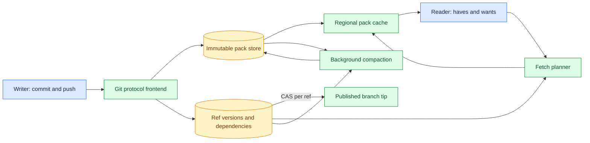
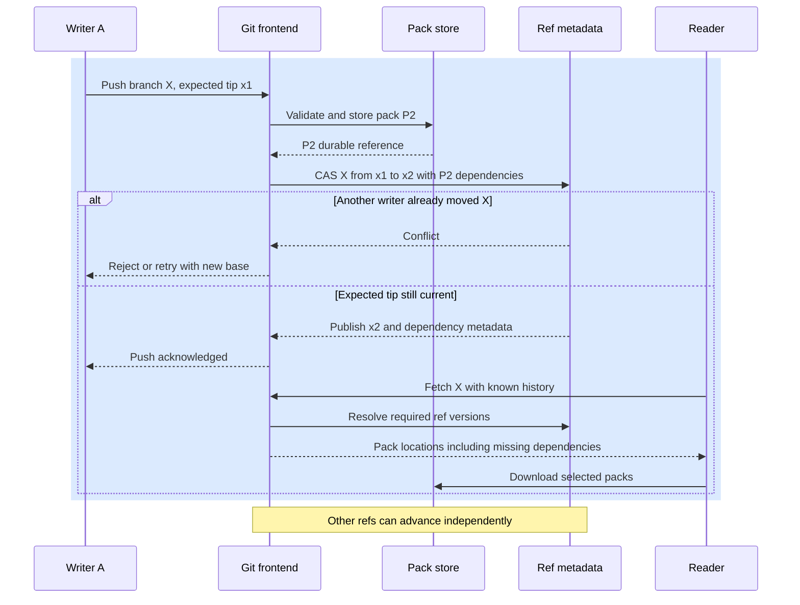

# Scaling Git for many agent workflows
Status: emerging
Sources: [OpenAI Engineering — 2026-11-02](https://openai.com/index/scaling-git-at-openai/) (vendor engineering report)

## In one sentence

A Git service can support many independent agent branches by separating per-reference write coordination from reusable object transfer, while making the resulting cross-branch consistency tradeoff explicit.

## Background: what existed before

Git gives developers a familiar local workflow: inspect a repository, create a commit, push a branch, and fetch changes from others. A server hosting that repository must keep its content and its branch pointers coherent even when many clients write at once. A small team may never notice the underlying coordination. A large monorepo, continuous integration (CI) fleet, and many simultaneous coding agents can turn one developer action into many operations: a push triggers several CI jobs, each job fetches the same commit, and every agent may create and update its own branch.

Distributed Git services have long used replicas, shared storage, caches, logs, and batching. Their tradeoffs resemble other distributed systems: replicas need to agree on which writes are visible; a write can wait for storage or network acknowledgments; a reader needs the content associated with the branch value it sees. A server that coordinates every branch update through one global sequence can become a bottleneck even when clients push to unrelated branches. Caching helps read throughput, but a response tailored to each client's existing object set can be expensive to generate and difficult to reuse.

In a November 2, 2026 engineering post, OpenAI describes Pando, its Git-compatible backend for its monorepo. It reports per-reference coordination, immutable stored packs, reusable fetch data, regional caching, and background compaction. This article uses the post to teach the architecture and its implications. Performance numbers and production behavior are OpenAI's reports; the article does not independently benchmark Pando or assert that its choices are best for another service.

### Prerequisites

You should know basic Git commands, HTTP requests, a key-value database, and what a cache does. A **repository** contains Git objects and references. A **reference** or **ref**, such as `refs/heads/main`, is a named pointer to an object, usually a commit. A **commit** identifies a snapshot and parent commits. A **packfile** groups Git objects for efficient storage and transfer. A **compare-and-swap** (CAS) operation updates a value only if its current value matches the expected one; it prevents two writers from silently overwriting one another. A **monorepo** is a repository containing multiple projects or services. These terms describe the infrastructure; the model generating code does not change Git's object model.

## What changed and why now

OpenAI reports that increased parallel development put pressure on its monorepo's push, fetch, and merge services. Pando keeps Git clients and the Git protocol while changing how the backend stores and serves repository data. In its described design, a push is stored as an immutable pack in blob storage and recorded as a new ref version with dependencies in a metadata store. Updates to a particular ref are serialized; unrelated refs can progress independently. Fetches select previously stored packs and can serve their bytes through caches.

The important tradeoff is the consistency contract. For a particular ref, the service coordinates competing updates. Across multiple refs, a client cannot assume it sees one repository-wide instant. The post calls the model causal consistency: a fetched ref must include the history on which its writer's update depends. It does not promise a global order of all branch updates. This distinction matters to an automation that compares two branch tips: reading each successfully does not prove both values existed simultaneously.

OpenAI reports that Pando reduced its median push latency by nearly five times and serves nearly a petabyte of Git data per day. Those figures describe its deployment and workload, not a general performance guarantee. Its interactive comparison also labels its modeled results as synthetic teaching models rather than production benchmarks. Treat either type of number with its stated conditions.

## Impact on current processing and architecture

### Objects, refs, and reachability

Git objects are content addressed: their IDs derive from object content and type. A blob contains file content; a tree relates names to blobs or other trees; a commit points to a tree and parent commits. A branch ref identifies a commit. **Reachability** means following these links from a commit to the objects it needs. If a server publishes a ref before it can supply its reachable objects, a client may observe a branch tip it cannot fetch. The service must therefore connect publication of the pointer to availability of its data.

During a push, a client sends a pack that may omit objects the server advertised it already has. Such a pack depends on prior shared history. A server cannot safely hand that pack alone to an arbitrary reader unless the reader already has the omitted objects or receives their dependencies. Pando's reported metadata records the ref version, the pack, and prior ref versions on which that pack depends. A fetch plan can then include the packs needed to reconstruct the requested history.



This is a simplified teaching diagram based on the vendor report, not an operational deployment diagram. The push path validates and stores data before publishing the corresponding ref version; the fetch path resolves a requested ref into the packs and dependencies a reader needs. The cache serves immutable pack bytes, so many readers can reuse a response. The metadata and pack store still need availability, capacity, access control, and recovery procedures.

### Two dimensions of scale

**Write scale** concerns simultaneous branch updates. A service that serializes all pushes through one repository-wide record can spend time contending on that record even when writers touch different branches. Pando reports a per-ref update path, so only writers competing for the same ref share that contention point. This does not eliminate contention on a popular trunk branch or eliminate merge conflicts between changes. The branch pointer update and the semantic merge of source code are separate operations.

**Read scale** concerns the number of clients fetching history. A conventional server can negotiate a minimal response for a specific client, but generating many distinct packs consumes CPU and disk input/output. Reusing a stored pack reduces that work and makes caching effective, while a client may download objects it already possesses. An architecture review should compare server compute saved against extra network and storage bytes, cache misses, and client startup time.

## Real-world applications and constraints

Imagine a repository with 500 agents, each producing a change on a separate branch. Each push starts four CI jobs. Even if each agent pushes once, the CI fan-out can create 2,000 fetches for a relatively small number of new commits. If each fetch triggers expensive server-side packing, read computation can dominate. Shared immutable packs can make that fan-out a cacheable delivery problem, provided every reader receives the complete dependency set and has permission to access it.

Now imagine the same 500 agents all attempting to update `main`. Per-ref serialization still makes that one ref a shared bottleneck, and code changes may conflict semantically even when the storage system accepts them in sequence. A merge queue, review process, or integration branch may control how work reaches trunk. These are application-level controls built around the Git service; Pando's reported per-ref coordination does not automatically resolve competing patches or validate their tests.

For a small repository, the extra metadata, compaction, cache operations, and operational expertise may cost more than they save. Network bandwidth can also be expensive where clients are remote or metered. Git compatibility should be tested with the actual clients and features in use, including tags, large histories, shallow or partial clones if required, access controls, and failure behavior. The vendor article describes its deployment; it does not certify every client combination.

## Mental model

Think of each branch as a train track with an ordered sequence of ref versions. Writers on different tracks can advance independently. Each new car carries a pack and a ticket naming earlier history it relies on. A reader can assemble a branch only if it receives the required tickets and packs. Looking at two tracks gives useful individual views, but it does not create a single photograph of both at the same instant. This picture leaves out many details of Git negotiation, but it makes the main correctness condition visible: a published ref must be fetchable with its dependencies.



The sequence is an explanatory model. A failed CAS must not be reported as a successful update. A retry must fetch or otherwise account for the new branch tip, re-evaluate the intended update, and preserve authorization. A durable pack uploaded before a failed ref update may become unreferenced data; the storage lifecycle must handle such objects according to the service's retention and garbage-collection policy.

## What changed this month

The November report describes Pando's use of a scalable metadata store and blob store, selected ref advertisements during push negotiation, stored pack reuse, a delivery service with regional caches, and background pack compaction. The article says the backend provides serializability for individual ref updates and does not provide a point-in-time snapshot of all refs during a clone or fetch. Those are claims about the described system, not universal properties of Git.

The post says the company used a read- and write-through proxy during rollout, migrating workloads in phases while keeping the old system in sync. It also describes conformance tests, deterministic simulation, and formalization work as part of validation. These are reported engineering practices, not proof that every implementation bug was eliminated. A team designing its own migration can use them as prompts for a migration plan and local tests.

## Engineering consequence

### Publish dependencies with the pointer

A robust ref update contract includes the ref name, expected old tip, new tip, pack identifier, required prior versions, writer identity, and an authorization decision. Validate the incoming pack before publishing its pointer. On success, a reader must be able to resolve all required history from durable storage. If a pack upload succeeds but the metadata transaction fails, the service must not advertise the new tip. If metadata is published while pack bytes are unavailable, a successful push acknowledgment becomes misleading.

The post describes a multi-key metadata transaction that records the new ref version and atomically updates the pointer. In an independent implementation, the specific transaction API will vary, but the invariant can be stated without assuming one vendor: an acknowledged ref must resolve to available objects and their dependencies. Test a simulated crash between every step, including after bytes are stored and before metadata is published. Also test a client retry after an acknowledgment is lost: the client may not know whether the server committed the update.

### Advertise a useful shared base

Git push negotiation tells the client which objects the server already has. Advertising many refs can produce a smaller upload because the client can omit more objects. But a pack that depends on a different collection of prior refs is harder to reuse for many readers. Pando reports advertising a selected set, typically the trunk base for a new feature branch, so a reader that has that base can consume the feature pack. Repeated feature-branch pushes may resend objects beyond trunk. The choice intentionally spends some network and storage bandwidth to improve reuse and simplify dependency tracking.

The best base depends on workload. Measure pack sizes, client upload time, repeated objects, cache hit rate, and fetch completion latency for representative branch histories. A branch based on an old trunk may need a different dependency chain than one based on the current tip. A mistaken assumption that every client has the advertised base can produce an incomplete fetch plan. Use explicit metadata and verify the object graph before treating a fetch as successful.

### Make cross-ref semantics visible

Suppose a release tool fetches `service-api` and `service-client` branches separately and checks whether their versions are compatible. If the service permits cross-ref views from different moments, the tool may combine an older API ref with a newer client ref. That combination can be useful for development, but it is not evidence of a single atomic release snapshot. A release process that needs a consistent collection can record a manifest listing exact commit IDs, create an integration commit, or use a separate transactional coordination mechanism. The right choice depends on the release contract.

Do not mistake a causal dependency for a global ordering. A branch update based on another branch's commit needs that history for correct checkout. That does not mean every unrelated branch is observed at the same logical time. Document the guarantee in the API and CI integration, and make audit logs name the exact commit IDs used for builds and tests.

### Manage compaction and cache lifecycle

An active trunk can create many small packs. Fetching thousands of separate objects introduces request overhead and makes a client wait even when each transfer is fast. The post describes grouping packs into covers at increasing levels and compacting them in the background. Covers also help select packs without scanning every version. The service retains packs at different levels because different readers may benefit from different granularities.

Compaction is not free. It consumes CPU, storage reads and writes, and extra space while old and new artifacts coexist. Schedule it so it does not starve push or fetch traffic. Verify that the replacement pack contains the objects it claims before publishing it as an available cover. Track compaction backlog, bytes read and written, fetch plan length, time to first byte, cache hit rate, and the age of the slowest client. An aggressively compacted representation may help a full clone but be wasteful for a client that needs one small recent change.

### Operate and migrate safely

Roll out a replacement backend with explicit consistency checks. Shadow reads can compare ref values and object reachability across old and new services. A proxy can move selected traffic while preserving a route back, but rollback requires knowing which system accepted the latest write and whether its data is available in both. Preserve a mapping between acknowledged pushes, ref versions, and pack identifiers. Exercise network partitions, slow object storage, metadata transaction failure, stale caches, and retries with lost responses before increasing traffic.

Observability should distinguish push acknowledgment latency from **push-to-fetch latency**, the time until another reader can retrieve the acknowledged commit. The latter includes visibility and delivery, so it catches a system that accepts writes quickly but makes readers wait. Also track same-ref conflicts, independent-ref throughput, cache miss latency, pack planning time, bytes transferred per useful object, and repository integrity checks. Averages alone can conceal a slow tail that blocks CI.

## Limits and failure modes

**Same-ref contention.** Independent branches scale separately, but a hot ref still requires ordering. Reject stale expected tips instead of silently overwriting them. A merge queue can control integration pressure, though it adds queue latency and needs its own availability target.

**Missing dependency.** A pack may depend on objects absent from a reader. A successful metadata lookup is not enough; the fetch plan must cover the reachable object graph. Test with clients that have no history, an old trunk, a recent trunk, and only a side branch.

**Stale cross-ref view.** A consumer can see individually valid branch values that did not form one global snapshot. Use commit-pinned manifests when atomic multi-component interpretation matters. Do not infer release consistency from two successful ref reads.

**Cache and storage outage.** An immutable cache entry simplifies reuse but does not remove the need for origin availability, checksums, eviction policy, or access checks. A cache miss during an origin outage can prevent a fetch even if popular packs remain warm.

**Compaction errors.** A replacement pack or index can omit a dependency or point to an incomplete artifact. Validate before publication and retain a recoverable earlier representation according to the service's retention rules.

**Unrepresentative measurements.** OpenAI's reported throughput and latency belong to its infrastructure, clients, repository, and operating conditions. Its simulation illustrates modeled behavior. Neither result establishes the capacity or correctness of a separate installation.

## Mini exercise (15–30 min)

Two agents both read branch `main` at `c0`. Agent A proposes `c1`; agent B proposes `c2`. Predict what happens if both write with expected tip `c0`. Next, let a third agent update a different branch. Which updates should conflict? Finally, add a dependency from a feature pack to a trunk pack and remove the trunk pack from the reader's cache. What must the fetch plan include? The following small program models the ref and dependency rules without invoking Git or network services.

### Runnable low-cost example

Save as `ref_store.py` and run `python3 ref_store.py`. It uses the Python standard library only.

```python
refs = {"main": "c0", "feature": "f0"}
packs = {"base": set(), "feature-pack": {"base"}}


def update_ref(name, expected, new_tip):
    if refs[name] != expected:
        return False
    refs[name] = new_tip
    return True


def required_packs(target, already_have):
    needed = set()

    def visit(pack):
        if pack in already_have or pack in needed:
            return
        needed.add(pack)
        for dependency in packs[pack]:
            visit(dependency)

    visit(target)
    return sorted(needed)


assert update_ref("main", "c0", "c1")
assert not update_ref("main", "c0", "c2")
assert update_ref("feature", "f0", "f1")
assert required_packs("feature-pack", set()) == ["base", "feature-pack"]
assert required_packs("feature-pack", {"base"}) == ["feature-pack"]
print("same-ref conflict detected; missing dependencies included")
```

The dictionaries model one process, not an atomic distributed database. The example does not implement Git objects, durable storage, authorization, cycles in dependency metadata, crash recovery, or a network cache. Its purpose is to expose the invariant that stale same-ref updates fail and that missing pack dependencies must be included.

## Build it locally: numbered implementation steps

1. Create fictional refs and pack metadata in JSON. Record each ref's tip and each pack's dependencies; include a reader that starts with no packs.
2. Implement a conditional ref update that requires an expected old tip. Simulate two writers with the same expectation and assert that only one advances the ref.
3. Add independent feature refs and verify that their updates do not depend on the current value of the trunk ref, unless their pack metadata explicitly names a trunk dependency.
4. Implement a fetch planner that walks dependencies and detects cycles or missing pack records. Return an error instead of a partial successful plan.
5. Simulate a pack upload followed by metadata failure and confirm that the new ref is not advertised. Simulate a lost acknowledgment and inspect the current ref before retrying.
6. Add a simple cache model with hits and misses. Compare bytes transferred and lookup count for many readers, recording the assumptions instead of claiming a production benchmark.
7. Create a release manifest with exact commit IDs for two components and explain why it supplies a stronger cross-component reference than reading two changing branches separately.

## Interview Q&A

**Q: Why can independent branch pushes scale better with per-ref coordination?**

**A:** Writers updating different refs do not have to contend on a single repository-wide ref update. Storage and network capacity still matter, and writers on the same ref still need conflict detection.

**Q: What must be true before a new branch tip is visible?**

**A:** The service must be able to supply the objects reachable from that tip, including any dependencies omitted from the incoming pack. Publishing metadata without durable data can create an unfetchable branch.

**Q: Why reuse a pack rather than tailor one to every client?**

**A:** A reusable pack can be cached and served to many readers without recomputing compression for each request. Some readers may download redundant objects, so the design trades transfer bytes for server efficiency.

**Q: Does per-ref serializability provide a repository-wide snapshot?**

**A:** No. Each ref's update order can be valid while a reader observes multiple refs at different points in time. A workflow needing an atomic set of versions needs an additional contract, such as a commit-pinned manifest.

**Q: Why measure push-to-fetch latency as well as push latency?**

**A:** A fast acknowledgment is less useful if a second client cannot promptly retrieve the new commit. Push-to-fetch includes the visibility and delivery path that CI and collaborators depend on.

## Glossary

- **Git object:** content-addressed blob, tree, commit, or tag stored by Git.
- **Ref:** a named pointer, often a branch or tag, to a Git object.
- **Packfile:** a file containing multiple Git objects, potentially using compression and deltas.
- **Reachability:** the set of objects found by following references from a commit through its history and trees.
- **Ref version:** a recorded value of a ref, together with metadata needed to interpret or serve that version.
- **Compare-and-swap:** an atomic conditional update that succeeds only when the current value matches an expected value.
- **Causal consistency:** a guarantee that an observed update includes the dependencies on which that update relies; it does not necessarily supply a global snapshot.
- **Compaction:** background combination or reorganization of stored data to reduce read or metadata overhead.
- **Push-to-fetch latency:** elapsed time from a writer's push attempt or acknowledgment to another reader retrieving the intended commit; define the precise start in measurements.
- **Conformance test:** a check that an implementation follows the externally expected protocol or behavior.

## References

- [OpenAI Engineering, Scaling Git at OpenAI, November 2, 2026](https://openai.com/index/scaling-git-at-openai/) — vendor account of Pando's design, deployment, and reported measurements.

## Claim ledger

| Claim | Source | Fact or inference |
|---|---|---|
| Pando stores incoming packs in blob storage and records ref versions and dependencies in metadata. | [OpenAI Engineering](https://openai.com/index/scaling-git-at-openai/) | Vendor description of its system |
| The reported design serializes updates to an individual ref and does not offer a single point-in-time view across all refs. | [OpenAI Engineering](https://openai.com/index/scaling-git-at-openai/) | Vendor description of consistency |
| OpenAI reports nearly five times lower median push latency and nearly a petabyte of Git data served per day. | [OpenAI Engineering](https://openai.com/index/scaling-git-at-openai/) | Vendor-reported production result, not independently verified here |
| A commit-pinned manifest can give a release workflow an explicit set of component versions when cross-ref reads lack a global snapshot. | Design reasoning from the described consistency model | Engineering inference |
| The Python example models conditional updates and pack dependencies but is not a distributed Git server. | Runnable example above | Fact about example scope |
